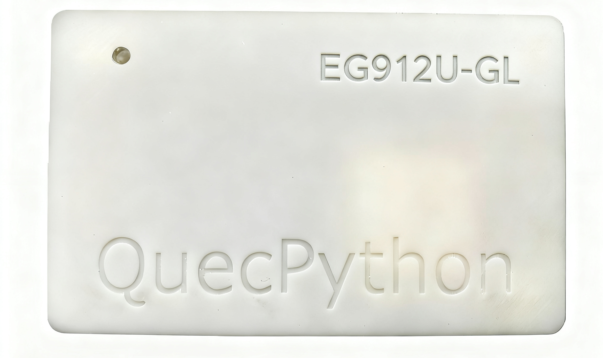

# 基于EG912U的Smart Tracker解决方案

该Smart Tracker解决方案基于QuecPython **EG912U** 标准开发板实现，具有以下特性：

- 提供准确的高精度GNSS定位。
- 强大丰富的接口。
- 使用python语言，便于二次开发

------

- [开发资源汇总](./dev_resources.md)
- [快速上手](quick_start.md)
- [软件设计讲解](./software_design.md)