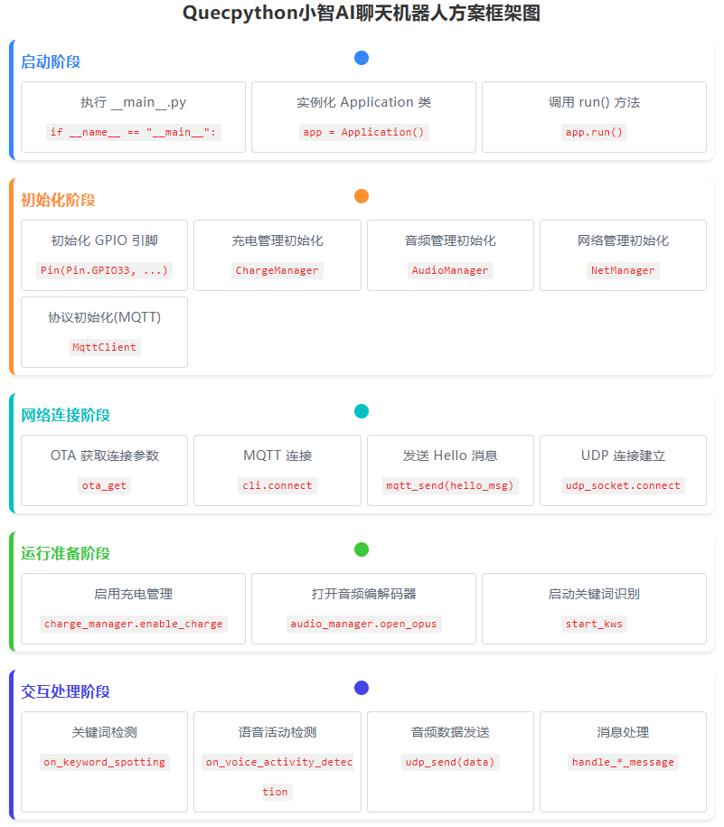
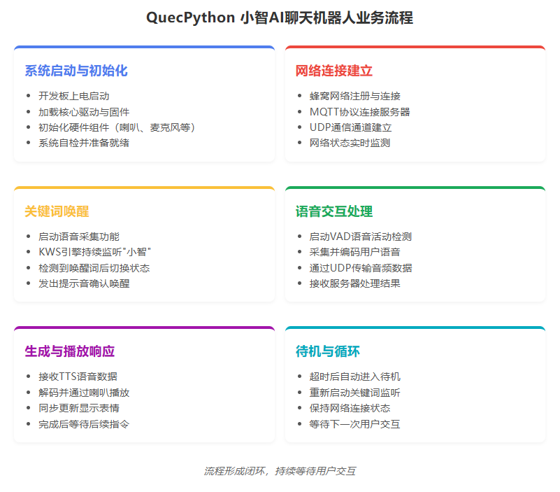
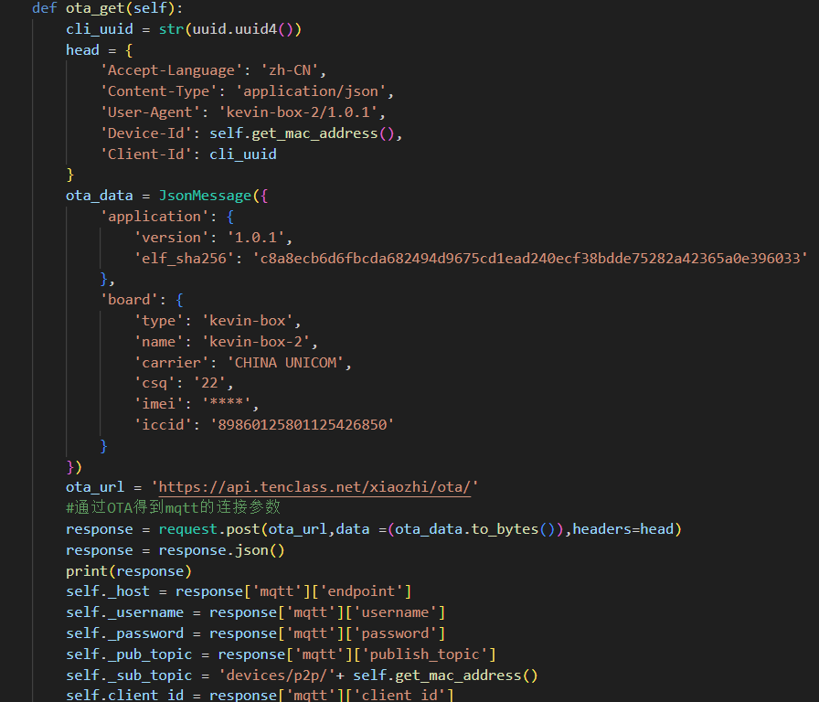
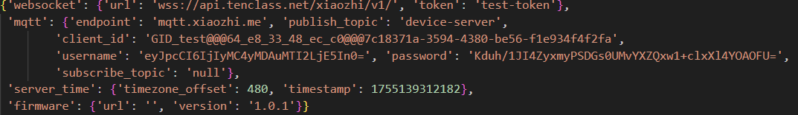
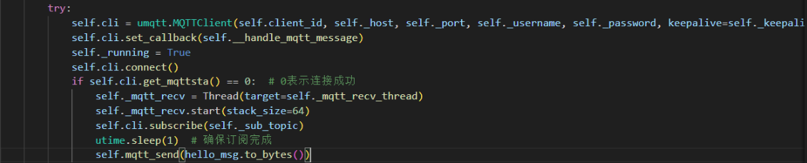
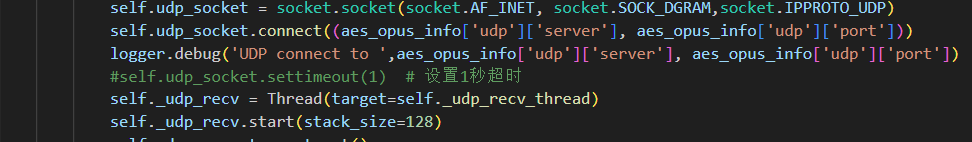
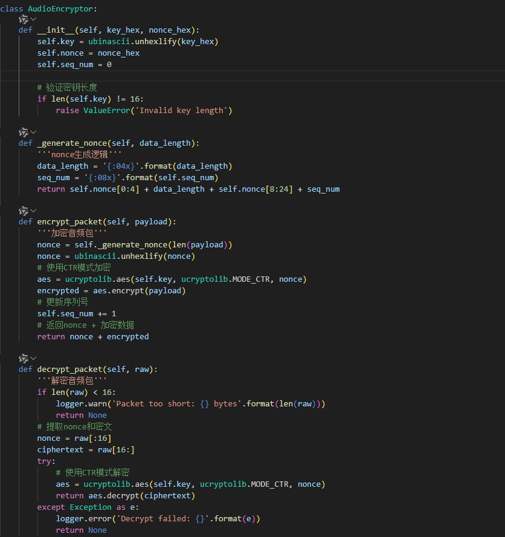
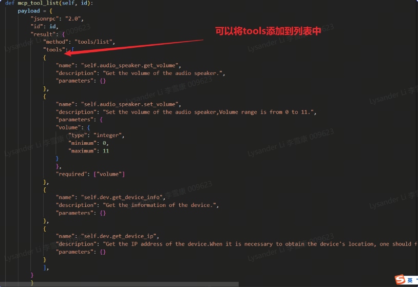
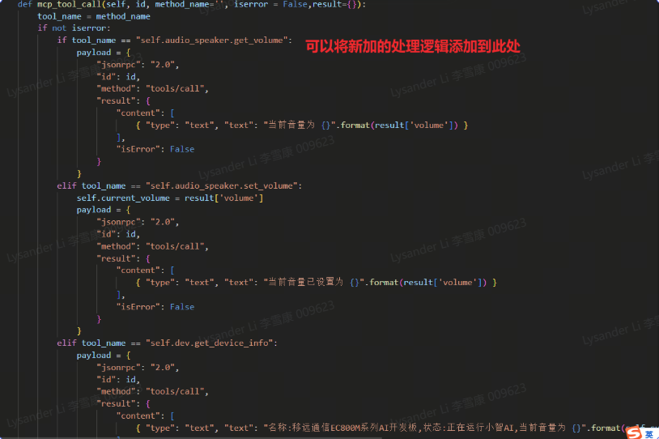

# 软件设计讲解

## 软件框架

### 方案框架



### 业务流程




## 代码讲解

### Application类初始化

初始化 AI 对象以及其他硬件驱动。

```python
class Application(object):
    def __init__(self):
        
		Pin(Pin.GPIO33, Pin.OUT, Pin.PULL_PD, 1)
        self.prev_emoj = None        
        
        # 初始化充电管理
        self.charge_manager = ChargeManager()

        # 初始化音频管理
        self.audio_manager = AudioManager()
        self.audio_manager.set_kws_cb(self.on_keyword_spotting)
        self.audio_manager.set_vad_cb(self.on_voice_activity_detection)

        # 初始化网络管理
        self.net_manager = NetManager()

        # 初始化任务调度器
        self.task_manager = TaskManager()

        # 初始化协议
        self.__protocol = MqttClient()
        self.__protocol.set_callback(
            audio_message_handler=self.on_audio_message,
            json_message_handler=self.on_json_message
        )

        self.__working_thread = None
        self.__record_thread = None
        self.__record_thread_stop_event = Event()
        self.__voice_activity_event = Event()
        self.__keyword_spotting_event = Event()
```

### 唤醒&人声检测

检测到唤醒词时，会拉起工作线程`self.__working_thread`，工作线程会开启vad进行人声检测

```python
class Application(object):
    def on_keyword_spotting(self, state):
        logger.info("on_keyword_spotting: {}".format(state))
        if state == 0:
            # 唤醒词触发
            if self.__working_thread is not None and self.__working_thread.is_running():
                return
            self.__working_thread = Thread(target=self.__working_thread_handler)
            self.__working_thread.start()
            self.__keyword_spotting_event.clear()
        else:
            self.__keyword_spotting_event.set()

    def on_voice_activity_detection(self, state):
        gc.collect()
        logger.info("on_voice_activity_detection: {}".format(state))
        if state == 1:
            self.__voice_activity_event.set()  # 有人声
        else:
            self.__voice_activity_event.clear()  # 无人声
```

### 对话逻辑

工作线程开启后会启动线程执行`__chat_process`，检测到人声后就会发送读取的音频数据

```python
class Application(object):
    def __chat_process(self):
        self.start_vad()
        try:
            with self.__protocol:
                self.power_red_led.on()
                self.__protocol.hello()
                self.__protocol.wakeword_detected("小智")
                is_listen_flag = False
                while True:
                    data = self.audio_manager.opus_read()
                    if self.__voice_activity_event.is_set():
                        # 有人声
                        if not is_listen_flag:
                            self.__protocol.listen("start")
                            is_listen_flag = True
                        self.__protocol.udp_send(data) 
                        # logger.debug("send opus data to server")
                    else:
                        if is_listen_flag:
                            self.__protocol.listen("stop")
                            is_listen_flag = False
                    if not self.__protocol.is_state_ok():
                        break
                    # logger.debug("read opus data length: {}".format(len(data)))
        except Exception as e:
            logger.debug("working thread handler got Exception: {}".format(repr(e)))
        finally:
            self.power_red_led.blink(250, 250)
            self.stop_vad()
```

### 音频管理

统一管理设备的音频输入输出、编解码、语音识别相关功能（关键词识别 KWS 和语音活动检测 VAD），并提供回调接口供上层应用使用。

```python
class AudioManager(object):
    def __init__(self, channel=0, volume=11, pa_number=29):
        self.aud = audio.Audio(channel)  # 初始化音频播放通道
        self.aud.set_pa(pa_number)
        self.aud.setVolume(volume)  # 设置音量
        self.aud.setCallback(self.audio_cb)
        self.rec = audio.Record(channel)
        self.__skip = 0
    # ========== 音频文件 ====================
    def audio_cb(self, event):
        if event == 0:
            # logger.info('audio play start.')
            pass
        elif event == 7:
            # logger.info('audio play finish.')
            pass
        else:
            pass
    def play(self, file):
        self.aud.play(0, 1, file)
    # ========= opus ====================
    def open_opus(self):
        self.pcm = audio.Audio.PCM(0, 1, 16000, 2, 1, 15)  # 5 -> 25
        self.opus = Opus(self.pcm, 0, 6000)  # 6000 ~ 128000 
    def close_opus(self):
        self.opus.close()
        self.pcm.close()
        del self.opus
        del self.pcm
    def opus_read(self):
        return self.opus.read(60)
    def opus_write(self, data):
        return self.opus.write(data)
    # ========= vad & kws ====================
    def set_kws_cb(self, cb):
        self.rec.ovkws_set_callback(cb)         
    def set_vad_cb(self, cb):
        def wrapper(state):
            if self.__skip != 2:
                self.__skip += 1
                return
            return cb(state)
        self.rec.vad_set_callback(wrapper)
    def end_cb(self, para):
        if(para[0] == "stream"):
            if(para[2] == 1):
                pass
            elif (para[2] == 3):
                pass
            else:
                pass
        else:
            pass   
    def start_kws(self):
        self.rec.ovkws_start("_xiao_zhi_xiao_zhi", 0.7)
    def stop_kws(self):
        self.rec.ovkws_stop()
    def start_vad(self):
        self.__skip = 0
        self.rec.vad_start() 
    def stop_vad(self):
        self.rec.vad_stop()
```

### MQTT和UDP连接

#### MQTT连接

首先需明确，要成功连接小智平台的 MQTT 服务器，必须具备对应的 MQTT 连接参数，而该参数需通过小智的 OTA 接口获取。在本方案中，我们直接采用 Quecpython 的 request 模块发送 GET 请求来完成参数获取；其中，OTA 请求的具体方式、请求头格式及请求体格式，均严格参照小智官方提供的 OTA 文档执行。

方案中专门设计了参数获取方法`ota_get()`，且该方法会在`MqttClient`类初始化时自动调用一次，确保在 MQTT 客户端实例创建的初始阶段，就能完成必要连接参数的获取，为后续 MQTT 服务器的连接流程奠定基础。





成功获取 MQTT 连接参数后，方案会将该参数暂存至全局列表`aes_opus_info`中，以实现参数的临时存储与后续便捷调用。

当系统通过唤醒词触发唤醒流程时，程序将自动启动 MQTT 连接操作 —— 此时会从全局列表`aes_opus_info`中提取此前通过 OTA 接口获取的 MQTT 连接参数，并基于该参数完成与小智平台 MQTT 服务器的连接配置，确保 MQTT 连接流程能基于有效、正确的参数顺利执行。



#### UDP连接

在与小智平台 MQTT 服务器的连接成功建立后，系统将进一步通过 MQTT 通道发送消息，以获取 UDP 连接所需的参数 —— 具体需发送小智平台规定的 “hello” 类型消息，该消息的格式需[参照小智官方相关规范执行](https://github.com/78/xiaozhi-esp32/blob/main/docs/mqtt-udp.md)。

当成功接收到小智平台返回的 UDP 连接参数后，程序会基于该参数启动 UDP 连接流程，完成与小智平台的 UDP 通道建立，为后续音频流数据的传输做好准备。



### 音频数据加密

在与小智平台的 UDP 通道成功建立后，后续音频流数据使用UDP传输。根据小智平台的明确技术规范，通过 UDP 协议发送的音频流数据必须经过加密处理，以保障数据传输过程中的安全性与完整性，而指定采用的加密算法为**AES-CTR 算法**。

在本方案中，我们直接依托我们 Quecpython 的加密模块`ucryptolib`来实现 AES-CTR 加密功能：在音频流数据发送前，程序会调用`ucryptolib`模块中对应的加密接口，传入预设的密钥等参数，完成数据加密处理；加密后的音频流数据再通过已建立的 UDP 通道发送至小智平台，确保整个音频传输流程既符合平台规范，又具备可靠的安全保障。



### 小智内部MCP

连接时在hello消息中打开mcp通道，服务器会发来请求消息(tools/list类型)，此时我们需要告知我们可以给小智调用的本地工具，在我们语音交互时，服务器识别到我们的意图时会请求调用我们本地工具，设备接收到工具调用请求后会做出响应并回复服务器。我们可以在tools/list和tools/call的响应消息里添加工具信息和处理逻辑




