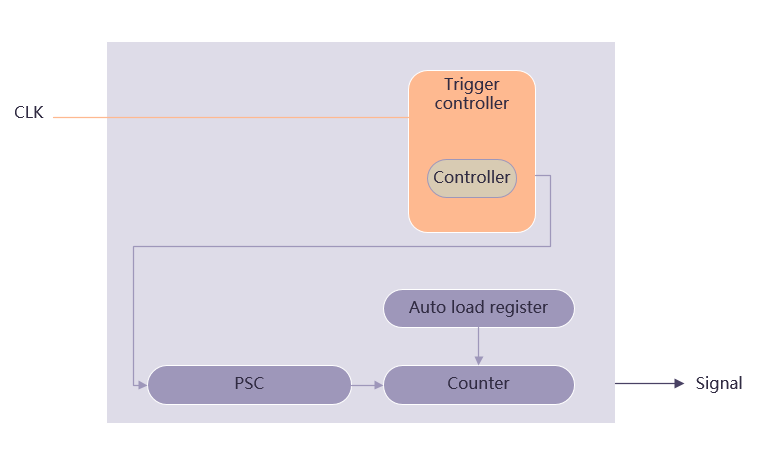
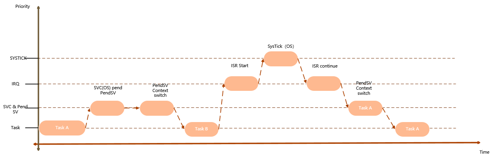
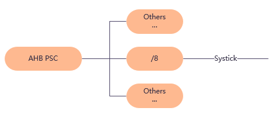
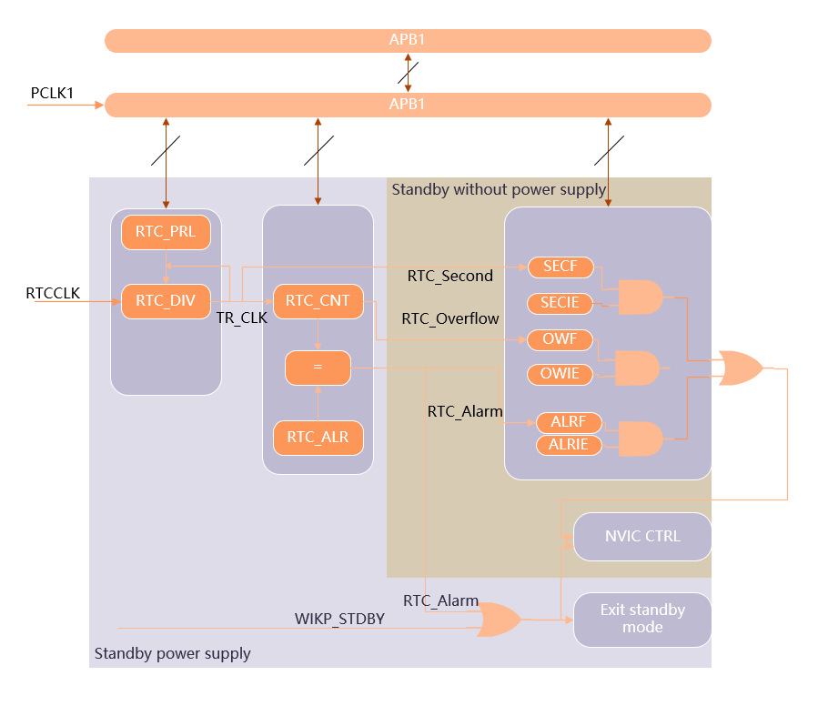
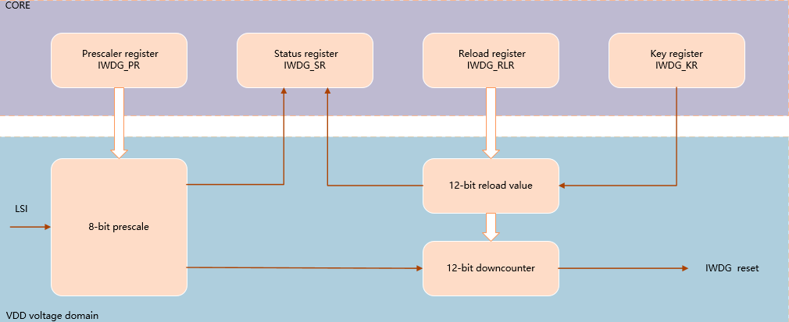
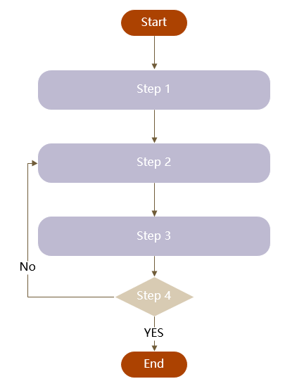

# 定时器

## 概念

定时器：一般是指SOC或MCU内部外设器件，这个器件可以周期性引起系统中断。系统可以根据这个信号，切换任务，也可以利用这个信号进行分频输出信号等操作。

硬件上定时器可以分为以下几类：

* Systick
  * 系统滴答定时器，用于提供一个周期性的计时功能，此定时器可以周期的产生中断信号，是系统的心跳时钟，起到切换任务或对任务分配时间片的作用。
* 基本定时器
  * 没有对外输入/输出，主要用于时基计数以及定时。
* 通用定时器
  * 除了具备基本定时器功能外，可以对外提供能输入捕捉、输出比较以及连接其他传感器接口的功能。
* 高级定时器
  * 除了具备通用定时器功能外，可以提供电机控制、数字电源应用、死区时间可编程的互补输出等功能。
* RTC
  * 主要用于提供实时的时间和日期。
* 看门狗
  * 主要用于监测系统是否出现了异常。

## 定时器背景

### 介绍

定时器可以产生中断，通知CPU当前发生了事件，这样CPU可以不用阻塞等待某一项任务的结果，在等待期间可以运行别的功能。这种方式可以提高效率，对于整体功能来说，系统整体运行更流畅，更便捷，响应更快，用户体验更好，应用更加广泛。

### 定时器分类

定时器从广泛上分类可分为硬件定时器和软件定时器。硬件定时器是软件定时器的基础，软件定时器在硬件定时器的基础上进行软件上的扩展，理论上是没有个数限制的。但软件定时器不精准，并且当软件定时器数量越多，其差值越大。

#### 硬件定时器

硬件定时器分为：Systick、基本定时器、通用定时器、高级定时器、RTC定时器、看门狗定时器等。在项目稳定运行过程中，以上定时器各司其职。

硬件定时器工作原理概念框架图如下图：



<center>图2-1</center>

* CLK时钟信号输出到触发控制器。
* 触发控制器将信号输出到预分频器。
* 预分频后输出到信号给计数器。
* 当计数器数值到达自动装载器数值时（根据定时器类型判断处理），如开启使能中断，则定时器产生溢出中断。

上述流程即为定时器原理概念概述，以下几类定时器大同小异。

##### Systick

系统滴答定时器，也称为心跳定时器，每次产生Systick中断可以起到切换系统任务的作用，系统以此完成对任务的时间片分配以及任务的切换。切换任务示意图，见图2-2。



<center>图2-2</center>

内部结构简图见图2-3，RCC用AHB时钟分频除以8对其提供外部时钟源。



<center>图2-3</center>

##### 基本定时器

基本功能如下：

* 自动装载累加计数器。
* 触发DAC的同步电路。
* 更新时间产生中断请求。
* 可编程预分频器。

原理概念图见图2-1，时钟从内部或者外部提供给预分频器，经过分频将信号提供给计数寄存器。当计数器达到自动重装载寄存器中的数值时即满足了中断产生的条件，如若开启了中断的功能，此时即可触发中断，完成定时任务。从上可知，定时是通过预分频器，自动重装载寄存器的设置完成的。

##### 通用定时器

除具备基本定时器功能外，还有以下功能：

* 向上、向下、向上/向下自动装载计数器。
* 独立通道。
* 使用外部信号控制定时器和定时器互连的同步电路。
* 支持针对定位的增量编码器和霍尔传感器电路。
* 触发输入作为外部时钟或者按周期的电流管理。

原理概念图见图2-1，通用定时器和基本定时器的基本原理是相同的，扩展的功能只是在基本功能上进行了一些简单扩展，这些扩展的功能只是定时器的应用，在此不再赘述。

##### 高级定时器

除具备通用定时器功能外，还有以下功能：

* 死区时间可编程的互补输出。
* 仅在给定周期数后更新定时计数器。
* 中断信号输入，使计时器的输出信号处于重置状态或已知状态。
* 设置循环次数，重复计数。

原理概念图见2-1，高级定时器和通用定时器、基本定时器的基本原理是相同的，也是对于基本功能的扩展。比较有用的死区时间的功能支持，可以方便PWM的应用。

##### RTC定时器

实时时钟（RTC）是一个独立的BCD定时器/计数器。其可以将设备从休眠态唤醒用以管理设备的低功率模式。在相应的配置下可以提供时钟日历功能。QuecPython模组重启后RTC时间将被重置，当注网成功后，将会更新RTC时间。其硬件框图如下所示：

<center>图2-4</center>


##### 看门狗定时器

看门狗用于监测和解决由于软件错误导致的故障，当计数器递减到0（或者递增到设定的计数值）时将触发系统复位。其有专用的低速时钟驱动，即使主时钟发生故障也依然有效，通过可配置的时间窗口，即可进行调整看门狗的时间，从上述描述也可知道所谓喂狗即是对计数器重新赋初值（或着计数器清零）。其原理框图如下：



<center>图2-5</center>

#### 软件定时器

软件定时器实现的基础是硬件支持定时任务设置。

其实现逻辑是建立一个链表（或者二叉树或者其他的数据结构），设置新的软件定时器时记录到期时间并将其加入到链表中（或者二叉树中）。每一次都选取最近的软件定时器的到期时间并将其设置到硬件定时器中。当触发硬件定时器中断时，即可执行到期的硬件定时任务，在硬件定时任务中既可处理软件定时器的任务。下次到期后选取最近的软件定时器到期时间重新设置到硬件定时器中。如此循环，即可实现软件定时器。从上述原理可以看出软件定时器无法达到硬件定时器的精准，但是可以突破硬件定时器的个数限制。实现逻辑框图如下：



<center>图2-6</center>

* Step 1
  * 记录当前添加的软件定时器的到期时间，并加入到软件定时器链表中。
* Step 2
  * 遍历软件定时器链表并排序，选取最小的一个到期时间，将其到期时间设置到硬件定时器中。
* Step 3
  * 硬件定时器到期，遍历软件定时器链表，执行此定时器注册的事件。并将到期的节点从软件定时器链表中删除。
* Step 4
  * 判断软件定时器链表是否为空，为空则退出流程。

以上只是软件定时器实现的一种简单方式，不是最佳方式，针对不同的场景软件定时器的实现会根据不同的场景进行数据结构的选型和优化。以上只是介绍其实现的基本原理。


## 定时器接口介绍

QuecPython模组定时器分为两种，一种是软件定时器，一种是硬件定时器。硬件定时器用于内核侧，软件定时器QuecPython开放到应用层使用。在QuecPython应用层，定时器又分为了系统定时器和普通定时器。以下仅介绍普通定时器和系统定时器的应用。

### 系统定时器

QuecPython模组提供底层的定时器接口，当定时器超时会触发定时器绑定的回调函数，在回调函数中不建议做阻塞和费时操作，会影响整体性能。建议在回调函数中仅做发送消息操作，在别的任务中完成业务处理。对于时间精度精度如下表（此表精度仅对于QuecPython接口的系统定时器和普通定时器）：

<center>表3-1</center>

<table style="text-align: center">
    <tr>
            <td  style="background-color: red" rowspan="1">型号</td>
            <td  style="background-color: red" rowspan="1">精度（ms）</td>
        </tr>
        <tr >
            <td rowspan="1">Qualcomm</td>
           <td rowspan="1">10</td>
        </tr>
        <tr >
            <td rowspan="1">ASR</td>
           <td rowspan="1">5</td>
        </tr>
        <tr >
            <td rowspan="1">RDA</td>
           <td rowspan="1">5</td>
        </tr>
        <tr >
            <td rowspan="1">UNISOC</td>
           <td rowspan="1">5</td>
        </tr>
        <tr >
            <td rowspan="1">EIGEN</td>
           <td rowspan="1">5</td>
        </tr>
</table>


#### 创建系统定时器

启用定时器前需要先创建定时器，调用如下接口进行创建定时器。

```python
osTimer()
```

示例

```python
# -*- coding: UTF-8 -*-
#示例
import osTimer

timer = osTimer()

```


#### 启动系统定时器

创建好定时器后，当要启用定时器时，需调用如下接口启动定时器，时间单位为ms。定时器启动分为单次模式和周期模式。单次模式，定时器只执行一次回调函数，周期模式，定时器会按照设置的周期循环产生超时事件并执行注册的回调函数。QuecPython模组中不建议在任何的回调函数（不仅仅是定时器回调函数中）中做阻塞或者费时操作，否则会影响模组性能。

```
osTimer.start(initialTime, cyclialEn, callback)
```

示例

```python
# -*- coding: UTF-8 -*-
#示例
import osTimer

def timer_cb(arg):
    print("osTimer Expired!!")
# 创建os定时器
timer = osTimer()
# 启动定时器，参数依次为时间、是否循环、回调函数
time_out = 10
timer.start(time_out * 1000,1,timer_cb)
```


#### 停止系统定时器

当业务完成，暂时不需要定时器时，可以调用如下接口停止定时器，如需要重新使用定时器完成业务只需重新调用启动定时器接口即可。

```python
osTimer.stop()
```

示例

```python
# -*- coding: UTF-8 -*-
#示例
import osTimer
import utime

time_out = 1
timer_out_nums = 0

# 创建os定时器
timer = osTimer()
timer_is_runing = True

def timer_cb(arg):
    global timer_out_nums
    global timer_is_runing
    global timer
    timer_out_nums = timer_out_nums + 1
    print("osTimer Expired!! {}".format(timer_out_nums))
    if timer_out_nums >= 10:
        timer.stop()
        timer_is_runing = False
        timer_out_nums = 0

if __name__ == "__main__":

    #周期模式启动定时器
    timer.start(time_out * 1000,1,timer_cb)
    while timer_is_runing:
        utime.sleep(1)
        print("waiting timer stop !")
    #停止后重新以单次模式启动定时器
    print("will restart timer  !")
    timer.start(time_out * 1000,0,timer_cb)
```


#### 删除系统定时器

当业务完成之后不再需要定时器时，可以调用如下接口删除定时器。调用此接口后，定时器将被删除，如需要重新启用定时器，需要重新创建定时器并启动定时器。

```python
osTimer.delete_timer()
```

示例

```python
# -*- coding: UTF-8 -*-
#示例
import osTimer
import utime

time_out = 1
timer_out_nums = 0

# 创建os定时器
timer = osTimer()
timer_is_runing = True

def timer_cb(arg):
    global timer_out_nums
    global timer_is_runing
    global timer
    timer_out_nums = timer_out_nums + 1
    print("osTimer Expired!! {}".format(timer_out_nums))
    if timer_out_nums >= 10:
        timer.stop()
        timer_is_runing = False
        timer_out_nums = 0

if __name__ == "__main__":

    #周期模式启动定时器
    timer.start(time_out * 1000,1,timer_cb)
    while timer_is_runing:
        utime.sleep(1)
        print("waiting timer stop !")

    print("will delete timer  !")
    #删除定时器
    timer.delete_timer()

    #重新创建定时器
    timer1 = osTimer()

    print("will start a new timer  !")
    #单次模式启动定时器
    timer1.start(time_out * 1000,0,timer_cb)

```

#### 系统定时器应用示例

定时器到期后，发送定时器消息到队列，在队列中完成业务。

```python
# -*- coding: UTF-8 -*-
#示例

import _thread
from queue import Queue
import osTimer
import utime

class QuecPythonTimer():

    def __init__(self,timer):
        self.timer_out          = 10*1000
        self.timer_queue        = Queue(100)
        self.timer_out_count    = 0
        self.timer              = timer
        self.cycle              = 0
        self.is_loop            = True

    def timer_set_cycle(self,cycle):
        self.cycle = cycle

    def timer_call(self,args):
        self.timer_out_count = self.timer_out_count + 1
        print("Will put {} to timer_queue ".format(self.timer_out_count))
        self.timer_queue.put(self.timer_out_count)

    def timer_set_timeout(self,timer_out = 10 * 1000):
        self.timer_out  =   timer_out

    def timer_start(self):
        self.timer.start(self.timer_out,self.cycle,self.timer_call)

    def timer_wait_message(self):
        while self.is_loop:
            data = self.timer_queue.get()
            print("Get timer_queue data {}".format(data))


if __name__ == "__main__":
    timer = osTimer()
    timer = QuecPythonTimer(timer)

    #设置5秒产生一次定时器超时
    timer.timer_set_timeout(5000)

    #设置可以循环产生定时器超时
    timer.timer_set_cycle(1)

    #启动新任务等待定时通知
    _thread.start_new_thread(timer.timer_wait_message, ())

    #启动定时器
    timer.timer_start()

```


### 普通定时器

QuecPython模组提供应用层定时器接口，当定时器超时会触发定时器绑定的回调函数，在回调函数中不建议做阻塞和费时操作，会影响整体性能。建议在回调函数中仅做发送消息操作，在别的任务中完成业务处理。时间精度见表3-1。普通定时器最多只支持四个定时器创建。分为单次模式和周期模式。

<center>表3-2</center>

<table style="text-align: center">
    <tr>
            <td  style="background-color: red" rowspan="1">定时器常量</td>
            <td  style="background-color: red" rowspan="1">说明</td>
        </tr>
        <tr >
            <td rowspan="1">Timer.Timer0</td>
           <td rowspan="1">定时器0</td>
        </tr>
        <tr >
            <td rowspan="1">Timer.Timer1</td>
           <td rowspan="1">定时器1</td>
        </tr>
        <tr >
            <td rowspan="1">Timer.Timer2</td>
           <td rowspan="1">定时器2</td>
        </tr>
        <tr >
            <td rowspan="1">Timer.Timer3</td>
           <td rowspan="1">定时器3</td>
        </tr>
        <tr >
            <td rowspan="1">Timer.ONE_SHOT</td>
           <td rowspan="1">单次模式，定时器只执行一次</td>
        </tr>
        <tr >
            <td rowspan="1">Timer.PERIODIC</td>
           <td rowspan="1">周期模式，定时器循环执行</td>
        </tr>
</table>


如上述表3-2所示，普通定时器支持Timer0、Timer1、Timer2和Timer3共四个定时器，每个定时均支持单次模式和周期模式。

#### 初始化普通定时器

在使用定时器之前需要先初始化定时器，调用如下接口即可初始化定时器。

```
class machine.Timer(Timern)
```

示例

```python
# -*- coding: UTF-8 -*-
#示例

from machine import Timer
timer1 = Timer(Timer.Timer1)
```


#### 启动普通定时器

初始化定时器后，需要启动定时器才能产生定时器超时事件。调用如下接口即可启动定时器，定期器启动支持设置单次模式和周期模式。单次模式只产生一次定时器超时事件，周期模式会循环（时间间隔为设置的定时器超时时间）产生定时器超时事件。QuecPython模组中不建议在任何的回调函数（不仅仅是定时器回调函数中）中做阻塞或者费时操作，否则会影响模组性能。

```
Timer.start(period, mode, callback)
```

示例

```python
# -*- coding: UTF-8 -*-
#示例

from machine import Timer

timer1 = Timer(Timer.Timer1)

time_out = 1
timer_out_nums = 0
def timer_out_call(args):
    global timer_out_nums
    timer_out_nums = timer_out_nums + 1
    print("timer will Expired!! {}".format(timer_out_nums))

timer1.start(period=time_out*1000, mode=timer1.PERIODIC, callback=timer_out_call)

```


#### 停止普通定时器

当业务完成后需要停止定时器，可以调用此接口停止定时器。调用此接口后当需要重新启动定时器产生超时事件时，可以重新调用启动定时器接口，重新启动定时器。

```
Timer.stop()
```

示例

```python
# -*- coding: UTF-8 -*-
#示例

from machine import Timer

timer1 = Timer(Timer.Timer1)

time_out = 1
timer_out_nums = 0
timer_is_runing = True

def timer_out_call(args):
    global timer_out_nums
    global timer_is_runing
    global timer1
    timer_out_nums = timer_out_nums + 1
    print("timer will Expired!! {}".format(timer_out_nums))
    if timer_out_nums >= 10:
        #停止定时器
        timer1.stop()
        timer_is_runing = False
        timer_out_nums = 0

timer1.start(period=time_out*1000, mode=timer1.PERIODIC, callback=timer_out_call)

```

#### 普通定时器应用示例

```python
# -*- coding: UTF-8 -*-
#示例

import _thread
from queue import Queue
from machine import Timer
import utime

class QuecPythonTimer():

    def __init__(self,timer):
        self.timer_out          = 10*1000
        self.timer_queue        = Queue(100)
        self.timer_out_count    = 0
        self.timer              = timer
        self.cycle              = 0
        self.is_loop            = True

    def timer_set_cycle(self,cycle):
        self.cycle = cycle

    def timer_call(self,args):
        self.timer_out_count = self.timer_out_count + 1
        print("Will put {} to timer_queue ".format(self.timer_out_count))
        self.timer_queue.put(self.timer_out_count)

    def timer_set_timeout(self,timer_out = 10 * 1000):
        self.timer_out  =   timer_out

    def timer_start(self):
        self.timer.start(period=self.timer_out,mode=self.cycle,callback=self.timer_call)

    def timer_wait_message(self):
        while self.is_loop:
            data = self.timer_queue.get()
            print("Get timer_queue data {}".format(data))

if __name__ == "__main__":
    timer1 = Timer(Timer.Timer1)
    timer = QuecPythonTimer(timer1)

    #设置5秒产生一次定时器超时
    timer.timer_set_timeout(5000)

    #设置可以循环产生定时器超时
    timer.timer_set_cycle(timer1.PERIODIC)

    #启动新任务等待定时通知
    _thread.start_new_thread(timer.timer_wait_message, ())

    #启动定时器
    timer.timer_start()
```


## 定时器常见疑问

**问题1：定时器失效有哪些可能？**

* 检查系统是否压力过大，导致定时器回调函数未能正常执行。
* 检查定时器是否已经被删除或被停止。
* 是否虚拟机进行了重启，未重新创建定时器。


**问题2：定时器是否会因为更新网络时间导致定时器超时时间错乱？**

* 定时器不会因为更新网络时间导致超时时间错乱 。


**问题3：关机和深休眠情况下定时器表现怎样？**

* 关机后定时器不再工作，重启启动后需要重新创建启用定时器。
* 深休眠后定时器将不再运行，唤醒后定时器也不再起作用，需要重新设置。

* 在深休眠情况下RTC可以唤醒模组，正常运行。


**问题4：硬件定时器软件定时器区别？**

* 硬定时器系统个数是有限的，软定时器理论上，只要系统资源足够是没有个数限制的。
* 软定时器实现的基础是硬定时器。

**问题5：系统定时器和普通定时器有什么区别？**

* osTimer直接import即可使用，Timer需要从machine模块中引用出来才能使用。
* 两者包含的方法不同。
* 在内部原理实现上，两者是相同的，表现一致。