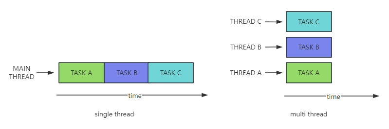
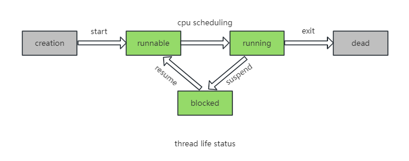
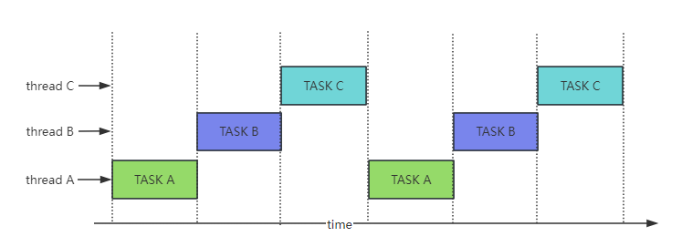
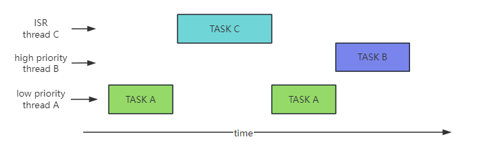
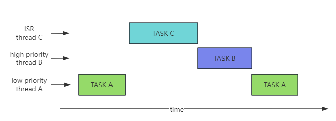
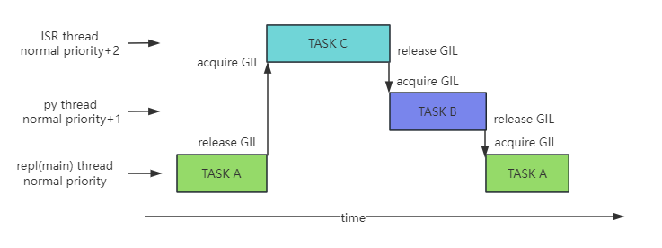

# 多线程

## 概述

多线程是指从软件或者硬件上实现多个线程并发执行的技术。在一个程序中同时执行多个线程，每个线程都可以执行独立的任务，可以让程序在执行阻塞操作（如I/O操作）时不会阻塞整个程序的执行，从而提高程序的效率。



QuecPython _thread 模块包含软件层线程操作相关的功能，提供创建、删除线程的方法以及互斥锁、信号量等相关的接口。并且 QuecPython 提供 queue、sys_bus、EventMesh等组件模块方便多线程业务处理。

## 多线程实现原理

QuecPython 本身并没有创建线程资源，QuecPython 中一个线程对应底层 RTOS 系统中一个线程，依赖于底层的线程调度。那么底层是如何调度的进行多任务执行的？

### 线程创建

python 创建线程提供了较为便捷的创建方式，忽略了底层的栈大小配置，优先级等参数传递，尽量简化用户使用。python 创建线程时会在底层 RTOS 系统中生成对应的任务控制块（TCB），用于任务调度及线程资源控制。

协议栈大小默认配置 8k。并且也为客户提供了栈大小的配置，可以通过 `_thread.stack_size()` 接口对栈大小进行配置查询。

```python
import _thread
import utime

# 线程函数入口，实现每隔一秒进行一次打印。
def thread_func_entry(id, name):
    while True:
        print( 'thread {} name is {}.'.format(id, name))
        utime.sleep(1)

# 创建线程
_thread.start_new_thread(thread_func_entry, (1, 'QuecPython'))

```

### 线程状态

线程有着自己的生命周期，从创建到结束，总是处于下面五个状态之一：新建状态（creation）、就绪状态（runnable）、运行状态（running）、阻塞状态（blocked）、终止状态（dead）。



- 新建状态（creation）：创建线程，实现线程可运行状态初始化。
- 就绪状态（runnable）：处于这个状态的线程位于可运行池中，等待获得 CPU 的使用权。
- 运行状态（running）：当就绪状态中的线程获得了 CPU 执行资源，执行线程函数中的代码，这样的线程我们称为运行状态的线程。
- 阻塞状态（blocked）：处于运行中的线程，由于某种原因放弃对 CPU 的使用权，处于阻塞状态，此时线程被挂起，不再执行，直到其进入就绪状态，才有机会再次被 CPU 调用进入运行状态。这种阻塞状态可能由多种原因导致，比如调用 sleep，信号量，锁等方式。
- 终止状态（dead）：线程在完成执行或异常中止时进入终止状态。

### 线程调度机制

多线程同时执行是伪命题，实际多线程并不是所有线程都能一直运行，一直独占 CPU，不论硬件资源多强大，对于创建成千上万个线程，都是需要一定的调度算法实现多线程的，那么多线程的调度机制是如何实现的呢？

在 RTOS 系统中，常见调度机制包括时间片轮询调度、基于优先级的协同调度、抢占式调度。一般在 RTOS 系统中，包含多种调度算法结合使用。

#### 时间片轮询调度

RTOS 中的轮询调度策略，是允许多个任务可以分配同一个优先级别。调度程序基于 CPU 时钟监控任务时间，任务处于相同优先级，按照先进先出的原则执行分配到的时间片，时间到了，即使当前任务还没有完成，任务也将 CPU 时间传递给下一个任务。在下一个分配到的时间段内，该任务将从它停止的位置继续执行。

如下图所示，根据 cpu tick 时间划分一个一个时间片，每个时间片结束后，会切换到下个就绪状态的任务执行，然后依次执行就绪状态任务A、B、C。



#### 基于优先级的协同调度

RTOS 中的优先级协同调度，是基于优先级的非抢占调度方法。任务按优先级排序，并且是事件驱动类型的，一旦正在运行的任务完成，或者任务主动放弃 CPU 使用，就绪运行的优先级最高的任务才可以获得 CPU 使用权。

如下图所示，根据优先级任务调度方法，在执行任务 A 时，出现中断时间任务，会立马执行高优先级中断事件任务，高优先级中断执行完成或者让出 CPU 后，继续执行任务 A，在任务 A 完成后或者让出 CPU 后，再切换到较高优先级任务 B。



#### 抢占式调度

RTOS 通过可抢占调度保证实时性。为了保证任务响应，在抢占调度策略中，只要一个优先级更高的任务就绪，正在运行的任务低优先级任务将被切换出来。通过抢占，正在运行的任务被迫放弃 CPU，即使任务工作还没有完成。

如下图所示，根据抢占式调度方法，执行任务 A 时，出现优先级高的任务 C，会立即切换到任务 C 执行，在高优先级任务 C 执行完成或者让出 CPU 后，根据当前就绪状态的线程任务中找优先级较高的任务执行，此时执行任务 B，任务 B 执行完成或者让出 CPU 后，再继续执行任务 A。



### 线程上下文切换

实际多线程运行中，总是通过不断切换来保持多个线程同时运行的，那么对于多线程任务调度切换过程是如何进行的？切换后如何恢复运行？

当操作系统需要运行其他的任务时，操作系统首先会保存和当前任务相关的寄存器的内容到当前任务的栈中，然后从将要被加载的任务的栈中，取出之前保存的全部寄存器的内容并加载到相关的寄存器中，从而继续运行被加载的任务，这个过程叫作线程上下文切换。

线程上下文切换会带来额外的开销，包括对线程上下文信息保存和恢复的开销，对线程进行调度的 cpu 时间开销以及 cpu 缓存失效的开销。

### 线程清除

线程是系统最小的调度单位，系统线程创建及释放需要对应的资源创建及清除。

QuecPython 为简便客户使用，在线程运行结束后，会自动释放线程资源，可以无需关心线程资源释放问题，对于需要在其他线程控制某线程关闭，可以通过 `_thread.stop_thread(thread_id)` 接口，根据 thread_id 来控制指定线程。
> 通过 _thread.stop_thread(thread_id) 暴力关闭线程，释放线程资源，需要注意对应线程是否有锁、内存申请等需要用户释放的相关操作，防止导致死锁或者内存泄漏情况。

```python
import _thread
import utime

# 线程函数入口，实现每隔一秒进行一次打印。
def thread_func_entry(id, name):
    while True:
        print( 'thread {} name is {}.'.format(id, name))
        utime.sleep(1)

# 创建线程
thread_id = _thread.start_new_thread(thread_func_entry, (1, 'QuecPython'))

# 延时 10 秒后删除每秒打印线程。
utime.sleep(10)
_thread.stop_thread(thread_id)
```

### QuecPython 多线程处理

QuecPython 多线程依赖于底层系统的调度方式，并且在此基础上增加 GIL 锁实现多线程。

python 是解释器语言，对于多线程处理需要按顺序执行，用来保证进程中同一个时刻只有一个线程在执行，因此引入 GIL 全局锁概念，防止因为多线程状况下引起共享资源异常问题。

QuecPython 线程在系统基础上定义了主线程、python 子线程、中断/回调线程，并固定其优先级，其主线程（repl交互线程）优先级 < python 子线程 < 中断/回调线程。

如下图所示，QuecPython 多线程处理切换过程，执行任务 A 时，在任务 A 释放 GIL 锁后，切换到优先级高的中断任务 C，在高优先级任务 C 释放 GIL 后，执行优先级较高的任务 B 并加 GIL 锁，任务 B 执行释放 GIL 锁后，再继续执行任务 A。QuecPython 避免 GIL 锁导致高优先级任务无法执行及多线程调度灵活性，在执行一定次数后会自动释放 GIL 锁，由系统调度。



## 线程间通信&资源共享

线程间通信指至少两个进程或线程间传送数据或信号的一些技术或方法。在多线程中使用中，线程间通信必不可少，通过线程间通信控制线程运行，共享资源控制、消息传递等，实现程序的多样化。

|  线程间通信   | 适用场景  | 资源消耗 |
|  ----  | ----   |  ---- |
| 互斥锁  | 用于信号传递，不可数据传递，常对于多线程公共资源竞争进行保护，控制程序运行。| 使用资源消耗较少。 |
| 信号量  | 用于信号传递，不可数据传递，常对于多线程公共资源竞争进行保护，控制程序运行。相比较互斥锁更加灵活。 | 使用资源消耗较少。 |
| 共享变量  | 数据传递，常搭配互斥锁、信号量使用。| 使用资源消耗较少。 |
| 消息队列  | 用于信号传递，数据传递，适用于生产者-消费者模型。| 使用资源消耗中等。 |
| sys_bus  | 数据传递，一对一通信或者一对多通信，基于发布/订阅范式的数据协议。| 异步发布数据使用资源较大。 |
| EventMesh  | 数据传递，一对一通信，基于发布/订阅范式的数据协议。 | 异步发布数据使用资源较大。 |


### 互斥锁 - 线程间通信&资源共享

互斥锁是一种用于多线程编程中，防止两条线程同时对同一公共资源（比如全局变量）进行读写的机制。互斥锁目的通过将代码切片成一个一个的临界区域，以达到对临界区域保护作用，使得多线程能够顺序访问。

```python
# 该示例线程 B 一定条件下通过互斥锁控制线程 A 运行，达到线程间通信目的。
import _thread
import utime

lock = _thread.allocate_lock()
count = 1

# 线程 B 函数入口，通过锁控制，防止同时操作操作全局变量count。
def thread_entry_B(id):
    global count
    while True:
        with lock:
            print( 'thread {} count {}.'.format(id, count))
            count += 1
            utime.sleep(1)

# 线程 A 函数入口，通过锁控制，防止同时操作操作全局变量count。
def thread_entry_A(id):
    global count
    while True:
        with lock:
            print('thread {} count {}.'.format(id, count))
            count += 1

# 创建线程
_thread.start_new_thread(thread_entry_A, ('A',))
_thread.start_new_thread(thread_entry_B, ('B',))
```

### 信号量 - 线程间通信&资源共享

信号量（英语：semaphore）又称为信号标，是一个同步对象，用于保持在 0 至指定最大值之间的一个计数值。当线程完成一次对该 semaphore 对象的等待时，该计数值减一；当线程完成一次对 semaphore 对象的释放时，计数值加一。

通过信号量的控制，以达到对多线程控制的目的，比如多线程对于资源操作的顺序或者执行有因果关系，必须通过一个线程先进行而后其他线程才能进行处理，可以通过信号量进行控制。

```python
# 该示例线程 B 一定条件下通过信号量控制线程 A 运行，达到线程间通信目的。
import _thread
import utime

semphore = _thread.allocate_semphore(1)

# 线程 B 函数入口，通过信号量控制线程 A 运行。
def thread_entry_B(id):
    while True:
        print('this is thread {}.'.format(id))
        utime.sleep(1)
        semphore.release()

# 线程 A 函数入口，等待信号量运行。
def thread_entry_A(id):
    while True:
        semphore.acquire()
        print('this is thread {}.'.format(id))

# 创建线程
_thread.start_new_thread(thread_entry_A, ('A',))
_thread.start_new_thread(thread_entry_B, ('B',))
```

### 共享变量

共享变量指多个线程同时对同一个变量进行读写操作，并且这些操作都能够影响到其他线程。

在进行多线程编程时，使用共享变量，需要对共享变量进行合理的管理和控制，避免多线程竞态条件的出现。

```python
# 该示例一个线程修改共享变量，一个线程读取，当存在多线程写入时，需要考虑变量安全，防止出现意外情况。
import _thread
import utime

lock = _thread.allocate_lock()
count = 1

# 线程 B 函数入口，共享变量 count 累增。
def thread_entry_B(id):
    global count
    while True:
        count += 1
        utime.sleep(1)

# 线程 A 函数入口，共享变量 count 读取打印。
def thread_entry_A(id):
    global count
    while True:
        print('thread {} current count is {}.'.format(id, count))
        utime.sleep(5)

# 创建线程
_thread.start_new_thread(thread_entry_A, ('A',))
_thread.start_new_thread(thread_entry_B, ('B',))
```

### 消息队列

消息队列实现了多生产者、多消费者队列。采用数据先进先出的数据结构，这特别适用于消息必须安全地在多线程间交换的线程编程。常用于消息异步处理，比如接收数据线程防止接收阻塞，只是对数据进行入栈存储，另一个线程专门处理消息队列消息。

```python
# 该示例线程 B 通过将消息压栈，线程 A 专门读取消息队列的内容进行处理。
import _thread
import utime
from queue import Queue

q = Queue()

# 线程 B 函数入口，共享变量 count 累增。
def thread_entry_B(id):
    data = 'Hello QuecPython!'
    while True:
        q.put(data)
        print('thread {} send {}.'.format(id, data))
        utime.sleep(3)

# 线程 A 函数入口，共享变量 count 读取打印。
def thread_entry_A(id):
    while True:
        data = q.get()
        print('thread {} recv {}.'.format(id, data))

# 创建线程A、B。
_thread.start_new_thread(thread_entry_A, ('A',))
_thread.start_new_thread(thread_entry_B, ('B',))
```

### sys_bus

sys_bus 组件用于消息的订阅和发布。在多线程中可用于，多个线程多个消息的解耦处理，通过定义不同的类型的 topic 用于处理不同的事务，任何线程可以随时通过 publish 来处理该消息。
> 该组件能够一对多或者多对多通信，即一个topic同时多个订阅者，发布到该topic的消息，所有订阅者均能处理。

```python
# 该示例线程通过订阅 topic，A、B 线程分别向其订阅topic发送订阅消息处理。
import _thread
import utime
import sys_bus

def callback_A(topic, msg):
    print("topic = {} msg = {}".format(topic, msg))

def callback_B(topic, msg):
    print("topic = {} msg = {}".format(topic, msg))

# 线程 B 函数入口，订阅 sysbus/thread_B topic并定时3秒发送消息到sysbus/thread_A topic。
def thread_entry_B(id):
    sys_bus.subscribe("sysbus/thread_B", callback_B)
    while True:
        sys_bus.publish_sync("sysbus/thread_A", "this is thread B msg")
        utime.sleep(3)

# 线程 A 函数入口，订阅 sysbus/thread_A topic并定时3秒发送消息到sysbus/thread_B topic。
def thread_entry_A(id):
    sys_bus.subscribe("sysbus/thread_A", callback_A)
    while True:
        sys_bus.publish_sync("sysbus/thread_B", "this is thread A msg")
        utime.sleep(3)

# 创建线程A、B。
_thread.start_new_thread(thread_entry_A, ('A',))
_thread.start_new_thread(thread_entry_B, ('B',))
```

```python
# 该示例线程 A、B 通过订阅同一 topic，实现一对多进行通信，其他线程发布消息到该topic，A、B线程均收到内容。
import _thread
import utime
import sys_bus

def callback_A(topic, msg):
    print("callback_A topic = {} msg = {}".format(topic, msg))

def callback_B(topic, msg):
    print("callback_B topic = {} msg = {}".format(topic, msg))

# 线程 B 函数入口，订阅 sysbus/multithread topic。
def thread_entry_B(id):
    sys_bus.subscribe("sysbus/multithread", callback_B)
    while True:
        utime.sleep(10)

# 线程 A 函数入口，订阅 sysbus/multithread topic。
def thread_entry_A(id):
    sys_bus.subscribe("sysbus/multithread", callback_A)
    while True:
        utime.sleep(10)

# 创建线程A、B。
_thread.start_new_thread(thread_entry_A, ('A',))
_thread.start_new_thread(thread_entry_B, ('B',))

# 主线程间隔3秒发布消息到 sysbus/multithread topic。
while True:
    sys_bus.publish_sync("sysbus/multithread", "sysbus broadcast conntent!")
    utime.sleep(3)
```

### EventMesh

EventMesh 组件用于消息的订阅和发布。在多线程中可用于，多个线程多个消息的解耦处理，通过定义不同的类型的 topic 用于处理不同的事务，任何线程可以随时通过 publish 来处理该消息。
> 该组件只能一对一或者多对一通信，即一个topic同时只能一个订阅者，最后一个订阅的会挤掉其他订阅者。

> [点此在 github 中下载 EventMesh 组件代码。](https://github.com/QuecPython/EventMesh)

```python
# 该示例线程通过订阅 topic，A、B 线程分别向其订阅 topic 发送订阅消息处理。
import _thread
import utime
from usr import EventMesh

def callback_A(topic, msg):
    print("topic = {} msg = {}".format(topic, msg))

def callback_B(topic, msg):
    print("topic = {} msg = {}".format(topic, msg))

# 线程 B 函数入口，订阅 EventMesh/thread_B topic并定时3秒发送消息到EventMesh/thread_A topic。
def thread_entry_B(id):
    EventMesh.subscribe("EventMesh/thread_B", callback_B)
    while True:
        EventMesh.publish_sync("EventMesh/thread_A", "this is thread B msg")
        utime.sleep(3)

# 线程 A 函数入口，订阅 EventMesh/thread_A topic并定时3秒发送消息到EventMesh/thread_B topic。
def thread_entry_A(id):
    EventMesh.subscribe("EventMesh/thread_A", callback_A)
    while True:
        EventMesh.publish_sync("EventMesh/thread_B", "this is thread A msg")
        utime.sleep(3)

# 创建线程A、B。
_thread.start_new_thread(thread_entry_A, ('A',))
_thread.start_new_thread(thread_entry_B, ('B',))
```

```python
# 该示例线程 A、B 通过订阅同一 topic，EventMesh 一个 topic 只能一个订阅，B 最后订阅，会直接挤掉 A 的订阅，只有 B 线程能收到该 topic 消息。
import _thread
import utime
from usr import EventMesh

def callback_A(topic, msg):
    print("callback_A topic = {} msg = {}".format(topic, msg))

def callback_B(topic, msg):
    print("callback_B topic = {} msg = {}".format(topic, msg))

# 线程 B 函数入口，订阅 EventMesh/multithread topic。
def thread_entry_B(id):
    EventMesh.subscribe("EventMesh/multithread", callback_B)
    while True:
        utime.sleep(10)

# 线程 A 函数入口，订阅 EventMesh/multithread topic。
def thread_entry_A(id):
    EventMesh.subscribe("sysbus/multithread", callback_A)
    while True:
        utime.sleep(10)

# 创建线程A、B。
_thread.start_new_thread(thread_entry_A, ('A',))
_thread.start_new_thread(thread_entry_B, ('B',))

# 主线程间隔3秒发布消息到 EventMesh/multithread topic。
while True:
    EventMesh.publish_sync("EventMesh/multithread", "EventMesh broadcast conntent!")
    utime.sleep(3)
```

## 多线程应用案例

### 简单多线程示例

简单多线程使用示例，如下所示创建线程A、B，各自做自己的独立任务。因此在需要任务长时间运行，并且会阻塞后续任务执行时，可以采用多线程的方式进行执行。

```python
import _thread
import utime

# 线程 B 函数入口，每隔 3 秒打印一次。
def thread_entry_B(id):
    while True:
        print('thread {} is running.'.format(id))
        utime.sleep(3)

# 线程 A 函数入口，每隔 3 秒打印一次。
def thread_entry_A(id):
    while True:
        print('thread {} is running.'.format(id))
        utime.sleep(3)

# 创建线程
_thread.start_new_thread(thread_entry_A, ('A',))
_thread.start_new_thread(thread_entry_B, ('B',))
```

### 多线程原子性操作

原子操作指不会被线程调度机制打断的操作，这种操作一旦开始，就一直运行到结束，中间不会切换到其他线程。

多线程原子性操作，它表示在多个线程访问同一个共享资源的时候，能够确保所有其他的线程都不在同一时间内访问相同的资源。因此在多线程对同一资源进行访问时，但是该资源无法同时进行访问可以采用该方法实现。

如下示例线程 A、B 同时操作共享资源，加锁对共享资源进行保护，保证共享资源在同时只能一个线程访问。
```python
import _thread
import utime

lock = _thread.allocate_lock()
count = 1

def shared_res(id):
    global count
    with lock:
        print( 'thread {} count {}.'.format(id, count))
        count += 1

# 线程 B 函数入口，对共享资源 count 进行累加操作。
def thread_entry_B(id):
    while True:
        shared_res(id)
        utime.sleep(1)

# 线程 A 函数入口，对共享资源 count 进行累加操作。
def thread_entry_A(id):
    global count
    while True:
        shared_res(id)
        utime.sleep(1)

# 创建线程
_thread.start_new_thread(thread_entry_A, ('A',))
_thread.start_new_thread(thread_entry_B, ('B',))
```

### 多线程顺序执行

多线程顺序执行，通过信号量控制，实现多线程按照顺序进行执行。常用于对于多线程执行有依赖关系，可以通过该种方式进行控制运行。

如下示例线程 A、B、C 三个线程，通过信号量控制，实现顺序运行，按照A、B、C 顺序打印。
```python
import _thread
import utime

semphore_A = _thread.allocate_semphore(1)
semphore_B = _thread.allocate_semphore(1)
semphore_C = _thread.allocate_semphore(1)

# 线程 C 函数入口，通过信号量控制线程 A 运行。
def thread_entry_C(id):
    count = 0
    while count < 30:
        semphore_B.acquire()
        print('this is thread {}.'.format(id))
        utime.sleep_ms(100)
        semphore_C.release()
        count += 1

# 线程 B 函数入口，通过信号量控制线程 C 运行。
def thread_entry_B(id):
    count = 0
    while count < 30:
        semphore_A.acquire()
        print('this is thread {}.'.format(id))
        utime.sleep_ms(100)
        semphore_B.release()
        count += 1

# 线程 A 函数入口，等待信号量运行。
def thread_entry_A(id):
    count = 0
    while count < 30:
        semphore_C.acquire()
        print('this is thread {}.'.format(id))
        utime.sleep_ms(100)
        semphore_A.release()
        count += 1

# 清空 A、B 信号量。保证只能线程 A 先运行，及多余信号量干扰。
semphore_A.acquire()
semphore_B.acquire()

# 创建线程A、B、C。
_thread.start_new_thread(thread_entry_A, ('A',))
_thread.start_new_thread(thread_entry_B, ('B',))
_thread.start_new_thread(thread_entry_C, ('C',))
```

### 生产者-消费者模式

生产者-消费者模式一般用于将生产数据的一方和消费数据的一方分割开来，将生产数据与消费数据的过程解耦开来。

在多线程开发中，如果生产者生产数据的速度很快，而消费者消费数据的速度很慢，那么生产者就必须等待消费者消费完了数据才能够继续生产数据，因为生产那么多也无法处理，所以为了达到生产者和消费者生产数据和消费数据之间的平衡，那么就需要一个缓冲区用来存储生产者生产的数据，所以就引入了生产者-消费者模式。

如下示例线程生产者每隔 3 秒发送给消费者信息、消费者等待生产者消息进行打印处理。
```python
# 该示例线程 B 通过将消息压栈，线程 A 专门读取消息队列的内容进行处理。
import _thread
import utime
from queue import Queue

q = Queue()

# 线程生产者函数入口，输出信息供给消费者。
def thread_producer(id):
    data = 'Hello QuecPython!'
    while True:
        q.put(data)
        print('thread {} send: {}.'.format(id, data))
        utime.sleep(3)

# 线程消费者函数入口，处理生产者信息。
def thread_consumer(id):
    while True:
        data = q.get()
        print('thread {} recv: {}.'.format(id, data))

# 创建线程producer、consumer。
_thread.start_new_thread(thread_producer, ('producer',))
_thread.start_new_thread(thread_consumer, ('consumer',))
```

### 中断处理流程

在多线程处理中，对于提供的中断/回调接口是其他线程的操作，在使用时需要注意不要在中断/回调中做延时任务，延时任务会导致后续中断/回调阻塞，从而导致中断/回调触发接口异常。对于在接收中断/回调后处理过程中需要耗时操作，一般是通过线程间通信方式，交给其其他独立线程进行任务处理。

如下示例实操对于串口数据中断触发，通过消息队列控制另一个接口进行数据读取及处理，防止对中断/回调接口阻塞丢包等问题。
```python
# 该示例串口触发中断/回调，防止读取串口及串口数据处理延时，通过消息队列控制专门线程对串口数读取及处理。
import _thread
from machine import UART
from queue import Queue

# 串口数据读取线程函数入口，通过消息队列触发消息读取。
def thread_entry():
    while True:
        len = uart_msg_q.get()
        data = UART2.read(len)
        print('uart read len {}, recv: {}.'.format(len, data))

def callback(para):
        print("uart call para:{}".format(para))
        if(0 == para[0]):
            uart_msg_q.put(para[2])

uart_msg_q = Queue()
UART2 = UART(UART.UART2, 115200, 8, 0, 1, 0)
UART2.set_callback(callback)

# 创建线程
_thread.start_new_thread(thread_entry, ())
```

## API 说明

### 线程栈大小设置及查询

线程栈大小设置及查询，方便根据自己业务动态调整栈大小。

```python
import _thread
import utime

# 线程函数入口，实现每隔一秒进行一次打印。
def thread_func_entry(name):
    while True:
        print( 'thread {} id is {}.'.format(name, thread_id))
        utime.sleep(1)

#查询当前协议栈大小
thread_size_old = _thread.stack_size()
print('current thread_size_old {}'.format(thread_size_old))

#设置线程栈大小为 10k
_thread.stack_size(10*1024)

# 创建线程
thread_id = _thread.start_new_thread(thread_func_entry, ('QuecPython'))

#还原线程栈大小
_thread.stack_size(thread_size_old)
```

### 线程创建及删除

线程创建及删除接口，方便通过该接口建立并行任务或者中断某个任务执行。删除某个任务指中断某个正常执行的任务，对于自动完成的任务，直接退出即可。
> 通过 _thread.stop_thread(thread_id) 暴力关闭线程，释放线程资源，需要注意对应线程是否有锁、内存申请等需要用户释放的相关操作，防止导致死锁或者内存泄漏情况。
```python
import _thread
import utime

# 线程函数入口，实现每隔一秒进行一次打印。
def thread_func_entry(name):
    while True:
        print( 'thread {} id is {}.'.format(name, thread_id))
        utime.sleep(1)

# 创建线程
thread_id = _thread.start_new_thread(thread_func_entry, ('QuecPython'))

utime.sleep(10)
#删除线程
_thread.thread_stop(thread_id)
```

### 互斥锁 - API 说明

互斥锁是为了解决在多线程访问共享资源时，多个线程同时对共享资源操作产生的冲突而提出的一种解决方法。

如下示例介绍互斥锁创建、加锁、解锁、删除锁的使用过程。
```python
# 该示例线程 B 一定条件下通过互斥锁控制线程 A 运行，达到线程间通信目的。
import _thread
import utime

# 创建线程锁
lock = _thread.allocate_lock()
count = 1

# 线程 B 函数入口，通过锁控制，防止同时操作操作全局变量count。
def thread_entry_B(id):
    global count
    while True:
        # 获取线程锁，加锁。
        lock.acquire()
        print( 'thread {} count {}.'.format(id, count))
        count += 1
        utime.sleep(1)
        # 释放线程锁，解锁。
        lock.release()

# 线程 A 函数入口，通过锁控制，防止同时操作操作全局变量count。
def thread_entry_A(id):
    global count
    while True:
        # 获取线程锁，加锁。
        lock.acquire()
        print('thread {} count {}.'.format(id, count))
        count += 1
        # 释放线程锁，解锁。
        lock.release()

# 创建线程
thread_id_A = _thread.start_new_thread(thread_entry_A, ('A',))
thread_id_B = _thread.start_new_thread(thread_entry_B, ('B',))

utime.sleep(10)

# 删除锁
_thread.thread_stop(thread_id_A)
_thread.thread_stop(thread_id_B)
_thread.delete_lock(lock)
```

### 信号量 - API 说明

信号量是操作系统用来解决并发中的互斥和同步问题的一种方法，是进化版的互斥锁。

如下示例介绍信号量创建、释放信号量、消耗信号量、删除信号量的使用过程。
```python
# 该示例线程 B 一定条件下通过信号量控制线程 A 运行，达到线程间通信目的。
import _thread
import utime

semphore = _thread.allocate_semphore(1)

# 线程 B 函数入口，通过信号量控制线程 A 运行。
def thread_entry_B(id):
    while True:
        print('this is thread {}.'.format(id))
        utime.sleep(1)
        # 释放信号量
        semphore.release()

# 线程 A 函数入口，等待信号量运行。
def thread_entry_A(id):
    while True:
        # 消耗信号量
        semphore.acquire()
        print('this is thread {}.'.format(id))

# 创建线程
_thread.start_new_thread(thread_entry_A, ('A',))
_thread.start_new_thread(thread_entry_B, ('B',))

# 删除信号量
_thread.thread_stop(thread_id_A)
_thread.thread_stop(thread_id_B)
_thread.delete_semphore(semphore)
```

## 常见问题

1. 线程创建失败

    一般情况下，创建线程失败基本都是由于内存不足导致的。可以使用`_thread.get_heap_size()`确认当前内存大小，并且通过调整线程栈空间的方式，尽量节省内存消耗，当然栈空间需要满足使用空间需求，否则会出现dump。

2. 线程资源如何释放防止内存泄漏

    当前线程退出可以通过两种方式，通过接口`_thread.thread_stop(thread_id)`，可以直接在外部中断程序运行。或者线程自动运行结束退出，系统会自动回收线程资源。

3. 线程死锁问题

    死锁（英语：deadlock），当多线程情况下，双方都在等待对方停止执行，以获取系统资源，但是没有一方提前退出时，就称为死锁。

    需要保证线程锁成对使用，加锁后不应该有较多任务，避免锁内再掉锁等情况， 并且`_thread.thread_stop(thread_id)`慎用，防止出现加锁过程中，退出程序导致死锁。

4. 如何唤醒阻塞线程

    对于需要阻塞的线程，可以通过线程间通信的方式实现，能够唤醒的方式进行阻塞，不要采用sleep等方式，无法唤醒。

5. 优先级

    QuecPython 固定优先级，当前主线程（repl交互线程）优先级 < python 子线程 < 中断/回调线程。用户创建所有的 python 子线程优先级同级。

6. 如何进行线程保活

    当前尚未提供 python 守护线程，或者线程状态查询接口，如果需要保证线程存活，可以自定义保活机制，比如根据需要保活的线程的使用情况，进行计数统计，保证线程在一定时间内会执行某个动作，若未完成，则进行线程清除及重新创建。

7. 线程死循环

    当前QuecPython适配较多平台，对于线程死循环可能会导致业务无法进行，系统喂狗超时，导致dump。

8. 线程栈耗尽

    QuecPython 不同的平台上，默认创建线程栈空间不同，默认2k/8k，当线程业务量较大时会导致栈溢出，会导致无法预知dump，因此需要考虑当前默认栈是否满足业务需要，通过`_thread.thread_size()`接口确认当前栈大小及设置栈大小。

9. 线程安全

    线程安全是多线程编程时的计算机程序代码中的一个概念。在拥有共享数据的多条线程并行执行的程序中，线程安全的代码会通过同步机制保证各个线程都可以正常且准确的执行，不会出现数据污染等意外情况。
    我们支持互斥锁、信号量等方式进行数据保护，在进行多线程共享数据时，用户可以根据需要进行使用。

10. 中断、回调、python 子线程、主线程（repl交互线程）的优先级对比。

    中断/回调依赖与其触发线程的，不同的中断/回调具有不同的触发对象，因此无法确定其优先级。

    主线程（repl交互线程）优先级 < python 子线程 < 中断/回调线程。

11. 相同优先级的是否支持时间片轮转。

    支持，但是是受限的，由于 python 层 GIL 锁机制，线程在调度后会添加 GIL 锁，只有保证 GIL 锁是空闲的才能执行成功，直到 python 线程执行结束或者让出 GIL 锁，其他线程才能会被执行。

12. 是否支持线程优先级配置。

    不支持。
