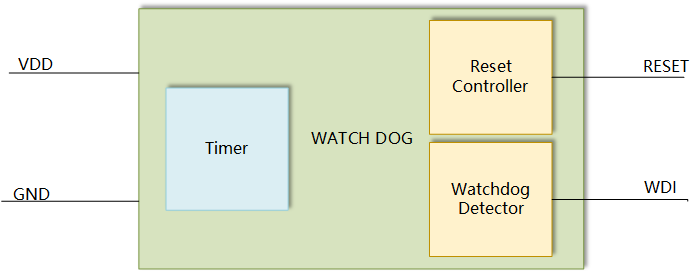
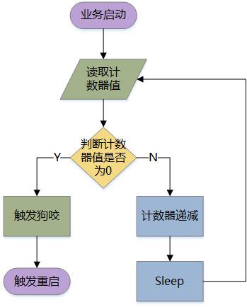
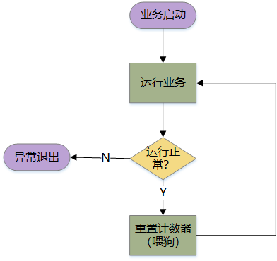
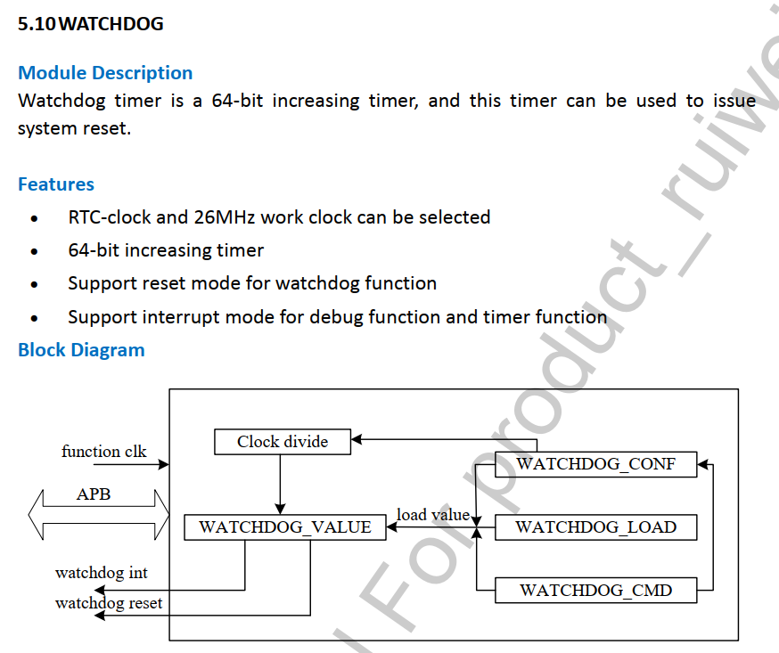
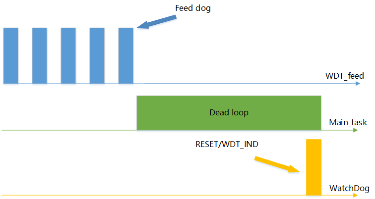
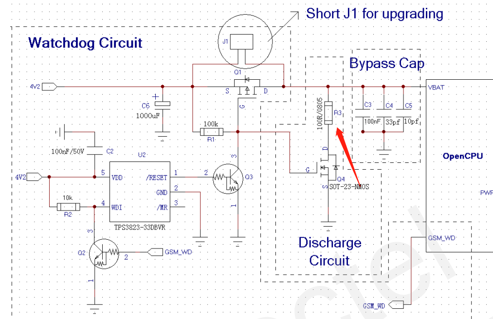
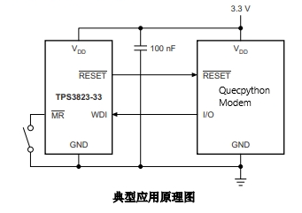
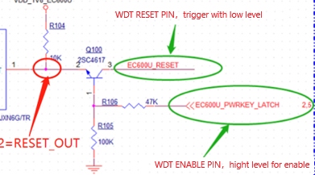

# 看门狗

## 概述

对蜂窝通信模组而言，看门狗（Watchdog）是一种硬件或软件的监控机制，用于监测模组的运行状态。当模组因为外界干扰或程序错误陷入死循环时，看门狗会自动触发模组重启，从而恢复模组的运行状态。

对看门狗而言，一般用以下术语来描述它的触发和重置行为：

**狗咬：** 指看门狗触发模组重启的行为

**喂狗：** 模组重置看门狗状态的行为（目的是通知看门狗自身仍在正常运行）

#### 硬件看门狗

**硬件看门狗的原理：** 典型的硬件看门狗主要包括硬件定时器、输入、输出等。其输入连接在模组IO上，输出则连接模组RESET引脚。看门狗的硬件定时器每会不断递增，超过阈值时间时，就会通过输出引脚触发模组复位（这种情况即为“狗咬”）。

正常运行的模组应通过IO周期性给看门狗输出信号，该信号在看门狗定时器到达阈值前将其重置（即“喂狗”）。因此，当模组正常保持运行时，定时器应不会递增到阈值。

当模组运行异常，无法在指定时间内重置看门狗定时器，就会触发模组RESET引脚，引发复位。

Quecpython通信模组一般内置了看门狗，业务里也可以写软件看门狗，为什么需要外置看门狗呢？因为无论是内置看门狗还是软件看门狗，在模组开机时都要走初始化流程，如果这两个看门狗尚未初始化完成就出现异常阻塞等情况，此时只有外置看门狗就才能发挥作用。

**典型硬件看门狗图示：**



如图，基本的硬件看门狗结构基本如此。其中WDI为输入，RESET为输出。WDI在探测到电平跳变时，判断为喂狗，清空Timer的计数。如果在一定时间内没有喂狗，Timer就会超时，通过RESET引脚触发模组重启。

#### 软件看门狗

**软件看门狗原理：** 与硬件看门狗类同，只是定时器改为软件实现，一般用于监视特定线程运行，被监控的线程需要定期重置定时器。

某些情况下，当某个应保持运行的业务线程出现异常阻塞或退出，但系统整体仍保持正常，无法触发硬件看门狗相关的保护机制。软件看门狗则能对一个或几个特定的线程进行监控，在这些线程出现异常时触发重置。

**典型软件看门狗图示：**



如图，软件看门狗一般在一个守护线程中运行，其基本逻辑如图。看门狗线程伴随业务启动，其运行机制类似于一个定时心跳，大部分的时候都在休眠，在心跳中完成计数器检测动作。当计数器已经归零时，则会触发reset。


它的监控对象是某个特定业务线程，也就是说，这个特定的业务线程要进行喂狗动作，即定时重置看门狗的计数器。如果这个线程异常退出或阻塞，无法再重置看门狗计数器。看门狗线程在计数器递减到0后，即会触发reset。

作为守护线程，需要注意的是。如果喂狗线程主动退出，需要同时停止看门狗线程，防止出现误触发reset的情况。

## 模组内置看门狗
蜂窝模组一般会内置硬件看门狗，看门狗主要功能是监控RTOS运行，狗咬时的输出可能是触发reset或者看门狗中断。喂狗机制一般是任务优先级最低的task负责执行，系统受干扰跑飞、线程或中断长期占用CPU均可触发狗咬。

相比于一般的硬件看门狗，内置看门狗一般是伴随模组的CPU启动，且需要从模组中取得时钟源（硬件看门狗一般自带时钟源）。狗咬时的动作除了触发RESET，还可选择触发看门狗中断
（用于输出调试信息或进入dump模式）。

  

**死循环导致看门狗咬死系统时序图：**

正常运行时，低优先级的喂狗线程隔一段时间运行一次，绝大部分时间空闲。业务线程进入死循环后，喂狗线程无法抢占CPU，无法进行喂狗。看门狗超时后，触发reset或者看门狗中断。



**底层跑飞：**
因内存踩踏、电磁干扰等情况，内存中数据错乱，进而导致CPU取到错误的程序地址，出现异常的运行逻辑，产生死锁或者死循环，导致看门狗超时。

**应用编程注意事项：**

内置看门狗由于是针对守护RTOS设计，其喂狗动作我们无法在业务层控制，所以要规避业务长期占据CPU不释放的情况，主要是避免死锁和死循环，包括以下几点：
1.尽量排除业务中可能的死循环逻辑。
2.在业务中设置合理的阻塞或者sleep，确保低优先级任务能得到正常调度。
3.针对必须使用的循环可增加安全措施。如在循环体中增加循环计数器，即使进入了死循环，也可以在循环达到一定次数时跳出。
4.检查互斥锁，保证其使用一定是成对的。删除拿锁的线程并不会释放其已经持有的互斥锁，这种操作会导致与之互斥的线程无法运行，务必在删除线程前释放其持有的互斥锁。

**内置看门狗无法覆盖的情况：**
内置看门狗在开机时会进行初始化，初始化完成之前实际上并不能发挥作用。如果出现开机流程中的异常或阻塞，内置看门狗无法保护到此处。在需要多次进行开关机的场合需要注意这种缺陷，需要外置看门狗解决。

## 外置看门狗方案

**外置看门狗原理图：**



**推荐的看门狗芯片：**
TPS3823-33DBVR

工作电压：DC 1.1V~5V
最大喂狗时间：1.6S
复位引脚：低电平有效
耗流：15uA

**外置看门狗特殊情况下喂狗：**

1.开机流程中：如果开机流程时间会明显长于看门狗触发狗咬的阈值，需要在boot中触发一次WDI电平改变，或者延迟看门狗生效时间。

2.FOTA流程中：利用FOTA进度的回调，操作WDI接口电平改变。在FOTA未适配回调，无法操作IO时，需要设法停止看门狗的工作。

3.可选择最大喂狗时间较长的看门狗，使其喂狗时长大于开机和FOTA的时间。该方法对以上两种情况均适用，缺点是出现异常时需要等待较长时间才能复位。

**可控制看门狗是否生效的典型电路设计：**
使用一个三极管，栅极接入高电平时看门狗和模组RESET 引脚导通



**外置看门狗喂狗例程：**

```python
import _thread
import usys as sys
import utime as time
from machine import Pin

class WatchDog:
    def __init__(self, gpio_n):
        self.__pin = Pin(gpio_n, Pin.OUT, Pin.PULL_PD, 0)
        self.__tid = None
  

    def __feed(self):
        while True:
            self.__pin.write(1)
            time.sleep_ms(200)
            self.__pin.write(0)
            time.sleep(1)

    def start(self):
        if not self.__tid or (self.__tid and not _thread.threadIsRunning(self.__tid)):
            try:
                _thread.stack_size(0x1000)
                self.__tid = _thread.start_new_thread(self.__feed, ())

            except Exception as e:
                sys.print_exception(e)
  

    def stop(self):
        if self.__tid:
            try:
                _thread.stop_thread(self.__tid)
            except:
                pass

        self.__tid = None
```

## 软件看门狗方案

软件看门狗一般在守护线程中运行，可覆盖业务线程异常阻塞或退出的场景（但系统保持正常运行）。

**软件看门狗示例&业务内喂狗示例：

```python
import _thread
import usys as sys
import utime as time
from machine import Pin
from misc import Power

class WatchDog:#软件看门狗类
    def __init__(self, max_count):
		self.__max_count = max_count#看门狗最大计数
		self.__count = self.__max_count#初始化看门狗计数器
		self.__tid = None

	def __bark(self):
		Power.powerRestart()

    def feed(self):
		self.__count = self.__max_count#喂狗，重置看门狗计数器

	def __check(self):
		while True:#循环中检查计数器
			if(self.__count == 0):
				self.bark()#计数器归零时，触发重启
			else:
				self.__count = (self.__count - 1)#否则计数器减一
				
			utime.sleep(10)			

    def start(self):
        if not self.__tid or (self.__tid and not _thread.threadIsRunning(self.__tid)):
            try:
                _thread.stack_size(0x1000)
                self.__tid = _thread.start_new_thread(self.__check, ())

            except Exception as e:
                sys.print_exception(e)
  

    def stop(self):
        if self.__tid:
            try:
                _thread.stop_thread(self.__tid)
            except:
                pass

        self.__tid = None


wdt = WatchDog(5)#初始化软件看门狗

def th_func1():
	wdt.start()#启动看门狗
    while True:
    	print("Bussiness code running")
    	if(wdt != None):
		    wdt.feed()	#在业务线程中喂狗
    	#bussiness code here
    	utime.sleep(1)
    	
if __name__ == '__main__':

    thread_id = _thread.start_new_thread(th_func1, ())
```

## 常见问题

### 软件看门狗选取喂狗时间间隔

有以下三个原则
1.喂狗时间间隔必须大于业务代码单次运行的时间，否则即使在业务线程中进行喂狗，也会在下次喂狗前触发重启

2.喂狗时间周期也是守护线程的心跳周期，尽量是业务线程心跳的整数倍，让模组被唤醒时同时处理业务和看门狗的心跳，减少唤醒次数，对减少耗流有重要意义。

3.喂狗时间需要匹配业务需求，太长的喂狗时间会导致异常发生时等待恢复的时间过长。
### 开机时间如何喂狗

如果选择的看门狗喂狗间隔小于开机时间，就需要考虑避免在开机时误触发看门狗狗咬：
1.需要在boot阶段中增加喂狗操作，添加方式与请联系移远通信技术支持。
2.开机时延迟对看门狗使能，在能够操作喂狗IO后再对硬狗做初始化。例如通过一个三极管控制看门狗输出引脚与RESET引脚的连接，开机完成后才控制这两个引脚导通，电路设计参考[外置看门狗方案章节](#外置看门狗方案)。

### FOTA时如何喂狗

1.通过FOTA进度的回调操作喂狗IO
2.没有FOTA进度回调的模组，需要暂时关闭看门狗，电路设计参考[外置看门狗方案章节](#外置看门狗方案)。

### 如何判断是否需要外置看门狗

1.在对产品可靠性要求较高时需要外置看门狗
2.频繁开关模组的产品，触发内置看门狗失效场景的可能性较大，需要外置看门狗