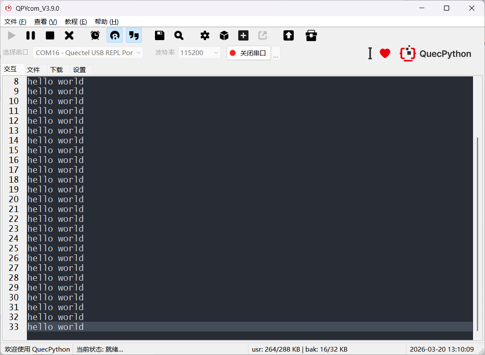

## 用main.py实现脚本自启动

QuecPython运行后，会自动启动`usr`目录下名为`main.py`的脚本。设备在进入量产前，一定要将程序的入口脚本命名为`main.py`。

编写最简版自启动脚本 `main.py`，实现开机后循环打印 `hello world`，用于验证自启动功能。

### 示例代码

```python
# 导入QuecPython内置的系统延时模块
import utime
# 程序主入口
if __name__ == '__main__':
    # 无限循环，实现持续打印，保证串口可稳定捕获日志
    while True:
        print("hello world")
        # 1秒延时，控制打印频率，避免占用过高CPU资源
        utime.sleep(1)
```

### 测试自动运行效果（重启模组验证执行结果）

模组启动完成后每秒持续输出`hello world`日志，证明程序已随模组开机自动执行，自启动功能验证完成。



> 注意：若`main.py`中仅编写单次执行的`print("hello world")`代码，无循环持续运行逻辑，由于单次执行未打开REPL口时已经打印输出,所以QPYcom看不到单次打印的输出。

## 常见问题与注意事项

### 脚本无法自启动

- 路径错误：`main.py` 必须存放于 `/usr` 根目录，不可在子文件夹（如 `/usr/project/`）；
- 文件名错误：严格使用全小写 `main.py`，避免 `Main.py`/`main.py.txt` 等；
- 加密限制：`main.py` 不可加密，固件仅支持解析明文的自启动入口文件；
- 语法 / 运行异常：脚本存在语法错误、顶层代码异常，会直接终止自启动流程（建议先在 REPL 手动执行验证）。