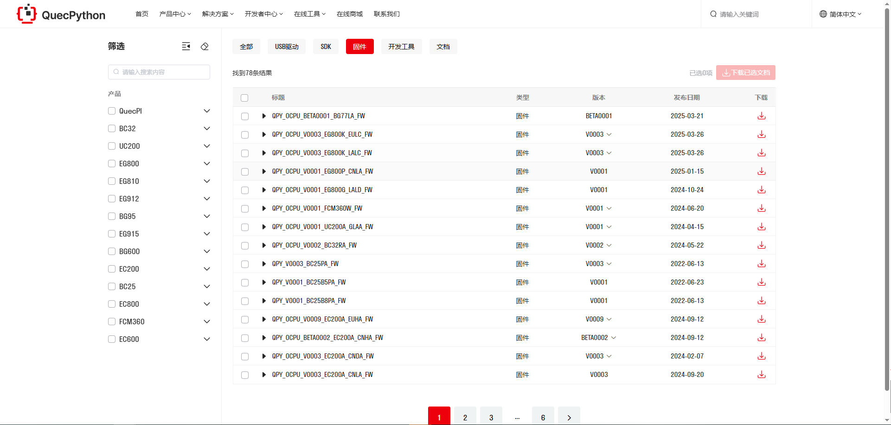
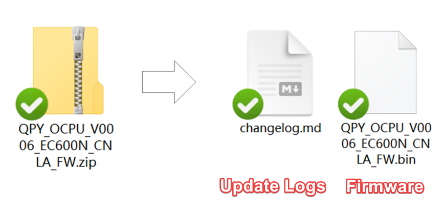
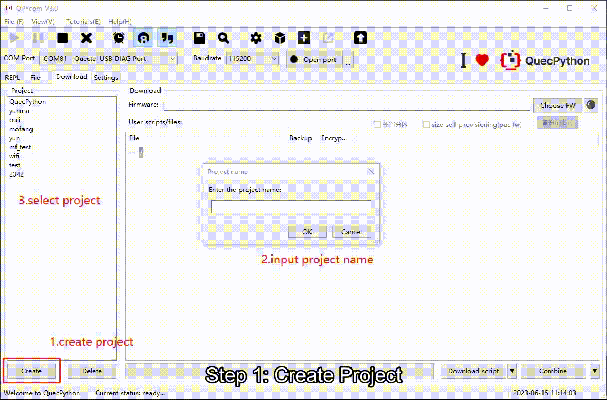

# 固件烧录

## 获取固件

模组在出厂时通常烧录有标准 AT 固件或 QuecOpen 固件，如需基于 QuecPython 对模块进行开发，需要手动为其重新烧录专门的 QuecPython 固件。

官网固件下载地址：**<https://developer.quectel.com/resource-download?cid=15>**

面对官网种类众多的固件，如何选择合适的固件包，首先需要知道使用的模组的型号，模组型号可以通过模组的镭雕或者发送AT指令来获得。

在获取到模组型号之后根据模组的型号去官网下载该模组对应的固件即可。

固件的名称一般为`QPY_OCPU_模组型号_FW`,例如QPY_OCPU_EC800M_CNGC_FW，如果是EC800M_CNGC的模组就可以下载这个固件，并且可以在版本这一列选择想要下载的固件版本，固件的版本号格式统一为`V+四位数版本号`，例如V0001

点击下载列的下载按钮即可下载，下载成功后会得到一个固件名称命名的压缩包文件(zip包)

从官网下载的固件包为压缩包格式，固件压缩包下载到本地后，需进行解压。解压后可获得两个文件，其中 .bin 、.lod或 .pac 格式的是 QuecPython 固件本体，.md 格式的是更新日志。

固件解压后的本体文件有以下后缀区分(**官网发布日期于2024.05.20之后的固件，所有模组型号固件已统一为.bin后缀**)

| 固件下载文件名称后缀 | 固件文件对应模组型号                    | 备注                       |
| -------------------- | -------------------------------------- | -------------------------- |
| zip、bin             | EC600M、EC600N、EG915N、EC200N、EG810M    | 固件压缩包解压后可得       |
| pac                  | EC600U、EC200U、EG912U、EC800G、EC600G   | 固件压缩包解压后可得       |
| lod                  | BC25                                   | 固件压缩包解压后可得       |
| binpkg               | EC600E、EC800E                         | 解压后选择文件夹内的at_command.binpkg文件 |
| hbinpkg               | EC800Z                               | 解压后选择文件夹内的at_command.hbinpkg文件 |
| blf                  | EC200A                                 | 解压后选择文件夹内的.blf文件 |
| mbn                  | BG95                                   | 解压后固件选择文件夹内的update\firehose\partition.mbn文件 |

> 请务必将压缩包内容解压至一个**不包含中文、空格和其他特殊字符**的路径下，否则下载工具可能无法正常识别到固件，同时下载工具路径也**不可包含中文、空格和其他特殊字符**。

## 烧录固件

- **Step1：创建项目**

首先确保模组连接正常并已开机，打开QPYcom工具进入下载页面，点击**"创建"**项目，新建要下载的固件项目，项目名称自定义，配置完成后持久化保存

- **Step2：选择固件**

选择要下载到模组的固件(根据要下载的模组型号选择对应的固件，若为新格式固件则所有模组型号都选择.bin文件即可）

其中BG95系列选择官网下载固件包解压后mbn结尾的文件，M/N系列选择官网下载固件包解压后的bin文件，U/G系列模组选择解压后的PAC文件，BC25选择lod文件，A系列选择blf文件，E系列选择binpkg文件

- **Step3：设置下载模式**

单击**“Download script”**右侧的下拉选择箭头，选择**"Download FW"**

- **Step4：开始烧录固件**

点击**"Download FW"**后，开始下载固件,下载过程会有进度条和进度百分比显示，等待下载完毕会有弹窗提示下载成功

| 模组型号                     | 注意事项                       |
| -------------------------------------- | -------------------------- |
| BC25    | 需要打开固件下载串口后再点击**"Download FW"**，直接点击会提示打开串口                                         |
| EC200A    | 点击**"Download FW"** 后会提示 **"请重启板子，按RESET"**，按一次**“RESET”**按钮开始下载固件                   |
| EC600E  | 需要短接开发板 BOOT 和 GND 并按下开发板**“RESET”**按钮出现下载口后，立即点击**"Download FW"**开始下载固件      |
| EC800E  | 需要短接开发板 BOOT 和 GND 并按下开发板**“RESET”**按钮出现下载口后，立即点击**"Download FW"**开始下载固件       |
| EC800Z  | 需要短接开发板 BOOT 和 EXT 并按下开发板**“RESET”**按钮出现下载口，其维持时间较短，要快速立即点击**"Download FW"**开始下载固件      |
| EG800Z  | 需要短接开发板 BOOT 和 EXT 并按下开发板**“RESET”**按钮出现下载口，其维持时间较短，要快速立即点击**"Download FW"**开始下载固件      |

