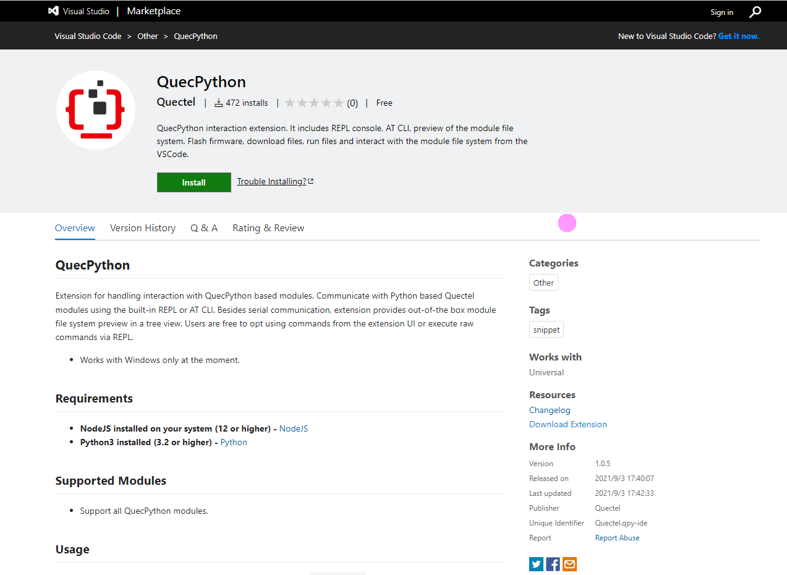

# 获取工具

## QPYcom获取

使用QuecPython进行开发需要用到专用的开发调试工具——**QPYcom**，包括但不限于调试代码、分析日志、文件传输、烧录固件、合并固件等。

[QPYcom](https://developer.quectel.com/wp-content/uploads/2024/09/QPYcom_V4.1.0.zip) : 适用于QuecPython开发的一站式调试工具

*注意:该工具无需安装，解压即用。*

## 安装VSCode插件

编辑Python代码一般会用到专用于Python或者兼容多种语言的IDE，可以有效提升开发效率，这里推荐VSCode

针对VScode，QuecPython推出专用插件实现代码提示、代码补全和串口调试等功能，安装方法见下图

- 在VSCode中点击侧边栏插件市场，在插件市场中搜索 “QuecPython”，根据搜索结果下载该插件即可

- 在[VSCode插件商店网站](https://marketplace.visualstudio.com/vscode) 搜索“QuecPython”，根据搜索结果下载该插件后会自动打开VSCode并安装

