# EC200U/A C4-P01

## 支持的模块列表

- [EC200U-CN](https://developer.quectel.com/modules-cat/ec200u-series)
- [EC200U-EU](https://developer.quectel.com/modules-cat/ec200u-series)
- [EC200A-CN](https://developer.quectel.com/modules-cat/ec200a-series)
- [EC200A-AU](https://developer.quectel.com/modules-cat/ec200a-series)
- [EC200A-EU](https://developer.quectel.com/modules-cat/ec200a-series)


## 功能列表

### 基本概述

QuecPython_EC200U/A C4-P01开发板是一款专门针对QuecPython设计的、小巧便携的开发板。

主模块搭载EC200U/A系列LTE Cat 1/LTE Cat 4无线通信模块。

该开发板自身板载USB Type-C接口，方便开发，开发者仅需一条USB Type-C数据线即可轻松玩转开发板。

并且该开发板兼容树莓派zero的扩展板，树莓派zero的扩展板可以在开发板上直接使用。

### 功能说明

开发板的主要组件、接口布局见下图

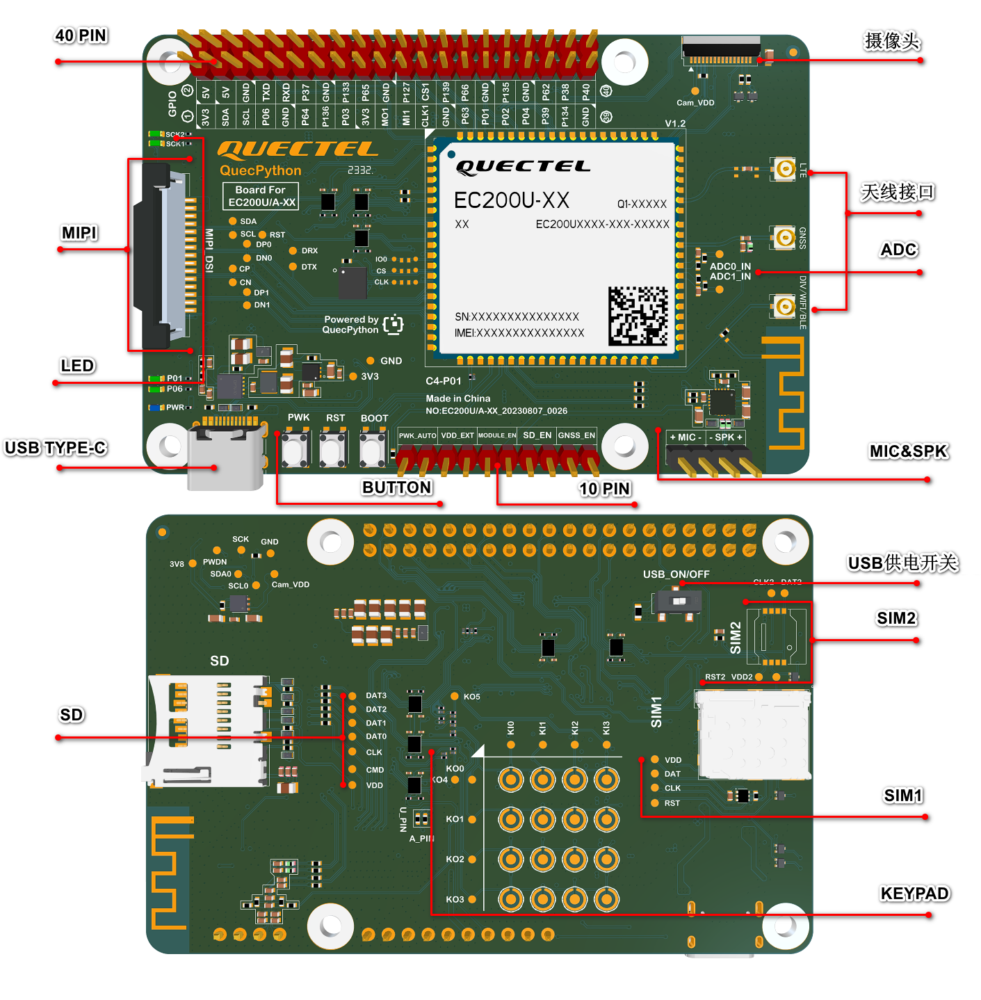

开发板尺寸图

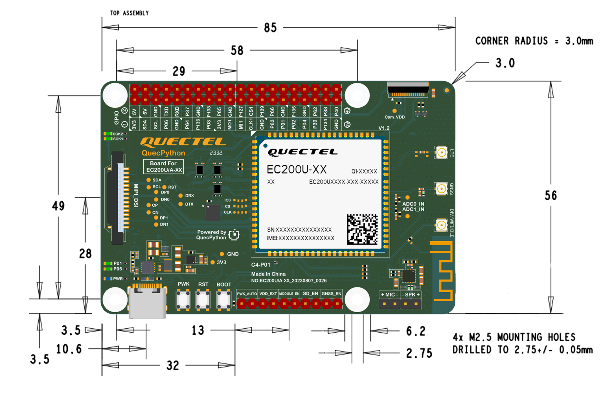

### 资料下载

- [QuecPython_EC20X_EVB_SCH](https://developer.quectel.com/wp-content/uploads/2024/09/EC200UA_C4-P01%E7%B3%BB%E5%88%97%E5%BC%80%E5%8F%91%E6%9D%BF%E5%8E%9F%E7%90%86%E5%9B%BE.pdf)
- [EC20X_EVB_丝印](https://developer.quectel.com/wp-content/uploads/2024/09/EC200UA_C4-P01%E7%B3%BB%E5%88%97%E5%BC%80%E5%8F%91%E6%9D%BF%E4%B8%9D%E5%8D%B0.pdf)


## 开发板资源

### 开发板接口

该开发板提供40-Pin兼容树莓派的引脚，以及10-Pin功能使能引脚，开发板功能描述如下：

**10-Pin排针引脚分配表**

| **排针** | **编号** | **丝印**  | **功能** |
| -------- | -------- | --------- | -------- |
| 10-Pin   | 1        | PWK_AUTO  | POWERKEY |
| 10-Pin   | 2        | PWK_AUTO  | GND      |
| 10-Pin   | 3        | VDD_EXT   | 1.8 V    |
| 10-Pin   | 4        | VDD_EXT   | VDD_EXT  |
| 10-Pin   | 5        | MODULE_EN | 3.8 V    |
| 10-Pin   | 6        | MODULE_EN | 3.8 V    |
| 10-Pin   | 7        | SD_EN     | SD_EN    |
| 10-Pin   | 8        | SD_EN     | 3.3 V    |
| 10-Pin   | 9        | GNSS_EN   | 3.3 V    |
| 10-Pin   | 10       | GNSS_EN   | GNSS_EN  |

- **1 & 2**：自动开机
- **3 & 4**：VDD_EXT连接时可对外供电，测量功耗时需断开
- **5 & 6**：接通DCDC对模块供电
- **7 & 8**：使能SD供电
- **9 & 10**：使能GNSS有源供电

> 测量功耗时注意关闭USB供电开关，开发板背面USB_ON/OFF的拨杆开关。

**40-Pin排针单号引脚分配表**

| **排针** | **编号** | **名称** | **功能复用**       | **功能**                                        |
| -------- | -------- | -------- | ------------------ | ----------------------------------------------- |
| 40-Pin   | 1        | 3V3      | -                  | 3.3 V输出                                       |
| 40-Pin   | 3        | SDA      | I2C0_SDA/GPIO35    | I2C0串行数据/通用输入输出                       |
| 40-Pin   | 5        | SCL      | I2C0_SCL           | I2C0串行时钟                                    |
| 40-Pin   | 7        | P06      | GPIO46/A_PWM2      | 通用输入输出/PWM2输出（模块为EC200A时）         |
| 40-Pin   | 9        | GND      | -                  | 接地                                            |
| 40-Pin   | 11       | P64      | GPIO19             | 通用输入输出                                    |
| 40-Pin   | 13       | P136     | GPIO7              | 通用输入输出                                    |
| 40-Pin   | 15       | P03      | GPIO9              | 通用输入输出                                    |
| 40-Pin   | 17       | 3V3      | -                  | 3.3 V输出                                       |
| 40-Pin   | 19       | MO1      | SPI1_MOSI/GPIO3    | SPI1主输出从输入/通用输入输出                   |
| 40-Pin   | 21       | MI1      | SPI1_MISO/GPIO4    | SPI1主输入从输出/通用输入输出                   |
| 40-Pin   | 23       | CLK1     | SPI1_CLK/GPIO1     | SPI1时钟/通用输入输出                           |
| 40-Pin   | 25       | GND      | -                  | 接地                                            |
| 40-Pin   | 27       | P63      | GPIO44/A_UART1_TXD | 通用输入输出/UART1发送（模块为EC200A时）        |
| 40-Pin   | 29       | P01      | GPIO28/A_PWM0      | 通用输入输出/PWM0输出（模块为EC200A时）         |
| 40-Pin   | 31       | P02      | GPIO29             | 通用输入输出                                    |
| 40-Pin   | 33       | P04      | GPIO30/A_PWM1      | 通用输入输出/PWM1输出（模块为EC200A时）         |
| 40-Pin   | 35       | P39      | GPIO13/A_SPI0_MISO | 通用输入输出/SPI0主输入从输出（模块为EC200A时） |
| 40-Pin   | 37       | P134     | GPIO37             | 通用输入输出                                    |
| 40-Pin   | 39       | GND      | -                  | 接地                                            |

**40-Pin排针双号引脚分配表**

| **排针** | **编号** | **名称** | **功能复用**       | **功能**                                        |
| -------- | -------- | -------- | ------------------ | ----------------------------------------------- |
| 40-Pin   | 2        | 5V       | -                  | 5 V输出                                         |
| 40-Pin   | 4        | 5V       | -                  | 5 V输出                                         |
| 40-Pin   | 6        | GND      | -                  | 接地                                            |
| 40-Pin   | 8        | TXD      | UART2_TXD          | UART2发送                                       |
| 40-Pin   | 10       | RXD      | UART2_RXD          | UART2接收                                       |
| 40-Pin   | 12       | P37      | GPIO11/A_SPI0_CS   | 通用输入输出/SPI0片选（模块为EC200A时）         |
| 40-Pin   | 14       | GND      | -                  | 接地                                            |
| 40-Pin   | 16       | P133     | GPIO8              | 通用输入输出                                    |
| 40-Pin   | 18       | P65      | GPIO18             | 通用输入输出                                    |
| 40-Pin   | 20       | GND      | -                  | 接地                                            |
| 40-Pin   | 22       | P127     | GPIO22             | 通用输入输出                                    |
| 40-Pin   | 24       | CS1      | SPI1_CS/GPIO2      | SPI1片选/通用输入输出                           |
| 40-Pin   | 26       | P139     | GPIO20             | 通用输入输出                                    |
| 40-Pin   | 28       | P66      | GPIO45/A_UART1_RXD | 通用输入输出/UART1接收（模块为EC200A时）        |
| 40-Pin   | 30       | GND      | -                  | 接地                                            |
| 40-Pin   | 32       | P135     | GPIO6/U_PWM0       | 通用输入输出/PWM0输出（模块为EC200U时）         |
| 40-Pin   | 34       | GND      | -                  | 接地                                            |
| 40-Pin   | 36       | P62      | GPIO43             | 通用输入输出                                    |
| 40-Pin   | 38       | P38      | GPIO12/A_SPI0_MOSI | 通用输入输出/SPI0主输出从输入（模块为EC200A时） |
| 40-Pin   | 40       | P40      | GPIO10/A_SPI0_CLK  | 通用输入输出/SPI0时钟（模块为EC200A时）         |

开发板主要引脚布局见下图

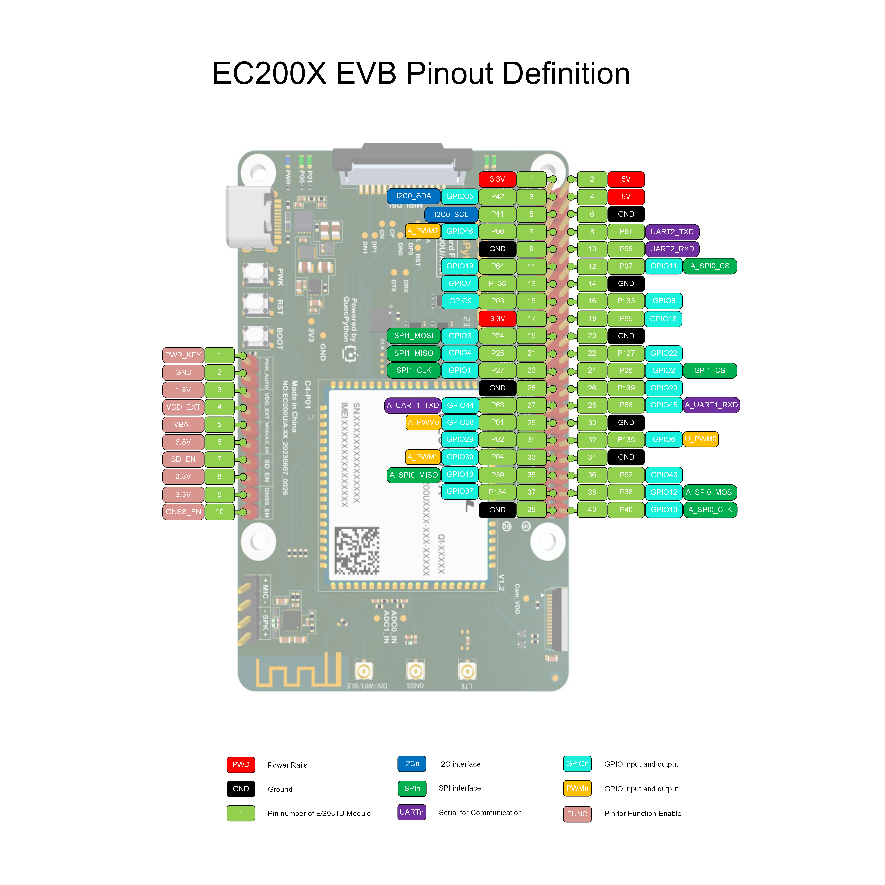

> **小提示**
>
> 图中以A/U开头的引脚复用功能为EC200A/U系列模块的功能差异项，即模块为EC200U时，U开头的引脚功能才会生效；模块为EC200A时，A开头的引脚功能才会生效。
>
> 开发板的更多资料，请访问 <https://developer.quectel.com/resource-download?cid=23>。

### 开发板配置

开发板外设接口分配表明细如下：

| 序号 | 名称           | 型号         | 丝印            | 备注                                                         |
| ---- | -------------- | ------------ | --------------- | ------------------------------------------------------------ |
| 1    | USB Type-C接口 | -            | -               | -                                                            |
| 2    | SIM卡座1       | SMN-315-ARP7 | SIM1            | Nano-SIM                                                     |
| 3    | SIM卡座2       | MUP-C7809-1  | SIM2            | -                                                            |
| 4    | SD卡槽         | TF-101A-P3   | SD              | 使用SD卡前，首先需要在10-Pin功能排针中使能SD，对 SD供电。    |
| 5    | USB 供电开关   | -            | USB_ON/OFF      | 开关处于常闭状态时，Type-C对模块和开发板供电，USB可正常连接；USB开关处于常开状态时，Type-C仅对开发板供电，此时模块处于未供电状态。 |
| 6    | MIPI接口       | -            | MIPI_DSI        | 主模块为 EC200U-XX 时，支持MIPI屏幕，且全兼容树莓派外设。    |
| 7    | 摄像头接口     | -            | -               | 开发板支持定制的SPI摄像头，最大像素支持30W像素。             |
| 8    | 矩阵键盘接口   | -            | KO&KI           | 预留矩阵键盘引脚，用户可进行自定义焊接或者连接，默认不带板载键盘按键。 |
| 9    | MIC&SPK接口    | AW8733A      | +MIC-/-SPK+     | -                                                            |
| 10   | 40-Pin排针     | -            | -               | 板载40-Pin排针，具体参见上文图表。                           |
| 11   | 10-Pin排针     | -            | -               | 板载10-Pin排针，具体参见上文图表。                           |
| 12   | ADC接口        | -            | ADC0_IN/ADC1_IN | ADC测量接口                                                  |
| 13   | PWK按键        | -            | PWK             | 开机按键                                                     |
| 14   | RST按键        | -            | RST             | 重启按键                                                     |
| 15   | BOOT按键       | -            | BOOT            | 固件烧录按键                                                 |
| 16   | 天线接口 | -            | LTE<br>DIV/WIFI/BT<br>GNSS | LTE天线座<br>DIV/Wi-Fi/蓝牙天线座<br>GNSS天线座 |

**开发板载有5颗功能性指示灯，分别如下**

- **P01**：模块Pin 1，默认为EC200A-XX PWM0。
- **P05**：模块Pin 5，为NET_MODE指示灯。
- **SCK1**：SIM1检测指示灯，SIM1卡插入时亮起。
- **SCK2**：SIM2检测指示灯，SIM2卡插入时亮起。默认连接Pin 128，EC200A-XX无SIM2，可忽略。
- **PWR**：电源指示灯。

> 上述指示灯位置参考上文开发板正面图下方丝印（模块所在面为正面）。


## 快速入门

### 硬件准备

以下是开发板上手之后的硬件准备步骤

- <font color='red'>**Step1：硬件准备**</font>

    开始之前需要准备以下配件

    1. **开发板**
    2. **USB 数据线** (USB-A TO USB-TypeC)
    3. **PC** (Windows10)
    4. **SIM 卡**
    5. **4G 天线**

- <font color='red'>**Step2：天线&SIM卡安装**</font>

安装开发板配套的天线,安装位置为 MAIN 天线座位置,并将 SIM 卡插入开发板上的 SIM 卡座。

- <font color='red'>**Step3：开发板连接**</font>

使用 USB Type-C 数据线连接开发板的 Type-C/Micro USB 接口和电脑 USB 口即可完成供电。

> 开发板PWR灯常亮即为正常供电。

- <font color='red'>**Step4: 开发板开机**</font>

长按PWRKEY开机，在按下PWRKEY按键之前，需保证供电电压稳定。建议从上电到按下PWRKEY按键之间的时间间隔不少于30 ms。如果需上电自动开机且不需要关机功能，则可以把10-Pin排针中PWK_AUTO丝印对应的两个引脚短接。

如果上一步短接PWK_ON则无需长按PWK自动开机，开机后开发板NET灯闪烁，开发板已正常开机。

### 驱动安装

- 打开[QuecPython官网驱动下载链接](https://developer.quectel.com/resource-download?cid=5)

- 选择与模组型号匹配的驱动，该开发板搭载的模组有EC200U和EC200A两种型号，以EC200U为例，在下载页面右侧选择该型号的USB驱动[QuecPython_USB Driver Win10_U_G](https://images.quectel.com/python/2023/04/Quectel_Windows_USB_DriverU_V1.0.19.zip)点击下载，如果开发板搭载的是其他型号同样按照以上操作即可。

- 下载后解压驱动压缩包，找到**"setup.exe"** 或者是**"setup.bat"**，双击运行即可，安装完之后打开设备管理器就可以看到设备管理器中端口的黄色感叹号消失了，说明安装成功，能够正常通信。

>  出现 <font color='red'>Mobile ECM Network Adapter </font>或 <font color='red'>CDC Ethernet Control Modle (ECM) </font>等设备未被识别属于正常现象，不影响固件烧录和后续开发，无需理会。

- 右键打开【**我的电脑**】——选择【**管理**】——选择【**设备管理器**】,然后在设备管理器中选择 【**端口**】，按照步骤打开页面后如图所示能刷新出**Quectel USB** 名称开头的串口则USB驱动安装成功。


### 工具安装

- QPYcom获取

使用QuecPython进行开发需要用到专用的开发调试工具——**QPYcom**，包括但不限于调试代码、分析日志、文件传输、烧录固件、合并固件等。

打开[QuecPython工具下载页面](https://developer.quectel.com/resource-download?cid=8)，根据操作系统选择对应的工具进行下载。

*注意:该工具无需安装，解压即用。*

- VSCode插件

编辑Python代码一般会用到专用于Python或者兼容多种语言的IDE，可以有效提升开发效率，这里推荐VSCode

针对VScode，QuecPython推出专用插件实现代码提示、代码补全和串口调试等功能，安装方法见下图

在VSCode中点击侧边栏插件市场，在插件市场中搜索 “QuecPython”，根据搜索结果下载该插件即可


### 固件烧录

**固件获取**

模组在出厂时通常烧录有标准 AT 固件或 QuecOpen 固件，如需基于 QuecPython 对模块进行开发，需要手动为其重新烧录专门的 QuecPython 固件。

[官网固件下载地址](https://developer.quectel.com/resource-download?cid=15)


面对官网种类众多的固件，如何选择合适的固件包，首先需要知道使用的模组的型号，模组型号可以通过模组的镭雕或者发送AT指令来获得。

在获取到模组型号之后根据模组的型号去官网下载该模组对应的固件即可,固件的名称一般为`QPY_OCPU_版本号_模组型号_FW`，没有特殊需求默认下载最新版本即可。

点击下载列的下载按钮即可下载，下载成功后会得到一个固件名称命名的压缩包文件(zip包)

从官网下载的固件包为压缩包格式，固件压缩包下载到本地后，需进行解压。解压后可获得两个文件，其中 .bin 格式的是 QuecPython 固件本体，.md 格式的是更新日志。

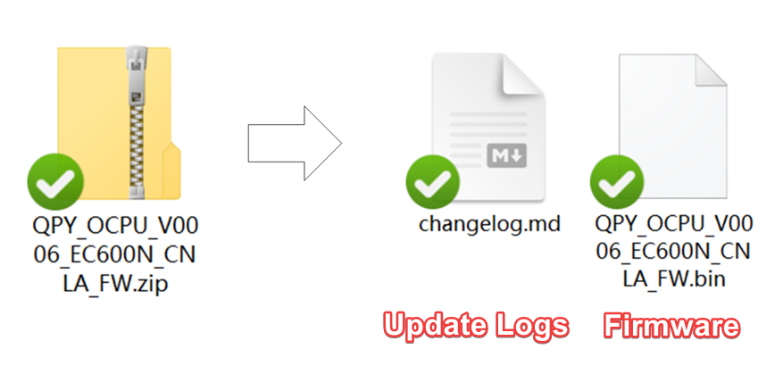

> 请务必将压缩包内容解压至一个**不包含中文、空格和其他特殊字符**的路径下，否则下载工具可能无法正常识别到固件，同时下载工具路径也**不可包含中文、空格和其他特殊字符**。

**固件烧录**

- <font color='red'>**Step1：创建项目**</font>

首先确保模组连接正常并已开机，打开QPYcom工具进入下载页面，点击**"创建"**项目，新建要下载的固件项目，项目名称自定义，配置完成后持久化保存

- <font color='red'>**Step2：选择固件**</font>

选择要下载到模组的固件(根据要下载的模组型号选择对应的固件，若为新格式固件则所有模组型号都选择.bin文件即可）

如果是老版本固件，固件文件格式不一定以bin结尾，其中EC200A系列选择解压后的文件夹内blf文件结尾的文件，EC200U系列模组选择解压后的pac文件

- <font color='red'>**Step3：设置下载模式**</font>

单击**“Download script”**右侧的下拉选择箭头，选择**"Download FW"**

- <font color='red'>**Step4：开始烧录固件**</font>

点击**"Download FW"**后，开始下载固件,下载过程会有进度条和进度百分比显示，等待下载完毕会有弹窗提示下载成功


### REPL调试

REPL全称为<font color='red'>**Read-Eval-Print-Loop (交互式解释器)**</font>，可以在REPL中进行QuecPython程序的调试

运行 **QPYcom** 工具后，选择正确的串口（波特率无需指定）并打开，即可开始 Python 命令行交互。

- <font color='red'>**Step1：进入交互页面**</font>

打开QPYcom工具，端口选择连接**Quectel USB REPL Port**，选择“交互”界面

- <font color='red'>**Step2：打开串口**</font>

点击“打开串口”按钮，在交互界面输入**print(‘hello world’)**，按回车后可以看到执行的结果信息

```python
>>> print('hello world')
hello world
```

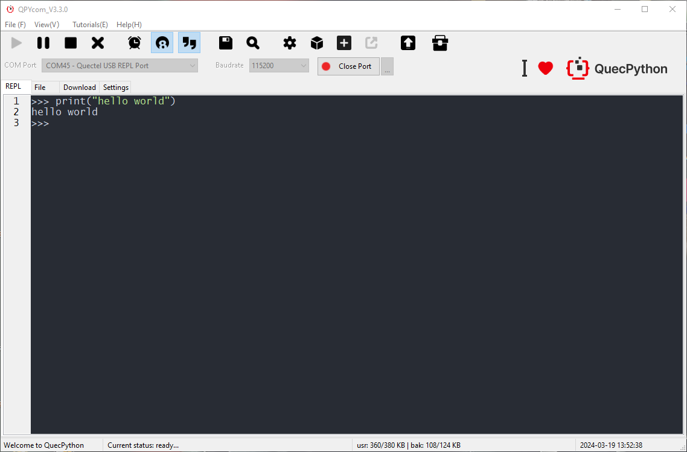

<font color='red'>*注意：工具交互页面输入时需要输入英文字符，中文字符将会被屏蔽*</font>

## 开发第一个脚本

### 编写第一个脚本文件

创建*helloworld.py*文件输出“hello world”，打印“hello world”，编写脚本如下所示：

```python
print("hello world")
```

通过QPYcom将上面编辑好的文件下载到模组中去并运行

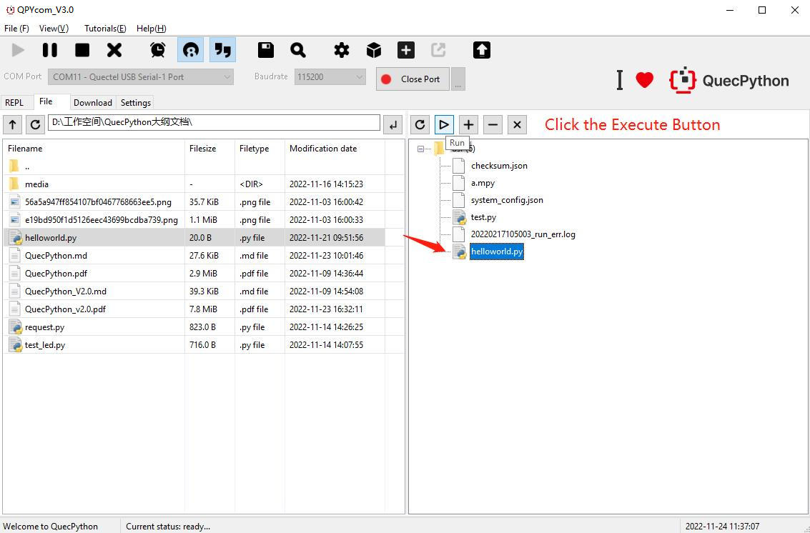

### PC与模组间的文件传输

**下载方法一:**


- <font color='red'>**Step1：打开串口**</font>

首先选择模组的交互口,点击"打开串口"按钮

- <font color='red'>**Step2：通过工具按钮下载**</font>

可以通过文件页面右侧上面的 "**+**","**-**" 按钮来上传和删除文件

- <font color='red'>**Step3：通过拖拽形式下载**</font>

也可以通过拖拽的方式将文件页面左侧显示的本地文件直接拖拽到右侧模组中去（也可以拖拽文件夹）

- <font color='red'>**Step4：下载进度和结果**</font>

下载过程中会在状态栏显示下载文件名和下载进度

**下载方法二:**


- <font color='red'>**Step1：创建项目**</font>

根据需求，创建用户项目（点击"创建"按钮）,步骤同上文烧录固件

- <font color='red'>**Step2：配置要下载的文件**</font>

选择需要下载到模块的用户脚本(在"用户脚本"区域通过右键菜单添加)

- <font color='red'>**Step3：设置下载模式**</font>

左击下拉选择箭头，选择"下载脚本"，即"Download Script"

- <font color='red'>**Step4：开始下载脚本**</font>

点击"下载脚本"开始下载脚本，下载过程中有进度条提示

### 运行脚本文件

- <font color='red'>**Step1：下载脚本**</font>

将要执行的脚本文件下载到模组中去,具体步骤参考上文

- <font color='red'>**Step2：通过repl执行脚本**</font>

打开串口之后，在QPYcom交互页面输入以下代码执行脚本文件

```python
import example
example.exec("/usr/helloworld.py") # filePath为要执行的脚本文件路径
```

- <font color='red'>**Step3：通过GUI工具执行脚本**</font>

或者通过QPYcom文件页面 **执行** 按钮执行脚本文件,在工具的文件页面选择要执行的脚本文件然后点击 "**▷**"按钮

执行结果如图

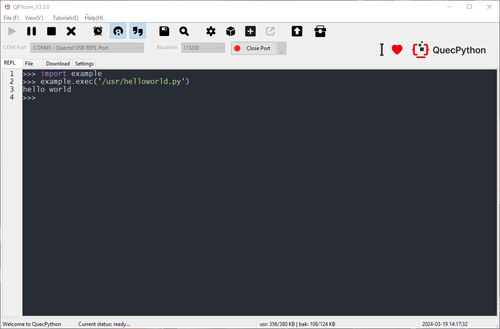

### 停止程序运行

如何停止正在运行的程序,根据运行的脚本文件类型有以下方法:

<table valign="center">
	<thead>
    <tr>
		<th>程序名是否</br>为main.py</th>
		<th>程序中是否</br>包含了死循环</th>
		<th>程序中是否</br>使用了多线程</th>
		<th valign="middle">停止步骤</th>
	</tr>
	 </thead>
    <tr>
		<td rowspan="4">✓</td>
		<td rowspan="2">✓</td>
		<td rowspan="1">✓</td>
		<td>（1）按 Ctrl + A 键进入 RAW 模式</br>（2）按 Ctrl + D 键重启 QuecPython 虚拟机</br>（3）按 Ctrl + B 键回到普通交互模式</br>（4）若以上方法无效，请重新烧录固件</td>
	</tr>
	<tr>
		<td rowspan="1">✗</td>
		<td>（1）按 Ctrl + C 键打断程序运行</br>（2）若以上方法无效，请重新烧录固件</td>
	</tr>
	<tr>
		<td rowspan="2">✗</td>
		<td rowspan="1">✓</td>
		<td>（1）按 Ctrl + A 键进入 RAW 模式</br>（2）按 Ctrl + D 键重启 QuecPython 虚拟机</br>（3）按 Ctrl + B 键回到普通交互模式</br>（4）若以上方法无效，请耐心等待程序运行结束</td>
	</tr>
	<tr>
		<td rowspan="1">✗</td>
		<td>（1）按 Ctrl + C 键打断程序运行</br>（2）若以上方法无效，请重新烧录固件</td>
	</tr>
	<tr>
		<td rowspan="4">✗</td>
		<td rowspan="2">✓</td>
		<td rowspan="1">✓</td>
		<td>（1）按 Ctrl + D 键重启 QuecPython 虚拟机</br>（2）若以上方法无效，请直接重启模块</td>
	</tr>
	<tr>
		<td rowspan="1">✗</td>
		<td>（1）按 Ctrl + D 键重启 QuecPython 虚拟机</br>（2）若以上方法无效，请直接重启模块</td>
	</tr>
	<tr>
		<td rowspan="2">✗</td>
		<td rowspan="1">✓</td>
		<td>（1）按 Ctrl + C 键打断程序运行</br>（2）若以上方法无效，请重新烧录固件或直接重启模块</td>
	</tr>
	<tr>
		<td rowspan="1">✗</td>
		<td>（1）按 Ctrl + C 键打断程序运行</br>（2）若以上方法无效，请重新烧录固件或直接重启模块</td>
	</tr>
</table>


## 低功耗测试指导

EC200X模组支持多种工作模式，每种模式的功耗各不相同，常见的工作模式有以下几种：

**ACTIVE**：模组进行LTE数传、GSM通话或RTOS在运行逻辑时的状态，功耗受到具体业务和网络通信制式的影响，CPU本身功耗和网络射频功率都有所不同，故实际功耗在不同工况下会有较大差异。

**IDLE**：此时模组处于空闲状态，硬件正常在电，RTOS保持运行，但没有任何线程需要被执行。有业务启动或网络业务呼入时，会立即恢复运行。ECX00U系列模组会在IDLE模式下降低时钟频率，进入轻睡眠状态（关闭高速时钟，但CPU不休眠的状态）。

**休眠**：休眠模式的前提是模组处于空闲状态且使能autosleep，进入休眠模式后，RTOS暂停运行，模组的时钟频率会变慢，部分外设控制器（UART、SPI等）下电，同时只保留部分中断控制器，达到减小功耗的目的。

**PSM**：PSM模式是3GPP协议所规定的一种低功耗模式，这种模式下，模组只会周期性的唤醒并执行业务，其余时间都处于PSM休眠中。PSM休眠时，模组行为和功耗都近似于关机。

**关机**：模组完全下电的状态，此时BB芯片和外设控制器完全关闭，但PMIC仍是在电的。一般可由Powerkey或者RTC闹钟唤醒。

| 模组型号             | EC200U   |
| :------------------- | :------- |
| IDLE（LTE FDD@64ms） | 12.34 mA |
| SLEEP (LTE FDD@64ms) | 2.05 mA  |
| SLEEP (CFUN0)        | 1.29 mA  |
| 关机                 | 40 μA    |

### 测试准备

- <font color='red'>**Step1：硬件准备**</font>

  开始之前需要准备以下配件

  1. **开发板**
  2. **USB 数据线** (USB-A TO USB-TypeC)
  3. **PC** (Windows10)
  4. **SIM 卡**
  5. **4G 天线**
  6. **Power Monitor Mini**（功耗仪）

- <font color='red'>**Step2：天线&SIM卡安装**</font>

安装开发板配套的天线,安装位置为 LTE 天线座位置,并将 SIM 卡插入开发板上的 SIM 卡座。

- <font color='red'>**Step3：开发板连接**</font>

使用 USB Type-C 数据线连接开发板的 Type-C 接口和电脑 USB 口，功耗仪正极连接MODULE_EN的Vbat，功耗仪负极连接模组GND即可。具体连接如图：

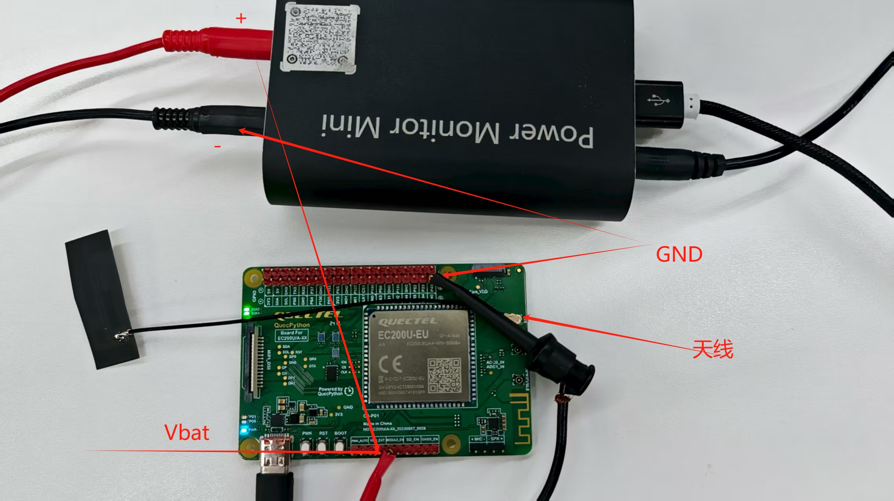

> 注意！！！
>
> 测量功耗时需要拔出所有跳线帽，以免测量结果受其他外界因素影响

### 测量功耗

#### 关机耗流

使用 USB Type-C 数据线连接开发板的 Type-C 接口和电脑 USB 口，待测设备硬件连接完毕后，断开USB_VBus，不进行开机，即可直接测量关机电流。此时，模组不工作，对外的输出引脚也全部拉低或悬空，整体平均耗流保持相对稳定，基本都在uA级。

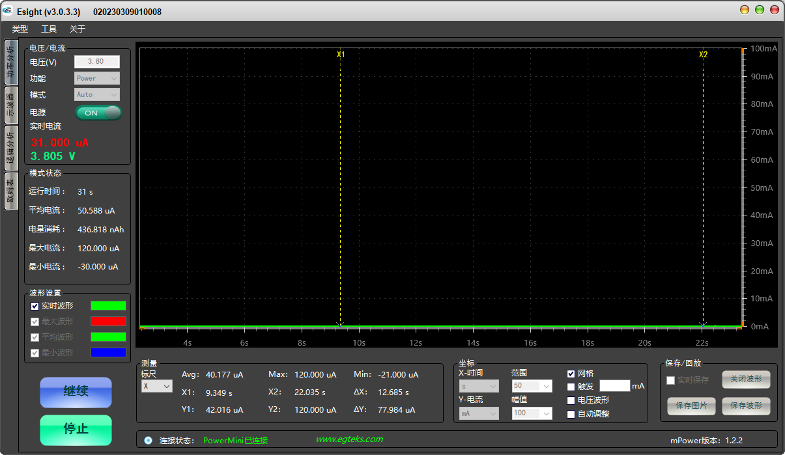

#### 空闲耗流

完成关机电流测量后，长按powerkey开机，模组开机默认的功耗模式是IDLE（即空闲模式）。此时模组处于空闲状态，硬件正常在电，但没有任何线程需要被执行。有业务启动或网络业务呼入时，会立即恢复运行。

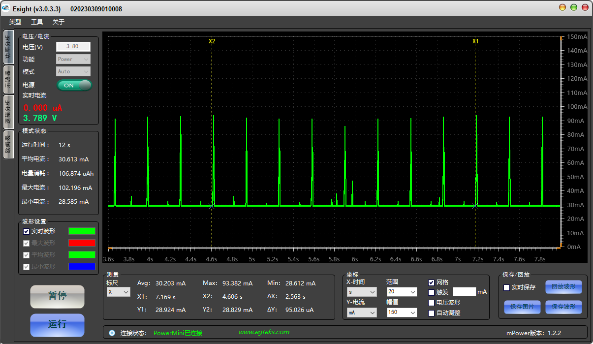

#### 休眠耗流

模组处于空闲状态时，若autosleep被使能，则模组会进入休眠状态。此时，模组会关闭部分IP核（如外设控制器和中断控制器等）并且降低时钟频率，从而实现功耗的降低。

完成空闲耗流测量后，打开USB_VBus，电脑端打开[QPYcom工具](https://developer.quectel.com/wp-content/uploads/2024/09/QPYcom_V3.8.0.zip)，导入`pm`模块，调用`autosleep`方法打开模组的自动休眠，在没有任务执行时，模组会自动进入休眠状态，调用方法后记得断开USB_VBus(USB开关拨至off)，否则模组不会进入休眠状态。[API参考](https://developer.quectel.com/doc/quecpython/API_reference/zh/syslib/pm.html#%3Ccode%3Epm.autosleep%3C/code%3E)。关于休眠耗流的详细介绍[参考](https://developer.quectel.com/doc/quecpython/Application_guide/zh/system/power-consumption.html)。

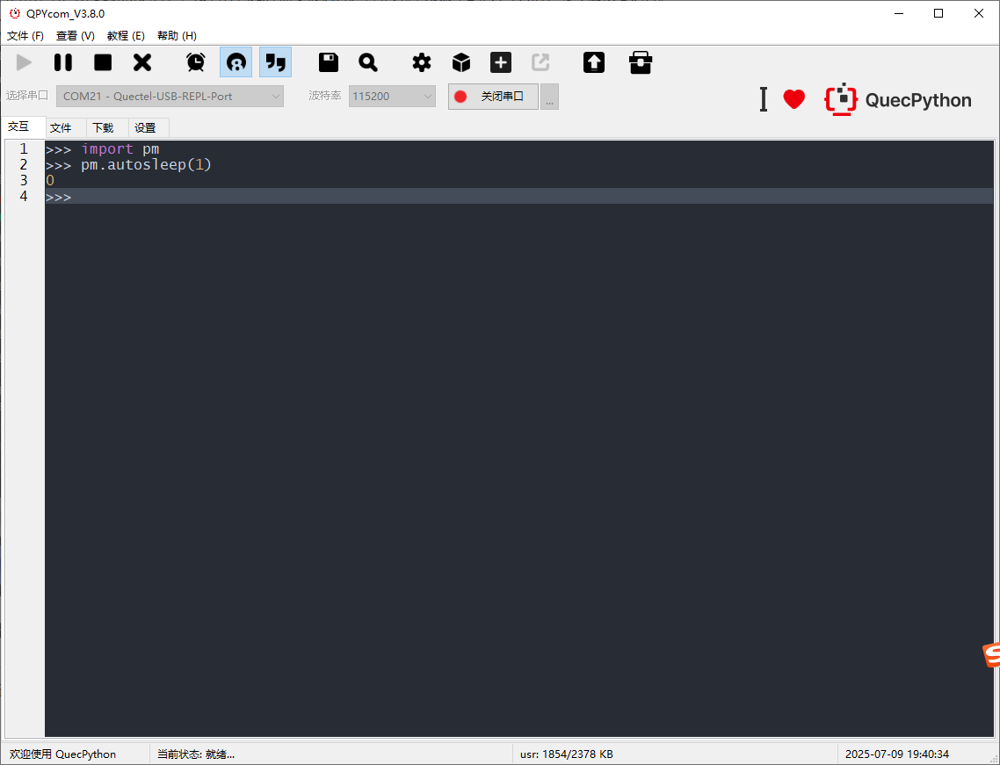

进入休眠模式后，模组应有的耗流波形会有周期稳定的凸起，如下图：	

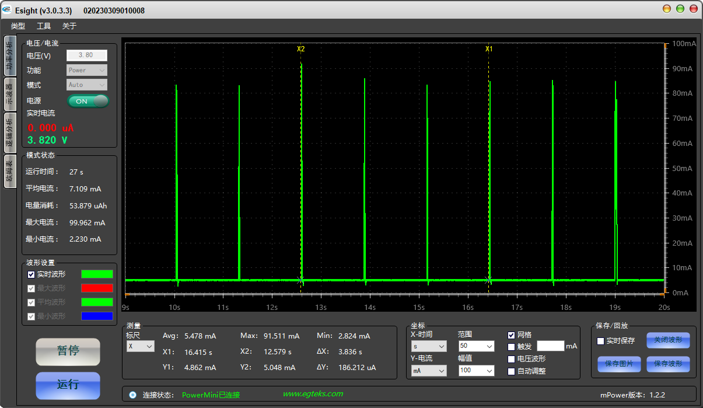

> 注意：
>
> 更多耗流测试指导请[参考这里](https://developer.quectel.com/doc/quecpython/Application_guide/zh/system/power-consumption.html)。
