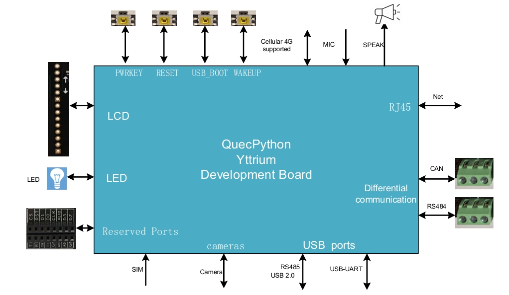
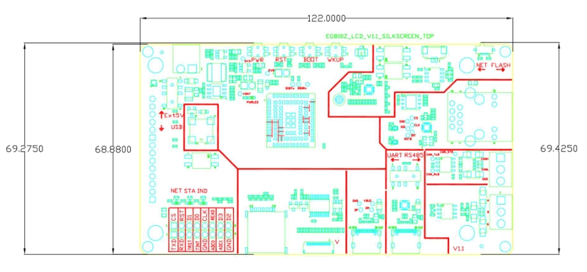
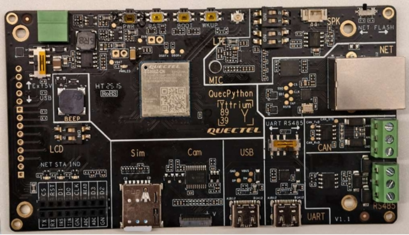
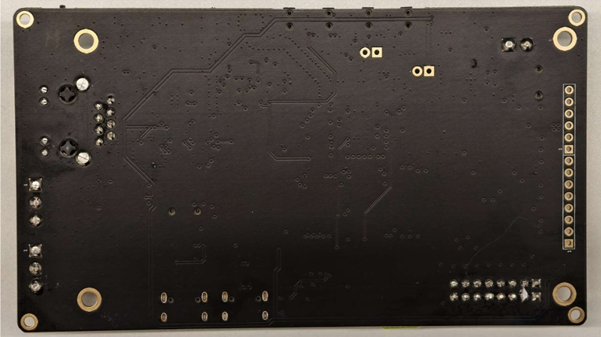
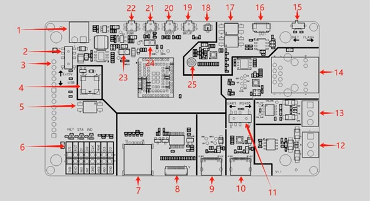
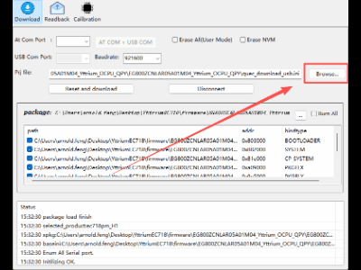
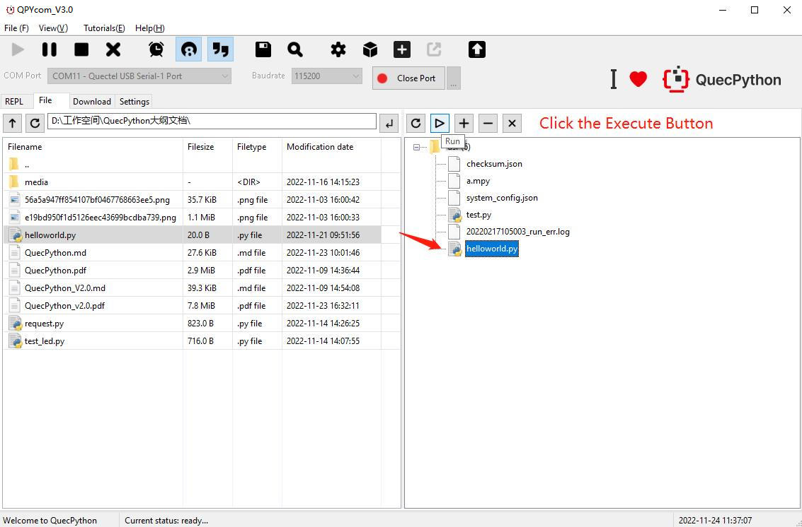
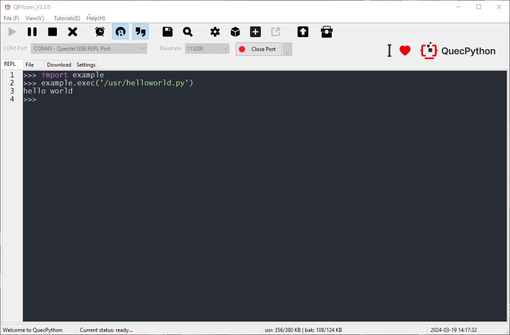

# QuecPython_Yttrium 开发板介绍

## 支持的模块列表

- [EG800Z-CN](https://developer.quectel.com/modules-cat/eg800z-series)

## 功能列表

### 基本概述

QuecPython_Yttrium 开发板是专为开发调试和方案演示场景设计的 Python 生态开发板，主模块搭载 EG800Z LTE 无线通信模块。

开发板板载双 USB Type-C 接口，支持便捷供电与串口调试，同时配备外部电源端子供电方案，可灵活适配不同开发场景；

集成 LCD 显示、摄像头采集、音频输入输出、蜂窝网络、百兆以太网、工业级 CAN/RS485 总线等丰富接口，可全面覆盖物联网开发、工业通信、多媒体交互等多种场景的开发需求。

### 功能说明

开发板的主要组件、接口布局见下图



开发板俯视尺寸图



开发板俯视图和底视图





## 资料下载

- [QuecPython_Yttrium产品规格书](https://developer.quectel.com/wp-content/uploads/2026/04/Quectel_QuecPython_Yttrium%E5%BC%80%E5%8F%91%E6%9D%BF_%E4%BA%A7%E5%93%81%E8%A7%84%E6%A0%BC%E4%B9%A6_V1.0.1_Preliminary_20260401-.pdf)

## 开发板资源

### 基本信息表

| 项目         | 说明                                         |
| ------------ | -------------------------------------------- |
| 封装         | PCBA                                         |
| 尺寸（mm）   | (122.0 ± 0.2) × (68.9 ± 0.2) × (1.6 ± 0.1)   |
| 重量（g）    | 49.2 ± 0.2                                   |
| 正常工作温度 | -10 ~ +50 °C                                 |
| 存储温度     | -20 ~ +60 °C                                 |
| 供电要求     | USB Type-C 5V ± 5% / 3.81mm 接线端子 5V ± 5% |
| 固件升级     | USB / OTA                                    |

### 开发板接口



开发板接口分配表明细如下：

| 序号              | 接口名                | 描述                                                         |
| ----------------- | --------------------- | ------------------------------------------------------------ |
| **预留端口**      |                       |                                                              |
| 6 (J0702)         | 1 × 8Pins             | MAIN_TXD, MAIN_RXD, LCD, CTP_INT, GND, ADC 信号              |
| 6 (J0703)         | 1 × 8Pins             | QSPI_D3, QSPI_D2, LCD 信号                                   |
| **按键与开关**    |                       |                                                              |
| 2                 | S0301                 | 通过该开关决定整板的供电方式是外部直流电源 5V 供电还是 USB Type-C 5V 供电；向上拨动使用外部直流电源供电；向下拨动使用 USB Type-C 供电 |
| 5                 | S0705                 | 通过拨码开关对 LED_PWM4 还是 GPIO2 进行复用。S0705 的 2-4 导通，S0502 的 1-3 断开，LED_PWM4 作为 IND_LED 的控制；S0705 的 2-4 断开，S0502 的 1-3 导通，LED_PWM4 作为 PWM4 音频输出；S0705 的 1-3 导通，GPIO2 作为蜂鸣器 BEEP 的控制 |
| 11                | S0401                 | 通过该开关决定整板的主 UART 连接 USB TypeC UART 还是 RS485；向左拨动连接到 USB TypeC UART；向右拨动连接到 RS485 |
| 15                | S0601                 | 通过该拨动开关决定 SPI0 连接 NET 还是 FLASH                  |
| 17                | S0501 / S0502         | S0501 开关拨码导通，S0502 断开，模块的 PCM 引脚通过 Codec 芯片至功放和扬声器；S0501 开关拨码断开，S0502 导通，模块的 PWM4 引脚通过滤波电路至功放和扬声器 |
| 19                | WAKEUP                | 按键按下唤醒模块                                             |
| 20                | USB_BOOT              | 开机前按下进入强制下载模式                                   |
| 21                | RESET                 | 按键按下模块重启                                             |
| 22                | PWRKEY                | 按键按下模块开机                                             |
| **通信接口**      |                       |                                                              |
| 12                | RS485                 | RS485 连接器，RS485_A, RS485_B, GND；半双工                  |
| 13                | CAN                   | CAN 连接器，CAN_H, CAN_L, GND；1Mbps 速率                    |
| 14                | 以太网                | 1 × RJ45 连接器，支持 10/100Mbps 通信速率的以太网，有 Link 指示 LED，有 Action 指示 LED |
| **摄像头**        |                       |                                                              |
| 8 (J0501)         | 1 × 18Pins            | CAM 信号连接器，支持 30W 像素，SPI 接口摄像头                |
| **蜂鸣器**        |                       |                                                              |
| 4                 | BEEP                  | 蜂鸣器，S0705 的 1-3 导通，GPIO2 作为蜂鸣器 BEEP 的控制      |
| **LCD（显示屏）** |                       |                                                              |
| 3                 | 1 × 14Pins            | LCD 屏幕分辨率 320×480；屏幕尺寸 4.0inch；电容触摸屏；显示屏接口是 4-Line SPI，驱动芯片 ICST7796S；触摸屏接口是 I2C，驱动芯片 FT6336U |
| **音频接口**      |                       |                                                              |
| 16                | SPEAK                 | 音频接口，支持音频输出，外接喇叭                             |
| 25                | MIC                   | 麦克风，板载 SOM4013SL-G423L                                 |
| **USB 端口**      |                       |                                                              |
| 9                 | USB Type-C            | 1 路 USB 2.0 Type-C 接口，最高数据传输速率可达 480Mbps，可作为供电接口 |
| 10                | USB Type-C 转 UART    | 1 路 USB 2.0 Type-C 接口，最高数据传输速率可达 12Mbps，通过 XR21B1411IL16 芯片转化为 TTL 电平，连接模块的 UART |
| **LTE 模块接口**  |                       |                                                              |
| 7                 | SIM 卡座              | MUP-C7081-2 卡座，支持 Nano SIM 卡，1.8V/3.0V                |
| 18                | 天线座                | 支持外置 LTE 天线                                            |
| **供电和开机**    |                       |                                                              |
| 1                 | 外部电源供电          | 3.81mm 规格的接线端子，5V ± 5% 供电                          |
| 23 (J0203)        | VBAT 和 VBAT12 测试点 | 拆除该测试点上方电阻 R0204，将电流表串在该测试点可以测得模块通过的电流 |
| 24                | PWRKEY 和 GND 测试点  | 上电前短接两个测试点，设备上电后自动开机                     |

#### 预留端口引脚分配表

##### J0702 8Pin 排针引脚分配表

|    排针    | 编号 | 信号名称 |      功能描述      |
| :--------: | :--: | :------: | :----------------: |
| J0702 8Pin |  1   | MAIN_TXD |   主串口发送信号   |
| J0702 8Pin |  2   | MAIN_RXD |   主串口接收信号   |
| J0702 8Pin |  3   | LCD_SIG  |   LCD 屏相关信号   |
| J0702 8Pin |  4   | CTP_INT  | 电容触摸屏中断信号 |
| J0702 8Pin |  5   |   GND    |        接地        |
| J0702 8Pin |  6   |   ADC0   |  模数转换接口信号  |
| J0702 8Pin |  7   |   ADC1   |  模数转换接口信号  |
| J0702 8Pin |  8   |   GND    |        接地        |

##### J0703 8Pin 排针引脚分配表

|    排针    | 编号 | 信号名称 |       功能描述       |
| :--------: | :--: | :------: | :------------------: |
| J0703 8Pin |  1   |    CS    |     SPI片选信号      |
| J0703 8Pin |  2   |   RST    |     SPI复位引脚      |
| J0703 8Pin |  3   | QSPI_D1  | QSPI 总线数据 1 信号 |
| J0703 8Pin |  4   | QSPI_D0  | QSPI 总线数据 0 信号 |
| J0703 8Pin |  5   |   CLK    |    LCD 屏时钟信号    |
| J0703 8Pin |  6   |   READ   |         接地         |
| J0703 8Pin |  7   | QSPI_D3  | QSPI 总线数据 3 信号 |
| J0703 8Pin |  8   | QSPI_D2  | QSPI 总线数据 2 信号 |

### 关键特性

| 类别               | 说明                                                         |
| ------------------ | ------------------------------------------------------------ |
| USB 接口           | 1 × USB 2.0 接口，最高数据传输速率可达 480Mbps；1 × USB Type-C 连接器，可作为供电接口 |
| UART               | 1 × USB 2.0 接口，最高数据传输速率可达 12Mbps；1 × USB Type-C 接口，可作为供电接口；通过 XR21B1411 芯片转化为 UART 接口，连接模块的主 UART |
| RS485              | 通过一个双刀双掷开关和 RS485 收发器（SIT3088E）实现模块的主 UART 转化为 RS485 |
| LCD 接口           | LCD 屏幕分辨率 320×480；屏幕尺寸 4.0inch；电容触摸屏；显示屏接口是 4-Line SPI，驱动芯片 ICST7796S；触摸屏接口是 I2C，驱动芯片 FT6336U |
| 音频接口 - Speaker | 1 × CS8126，2W，D 类音频功放芯片，支持音频输出               |
| 音频接口 - MIC     | 1 × SOM4013SL-G423L 板载麦克风，支持音频输入                 |
| 音频接口 - Codec   | 1 × ES8311 Codec 芯片，通过 PCM 和 I2C 接口与模块连接实现音频功能 |
| 兼容音频输出       | 兼容设计了 1 路 PWM 信号和滤波电路，用于验证 PWM 的音频输出功能 |
| 摄像头             | 1 × 16pin FPC 座；摄像头接口是 SPI，驱动芯片 GC032A；摄像头分辨率 30W |
| CAN                | 内部集成 CAN 控制器，通过 CAN 收发器芯片 SIT65HVD230，符合 ISO 11898 标准；允许一条总线上连接多达 120 个节点；最大传输速率 1Mbps |
| 以太网             | 1 × RJ45 连接器，支持 10/100Mbps 通信速率的以太网；有 Link 指示 LED，有 Action 指示 LED |
| SIM 卡             | 1 × MUP-C7081-2 卡座，支持 Nano SIM 卡；支持 1.8V 和 3V 两种电压 |
| 预留排座           | 预留 2×8Pin 排座；引出了 ADC 接口，主串口，Q-SPI 接口        |
| 按键               | 1 × PWRKEY 开机功能按键；1 × RESET 复位功能按键；1 × BOOT 强制下载功能按键；1 × WAKEUP 唤醒功能按键 |
| LED 指示灯         | 模块供电指示灯 PWRLED，红色；模块运行指示灯 INDLED（自定义功能），绿色 |
| 蜂鸣器             | 1 × Beep 蜂鸣器                                              |
| 固件升级           | USB / OTA                                                    |

#### 板载按键与指示灯

开发板板载 4 颗功能性按键与 2 颗状态指示灯，分别如下：

- **PWRKEY**：开机功能按键，长按可实现模块开机
- **RESET**：复位功能按键，按下可触发模块重启
- **BOOT**：强制下载功能按键，开机前按下可进入固件强制下载模式
- **WAKEUP**：唤醒功能按键，按下可唤醒模块
- **PWRLED**：红色模块供电指示灯，模块正常供电时常亮
- **INDLED**：绿色模块运行指示灯，支持自定义功能，可用于运行状态指示

## 快速入门

### 硬件准备

以下是开发板上手之后的硬件准备步骤

- <font color='red'>**Step1：硬件准备**</font>

  开始之前需要准备以下配件

  1. **开发板**
  2. **USB 数据线** (USB-A TO USB-TypeC)
  3. **PC** (Windows10)
  4. **SIM 卡**
  5. **4G 天线**

- <font color='red'>**Step2：天线&SIM卡安装**</font>

安装开发板配套的天线,安装位置为 MAIN 天线座位置,并将 SIM 卡插入开发板上的 SIM 卡座。

- <font color='red'>**Step3：开发板连接**</font>

使用 USB Type-C 数据线连接开发板的 Type-C/Micro USB 接口和电脑 USB 口即可完成供电。

> 开发板PWR灯常亮即为正常供电。

- <font color='red'>**Step4: 开发板开机**</font>

长按PWRKEY开机，在按下PWRKEY按键之前，需保证供电电压稳定。建议从上电到按下PWRKEY按键之间的时间间隔不少于30 ms。如果需上电自动开机且不需要关机功能，则可以把10-Pin排针中PWK_AUTO丝印对应的两个引脚短接。

如果上一步短接PWK_ON则无需长按PWK自动开机，开机后开发板NET灯闪烁，开发板已正常开机。

### 驱动安装

- 打开[QuecPython官网驱动下载链接](https://developer.quectel.com/resource-download?cid=5)

- 选择与模组型号匹配的驱动，该开发板搭载的模组为EG800Z，在下载页面右侧选择该型号的USB驱动[QuecPython_USB_Driver_Win10_E_Z](https://www.quectel.com.cn/wp-content/uploads/2026/03/Quectel_Windows_USB_DriverY_V1.0.2.zip)点击下载，如果开发板搭载的是其他型号同样按照以上操作即可。

- 下载后解压驱动压缩包，找到**"setup.exe"** 或者是**"setup.bat"**，双击运行即可，安装完之后打开设备管理器就可以看到设备管理器中端口的黄色感叹号消失了，说明安装成功，能够正常通信。

>  出现 <font color='red'>Mobile ECM Network Adapter </font>或 <font color='red'>CDC Ethernet Control Modle (ECM) </font>等设备未被识别属于正常现象，不影响固件烧录和后续开发，无需理会。

- 右键打开【**我的电脑**】——选择【**管理**】——选择【**设备管理器**】,然后在设备管理器中选择 【**端口**】，按照步骤打开页面后如图所示能刷新出**Quectel USB** 名称开头的串口则USB驱动安装成功。


### 工具安装

- QPYcom获取

使用QuecPython进行开发需要用到专用的开发调试工具——**QPYcom**，包括但不限于调试代码、分析日志、文件传输等。

打开[QuecPython工具下载页面](https://developer.quectel.com/resource-download?cid=8)，根据操作系统选择对应的工具进行下载。

*注意:该工具无需安装，解压即用。*

- FlashTools获取

该开发板需要使用[FlashTools](https://raw.githubusercontent.com/ArnoldFeng767/yttrium-board-tutorial/refs/heads/main/tools/FlashTools_V4.1.19_2509010.zip)进行固件烧录。

- VSCode插件

编辑Python代码一般会用到专用于Python或者兼容多种语言的IDE，可以有效提升开发效率，这里推荐VSCode

针对VScode，QuecPython推出专用插件实现代码提示、代码补全和串口调试等功能，安装方法见下图

在VSCode中点击侧边栏插件市场，在插件市场中搜索 “QuecPython”，根据搜索结果下载该插件即可


### 固件烧录

**固件获取**

模组在出厂时通常烧录有标准 AT 固件或 QuecOpen 固件，如需基于 QuecPython 对模块进行开发，需要手动为其重新烧录专门的 QuecPython 固件。

[官网固件下载地址](https://developer.quectel.com/resource-download?cid=15)


面对官网种类众多的固件，如何选择合适的固件包，首先需要知道使用的模组的型号，模组型号可以通过模组的镭雕或者发送AT指令来获得。

在获取到模组型号之后根据模组的型号去官网下载该模组对应的固件即可,固件的名称一般为`QPY_OCPU_版本号_模组型号_FW`，没有特殊需求默认下载最新版本即可。

点击下载列的下载按钮即可下载，下载成功后会得到一个固件名称命名的压缩包文件(zip包)

从官网下载的固件包为压缩包格式，固件压缩包下载到本地后，需进行解压。解压后可获得许多文件，其中 quec_dowload_usb.ini 就是我们烧录固件所需的文件。

> 请务必将压缩包内容解压至一个**不包含中文、空格和其他特殊字符**的路径下，否则下载工具可能无法正常识别到固件，同时下载工具路径也**不可包含中文、空格和其他特殊字符**。

**固件烧录**

- <font color='red'>**Step1：选择固件**</font>

首先确保模组连接正常并已开机，打开解压后的FlashTools.exe工具进入下载页面，点击**"Browse..."**选择解压后的quec_download_usb.ini固件

- <font color='red'>**Step2：进入烧录模式**</font>

选中端口号后，将右侧 **Erase All (User Mode)** 和 **Erase NVM** 两个选项打钩，波特率选择 **921600**

- <font color='red'>**Step3：开始烧录**</font>

**FlashTools** 工具识别到 **COM** 端口后，点击 **Reset and download** 按钮：

- <font color='red'>**Step4：完成烧录**</font>

等待进度条走完，提示烧录成功，烧录完成后，按 RESET 键或重新上电，设备将以新固件启动。



### REPL调试

REPL全称为<font color='red'>**Read-Eval-Print-Loop (交互式解释器)**</font>，可以在REPL中进行QuecPython程序的调试

运行 **QPYcom** 工具后，选择正确的串口（波特率无需指定）并打开，即可开始 Python 命令行交互。

- <font color='red'>**Step1：进入交互页面**</font>

打开QPYcom工具，端口选择连接**Quectel USB REPL Port**，选择“交互”界面

- <font color='red'>**Step2：打开串口**</font>

点击“打开串口”按钮，在交互界面输入**print(‘hello world’)**，按回车后可以看到执行的结果信息

```python
>>> print('hello world')
hello world
```


<font color='red'>*注意：工具交互页面输入时需要输入英文字符，中文字符将会被屏蔽*</font>

## 开发第一个脚本

### 编写第一个脚本文件

创建*helloworld.py*文件输出“hello world”，打印“hello world”，编写脚本如下所示：

```python
print("hello world")
```

通过QPYcom将上面编辑好的文件下载到模组中去并运行



### PC与模组间的文件传输

**下载方法一:**


- <font color='red'>**Step1：打开串口**</font>

首先选择模组的交互口,点击"打开串口"按钮

- <font color='red'>**Step2：通过工具按钮下载**</font>

可以通过文件页面右侧上面的 "**+**","**-**" 按钮来上传和删除文件

- <font color='red'>**Step3：通过拖拽形式下载**</font>

也可以通过拖拽的方式将文件页面左侧显示的本地文件直接拖拽到右侧模组中去（也可以拖拽文件夹）

- <font color='red'>**Step4：下载进度和结果**</font>

下载过程中会在状态栏显示下载文件名和下载进度

**下载方法二:**


- <font color='red'>**Step1：创建项目**</font>

根据需求，创建用户项目（点击"创建"按钮）,步骤同上文烧录固件

- <font color='red'>**Step2：配置要下载的文件**</font>

选择需要下载到模块的用户脚本(在"用户脚本"区域通过右键菜单添加)

- <font color='red'>**Step3：设置下载模式**</font>

左击下拉选择箭头，选择"下载脚本"，即"Download Script"

- <font color='red'>**Step4：开始下载脚本**</font>

点击"下载脚本"开始下载脚本，下载过程中有进度条提示

### 运行脚本文件

- <font color='red'>**Step1：下载脚本**</font>

将要执行的脚本文件下载到模组中去,具体步骤参考上文

- <font color='red'>**Step2：通过repl执行脚本**</font>

打开串口之后，在QPYcom交互页面输入以下代码执行脚本文件

```python
import example
example.exec("/usr/helloworld.py") # filePath为要执行的脚本文件路径
```

- <font color='red'>**Step3：通过GUI工具执行脚本**</font>

或者通过QPYcom文件页面 **执行** 按钮执行脚本文件,在工具的文件页面选择要执行的脚本文件然后点击 "**▷**"按钮

执行结果如图



### 停止程序运行

如何停止正在运行的程序,根据运行的脚本文件类型有以下方法:

<table valign="center">
	<thead>
    <tr>
		<th>程序名是否</br>为main.py</th>
		<th>程序中是否</br>包含了死循环</th>
		<th>程序中是否</br>使用了多线程</th>
		<th valign="middle">停止步骤</th>
	</tr>
	 </thead>
    <tr>
		<td rowspan="4">✓</td>
		<td rowspan="2">✓</td>
		<td rowspan="1">✓</td>
		<td>（1）按 Ctrl + A 键进入 RAW 模式</br>（2）按 Ctrl + D 键重启 QuecPython 虚拟机</br>（3）按 Ctrl + B 键回到普通交互模式</br>（4）若以上方法无效，请重新烧录固件</td>
	</tr>
	<tr>
		<td rowspan="1">✗</td>
		<td>（1）按 Ctrl + C 键打断程序运行</br>（2）若以上方法无效，请重新烧录固件</td>
	</tr>
	<tr>
		<td rowspan="2">✗</td>
		<td rowspan="1">✓</td>
		<td>（1）按 Ctrl + A 键进入 RAW 模式</br>（2）按 Ctrl + D 键重启 QuecPython 虚拟机</br>（3）按 Ctrl + B 键回到普通交互模式</br>（4）若以上方法无效，请耐心等待程序运行结束</td>
	</tr>
	<tr>
		<td rowspan="1">✗</td>
		<td>（1）按 Ctrl + C 键打断程序运行</br>（2）若以上方法无效，请重新烧录固件</td>
	</tr>
	<tr>
		<td rowspan="4">✗</td>
		<td rowspan="2">✓</td>
		<td rowspan="1">✓</td>
		<td>（1）按 Ctrl + D 键重启 QuecPython 虚拟机</br>（2）若以上方法无效，请直接重启模块</td>
	</tr>
	<tr>
		<td rowspan="1">✗</td>
		<td>（1）按 Ctrl + D 键重启 QuecPython 虚拟机</br>（2）若以上方法无效，请直接重启模块</td>
	</tr>
	<tr>
		<td rowspan="2">✗</td>
		<td rowspan="1">✓</td>
		<td>（1）按 Ctrl + C 键打断程序运行</br>（2）若以上方法无效，请重新烧录固件或直接重启模块</td>
	</tr>
	<tr>
		<td rowspan="1">✗</td>
		<td>（1）按 Ctrl + C 键打断程序运行</br>（2）若以上方法无效，请重新烧录固件或直接重启模块</td>
	</tr>
</table>


