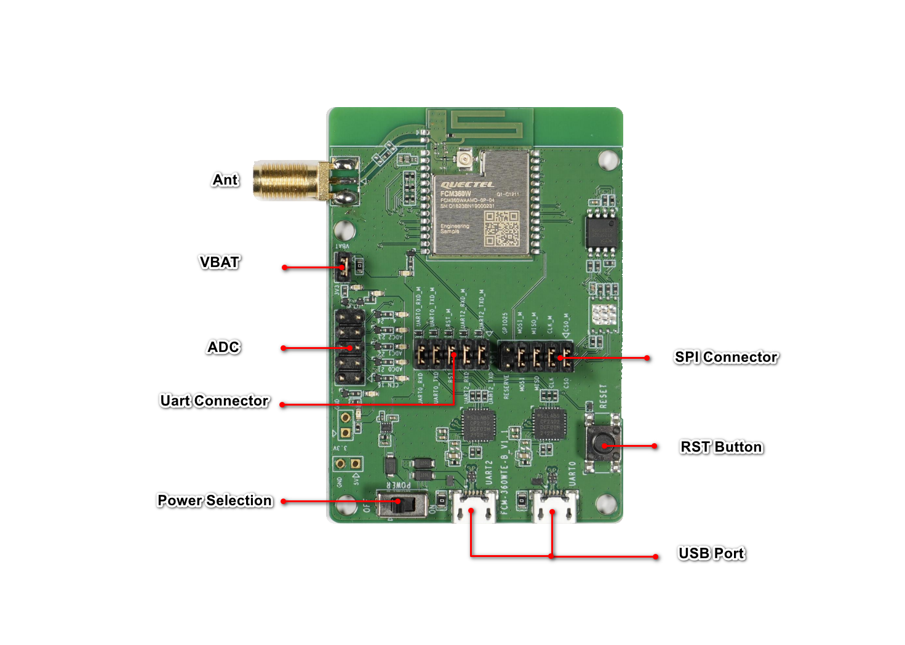
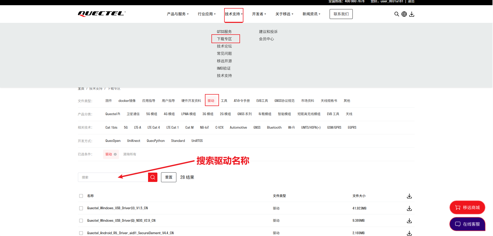
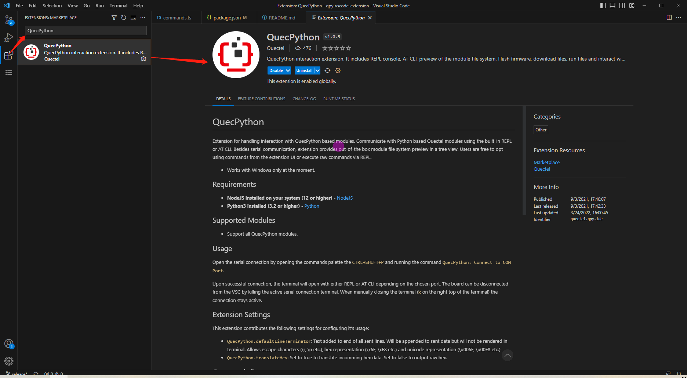
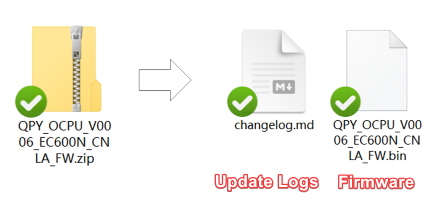
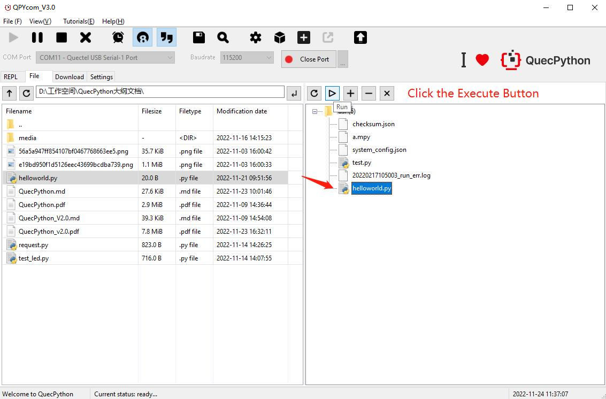
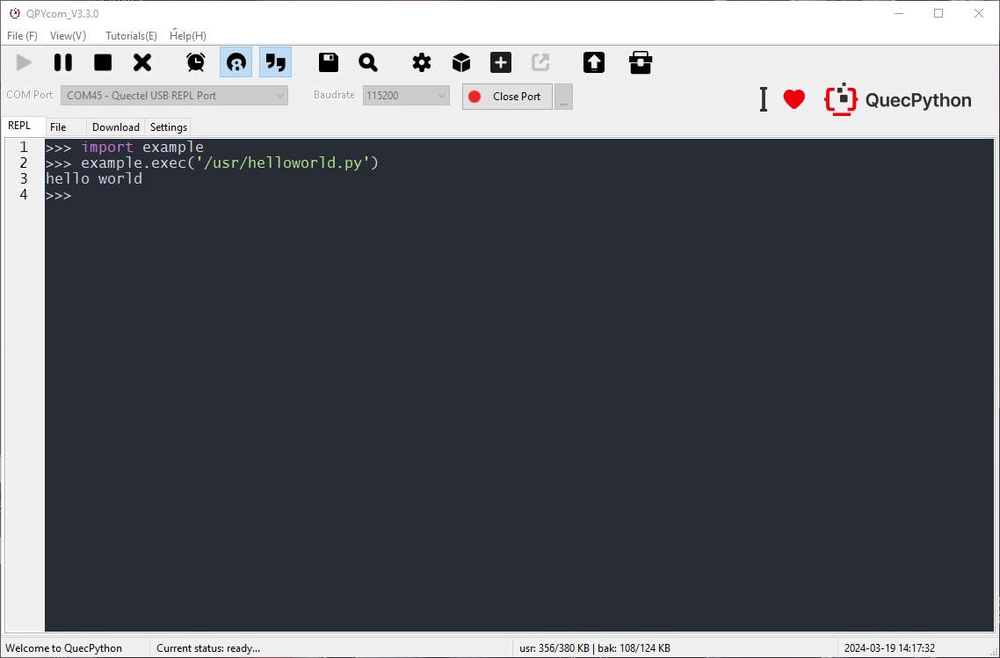

# FCM360W te-b开发板介绍

## 支持的模组列表

- [FCM360W](https://www.quectel.com.cn/product/wi-fi-bluetooth-fcm360w)


## 功能列表

### 基本概述

QuecPython_FCM360W_TE-B 开发板是一款Quectel推出的Wi-Fi 和蓝牙开发板。搭载FCM360W模组，支持 Wi-Fi 6 和蓝牙 5.1无线连接，提供包括 512 KB SRAM 和 4MB 闪存在内的超大内存。

开发板连接接口为两个micro-usb接口，并提供多种接口，包括 UART、SPI、I2C、ADC等，配套天线有外置引脚天线、PCB 天线等。

### 功能说明

开发板的主要组件、接口布局见下图



## 资料下载

- [FCM360X_EVB_SCH](https://developer.quectel.com/wp-content/uploads/2024/09/FCM360X-EVB-V1.0-SCH.pdf)
- [Quectel_FCM360W_硬件设计手册](https://developer.quectel.com/wp-content/uploads/2024/09/Quectel_FCM360W_硬件设计手册_V1.0.pdf)


## 开发板资源

### 开发板接口

开发板主要管脚布局见下表

| **排针**    | **名称**    | **引脚** | **功能**      |
| --------    | --------    | -------- | --------       |
| UART        | UART0_RXD   | 26       | UART0接收      |
| UART        | UART0_TXD   | 27       | UART0发送      |
| UART        | RST         | 11       | 模组复位       |
| UART        | UART2_RXD   | 19       | UART2接收      |
| UART        | UART2_TXD   | 20       | UART2发送      |
| UART        | UART0_RXD_M | 26       | UART0          |
| UART        | UART0_TXD_M | 27       | UART0          |
| UART        | RST_M       | 11       | 模组复位       |
| UART        | UART2_RXD_M | 19       | UART2          |
| UART        | UART2_TXD_M | 20       | UART2          |
| SPI         | RESERVE     | 17       | 预留           |
| SPI         | MOSI        | 29       | SPI主输出从输入|
| SPI         | MISO        | 23       | SPI主输入从输出|
| SPI         | CLK         | 22       | SPI时钟        |
| SPI         | CS0         | 21       | SPI片选        |
| SPI         | GPIO25      | 16       | GPIO25         |
| SPI         | MOSI_M      | 29       | SPI主输出从输入|
| SPI         | MISO_M      | 23       | SPI主输入从输出|
| SPI         | CLK_M       | 22       | SPI时钟        |
| SPI         | CS0_M       | 21       | SPI片选        |

- **名称中带_M的引脚为模组端直接引出来的脚**


> **小提示**
> 开发板的更多资料，请访问 <https://www.quectel.com.cn/download-zone>

### 开发板配置

外设资源管脚分配表明细如下：

| 序号 | 名称      | 型号   | 是否支持 | 接口类型 |
| ---- | --------- | ------ | -------- | -------- |
| 1    | USB转串口 | CP2102 | 是       | UART     |
| 2    | 按键      | -      | 是       | GPIO     |
| 2    | ANT       | -      | 是       | -        |


## 快速入门

### 硬件准备

以下是开发板上手之后的硬件准备步骤

- <font color='red'>**Step1：硬件准备**</font>

    开始之前需要准备以下配件

    1. **开发板**
    2. **micro usb 数据线**
    3. **PC** (Windows10)

- <font color='red'>**Step2：开发板连接**</font>

使用micro usb数据线将开发板上的UART2接口和电脑USB口连接即可完成供电，开发板的POWER开关切换到ON状态

- <font color='red'>**Step3: 开发板开机**</font>

上电后会自动开机


### 驱动安装

- 打开[QuecPython官网驱动下载链接](https://www.quectel.com.cn/download-zone)

- 选择与模组型号匹配的驱动，该开发板搭载的模组有FCM360W，以FCM360W为例，在下载页面右侧选择该型号的USB 转串口驱动[CH343SER](https://developer.quectel.com/wp-content/uploads/2024/09/CH343SER_V1.8.zip)点击下载，如果开发板搭载的是其他型号同样按照以上操作即可。

  

- 下载后解压驱动压缩包，找到**CH343SER.EXE**，双击运行即可，安装完之后打开设备管理器就可以看到设备管理器中端口的黄色感叹号消失了，说明安装成功，能够正常通信。

>  出现 <font color='red'>Mobile ECM Network Adapter </font>或 <font color='red'>CDC Ethernet Control Modle (ECM) </font>等设备未被识别属于正常现象，不影响固件烧录和后续开发，无需理会。


### 工具安装

- QPYcom获取

使用QuecPython进行开发需要用到专用的开发调试工具——**QPYcom**，包括但不限于调试代码、分析日志、文件传输、烧录固件、合并固件等。

打开[QuecPython工具下载页面](https://www.quectel.com.cn/download-zone)，根据操作系统选择对应的工具进行下载。

*注意:该工具无需安装，解压即用。*

- VSCode插件

编辑Python代码一般会用到专用于Python或者兼容多种语言的IDE，可以有效提升开发效率，这里推荐VSCode

针对VScode，QuecPython推出专用插件实现代码提示、代码补全和串口调试等功能，安装方法见下图

在VSCode中点击侧边栏插件市场，在插件市场中搜索 “QuecPython”，根据搜索结果下载该插件即可



### 固件烧录

**固件获取**

模组在出厂时通常烧录有标准 AT 固件或 QuecOpen 固件，如需基于 QuecPython 对模块进行开发，需要手动为其重新烧录专门的 QuecPython 固件。

[官网固件下载地址](https://www.quectel.com.cn/download-zone)


面对官网种类众多的固件，如何选择合适的固件包，首先需要知道使用的模组的型号，模组型号可以通过模组的镭雕或者发送AT指令来获得。

在获取到模组型号之后根据模组的型号去官网下载该模组对应的固件即可,固件的名称一般为`QPY_OCPU_版本号_模组型号_FW`，没有特殊需求默认下载最新版本即可。

点击下载列的下载按钮即可下载，下载成功后会得到一个固件名称命名的压缩包文件(zip包)

从官网下载的固件包为压缩包格式，固件压缩包下载到本地后，需进行解压。解压后可获得两个文件，其中 .bin 格式的是 QuecPython 固件本体，.md 格式的是更新日志。



> 请务必将压缩包内容解压至一个**不包含中文、空格和其他特殊字符**的路径下，否则下载工具可能无法正常识别到固件，同时下载工具路径也**不可包含中文、空格和其他特殊字符**。

**固件烧录**
- <font color='red'>**Step1：连接设备**</font>

使用micro usb数据线将开发板上的UART0接口和电脑USB口连接

- <font color='red'>**Step2：创建项目**</font>

首先确保模组连接正常并已开机，打开QPYcom工具进入下载页面，点击**"创建"**项目，新建要下载的固件项目，项目名称自定义，配置完成后持久化保存

- <font color='red'>**Step3：选择固件**</font>

选择要下载到模组的固件(根据要下载的模组型号选择对应的固件，若为新格式固件则所有模组型号都选择.bin文件即可）

- <font color='red'>**Step4：打开串口**</font>

点击打开串口

- <font color='red'>**Step5：设置下载模式**</font>

单击**“Download script”**右侧的下拉选择箭头，选择**"Download FW"**

- <font color='red'>**Step6：开始烧录固件**</font>

点击**"Download FW"**后，开始下载固件,下载过程会有进度条和进度百分比显示，等待下载完毕会有弹窗提示下载成功


### REPL调试

REPL全称为<font color='red'>**Read-Eval-Print-Loop (交互式解释器)**</font>，可以在REPL中进行QuecPython程序的调试

运行 **QPYcom** 工具后，选择正确的串口（波特率无需指定）并打开，即可开始 Python 命令行交互。

- <font color='red'>**Step1：连接设备**</font>

使用micro usb数据线将开发板上的UART2接口和电脑USB口连接

- <font color='red'>**Step2：进入交互页面**</font>

打开QPYcom工具，选择端口，选择“交互”界面

- <font color='red'>**Step3：打开串口**</font>

点击“打开串口”按钮，在交互界面输入**print(‘hello world’)**，按回车后可以看到执行的结果信息

```python
>>> print('hello world')
hello world
```


<font color='red'>*注意：工具交互页面输入时需要输入英文字符，中文字符将会被屏蔽*</font>

## 开发第一个脚本

### 编写第一个脚本文件

创建*helloworld.py*文件输出“hello world”，打印“hello world”，编写脚本如下所示：

```python
print("hello world")
```

通过QPYcom将上面编辑好的文件下载到模组中去并运行



### PC与模组间的文件传输

**下载方法一:**


- <font color='red'>**Step1：打开串口**</font>

首先选择模组的交互口,点击"打开串口"按钮

- <font color='red'>**Step2：通过工具按钮下载**</font>

可以通过文件页面右侧上面的 "**+**","**-**" 按钮来上传和删除文件

- <font color='red'>**Step3：通过拖拽形式下载**</font>

也可以通过拖拽的方式将文件页面左侧显示的本地文件直接拖拽到右侧模组中去（也可以拖拽文件夹）

- <font color='red'>**Step4：下载进度和结果**</font>

下载过程中会在状态栏显示下载文件名和下载进度

**下载方法二:**


- <font color='red'>**Step1：创建项目**</font>

根据需求，创建用户项目（点击"创建"按钮）,步骤同上文烧录固件

- <font color='red'>**Step2：配置要下载的文件**</font>

选择需要下载到模块的用户脚本(在"用户脚本"区域通过右键菜单添加)

- <font color='red'>**Step3：设置下载模式**</font>

左击下拉选择箭头，选择"下载脚本"，即"Download Script"

- <font color='red'>**Step4：开始下载脚本**</font>

点击"下载脚本"开始下载脚本，下载过程中有进度条提示

### 运行脚本文件

- <font color='red'>**Step1：下载脚本**</font>

将要执行的脚本文件下载到模组中去,具体步骤参考上文

- <font color='red'>**Step2：通过repl执行脚本**</font>

打开串口之后，在QPYcom交互页面输入以下代码执行脚本文件

```python
import example
example.exec("/usr/helloworld.py") # filePath为要执行的脚本文件路径
```

- <font color='red'>**Step3：通过GUI工具执行脚本**</font>

或者通过QPYcom文件页面 **执行** 按钮执行脚本文件,在工具的文件页面选择要执行的脚本文件然后点击 "**▷**"按钮

执行结果如图



### 停止程序运行

如何停止正在运行的程序,根据运行的脚本文件类型有以下方法:

<table valign="center">
	<thead>
    <tr>
		<th>程序名是否</br>为main.py</th>
		<th>程序中是否</br>包含了死循环</th>
		<th>程序中是否</br>使用了多线程</th>
		<th valign="middle">停止步骤</th>
	</tr>
	 </thead>
    <tr>
		<td rowspan="4">✓</td>
		<td rowspan="2">✓</td>
		<td rowspan="1">✓</td>
		<td>（1）按 Ctrl + A 键进入 RAW 模式</br>（2）按 Ctrl + D 键重启 QuecPython 虚拟机</br>（3）按 Ctrl + B 键回到普通交互模式</br>（4）若以上方法无效，请重新烧录固件</td>
	</tr>
	<tr>
		<td rowspan="1">✗</td>
		<td>（1）按 Ctrl + C 键打断程序运行</br>（2）若以上方法无效，请重新烧录固件</td>
	</tr>
	<tr>
		<td rowspan="2">✗</td>
		<td rowspan="1">✓</td>
		<td>（1）按 Ctrl + A 键进入 RAW 模式</br>（2）按 Ctrl + D 键重启 QuecPython 虚拟机</br>（3）按 Ctrl + B 键回到普通交互模式</br>（4）若以上方法无效，请耐心等待程序运行结束</td>
	</tr>
	<tr>
		<td rowspan="1">✗</td>
		<td>（1）按 Ctrl + C 键打断程序运行</br>（2）若以上方法无效，请重新烧录固件</td>
	</tr>
	<tr>
		<td rowspan="4">✗</td>
		<td rowspan="2">✓</td>
		<td rowspan="1">✓</td>
		<td>（1）按 Ctrl + D 键重启 QuecPython 虚拟机</br>（2）若以上方法无效，请直接重启模块</td>
	</tr>
	<tr>
		<td rowspan="1">✗</td>
		<td>（1）按 Ctrl + D 键重启 QuecPython 虚拟机</br>（2）若以上方法无效，请直接重启模块</td>
	</tr>
	<tr>
		<td rowspan="2">✗</td>
		<td rowspan="1">✓</td>
		<td>（1）按 Ctrl + C 键打断程序运行</br>（2）若以上方法无效，请重新烧录固件或直接重启模块</td>
	</tr>
	<tr>
		<td rowspan="1">✗</td>
		<td>（1）按 Ctrl + C 键打断程序运行</br>（2）若以上方法无效，请重新烧录固件或直接重启模块</td>
	</tr>
</table>
