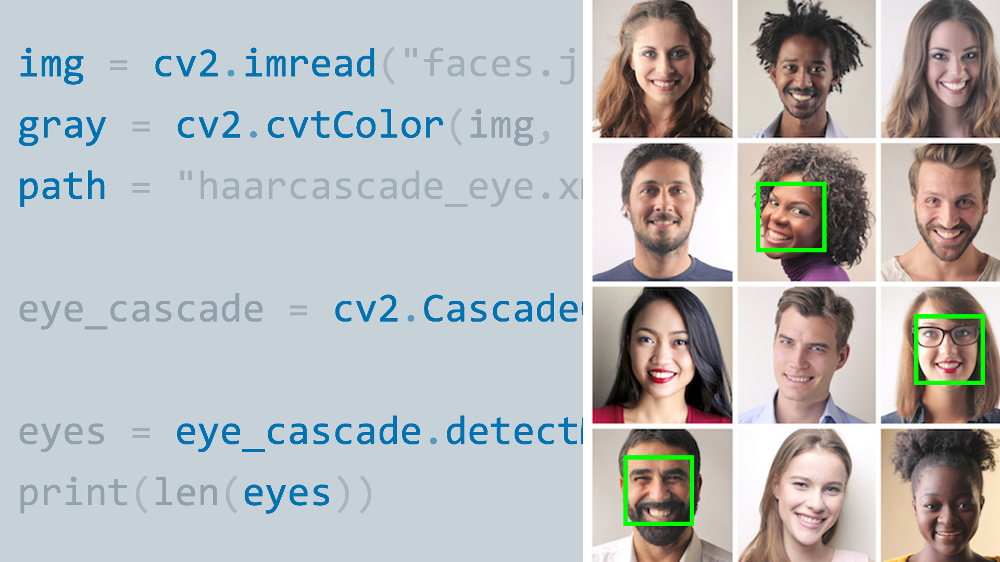
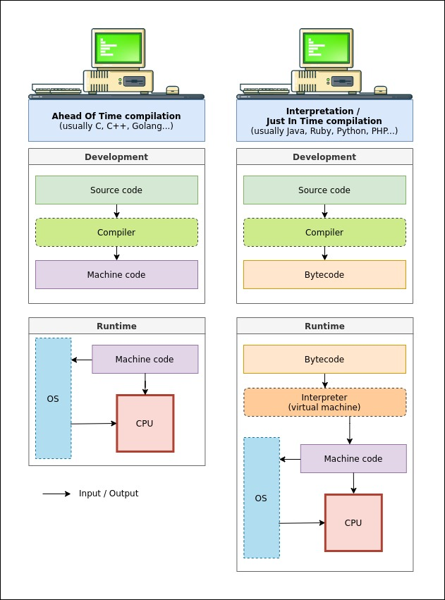
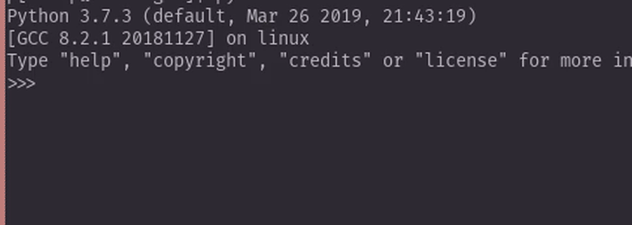
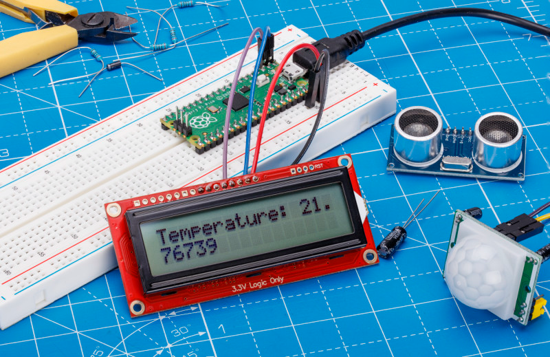
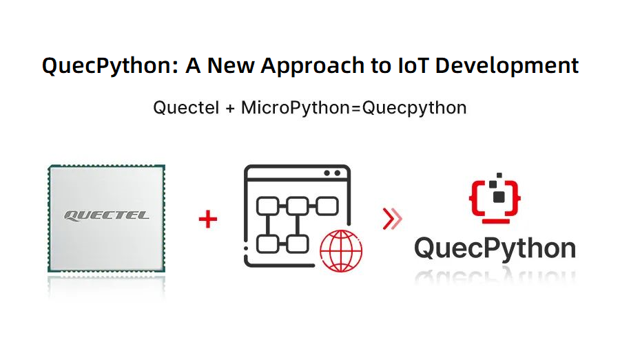
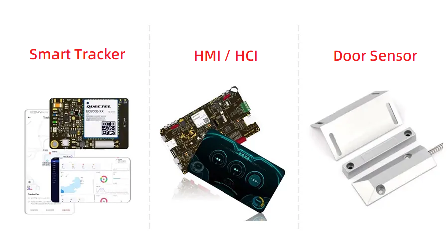
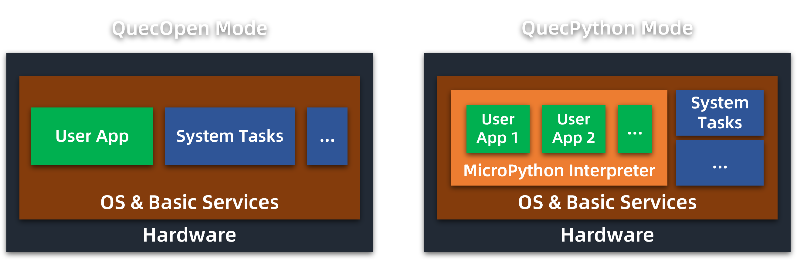

# Introduction to QuecPython

This document will start with an introduction to the Python language and then elaborate on the origin, structure, and characteristics of QuecPython. Through this introduction, you can gain a relatively comprehensive understanding of QuecPython.

## From Python to MicroPython

Python is a high-level scripting language that combines interpretability, compilability, interactivity, and object-oriented programming. As a programming language that represents minimalism, Python has relatively loose requirements for code formatting. When developing Python programs, you can focus on solving the problem at hand without worrying too much about the syntax details.

The following two examples compare the implementation of the same functionality in Python and C, highlighting the concise syntax and high readability of Python.

.. tabset:: Reading and displaying keyboard input

    ## Using C language

    ```c
    #include<stdio.h>

    int main(){
        int number;
        float decimal;
        char string[20];
        scanf("%d", &number);
        scanf("%f", &decimal);
        scanf("%s", string);

        printf("%d\n", number);
        printf("%f\n", decimal);
        printf("%s\n", string);

        return 0;
    }
    ```

    ## Using Python language

    ```python
    number = int(input())
    decimal = float(input())
    string = input()

    print(number)
    print(decimal)
    print(string)
    ```

.. tabset:: Simple for-loop

    ## Using C language

    ```c
    #include<stdio.h>

    int main()
    {
        for(int i = 0; i < 10; i++){
            printf("%d\n", i);
        }
    }
    ```

    ## Using Python language

    ```python
    for i in range(0, 10):
        print(i)
    ```

As an interpreted language, Python is highly portable and can run on various software and hardware platforms. Programs written in Python do not need to be compiled into binary code in advance; they can be executed directly from the source code. Additionally, Python has the most extensive and powerful libraries among scripting languages. These libraries cover most application scenarios, such as file I/O, GUI, network programming, and database access. When developing programs with Python, many functionalities can be implemented by calling existing libraries, which eliminates the need to write everything from scratch. Currently, Python is widely used in fields such as servers, databases, image processing, and artificial intelligence due to its simple syntax and rich functionality.

<center>
    
    <br>
    <div style="color: orange; border-bottom: 1px solid #d9d9d9; display: inline-block; color: #999; padding: 2px;">
        Facial Recognition Implemented with Just a Few Lines of Python Code
    </div>
</center>

MicroPython is a lightweight and efficient implementation of the Python language, designed to run on microcontrollers. It can be understood as a Python interpreter that can be executed on microprocessors. It enables users to write Python scripts to control hardware. MicroPython inherits the comprehensive REPL (Read-Eval-Print Loop) interactive functionality of Python, allowing code to be entered and executed through the REPL serial interface, which facilitates testing. MicroPython also includes a built-in file system, allowing you to upload arbitrary file contents to the device and modify the directory structure as desired. Based on this characteristic, the device can store multiple program scripts and other files simultaneously, and you can manually select and run them as needed, similar to the mechanism of mobile apps, providing great flexibility. Additionally, thanks to the nature of the Python-interpreted language, when using MicroPython for development, there is no need to repeatedly compile code or download firmware due to code changes. Simply uploading the modified code to the device is sufficient.

.. details:: About Interpreters

    An interpreter is a concept that is opposite to a compiler. As an interpreted language, Python's source code is transformed into machine-readable and executable binary form during runtime, rather than before execution. The tool that facilitates this process is called an interpreter.

    <center>
        
        <br>
        <div style="color: orange; border-bottom: 1px solid #d9d9d9; display: inline-block; color: #999; padding: 2px;">
            Execution process differences between interpreted and compiled languages
        </div>
    </center>
    For beginners, the interpreter can be loosely understood as the runtime environment for executing Python scripts. Currently, CPython is the most commonly used Python interpreter on computers. The term "Python" in most resources and tools typically refers to CPython. In the field of embedded systems, besides MicroPython, other interpreters such as CircuitPython and PikaPython are also popular among developers in China.

    For a more in-depth explanation of Python's code execution mechanism, you can refer to online resources such as "Differences and Workings of Compilers and Interpreters" and "An Introduction to Bytecode and Virtual Machines" or consult professional books on Python.

.. details:: About REPL

    REPL, short for Read-Eval-Print Loop, is a simple interactive programming environment. REPL typically provides a Command-Line Interface (CLI) that receives user input, parses and executes it, and then returns the results to the user. In terms of functionality and usage, it is similar to the Command Prompt (CMD) in Windows or the Shell in macOS/Linux.

    <center>
        
        <br>
        <div style="color: orange; border-bottom: 1px solid #d9d9d9; display: inline-block; color: #999; padding: 2px;">
            Python REPL Environment
        </div>
    </center>
    The advantage of REPL is that it makes exploratory programming and debugging more convenient. The "Read-Eval-Print Loop" cycle is usually more efficient and faster than the classic "Edit-Compile-Run-Debug" cycle. REPL is particularly helpful for learning a new programming language because it immediately responds to beginners' attempts.

<center>        <br>    <div style="color: orange; border-bottom: 1px solid #d9d9d9; display: inline-block; color: #999; padding: 2px;">        Raspberry Pi Pico Development with MicroPython    </div> </center>

Currently, MicroPython already supports dozens of hardware modules including STM32, Raspberry Pi Pico, and ESP32.

## Introduction to QuecPython

<center>    
</center>

Quectel has ported MicroPython to a variety of 4G and NB-IoT modules, and added a large number of wireless communication-related libraries, collectively known as QuecPython. In the [previous document](./wireless-modules.md), we introduced the module secondary development solution based on scripting languages, which is exactly the development solution of QuecPython. With QuecPython, you can use Python scripts to quickly and conveniently develop Quectel communication modules, easily implementing common IoT features such as remote control and data connection to cloud platforms.

Compared to traditional microcontroller (MCU) development and QuecOpen (CSDK) development, the biggest advantage of QuecPython development lies in its simplicity. The following diagram shows the approximate workflow of traditional development and QuecPython development. It is easy to see that QuecPython, using a scripting language, only requires the initial burning of the specialized QuecPython firmware inside the module. After that, once the code is written and modified, it can be immediately run without the need for cumbersome compilation and burning steps, significantly improving the speed of code debugging.

<center>        <br>    <div style="color: orange; border-bottom: 1px solid #d9d9d9; display: inline-block; color: #999; padding: 2px;">        Comparison of Module Development Processes Based on QuecOpen and QuecPython    </div> </center>

Another advantage of QuecPython is the built-in rich and practical libraries. In addition to the core standard library of MicroPython, QuecPython provides a series of IoT-related libraries, including voice calls, SMS, MQTT, and base station positioning, and supports mainstream cloud platforms such as Alibaba Cloud and Tencent Cloud. With less than 20 lines of code, a simple connection to Alibaba Cloud can be realized.

<center>        <br>    <div style="color: orange; border-bottom: 1px solid #d9d9d9; display: inline-block; color: #999; padding: 2px;">        Typical Products Developed with QuecPython    </div> </center>

Currently, QuecPython solutions have been applied in various scenarios such as smart home appliances, industrial control, and intelligent transportation. Companies have launched dozens of products based on QuecPython solutions, including car locators, DTUs, and 4G intercoms. Due to its low learning curve and short development cycle, QuecPython is also very suitable for rapid prototyping and course experiments.

## Differences Between QuecPython and Traditional Development Solutions

Many beginners using QuecPython may have prior experience with various software and hardware platforms. However, QuecPython, as a new type of Internet of Things (IoT) development solution, has significant differences compared to traditional development solutions. It is necessary to understand these differences before diving into development.

### Differences from Traditional Microcontroller (MCU) Development

#### Differences in Principle and Characteristic

- QuecPython differs from traditional MCU development, such as STM32, as it is not bare-metal development but built on top of a complete operating system. Most of the experience gained from bare-metal development cannot be directly applied to QuecPython development, and developers should avoid being misled by past experiences.
- As a script development solution, QuecPython abstracts away many low-level details. Concepts such as stacks, registers, DMA, and NVIC involved in traditional MCU development usually do not appear in QuecPython development.
- Due to the use of scripting languages, QuecPython has a slower execution speed. Therefore, QuecPython may not be suitable for applications with high-performance and timing precision requirements, such as pulse counting, ADC waveform acquisition, or operations with single-wire sensors like DS18B20, which can be implemented using traditional MCUs.
- QuecPython's execution speed is significantly influenced by the language itself, so there is no need to excessively focus on factors like the chip's clock frequency. However, during script execution, the available runtime memory (RAM) dynamically changes. It is important to closely monitor available memory during development and debugging to avoid memory overflow and program crashes.

#### Differences in Development Process

Compared to traditional MCU development, QuecPython is more similar to developing mobile apps. The process of QuecPython development is comparable to developing an Android app, which involves the following steps:

- **Environment Setup:** QuecPython, as a scripting language development solution, does not require a traditional SDK or the construction of a specialized development environment. Users only need to manually download the firmware containing the QuecPython scripting language interpreter into the module to begin development.
- **Code Writing:** QuecPython does not require specialized IDEs like Keil. Code (script files) can be written using common text editors such as VSCode, PyCharm, or even Notepad ++.
- **Program Download:** After writing the script files, there is no need for compilation or the use of separate programmers and simulators. The script files can be directly copied to the module for debugging and execution, similar to copying files to a USB drive. The module can store multiple scripts (apps) and other resource files simultaneously, allowing flexible invocation and execution of script files based on user needs.
- **Debugging and Execution:** QuecPython does not provide traditional MCU debugging features like breakpoints, step-by-step execution, or memory analysis. Instead, the script's execution result (or error information) is used to determine its status.

### Differences from QuecOpen Development

<center>        <br>    <div style="color: orange; border-bottom: 1px solid #d9d9d9; display: inline-block; color: #999; padding: 2px;">        Schematic Diagram of the Difference Between QuecPython and QuecOpen in System Architecture    </div> </center>

- **Development Difficulty**: Compared to QuecOpen, QuecPython has a lower entry barrier, abundant and open resources, and a quick learning curve. It eliminates the need for repetitive firmware compilation and burning, making debugging easier. QuecPython also comes with a wide range of built-in functional libraries, reducing the need for custom development. Overall, the development cycle is significantly shorter and the cost is lower compared to QuecOpen.
- **Performance**: From an architectural standpoint, QuecPython ported the MicroPython interpreter on top of the QuecOpen system as a running task. The user's scripts are parsed and executed within the MicroPython interpreter. This mechanism results in QuecPython having lower performance compared to QuecOpen.
- **Resources and Flexibility**: While QuecPython reduces the complexity and difficulty of programming by abstracting away various low-level details, it also decreases development flexibility. QuecPython provides fewer accessible resources and functionalities compared to QuecOpen, and users cannot directly modify or customize the built-in functional components.
- **Peripheral Interfaces**: QuecPython and QuecOpen differ in terms of the number, numbering scheme, and initial levels of peripheral interfaces (such as GPIO and I2C). When referring to documentation such as the "Hardware Design" or "Compatible Design", special attention should be paid to avoid directly applying QuecOpen-related data to QuecPython development. It is recommended to refer to the online documentation for QuecPython development.

### Differences from Standard AT Development

The differences between QuecPython development and traditional AT command development have been detailed in the [previous document](./wireless-modules.md). In summary, they can be seen as two separate and independent development solutions, rather than coexisting options.

- QuecPython is not an extension of AT command development; instead, it is a secondary development (OpenCPU) approach based on a scripting language specifically designed for modules.
- The QuecPython firmware retains only the basic AT command interaction functionality, which can be accessed through special means (such as USB virtual AT serial port, specific hardware serial port, or the built-in `atcmd` library in some firmware versions). Most of the functional AT commands become invalid or return abnormal results.
- Continuing to use AT commands to control the module after downloading the QuecPython firmware can cause exceptions in the QuecPython program. Therefore, in most cases, it is recommended not to continue AT development after downloading the QuecPython firmware.
- It is possible to restore the module's built-in AT functionality by redownloading it with the standard firmware.

### Differences from CPython

QuecPython is a port of MicroPython, which is a programming language developed for resource-constrained embedded environments. As a result, there are several differences between QuecPython and CPython, which is the version of Python typically used on desktop computers.

#### Differences in Syntax and Design Philosophy

- QuecPython (MicroPython) is compatible with the core syntax of Python 3.4, but there are differences in some advanced usage and built-in type attributes compared to Python. The MicroPython [official documentation](https://docs.micropython.org/en/latest/genrst/index.html) provides an overview of these differences, but it may not be exhaustive. Some detailed differences may only be encountered during the development process.
- MicroPython has made many streamlined design choices for resource-constrained environments. One typical design philosophy is that if users can implement certain functionality based on existing libraries, it is not integrated into the system. For example, in the CPython development, users commonly use the `datetime` library for formatted date and time output. In MicroPython, the author believes that users can manually concatenate and format the date and time information provided by the `utime` library to achieve the desired output. Therefore, MicroPython does not include a library similar to `datetime` by default.

#### Differences in Library

- Unlike traditional CPython development, QuecPython has a much smaller number of built-in libraries (standard libraries). Although QuecPython does include basic libraries for tasks such as time setting and file management, the quantity is significantly lower compared to CPython. The names and usage methods of these standard libraries also have many differences and are not fully compatible. For example, the `json` library used for parsing JSON files in CPython is replaced by the `ujson` library in QuecPython, and it only provides four built-in functions/methods: `dump()`, `dumps()`, `load()`, and `loads()`. Therefore, the experience with libraries in CPython development can't be directly applied to QuecPython development.
- In addition to the basic libraries, QuecPython also includes many libraries related to module hardware, IoT, and other functionalities. Most of these libraries rely on the underlying features of the module and can only run on the module itself.
- QuecPython does not have built-in pip functionality, so quick online installation of libraries is not possible. Manual porting is required.
- Complex libraries commonly used in CPython development, such as OpenCV, PyQt, Flask, NumPy, and Scrapy, are not supported in the QuecPython environment.

#### Differences in Development Tool

- Due to the syntax differences between QuecPython and CPython, as well as the fact that most QuecPython libraries cannot run on desktop computers, tools such as VSCode and PyCharm on the desktop can only be used for simple code editing. The completed scripts need to be manually downloaded to the module for execution and debugging.
- The syntax highlighting and code completion features provided by tools like VSCode and PyCharm are based on CPython and may not be fully applicable to QuecPython. Therefore, for beginners who have no prior experience with the Python language, it is not recommended to use overly intelligent IDE tools while writing code, as the built-in suggestions may be misleading.

### Differences from MicroPython

QuecPython is essentially MicroPython running on Quectel modules. Due to the lack of a comprehensive standard specification in MicroPython, the built-in libraries and the usage of various functions may vary depending on the developers and hardware platforms. Some QuecPython users may have prior experience developing with MicroPython on modules such as ESP32, ESP8266, and STM32. To facilitate the migration for these users, the known differences between QuecPython and MicroPython are listed below:

- Some MicroPython standard or dedicated libraries, such as `framebuf` and `network`, are not implemented or built-in in QuecPython.
- Some MicroPython standard libraries, such as `utime`, may have different implementations and feature completeness in QuecPython compared to modules like ESP32, resulting in differences in performance or other detailed characteristics.
- The organization of certain features in QuecPython may differ from MicroPython. For example, ADC functionality is generally included in the `machine` library in MicroPython, but in QuecPython, it is included in the `misc` library.
- APIs related to specific hardware interfaces such as UART, I2C, and SPI have significant differences between MicroPython and QuecPython and cannot be used interchangeably.
- QuecPython currently does not include the `upip` functionality, so quick online installation of libraries is not possible. Manual porting is required.
- Compatibility with MicroPython IDE tools such as Thonny and uPyCraft is not guaranteed.

In summary, MicroPython code that runs successfully on modules like ESP32 usually cannot be directly copied and run in the QuecPython environment without any modifications. Therefore, it is advisable to avoid directly applying documentation and development experience from other MicroPython hardware modules to QuecPython development.
