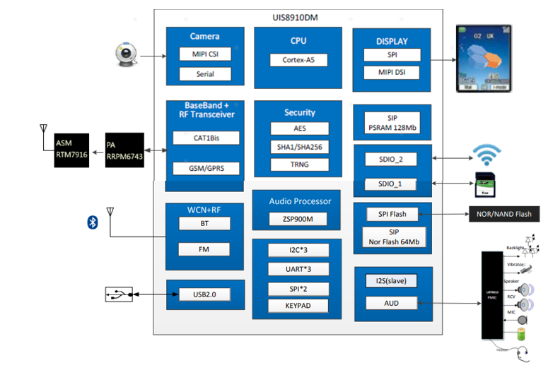
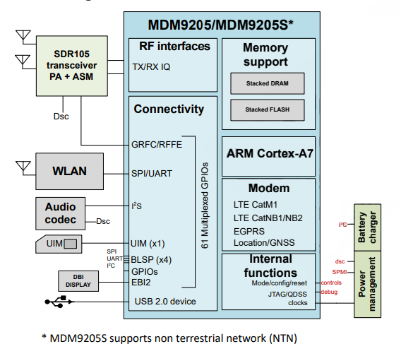
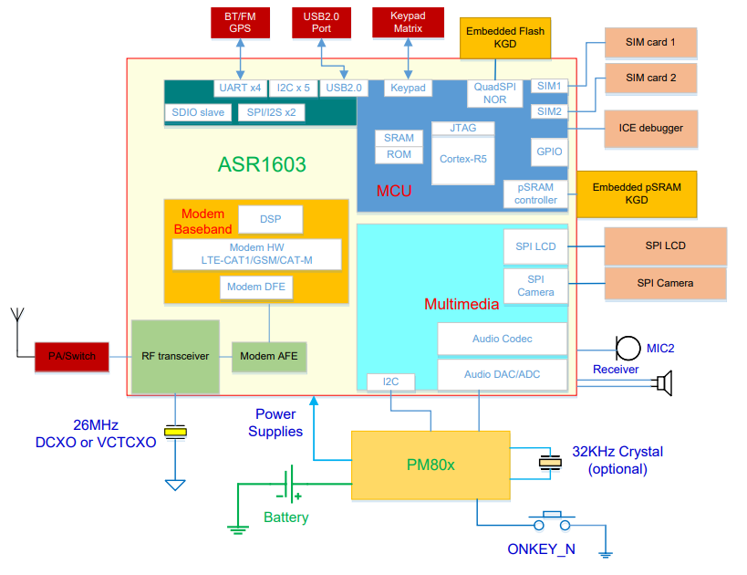
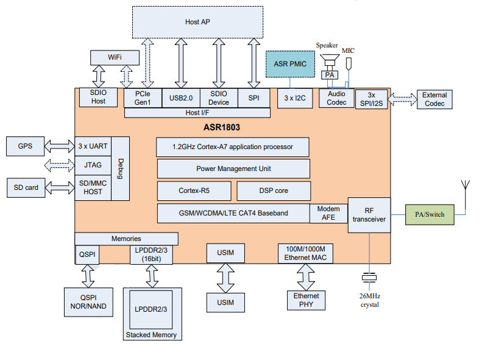
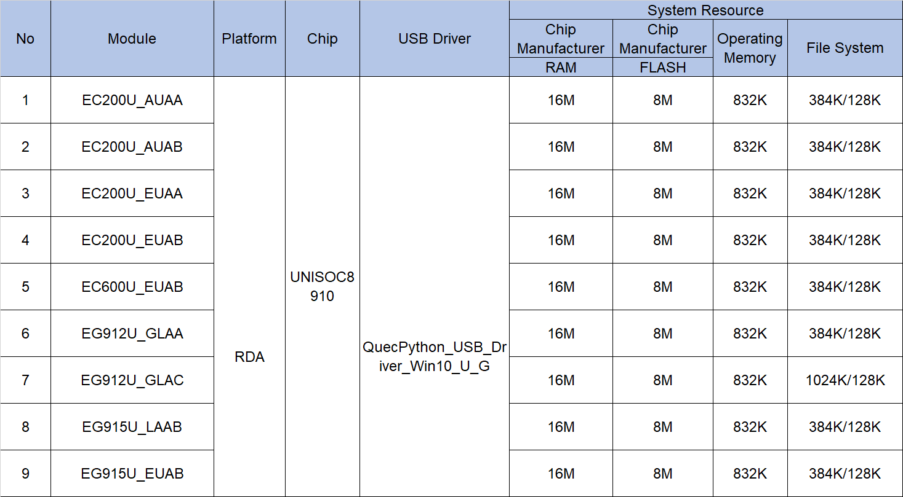
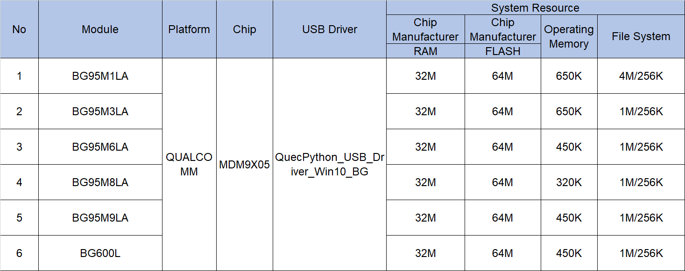
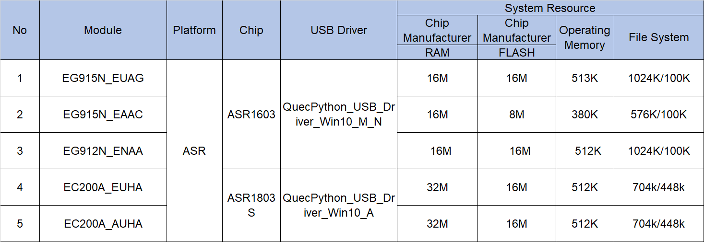

# Hardware Platform Support

In the [Introduction to Wireless Communication Modules](./wireless-modules.md) chapter, the concept of "main chip" is introduced. In practical applications, modules of various models manufactured based on the same series of chips from the same manufacturer often have similar functions and characteristics and usually use the same development tools and drivers. For easier expression and classification, the concept of "platform" is generated to refer to these different module models based on similar main chips.

## Chip Manufacturer and Product Introduction

Currently, the main chips of various types of cellular communication modules supported by QuecPython are usually from four manufacturers of Eigencomm, Unisoc, Qualcomm and ASR.

### Unisoc

Unisoc (Shanghai) Technologies Co., Ltd. is a leading integrated circuit design company in China and one of the few companies in the world that master communication technologies for various scenarios, including 2G/3G/4G/5G, Wi-Fi, Bluetooth, FM radio, and satellite communication. In 2018, Spreadtrum Communications (Shanghai) Co., Ltd. and RDA Microelectronics Co., Ltd. were merged and rebranded to Unisoc, achieving a powerful combination and leading the development of China's chip industry. The rise of Unisoc breaks foreign chip monopolies and leads the 5G chips, becoming a benchmark in China's chip design industry.

#### LTE Cat 1 IoT Chip: UIS8910DM

UIS8910DM chip is an LTE Cat 1 bis IoT chip. It adopts a mature 28 nm process and supports LTE Cat 1 bis and GSM dual-mode, with an uplink rate of up to 5 Mbps and a downlink rate of up to 10 Mbps. In addition, it integrates Bluetooth communication and Wi-Fi indoor positioning, enabling more stable connections. It supports VoLTE and achieves significant power consumption advantages through system optimization design. The launch of 8910DM solves the pain points in current IoT connections and fills the gap between low-power narrowband IoT and traditional broadband IoT cellular communication solutions. Compared with NB-IoT and 2G modules, it has advantages in network coverage, speed, and latency, and compared with traditional LTE Cat 4 modules, it has lower cost and power consumption. It is suitable for application scenarios with requirements for cost-effectiveness, latency, coverage range, and communication speed.

    
     
    

        Functional Block Diagram of UIS8910DM Chip 
    

### Qualcomm

Qualcomm is a global leader in semiconductor and wireless communication technologies. Headquartered in San Diego, California, the company was founded in 1985. Qualcomm is known for its innovative technologies in the field of mobile communications and is one of the world's largest suppliers of wireless communication chips. The company's products include mobile processors, modems, RF front-ends, wireless charging technologies, and more, which are widely used in various mobile terminals and communication devices such as smartphones, tablets, and IoT devices. Qualcomm also plays an important role in the development and standardization of 5G technology, driving the global advancement and innovation of mobile communications.

#### Multi-mode LTE IoT Chip: MDM9X05

With the aim of providing reliable and optimized cellular connectivity for IoT applications and a range of wearable trackers, Qualcomm has launched Qualcomm 9X05 LTE modem, which integrates key innovations required for cellular IoT products and services on a single chip. These innovations include global multi-mode LTE category M1 (eMTC) and NB2 (NB-IoT), as well as 2G/E-GPRS connectivity, application processing, geolocation, hardware-based security, IoT platform and software solution support, and complementary developer tools. Qualcomm 9X05 also integrates Qualcomm's 9th generation GNSS engine system, supporting GPS/GLONASS/BeiDou/Galileo.

    
     
    

        Functional Block Diagram of MDM9205 Chip 
    

### ASR Microelectronics

ASR Microelectronics is a platform-based chip company that provides wireless communication and large-scale chip solutions. Since its establishment, the company has been focusing on the research and technological innovation of wireless communication chips. It has the capability to design and supply full-mode cellular baseband chips and multi-protocol non-cellular IoT chips, as well as providing customization of large-scale high-speed SoC chips and semiconductor IP licensing services.

The company's chip products have a wide range of downstream application scenarios and can be applied in consumer electronics markets represented by smartphones and smart wearables, as well as in the smart IoT market represented by smart home appliances and autonomous driving.

#### LTE Cat 1 IoT Chip: ASR1603

ASR1603 is a cost-effective and ultra-low-power multi-mode cellular chip manufactured using 22 nm process technology. Compared to its predecessor, ASR1603 has a 14% smaller size and lowers power consumption by 20-25%, while also equipped with more peripheral interfaces. Additionally, ASR1603 is a highly integrated System-on-Chip (SoC) device that integrates application processing subsystems, communication subsystems, audio codecs, and embedded pSRAM + Flash. It supports the most compact single-chip LTE/GSM multi-mode data modules, POC, POS, and other IoT solutions.

    
     
    

        Functional Block Diagram of ASR1603 Chip
    

#### LTE Cat 4 Mobile Intelligent Terminal Chip: ASR1803S

ASR1803S is a 4G chip integrated with baseband and RF based on advanced technology. It is a highly integrated baseband communication chip that integrates RF and memory. The chip adopts 22 nm technology, supports 6-layer 1-order PCB, has a frequency bandwidth of 450 MHz–2.7 GHz, supports RTOS operating system, and occupies a small amount of memory. At the same time, the chip integrates an application processor (ARM Cortex-A7), which can support various applications under the Linux environment, providing flexible choices for the development of different customer products. ASR1803S supports a new dynamic voltage adjustment technology, which can effectively reduce operating voltage, reduce power consumption, and support NOR/NAND flash, making the boot speed faster. This chip can be widely used in civil and industrial applications, such as POS machines, POC intercoms, data card dongles, Mi-Fi terminals, and various industry applications such as water, electricity, and gas meters.

    
     
    

        Functional Block Diagram of ASR1803 Chip
    

## The Correspondence Between Platforms and Modules

The following tables show the correspondence between various module models supported by QuecPython and chip manufacturers and chip platforms.

### Unisoc Platform

### Qualcomm Platform

### ASR Platform

