# Introduction to IoT and Low Code Development

## Introduction to IoT

### What is IoT

In the late 20th century, with the rise of computer networks and communication technologies, the Internet began to enter and integrate into people's lives. Traditional internet systems usually revolve around humans, where data generation and transmission are controlled by people, and the application of data results is reflected in individuals. Taking short videos on the internet as an example, activities such as shooting, uploading, and watching videos all require active participation from users. The short video platform analyzes and processes user-generated data, and then pushes relevant content based on preferences, ultimately influencing the users themselves. It can be seen that most processes in traditional internet systems revolve around human operation and development.

    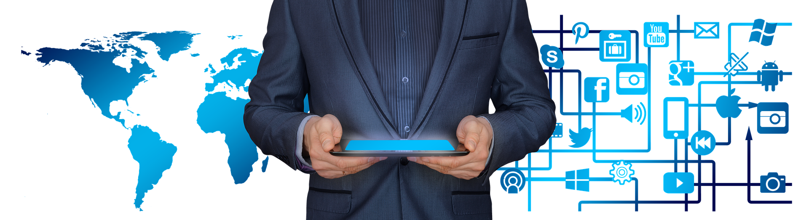
     
    

    Traditional Human-centric Internet
    

With the continuous evolution of technology, the demand for information transmission and exchange between things has been increasing. This led to the emergence of the concept of the Internet of Things (IoT).

The Internet of Things is a network that connects all objects, forming an interconnected network of things-to-things. It utilizes various devices and technologies such as information sensors, radio frequency identification (RFID), global positioning systems (GPS), infrared sensors, and laser scanners to collect real-time information from objects or processes that need to be monitored, connected, and interacted with. It captures various types of information such as sound, light, heat, electricity, mechanics, chemistry, biology, and location. Through various possible network access methods, it enables pervasive connections between things and between things and people, achieving intelligent perception, recognition, and management of objects and processes.

Modern IoT is essentially an extension of the internet. It uses the infrastructure of the traditional internet as a medium for information transmission, breaking the constraints of time and space. It enables "things" to become the main producers and consumers of data, greatly reducing the distance between "people and things" and "things and things". For example, in smart agriculture irrigation, moisture sensors embedded in the soil periodically upload soil moisture information to a cloud platform. When the platform's program detects soil dryness, it remotely activates the irrigation device in the field according to preset rules, thereby controlling the soil moisture content at an appropriate level. In this scenario, human intervention is not required, and all processes are completed through interactions between things. The data involved is directly related to the "things" themselves.

    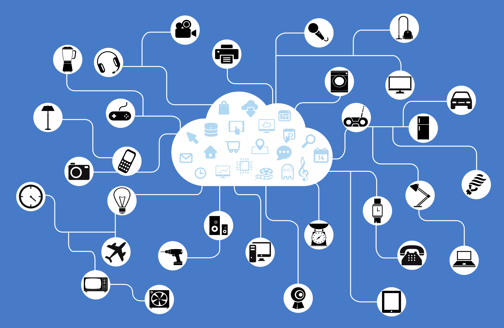
     
    

    Object-centric IoT
    

Currently, the definition and scope of IoT are still evolving and developing, so there is no clear and accurate definition yet. However, from the above introduction, we can roughly understand the characteristics of IoT: IoT is an internet where "things" are the main actors, and it embodies the characteristics of "things" in form and content. Therefore, the overall architecture and development methods of IoT applications are significantly different from traditional Internet applications.

Today, IoT has become a new information infrastructure and a model for socio-economic development. It has a wide range of applications and innovations in infrastructure fields such as industry, agriculture, environment, transportation, logistics, and security, as well as in areas closely related to daily life such as homes, healthcare, education, finance and services, and tourism. It effectively promotes the intelligent development of these areas, enables more rational use and allocation of limited resources, improves industry efficiency, and greatly enhances people's quality of life.

With the rapid development of the economy and technology, the fantasy of "everything connected" from over 20 years ago has begun to become a reality. From various smart devices and smart homes around us to the latest concepts of smart Earth and the "metaverse", IoT provides strong support for these technological transformations.

### Architecture of IoT

"Before leaving work, you can turn on the air conditioner on your phone, and when you get home, you can enjoy a comfortable indoor temperature." This is a common IoT application scenario in daily life. Most IoT applications, like remotely turning on the air conditioner, are straightforward from the user's perspective. However, in reality, implementing such a simple IoT application is not an easy task.

A complete IoT application involves various technologies, processes, and roles. From the perspective of data flow and functionality, the architecture of the IoT ecosystem can be roughly divided into four layers. Each layer performs its specific functionalities and interacts with other layers through various channels to achieve complete IoT functionality.

#### Terminal Layer

The Terminal Layer, also known as the Perception Layer or Perception Control Layer, is the most fundamental layer in the IoT architecture. The core function of the Terminal Layer is to interact with the physical world, enabling the perception of real-world objects (such as environmental parameters and device status) and control of specific devices.

    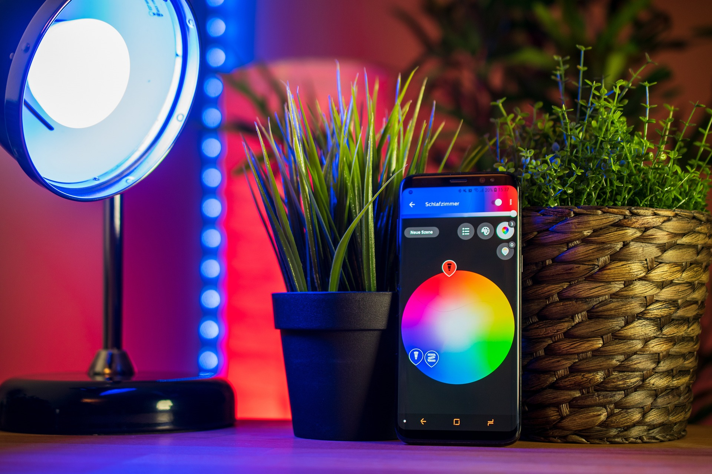
     
    

    Typical Terminal in Contemporary Smart Homes: Smart Bulb
    

The Terminal Layer is where the majority of physical IoT devices (such as sensors and RFID) reside. Sensors play a crucial role in information gathering and identification by converting physical quantities from the real world into electrical signals. In actual IoT devices, in addition to sensors, there are usually components such as controllers for coordinating and controlling all functionalities and components, as well as communication modules for network connectivity.

#### Network Layer

The Network Layer is responsible for transmitting the data collected by devices in the Terminal Layer to the Platform Layer and serving as a bridge for bidirectional communication, sending control commands from the Platform Layer back to the Terminal Layer. From a functional perspective, the Network Layer can be divided into the Access Layer and the Transport Layer.

The Access Layer mainly deals with the functions of the physical layer and data link layer in the traditional OSI model, which essentially involves various methods for devices to access networks and establish interconnections. In terms of media, it can be divided into wired network access and wireless network access. Wired network access methods include Ethernet, serial communication (such as RS-232 and RS-485), and USB, among others. Wireless network access methods include Wi-Fi, Bluetooth, cellular networks (such as 2G/3G/4G/5G, which will be detailed in the [next document](./wireless-modules.md)), and low-power wide-area networks (such as LoRaWAN and NB-IoT), among others.

    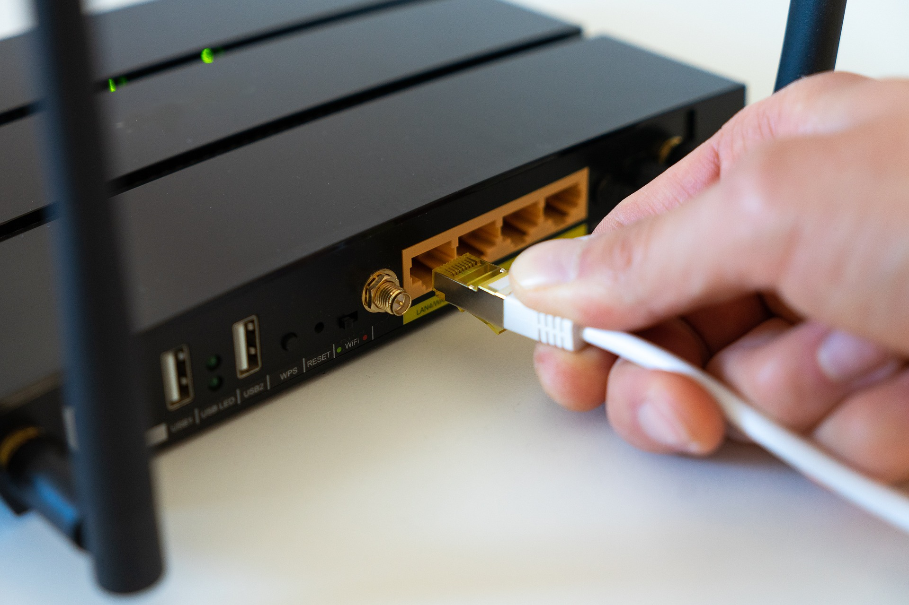
     
    

    Wireless Routers Serve as the Gateway to the Network in Many Scenarios
    

The Transport Layer is built on top of the Access Layer and includes communication protocols for data reporting and delivery. Compared to internet terminals, most IoT terminal devices currently have limited available resources in terms of processing power, storage capacity, and network speed. Therefore, they tend to use communication protocols that consume fewer resources, such as MQTT (Message Queuing Telemetry Transport) and CoAP (Constrained Application Protocol). These protocols are based on the publish/subscribe model, enabling bidirectional communication between devices and platforms. They also support features like data encryption and compression.

#### Platform Layer

The Platform Layer is the intermediate layer in the IoT architecture where data is processed, stored, and analyzed. In the past, this layer was typically composed of independent servers. With the development of technologies like microservices and cloud computing, modern IoT platform layers typically include cloud-based system platforms, data analytics engines, and middleware, enabling developers to build and deploy applications on top of the IoT infrastructure.

    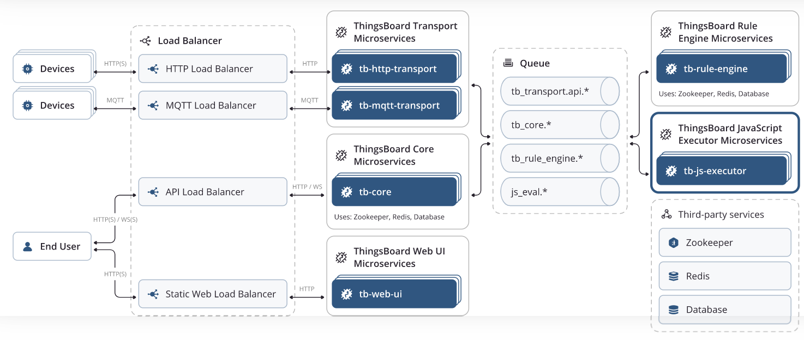
     
    

    Microservices Architecture of the ThingsBoard Platform
    

The Platform Layer serves as an intermediate service that connects devices and industrial applications. It plays a pivotal role in the overall IoT architecture by hosting abstracted business logic and standardized core data models. A typical platform layer not only enables fast device connection but also provides powerful modular capabilities to meet various requirements in industry application scenarios.

In addition to basic device connectivity and management functionalities, mature IoT platform layers often include security management, monitoring and operations, rule engines, and edge computing capabilities to provide added convenience for practical applications.

#### Application Layer

The Application Layer is the top layer of the IoT architecture where IoT data truly generates value, and it is the layer where IoT interacts directly with humans. The Application Layer includes network and mobile applications, dashboards, and other user interfaces that allow users to monitor and control devices, access data, and perform other tasks. In most scenarios, the Application Layer receives data from the Platform Layer and performs analysis and processing. The results are then applied to various automation processes or presented during interactions with users. The Application Layer may also include machine learning and artificial intelligence algorithms that enable the system to continuously learn from data and optimize results over time.

### Typical IoT Engineering Example

To better illustrate the architecture and development process of IoT, let's revisit the example of remotely turning on an air conditioner mentioned earlier and introduce the content and development workflow of a typical IoT engineering project.

#### Requirements Analysis

For most engineering projects, understanding and refining requirements is the first step in development. Starting development work without a thorough understanding of requirements can often impact development efficiency and the outcome, and even lead to irreparable losses.

In the case of the air conditioner project, the initial requirement might be as simple as "remotely turning on the air conditioner". Faced with this requirement, most people would envision a scenario and process like this:

> Press a button in an app on a mobile phone or tablet. The app sends a command to the server, and the server sends a command to a local device in the user's home, which controls the air conditioner to start.

    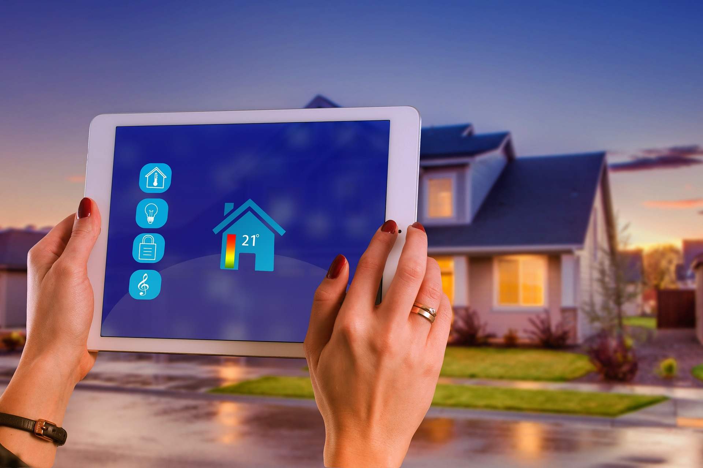
     
    

    Conceptual Remote Control of an Air Conditioner
    

Clearly, the information included in this description is too vague and contains a lot of assumptions. It is not sufficient to support the development of a complete project. Therefore, it is necessary to refine the content and overall process through in-depth communication with the stakeholders (customers). For this type of project, the information to be understood includes, but is not limited to:

- Devices used for remote control: Android smartphones / iPhones / PCs / ...
- Software used for user interaction: Dedicated app / WeChat mini programs / web control / ...
- Air conditioner model and control method: Infrared / Bluetooth / ...
- Type of cloud platform: Public Service / Private instance / Dedicated Service / ...
- Type of "local device": Smart plug / Home gateway / ...
- Communication method of "local device": Wi-Fi / Bluetooth / Matter / 4G / ...
- Other functional requirements from users: Timer control / Automatic power on/off / Power saving mode / ...
- ...

After refinement, the final business process might become:

> The user remotely sends instructions, including direct start and scheduled on/off commands, to the cloud program deployed on the Alibaba Cloud platform through a standalone app installed on an Android smartphone. The cloud program, based on different user instructions, directly or at scheduled times, sends messages to the smart plug deployed in the user's room. The smart plug receives the information via the Wi-Fi network and then controls the corresponding working mode of the xx model air conditioner using infrared remote control.

At first glance, it may seem like the development difficulty has increased. However, the addition of detailed requirements provides a clearer and more complete path for actual development.

#### Framework Establishment

Combining the IoT four-layer architecture introduced earlier and the refined requirement details, developers can begin to establish a high-level engineering framework. It can be observed that the main development work of this project is concentrated on the following three components:

1. Terminal Layer (Smart Hardware): Develop a smart plug responsible for interacting with the cloud platform and controlling the air conditioner.
2. Platform Layer (Core Logic): Deploy the corresponding platform and implement the necessary decision-making and control algorithms.
3. Application Layer (Mobile App): Remotely control the air conditioner through a smartphone app and easily query the real-time status of the air conditioner through the app.

In fact, most IoT engineering projects include these three aspects. In simpler terms, IoT development often involves developing the "ends" of data (data generation and consumption) and the "middle" (overall logic).

    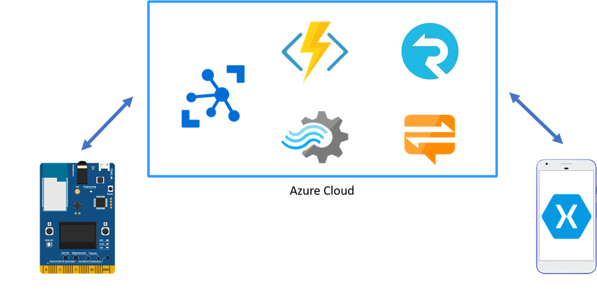
     
    

    Common IoT Application Structure
    

#### Development Content Organization

With a clear overall framework for the project, developers can further analyze the functionality of each component and outline the specific development path and content.

For the device-side development, the goal is to create a Wi-Fi-based smart plug. Therefore, during the development process, developers need to control the Wi-Fi chip or module to implement the necessary network configuration, connection, and bidirectional communication with the cloud platform. Additionally, the smart plug needs to integrate an infrared emitter to control the air conditioner via infrared signals. Developers need to consider factors such as the emission power and installation angle of the infrared emitter, as well as study the infrared codes for controlling the air conditioner.

    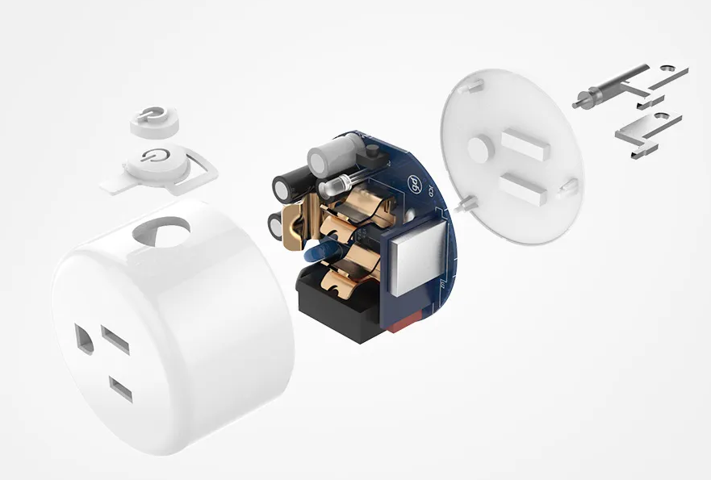
     
    

    Typical Structure of a Smart Plug
    

The development of the application side is relatively straightforward. Develop a smartphone app for Android that provides a graphical user interface, receives user commands, sends them to the cloud, and displays status information obtained from the cloud on the app interface. This process is not significantly different from developing a regular app.

Cloud development is the core of the entire project. Specifically, it requires designing a robust mechanism to facilitate device connectivity and enable the uploading, downloading, and storage of various data and instructions. Furthermore, an API for device operations accessible by the smartphone app needs to be provided. In addition, the core control logic, such as scheduled start/stop operations, is typically implemented on the cloud side. Fortunately, most existing commercial cloud platforms have established mature infrastructure that allows users to easily achieve IoT data connection to the cloud.

It is important to note that this section, for the sake of reader understanding, only introduces the most essential development content that constitutes a complete IoT business logic. A truly mature and commercially viable IoT project would involve additional functionality during the development process, such as device monitoring and firmware updates, which typically require a much larger development effort than a side project.

#### Actual Development Process

The actual development process typically starts with hardware design. Based on the clear functional requirements, component selection, and PCB design and manufacturing are carried out. For a smart plug, in addition to meeting the basic functional requirements, factors such as overall size and anti-interference capabilities need to be considered. Therefore, hardware design itself is a high-threshold and highly specialized task.

Next, the IoT cloud platform needs to be configured. As mentioned earlier, most existing commercial cloud platforms have established mature infrastructure. Developers need to create corresponding products and (virtual) devices based on the platform's instructions and configure attributes and interfaces for later integration with the devices.

Once the cloud platform configuration is complete, the actual code development phase begins. This includes embedded software development for the device side and app development for the mobile side. For general embedded software, in addition to implementing various required device functions, continuous iteration and optimization of factors such as power consumption and stability are typically necessary based on the actual needs.

Finally, after completing all software and hardware development and assembling the final product, the testing phase is entered. During this phase, relevant mass production tests are usually conducted based on the product's functionality and related specifications, such as device functionality testing, aging testing, and RF testing. Testing is usually not necessary for side projects, but for commercial projects, thorough testing is crucial to mitigate inherent risks and minimize the possibility of issues after the product is launched.

## Low-Code Development

From the previous discussion, it is evident that IoT project development involves a wide range of specialized knowledge and significant development effort. To reduce development complexity and involve more people in IoT development, low-code development is undoubtedly the best choice.

### Origins of Low-Code Development

Low-code development is a relatively new approach to software development that has gained popularity in recent years. In low-code development, developers can use pre-generated templates, components, and other tools to create software applications, significantly reducing the total amount of manually written code and the complexity of the code. Compared to traditional development methods, low-code development enables developers to complete project development faster and with less effort.

The concept of low-code development emerged as a response to the challenges faced in traditional software development. Traditional software development often requires specialized programming knowledge and significant resources to complete, and it often has long development cycles and high maintenance costs. Low-code development was introduced to simplify and accelerate the application development process, making it more accessible to developers at different levels and backgrounds, including non-professional users with limited programming experience.

The core idea behind low-code development is to allow developers to focus on business logic without wasting energy on non-business aspects. This idea can be traced back to fourth-generation programming languages and the popular rapid application development (RAD) tools of the late 20th century and early 21st century. Users with experience in Microsoft Visual Basic/Microsoft Visual C++ or industrial configuration software often understand this concept easily. In Microsoft Visual Basic, a complete user interface can be drawn with simple drag-and-drop actions. Developers only need to write business code related to event handling without worrying about interface-related code. In configuration software, besides the interface being created by drag-and-drop, much of the business logic is encapsulated as functional blocks. Developers can achieve complete system functionality by dragging and dropping these blocks and making simple configurations. These "building block" development methods reflect the core idea of low-code development.

    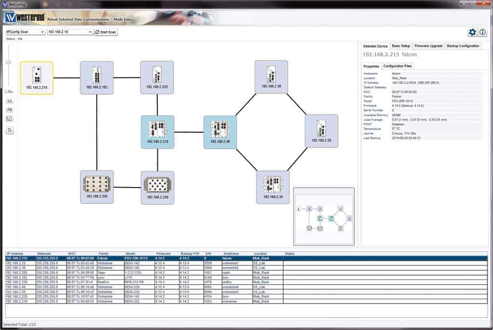
     
    

        Managing Network Devices with Configuration Tools
    

Low-code development offers numerous advantages, with the most notable one being the significant improvement in project development efficiency. By providing reusable components and other functionalities, low-code development greatly reduces the lengthy and time-consuming programming tasks typically involved in traditional approaches. As a result, developers can create applications faster and with less effort. This advantage has led to the widespread adoption of low code in rapid iteration and prototype design, allowing developers to easily modify and test new ideas without requiring extensive time and energy investments.

Another important advantage of low-code development is the assurance of program quality. In the "building block" development approach, developers primarily focus on connecting and arranging pre-developed functional modules, usually without the need for specific technical modifications. This enables the avoidance of subjective factors that may impact program quality, as developers do not engage in extensive modifications at a technical level. For general developers, as long as the low-code runtime environment and the quality of functional modules are ensured, applications developed using low-code methods tend to exhibit higher reliability compared to those developed using traditional approaches.

Currently, low-code development finds extensive applications across various domains, including web and mobile app development, process automation, and data integration. In web and mobile app development, low code is used to create custom user interfaces, workflows, and data models. In process automation, low-code development aids in automating repetitive tasks and simplifying business processes. When it comes to data integration, low-code development facilitates the creation of custom integrations between different systems and applications.

    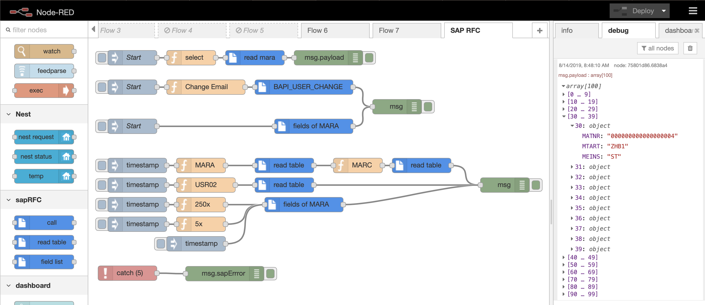
     
    

        Node-RED, a Low-code Platform that Has Been Widely Used in the Internet of Things
    

Furthermore, low-code development has gained significant popularity in physical enterprises. It helps organizations achieve the modernization of their traditional production systems at lower costs while accelerating digital transformation efforts. By empowering non-professional users to create applications and automate processes, low-code development technologies enable organizations to become more agile and responsive to ever-changing business needs.

In summary, low-code development represents a revolutionary approach to software development, enabling a broader range of individuals to participate in the application development process. It enhances development efficiency and quality, reduces costs and complexity, and caters to diverse business requirements across various scenarios.

### Internet of Things (IoT) and Low-Code

Low-code development technology has played an important role in both the platform and application layers of the Internet of Things (IoT) ecosystem. With low-code development, platform developers and users can easily control the flow of IoT data in the cloud ("cloud orchestration") and quickly build various end-user applications, including mobile apps, through visual interfaces and drag-and-drop operations. This greatly improves efficiency and flexibility while reducing complexity and risk in both IoT platform development and data utilization. With the development of various programming frameworks, low-code development is also being used in device-level IoT development.

In the practical implementation and promotion of IoT projects, there is often a contradiction between development effort and cost. For a specific IoT application scenario, such as smart farming, there is a wide variety of sensors and smart devices that need to be connected to the cloud. These devices have diverse physical connections and different communication protocols, significantly increasing development cycles and costs. Additionally, managing a large number of devices presents challenges for long-term maintenance. The overall cost of IoT systems is often a sensitive factor in many IoT scenarios. This contradiction presents a significant obstacle to the rapid implementation of IoT projects. Low-code development, with its advantages of low cost, short development cycles, and high stability, has become a key solution to address this problem.

IoT device development is a typical embedded system development scenario that traditionally requires expertise in multiple domains. Developers typically need to understand hardware design, circuit principles, embedded software, local and remote communication, middleware, applications, analytics, machine learning, and more. These areas of knowledge not only involve different technical stacks but also require constant updates and learning. This results in a high barrier to entry, scarcity of talent, and high costs for IoT device development. The introduction of low-code development technology significantly reduces this barrier, allowing non-specialized users to participate in development. Additionally, the modular development approach reduces the likelihood of developer errors and provides convenience for subsequent maintenance. As the number of IoT applications continues to increase and fragmentation deepens, the demand for full-stack engineers capable of developing end-to-end IoT solutions from the edge to the cloud becomes increasingly urgent. Low-code development will further demonstrate its irreplaceable value in this field.

### Low-Code Development for IoT Devices

Low-code development for IoT devices is a method of rapidly building and deploying applications on IoT devices using simple and user-friendly programming languages (such as scripting languages) and frameworks. As mentioned earlier, low-code development reduces the barrier to entry for IoT device development, improves development efficiency, and adapts to changing business requirements.

#### Common Low-Code Hardware Development Frameworks

Currently, there are many different types of low-code development frameworks available on the market, each with its advantages and characteristics that can be selected based on different scenarios and devices.

##### Arduino

Arduino is an open-source development framework based on the C++ language. It provides developers with a rich library and modules that enable easy control of various sensors and actuators, allowing the implementation of various creative projects and prototype designs.

As one of the important technologies in IoT embedded development in recent years, Arduino has good interoperability and portability. It is compatible with multiple hardware platforms and network protocols. Additionally, Arduino is the preferred programming framework for IoT hardware with limited computational power and memory resources as it optimizes performance and saves space, thereby improving development efficiency and quality. Furthermore, Arduino has advantages such as low cost, open-source nature, ease of use, and community support, making it highly favored and trusted by developers.

##### Johnny-Five

Johnny-Five is a JavaScript-based robotics and IoT programming framework that allows developers to control various hardware devices using the familiar language and tools of Node.js. It uses the Firmata protocol to communicate with hardware platforms and supports popular development boards such as Tessel 2, Raspberry Pi, Intel Edison, Particle Photon, and more.

Johnny-Five provides a rich component library that can easily control commonly used hardware modules such as sensors, actuators, and displays. It has a powerful event-driven model that can respond to changes in hardware states, enabling interactive and intelligent functionality. It also offers a flexible plugin mechanism for expanding hardware support or adding new functionality to meet different needs and scenarios. Johnny-Five provides friendly documentation and example codes to help developers get started quickly, thereby improving development efficiency and quality.

##### NodeMCU

If you want to develop IoT applications on low-cost Wi-Fi chips, NodeMCU is a good choice. NodeMCU is an open-source IoT development framework based on the Lua language, allowing you to write and run network applications using a concise and clear syntax. Lua is a high-level scripting language primarily targeted at data-driven IoT solutions, enabling quick processing and analysis of complex data to improve IoT system performance and efficiency.

NodeMCU supports various network services and cloud platforms such as HTTP, MQTT and CoAP, making it convenient to connect and control various IoT devices. You can use NodeMCU to implement functions such as smart homes, remote monitoring, and data acquisition. NodeMCU also provides a rich set of library functions and example code to help you get started quickly.

NodeMCU can run on low-cost Wi-Fi chips such as ESP8266 and ESP32, which integrate Wi-Fi capabilities and low-power microcontrollers, making them suitable for IoT application development. Additionally, NodeMCU has the following advantages: strong readability, ease of maintenance and modification, and ease of communication and collaboration with other developers. It is highly compatible with object-oriented, structured, and functional programming, allowing flexibility in adapting to different programming styles and requirements. It can also improve runtime speed through mixed programming with C/C++ or using a Just-in-Time (JIT) compiler.

##### MicroPython

MicroPython is a "lite" version of Python that runs on microcontrollers and small-scale embedded systems, retaining Python's syntax and interactive programming experience while adapting to resource-constrained devices. This means that developers can use familiar Python syntax and tools to write and debug code without the need to learn new languages or environments. MicroPython also inherits Python's Read-Eval-Print Loop (REPL) mode, allowing developers to directly enter code on the device and immediately see the execution results, which helps with rapid testing and idea validation.

To facilitate the use of MicroPython for Python developers and educators, it supports multiple hardware interfaces and libraries. For example, MicroPython can communicate with sensors, displays, motors, and other external devices via interfaces such as SPI, I2C and UART, and achieve wireless connectivity and remote control through network modules. Additionally, MicroPython provides specific libraries for microcontrollers and embedded systems, such as `machine`, `network`, and `uasyncio`.

    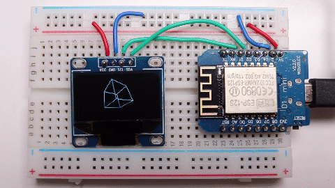
     
    

        Lighting Up an OLED Screen with MicroPython on an ESP8266 Module
    

In this chapter, we will provide more information about MicroPython. Please refer to [Introduction to QuecPython](about-qpy.md) for details.

#### Characteristics of Low-code Hardware Development

Although there are many types of low-code hardware development frameworks and various applicable scenarios, as low-code technologies, they all have some similar characteristics.

##### Object-Oriented

Object-oriented programming is a programming paradigm that encapsulates data and the methods that operate on that data into objects. Objects can interact with each other by passing messages, enabling the implementation of complex functionality. Object-oriented programming languages and frameworks make it easier for developers to understand and manipulate hardware devices because they abstract them as objects with properties and behaviors. For example, an LED light in Arduino can be seen as an object with properties like pin and brightness, and methods to set the pin and brightness. Using Arduino language, we can easily create an LED object and control its state by calling its methods.

##### Abstraction of Details

Abstraction of details is a programming technique that hides unnecessary or irrelevant information and exposes only what is necessary or relevant, simplifying the programming process. Programming languages and frameworks that abstract details allow developers to focus on the functionality and interface of hardware devices without needing to concern themselves with the underlying implementation details. This reduces the complexity of development and the likelihood of errors. For instance, the network service module in NodeMCU allows developers to establish network connections and transmit data without needing to understand the low-level drivers and protocol stacks of the Wi-Fi chip. They can simply use straightforward functions for these tasks.

> Taking GPIO (General Purpose Input/Output) development as an example, developers typically don't need to refer to schematics to understand circuit connections, understand various pin types and speed modes, or grasp concepts like level pull-up/pull-down. They also don't need to manually write clock configuration and system initialization code, which are essential in traditional embedded development. Instead, developers can directly write GPIO state control logic based on their specific business requirements. This significantly reduces the development threshold and amount of code.

##### Modularity

Modularity is a programming principle that breaks down a large program into small, independent modules, each with its functionality and interface, which can be reused and combined. Programming languages and frameworks that support modularity allow developers to flexibly call existing functional modules and combine them according to different needs, enabling the implementation of complex functionality. For example, in MicroPython, the hardware interface modules make it easy for developers to use various hardware devices such as I2C, SPI, and UART. They can import the corresponding modules and create objects to communicate with and control these devices.

Based on the analysis above, we can see that low-code development frameworks have the following advantages: they simplify the programming process and improve development efficiency, abstract hardware devices for enhanced portability, and leverage existing resources to expand functionality. In summary, low-code development frameworks are a programming paradigm that adapts to changes in the times and technological advancements. They allow more people to participate in innovation and creation, and bring their ideas and dreams to life.
