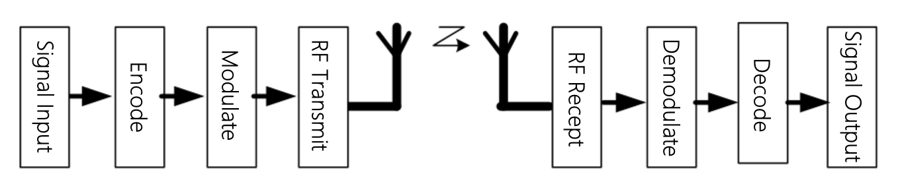
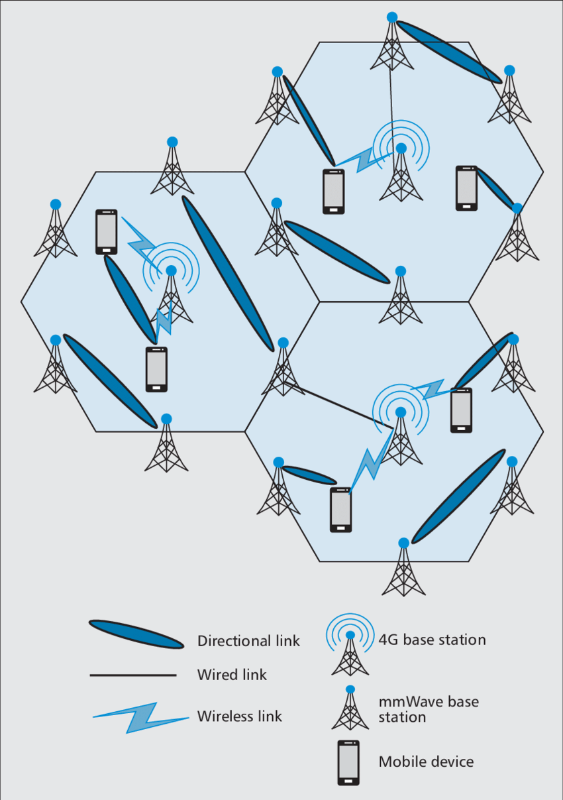
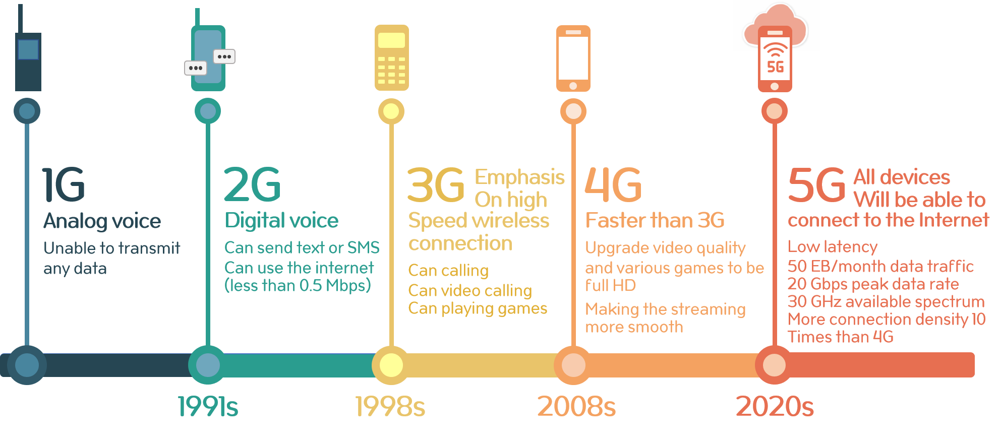
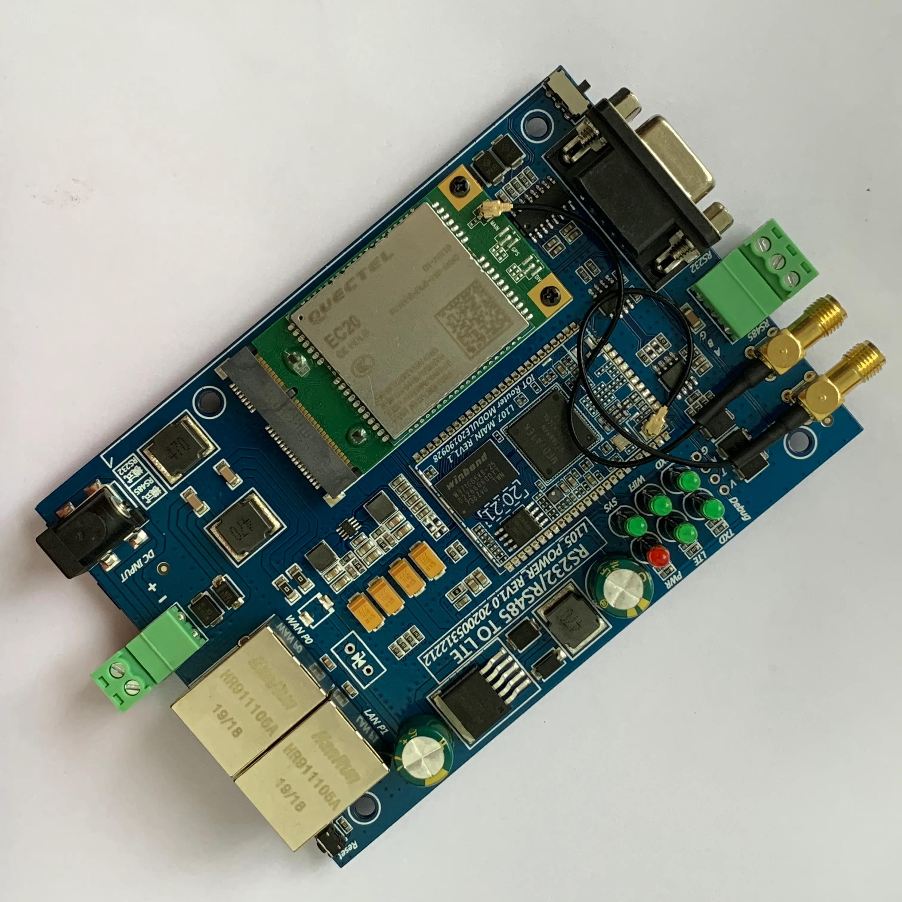
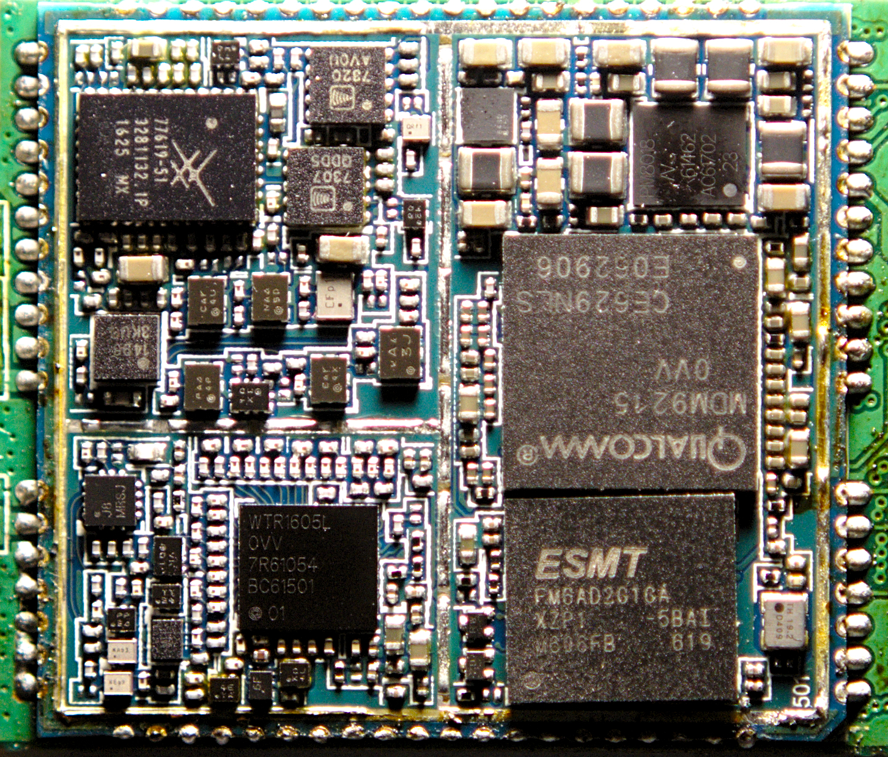
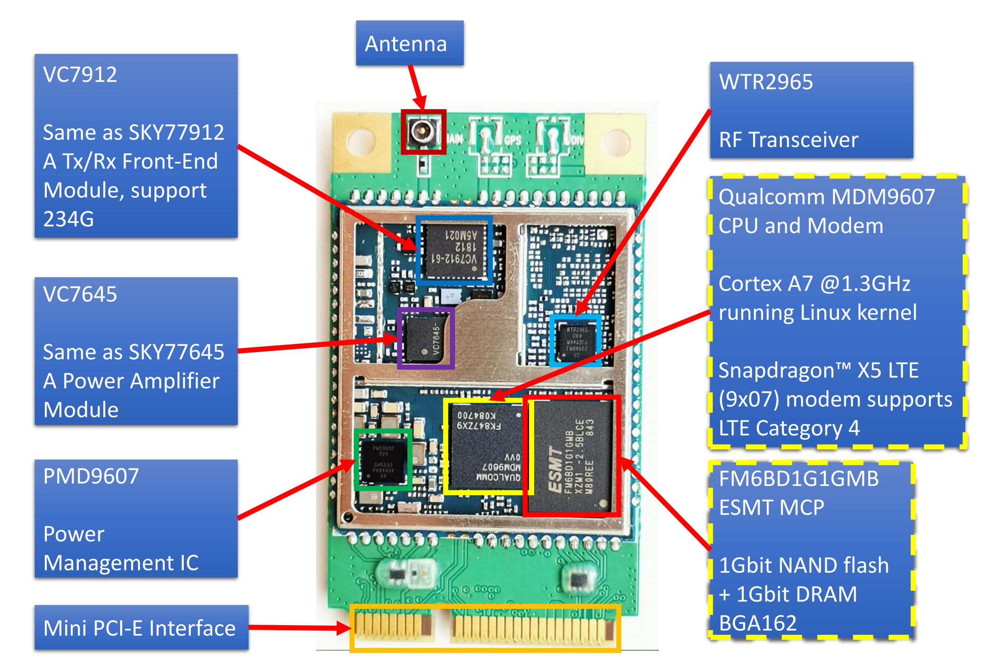
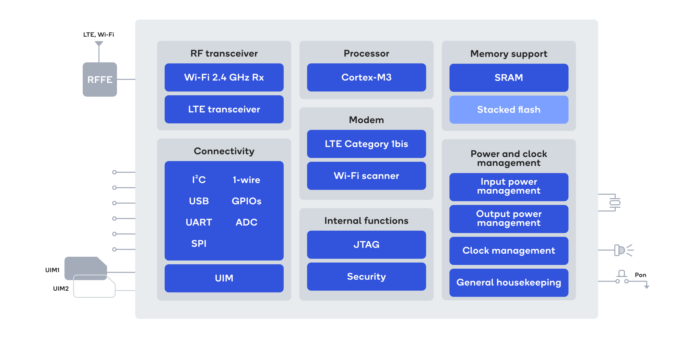
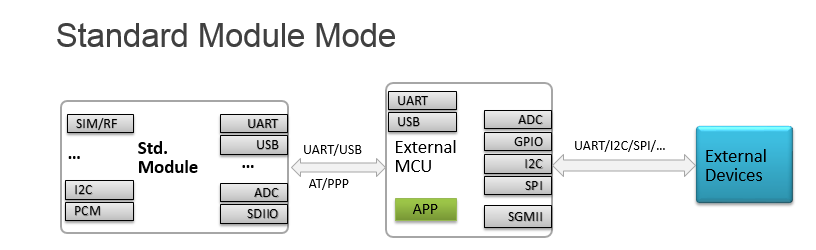
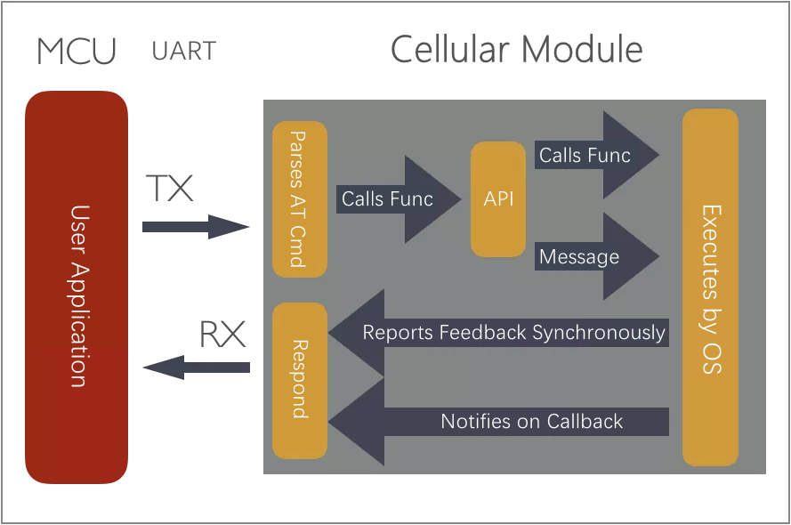
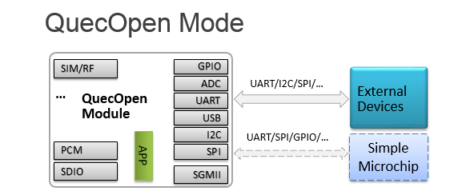

# Introduction to Wireless Communication Modules

QuecPython is a development framework that runs on wireless communication modules. For users who are new to IoT development, wireless communication modules may be an unfamiliar term. This section provides a brief introduction to wireless communication, cellular networks, as well as the concept, features, and development methods of modules.

## Wireless Communication and Cellular Network

### IoT Demands for Wireless Communication

In the [previous section](./iot-and-low-code.md), we introduced the four-layer structure of the IoT. The network layer plays a crucial role in device connectivity and data transmission. Due to the great quantity and extensive distribution, the connection via wired Ethernet cannot meet the requirement of IoT device development. Therefore, most IoT devices are wireless-communication-enabled, which utilize radio waves as the carrier for signal transmission. Currently, there are over ten common wireless communication methods, including Wi-Fi and Bluetooth, each with varying communication rates and distances.

.. details:: About Communication

    There are many types of wireless communication in the IoT and they are applicable to various scenarios, so there are great differences in the specific functional structure and technical details, but their basic processes and patterns are similar. For the sake of understanding, we will use an analogy of communication between people.

    Imagine a scenario where two individuals are located on adjacent mountaintops and need to communicate with each other in the absence of modern electronic devices.

    <center>
        
        <br>
        <div style="color: orange; border-bottom: 1px solid #d9d9d9; display: inline-block; color: #999; padding: 2px;">
            Two solitary mountaintops
        </div>
    </center>
    The simplest and most direct method is to shout and use sound as the information carrier while relying on air as the transmission medium. However, when the distance between the two individuals is far enough, the sound will be attenuated or interfered with, making this method impractical. In such cases, visual signals can be used for communication. The two individuals can use colored flags or torches as the information carrier while relying on light as the transmission medium. However, this method requires a prerequisite: both parties need to reach a consensus about the meaning of different flags or torch signals. Therefore, they can achieve low-efficiency but relatively reliable communication between distant mountaintops.

    <center>
        
        <br>
        <div style="color: orange; border-bottom: 1px solid #d9d9d9; display: inline-block; color: #999; padding: 2px;">
            Communicate using semaphore
        </div>
    </center>
    This rudimentary two-individual communication process encompasses the basic elements of a communication system: the information source, destination, channel, information carrier, and encoding rules. The information source refers to the originator and sender of information; The destination is the receiver and processor of information; The channel is the pathway through which signals are transmitted between the source and destination; The information carrier is the physical quantity that carries the information; And the encoding rules is the agreed representation of information.

    Modern communication systems also encompass similar elements but in a more complex and efficient manner. Users who have used dial-up access may be familiar with the term "modem". Telephone lines and networks are designed to transmit analog audio signals ranging from 300 Hz to 3400 Hz and are not suitable for direct transmission of network data. To enable bidirectional communication between computers over telephone lines, two basic requirements must be met:

    - Through the operating system and network interface, convert user raw data into standardized data formats that can be recognized and transmitted between network devices. This process, which involves standardizing data formats to improve information transmission efficiency and system effectiveness, is typically referred to as "coding". The corresponding process at the receiving end is known as "decoding".
    - Through the modem, convert digital signals into analog signals suitable for transmission over telephone lines, and vice versa. This process, which involves various transformations of the original signal to enable publication through different communication media or carriers, is typically referred to as "modulation". The corresponding process at the receiving end is known as "demodulation". The purpose of modulation and demodulation is to adapt to the channel characteristics, overcome channel interference, and enhance signal transmission quality.

    In addition to telephone lines, there are many other communication media available, such as radio waves, optical fibers, and satellites. Different communication media possess distinct characteristics and advantages, requiring the use of different encoding and modulation techniques. For example, a radio wave can be propagated through the air without physical connections but is easily interfered with by other radio waves. To allocate and utilize frequency spectrum resources, techniques such as frequency multiplexing, code  multiplexing, and orthogonal multiplexing are employed. Optical fibers can transmit high-speed and high-capacity optical signals with low loss, high bandwidth, and resistance to interference, but require special optoelectronic conversion devices to achieve optical-to-electrical signal conversion by using pulse code modulation, phase modulation, and frequency-shift keying. Satellites can provide coverage over extensive areas for long-distance communication but require high-power transmitters and receivers. Techniques such as multiple access, frequency-hopping spread spectrum, and quadrature phase shift keying are employed to facilitate communication between satellites and ground stations.

    Communication technology is an interdisciplinary science involving various disciplines, including information theory, signal processing, circuit theory, microwave technology, antenna technology, and network technology. However, as users or ordinary developers, you do not need to delve into excessive details. Various terminal devices and communication modules handle most aspects for us. Our focus should be on selecting and utilizing specific communication methods.

    <center>
        
        <br>
        <div style="color: orange; border-bottom: 1px solid #d9d9d9; display: inline-block; color: #999; padding: 2px;">
            Diagram of a wireless communication system
        </div>
    </center>
    > Please note that this section is not so comprehensive or rigorous in order to lower the comprehension threshold. This section does not provide an in-depth exploration of wireless communication principles or the specific details of various wireless communication methods used in IoT. If you are interested in the details, please refer to textbooks such as "Communication Principles", "Wireless Communication Principles and Applications" and "Internet of Things" for a more comprehensive self-study.

The table below lists the characteristics and usage scenarios of commonly used wireless communication technologies in IoT, considering the diverse requirements of different IoT applications.

| Communication Technology | Transmission Rate | Transmission Distance | Power Consumption |  Cost  | Application Scenarios                                                                               |
| :----------------------: | :---------------: | :-------------------: | :---------------: | :----: | --------------------------------------------------------------------------------------------------- |
|          Wi-Fi           |       High        |         Short         |       High        | Medium | <ul><li>Indoor wireless networking</li><li>Smart homes</li></ul>                                    |
|        Bluetooth         |      Medium       |         Short         |      Medium       |  Low   | <ul><li>Asset tracking</li><li>Location tags</li><li>Medical sensors</li><li>Smartwatches</li></ul> |
|          Zigbee          |        Low        |         Short         |        Low        |  Low   | <ul><li>Wireless sensors</li><li>Smart homes</li></ul>                                              |
|           UWB            |       High        |         Short         |       High        |  High  | <ul><li>High-precision positioning</li></ul>                                                        |
|            4G            |       High        |         Long          |       High        |  High  | <ul><li>Mobile communication</li><li>Vehicle tracking</li><li>Smart cities</li></ul>                |
|          NB-IoT          |        Low        |         Long          |        Low        | Medium | <ul><li>Remote meter reading</li><li>Manhole cover detection</li></ul>                              |
|           LoRa           |        Low        |         Long          |        Low        | Medium | <ul><li>Campus coverage</li><li>Offshore fishing vessel monitoring</li></ul>                        |

### What Is a Cellular Network?

A cellular network, also known as a mobile network, is a wireless communication technology that enables mobile devices, such as smartphones and tablets, to transmit voice, data, multimedia, and other services in different geographical areas. The cellular network is the foundational infrastructure of modern mobile telephone and personal communication systems, playing a crucial role in driving the process of society digitization.

<center>
    
    <br>
    <div style="color: orange; border-bottom: 1px solid #d9d9d9; display: inline-block; color: #999; padding: 2px;">
        Diagram of 5G Millimeter Wave Cellular Network Structure
    </div>
</center>

As shown in the diagram above, the core idea of a cellular network is to divide a large service area into multiple smaller cells. Each cell is equipped with a base station responsible for wireless communication with mobile devices within that cell. These base stations are interconnected through wired or wireless connections, forming a network that covers the entire service area. In traditional theory, these cells are designed as hexagonal, circular, or square shapes, with hexagons being the most common. The interconnection between cells enables complete coverage of the region, resembling a honeycomb, which is why this technology is referred to as cellular networks. Nowadays, the coverage areas of many base stations no longer have a cellular shape, but the term has persisted.

<center>
    
    <br>
    <div style="color: orange; border-bottom: 1px solid #d9d9d9; display: inline-block; color: #999; padding: 2px;">
        Evolution from 1G to 5G
    </div>
</center>

.. details:: From 1G to 5G

    The term cellular networks was initially proposed by Bell Labs in the United States in 1947 and was first commercially deployed in Japan in 1979. The early cellular networks, known as the mobile communication systems of "The 1st Generation (1G)", could only provide analog voice telephony services. The 1G systems adopt Frequency Division Multiple Access (FDMA) technology to allocate different users to different frequency channels. Although the 1G systems started the era of mobile communication, they had some limitations, such as low spectrum efficiency, limited service types, lack of high-speed data services, poor security, and high device costs.

    To address the issues in analog systems, the 2nd Generation (2G) mobile communication systems, also known as digital mobile communication technology, emerged in the early 1990s. The 2G systems employed digital modulation techniques and adopted either Time Division Multiple Access (TDMA) or Code Division Multiple Access (CDMA) technology. The 2G systems brought significant improvements over the 1G systems, including increased system capacity, improved security, voice call quality, and the introduction of data services. The most representative 2G system is the Global System for Mobile Communication (GSM) widely used in Europe, which enabled global roaming and became one of the most adopted standards worldwide.

    With the development of the internet, there was a growing demand for data services. To achieve higher data transmission rates, enhancements were introduced based on the 2G systems, such as General Packet Radio Service (GPRS) and Enhanced Data for GSM Evolution (EDGE). These technologies, referred to as 2.5G or 2.75G, provided higher data transfer rates compared to 2G but still could not meet the demand for high-speed broadband data services.

    In 2001, the 3rd Generation (3G) mobile communication systems, aiming at digital multimedia mobile communication, entered the commercial stage. The 3G systems adopted advanced Wideband Code Division Multiple Access (WCDMA) technology and utilized higher frequency bands with larger system bandwidth for data transmission, resulting in further improvements in data transfer rates. The 3G systems enabled simultaneous transmission of voice and data, supporting multimedia services such as images, music, and videos. Notable 3G systems include CDMA2000 in North America, WCDMA in Europe and Japan, and Time Division-Synchronous Code Division Multiple Access (TD-SCDMA) in China. These technologies were based on the standard IMT-2000 (International Mobile Telecommunications 2000) formulated by International Telecommunication Union (ITU).

    Along with the development of 3G networks, enhancements were introduced, such as High-Speed Downlink Packet Access (HSDPA), High-Speed Uplink Packet Access (HSUPA), and Enhanced High-Speed Packet Access (HSPA+). These technologies, known as 3.5G or 3.75G, provided higher data transfer rates and better user experiences compared to 3G.

    In 2011, the 4th Generation (4G) mobile communication systems, designed for digital broadband data mobile internet communication, were officially launched. The 4G systems are based on the flat network architecture and are upgraded on the basis of the Long Term Evolution (LTE) of 3G systems. The LTE systems employed key technologies such as Orthogonal Frequency-Division Multiple Access (OFDMA), Adaptive Modulation and Coding (AMC), and Multiple-input Multiple-output (MIMO), significantly improving spectrum efficiency and network performance. The 4G systems offered extremely high data transmission speeds, over 50 times faster than 3G networks, providing video transmission quality the same as high-definition television. The most representative 4G system is Long Term Evolution Advanced (LTE-A), which operates in Time Division Duplexing (TDD) or Frequency Division Duplexing (FDD) modes. LTE-A adopted technologies like Carrier Aggregation (CA), relaying, and Coordinated Multiple Point (CoMP), making breakthroughs in network capacity and coverage.

    With the rapid development of emerging technologies and applications such as smart devices, the Internet of Things (IoT), and cloud computing, the demand for mobile communication continues to increase. To meet the requirements of human information society in the future, the 5th Generation (5G) mobile communication system has emerged. 5G systems provide not only higher data transfer rates, lower latency, and increased reliability but also support massive connections and diverse business scenarios. Currently, 5G mobile communication systems have penetrated various fields such as industry, healthcare, and transportation, integrating deeply with devices and objects, enabling the vision of the Internet of Everything, providing strong support for social and economic development and improving the quality of human life.

Cellular networks, as a wireless communication technology, have undergone five generations of development since the creation. Each generation corresponds to different technologies and standards, providing users with higher data transmission speeds, better voice call quality, and a range of new features and functionalities. From 1G's analog voice communication to 5G's ubiquitous connectivity, cellular networks have become an indispensable information infrastructure in modern society.

### Internet of Things (IoT) and Cellular Networks

Compared to other wireless communication methods, cellular communication relies on existing networks of telecommunications operators, without the need for manual network deployment at application sites, which significantly reduces the difficulty and workload of connectivity. In the fields of agriculture, environmental protection, security and other IoT application scenarios, cellular networks have become one of the preferred wireless communication methods.

As mentioned above, cellular networks come in various standards and formats. What kind of cellular network does the IoT require? This depends on the specific application scenarios and requirements. Generally, most IoT application scenarios require the following characteristics:

- Numerous IoT devices with a large number of connections. For example, a smart city may need to connect tens of thousands of sensors and devices.
- Small-sized IoT devices with low power consumption. For instance, a smart water meter may be only a few centimeters in size and need to operate for extended periods without frequent battery replacement.
- Dispersed IoT devices with wide coverage. For instance, a smart agriculture system may need to cover hundreds of square kilometers of farmland and pastures.
- Simple IoT devices with small data volume. For example, a smart parking system may only require reporting the occupancy status of parking spaces, which amounts to a few bytes of data each time.

Based on these characteristics, we can identify the following key requirements of cellular networks for IoT:

- **Massive connectivity**: Ability to support the connection of thousands or even tens of thousands of devices simultaneously in each cell.
- **Low power consumption**: Enabling devices to operate for extended periods on low battery power, thereby extending battery life.
- **Wide coverage**: Providing stronger signal penetration and broader coverage, spanning urban and rural environments.
- **Cost-effectiveness**: Reducing device and operational costs to increase the adoption and sustainability of IoT.

In terms of speed and bandwidth, IoT does not demand high requirements. Since IoT devices transmit relatively small amounts of data, they do not require the high rates and bandwidth of smartphones and other smart devices. Moreover, speed and bandwidth are constrained by power consumption and cost, as increasing speed and bandwidth often lead to higher power consumption and costs. Therefore, traditional mobile networks like 4G and 5G are not suitable for many IoT applications.

Currently, in China, the most commonly used cellular communication standards in the IoT field include LTE Cat 4, LTE Cat 1, and NB-IoT. The table below compares their characteristics.

|        Feature        |                                           LTE Cat 4                                           |                                                              LTE Cat 1bis                                                              |                                                     NB-IoT                                                     |
| :-------------------: | :-------------------------------------------------------------------------------------------: | :------------------------------------------------------------------------------------------------------------------------------------: | :------------------------------------------------------------------------------------------------------------: |
|    Downlink Speed     |                                           150 Mbps                                            |                                                               10.3 Mbps                                                                |                                                    250 kbps                                                    |
|     Uplink Speed      |                                            50 Mbps                                            |                                                                5.2 Mbps                                                                |                                                    250 kbps                                                    |
|   Network Coverage    |                                      Global LTE Networks                                      |                                                          Global LTE Networks                                                           |                              Requires deployment of new or upgraded base stations                              |
|       Mobility        |                                 Supports high-speed mobility                                  |                                                    Supports mobility up to 100 km/h                                                    |                                           Does not support mobility                                            |
|        Latency        |                                       Millisecond-level                                       |                                                           Millisecond-level                                                            |                                                  Second-level                                                  |
|         Cost          |                                             High                                              |                                                                  Low                                                                   |                                                      Low                                                       |
|   Power Consumption   |                                             High                                              |                                                                  Low                                                                   |                                                      Low                                                       |
| Application Scenarios | HD video surveillance, routers, sales terminals, etc., requiring high-speed data transmission | Shared payments, industrial control, in-vehicle payments, public network intercom, POS, etc., requiring medium-speed data transmission | Water meters, electricity meters, gas meters, etc., requiring low-speed data transmission and stationary usage |
|     Voice Support     |                                 Supports VoLTE (Voice calls)                                  |                                                      Supports VoLTE (Voice calls)                                                      |                                          Does not support voice calls                                          |
| Antenna Configuration |                           2x2 MIMO (Multiple Input Multiple Output)                           |                                                 1x1 SISO (Single Input Single Output)                                                  |                                     1x1 SISO (Single Input Single Output)                                      |
|       Bandwidth       |                                            20 MHz                                             |                                                                1.4 MHz                                                                 |                                                    180 kHz                                                     |

## Introduction to Modules

A wireless communication module, also known as a module or module unit, is an essential component for achieving data connection to IoT platforms and remote communication. It has been widely used in various IoT scenarios. From the perspective of functionality, a module serves as a bridge between local devices and networks. Just like plugging a USB network card into a computer to start accessing the internet, adding a module to an embedded system enables the connection to a wireless network.

<center>        <br>    <div style="color: orange; border-bottom: 1px solid #d9d9d9; display: inline-block; color: #999; padding: 2px;">        Mainboard of an IoT Device Integrated with a Quectel EC20 Module    </div> </center>

Many users who encounter modules for the first time may feel unfamiliar with this strange device covered by a metal shield. Modules are different from traditional chips and discrete components. In reality, the essence of a module is a small Printed Circuit Board Assembly (PBCA). When we remove the metal shield on the surface of the module, we can still see a familiar (but denser) PCB circuit structure inside.

<center>        <br>    <div style="color: orange; border-bottom: 1px solid #d9d9d9; display: inline-block; color: #999; padding: 2px;">        Internal View of a 4G Module    </div> </center>

Users with experience in embedded system development should be familiar with "core boards" or System on Modules (SoM). Similarly, modules can be understood as "core boards" with high density, small size, shielding covers, and integrated various components required for wireless communication. They are used to complete the communication functions between local circuits and IoT platforms efficiently. In the introduction to communication at the beginning of this section, we talked about the concepts of encoding (decoding) and modulation (demodulation). In wireless communication processes, especially cellular communication processes, these steps tend to evolve and expand to be extremely complex. The role of the module is to help us complete these complex steps to achieve simple and efficient communication.

The internal structure of a module is complex. As shown in the following image, it includes various integrated components such as the main chip (Qualcomm MDM9607), memory, power management chip, power amplifier, RF front-end, as well as numerous small-sized packaged resistors and capacitors. Clearly, the complexity and precision of modules are much greater than that of traditional circuit boards.

<center>        <br>    <div style="color: orange; border-bottom: 1px solid #d9d9d9; display: inline-block; color: #999; padding: 2px;">        Components of the EC20 Mini PCIe Module    </div> </center>

The main chip, also referred to as the baseband chip or modem chip by some manufacturers, is the core of the entire module. Its role, functions, and features are similar to the SoC (System on Chip) in smartphones. With technological advancements and improvements in chip manufacturing processes, the main chip in modern modules usually integrates application processors (APs), baseband and RF functionalities, runs a complete operating system (RTOS or Linux), provides various interfaces such as GPIO and USB, and can perform various communication operations as required. In this sense, a module is both like a smartphone without a screen and battery and a more complex MCU.

<center>        <br>    <div style="color: orange; border-bottom: 1px solid #d9d9d9; display: inline-block; color: #999; padding: 2px;">       Diagram of the Latest Qualcomm QCX216 4G Modem Chip    </div> </center>

## Application Modes of Modules

Just like different people use the same Android phone in different ways, some users will safely use the factory system and features, while others are keen on unlocking, fastboot, root and other operations to further develop the device. Similar to mobile phones, modules also have two types of application modes: Standard Mode and Custom Development Mode.

### Standard Mode

Similar to regular smartphones, modules typically come with a built-in operating system and pre-installed applications. For many users, the preconfigured features of the module are sufficient to meet their network communication needs. This mode, known as Standard Mode or Traditional Mode, involves using the module as a ready-made functional unit without the need for further development or customization. It is currently the most common application mode for modules.

<center>        <br>    <div style="color: orange; border-bottom: 1px solid #d9d9d9; display: inline-block; color: #999; padding: 2px;">        Diagram of Standard Mode    </div> </center>

As shown in the diagram, in Standard Mode, the module is connected to the main controller (MCU), such as an STM32, via UART or USB interface for two-way communication using AT commands. The MCU serves as the core of the system, with the communication module acting as an independent peripheral device to the MCU. The main business logic (user app) runs on the MCU, and other external devices are connected to the MCU via interfaces like UART and I2C, controlled by the MCU.

.. details:: About AT Commands

    AT command is one of the oldest and most widely-used communication command sets in the industry. It establishes a complete bidirectional communication mechanism between users (or MCUs) and modules. Users (or MCUs) control the module by sending AT commands, which include various functions such as network connection, voice call, and positioning. The module then returns the execution results and status to the user. This "send and receive" mechanism and the simple processing method are well-suited for embedded environments with limited resources. Nowadays, most modules on the market come with built-in AT server programs that can receive, parse, and execute specific AT commands.

    <center>
        
        <br>
        <div style="color: orange; border-bottom: 1px solid #d9d9d9; display: inline-block; color: #999; padding: 2px;">
            Operation Mode of AT Commands
        </div>
    </center>

For developers using modules in Standard Mode, the main development effort lies in the user app running on the MCU. The business codes in the app need to include complex functionalities such as sending AT commands and parsing return values, including handling Unsolicited Result Codes (URC), which is challenging for beginners.

In addition to the AT command functionality, modules in Standard Mode can also serve as wireless network cards, providing a range of network services, including PPP dial-up networking, to the MCU or other host devices.

### Custom Development Mode

In the content above, we mentioned that modules are like more advanced MCU. In fact, the main chips used in modules typically have higher performance and more resources to meet the requirements of wireless communication. These chips are equipped with various peripheral interfaces such as GPIO, ADC, and I2C. However, in Standard Mode, these resources are not directly accessible to users. "Lifting" these limitations and unleashing the full potential of modules requires custom development.

Custom development, in essence, involves combining and extending the basic functionalities and interfaces provided by the software to develop new features that meet specific user needs. In the context of module development, Custom Development Mode allows developers to call APIs and write their own applications on top of the underlying operating system, fully utilizing the module's resources and enabling additional possibilities.

<center>        <br>    <div style="color: orange; border-bottom: 1px solid #d9d9d9; display: inline-block; color: #999; padding: 2px;">        Diagram of Custom Development Mode    </div> </center>

The most significant advantage of custom development is that it allows modules to have the ability to replace the MCU to some extent. Therefore, this mode is also known as OpenCPU or OpenMCU (Different manufacturers may have different specific terms, such as QuecOpen by Quectel). As shown in the diagram, in comparison to Standard Mode, the OpenCPU mode utilizes the module itself as the MCU, where the user application runs within the module. The external devices are connected directly to the module, eliminating the need for an external processor (MCU) or requiring only a simple external chip (referred to as "Simple Microchip" in the diagram). This solution effectively simplifies hardware design, reduces component costs, and reduces the product size. With the high cost of MCUs today, the OpenCPU solution has gained popularity among many companies.

However, the OpenCPU solution also has some limitations. Since this solution typically involves developing directly on the underlying operating system running on the module, it requires a higher level of technical expertise. Traditional MCU developers without system-level development experience may be challenging. Additionally, due to the complexity of OpenCPU technical support, module manufacturers usually provide relevant tools and materials only to key customers, making it less accessible for newcomers. Finally, different manufacturers and module models may have significant differences in the OpenCPU development environment and tools, which can make porting programs between different modules difficult.

### Module Development in Scripting Languages

Traditional OpenCPU development adopts the C language, also known as CSDK development. Users need to directly modify and control the underlying operating system, which requires a higher level of difficulty and carries some risks. In the [previous section](./iot-and-low-code.md), we introduced the concept of low-code development and its application in IoT. Currently, some module manufacturers have ported interpreters/virtual machines based on CSDK, allowing users to perform custom development on modules using scripting languages such as Lua and Python.

Compared to the C language, scripting languages are generally simpler in syntax and usage. Developers can quickly master them without spending too much time and effort, allowing for easier implementation of business logic and facilitating rapid development and iterative improvement of projects. Additionally, for low-code development, developers don't need to worry about low-level details such as memory management or basic task scheduling, which significantly reduces the technical barriers for module custom development. At last, for different module models, as long as they run the same scripting language interpreter, the programs written by users usually require minimal modifications (or even no modifications) for portability.

The following examples demonstrate the codes for flashing an LED using both the C language and Python language on an EC100Y-CN module. It is evident that the scripting language code is more straightforward, intuitive, and easier to write and understand.

.. tabset:: LED Flashing Code

    ## Using QuecOpen (CSDK)

    ```c
    #include "ql_application.h"
    #include "ql_gpio.h"
    #include <stdio.h>

    static quec_gpio_cfg_t led_gpio_cfg[] =
    {
        {GPIO_PIN_NO_75, PIN_DIRECTION_OUT, PIN_NO_EDGE, PIN_PULL_DISABLE, PIN_LEVEL_LOW}
    };

    static void led_test(void *argv)
    {
        ql_gpio_init(led_gpio_cfg[0].gpio_pin_num, led_gpio_cfg[0].pin_dir, led_gpio_cfg[0].pin_pull, led_gpio_cfg[0].pin_level);

        while (1)
        {
            ql_gpio_set_level(led_gpio_cfg[0].gpio_pin_num, PIN_LEVEL_LOW);
            ql_rtos_task_sleep_s(1);
            ql_gpio_set_level(led_gpio_cfg[0].gpio_pin_num, PIN_LEVEL_HIGH);
            ql_rtos_task_sleep_s(1);
        }
    }

    application_init(led_test, "led_test", 2, 2);
    ```

    ## Using QuecPython

    ```python
    from machine import Pin
    import utime as time

    led = Pin(Pin.GPIO15, Pin.OUT, Pin.PULL_DISABLE, 0)

    def led_test():
        while 1:
            led.write(0)
            time.sleep(1)
            led.write(1)
            time.sleep(1)

    if __name__ == "__main__":
        led_test()
    ```

However, using scripting languages for development filters many low-level details, which makes them less flexible and controllable compared to traditional C language development. Additionally, scripting languages generally have lower performance and slower execution speed compared to C language. Therefore, they may not be suitable for scenarios with high performance and real-time requirements.

## Choose the Best Development Solution

The following table compares the standard mode, CSDK custom development, and scripting custom development from multiple perspectives. You can choose the most suitable development solution based on your specific requirements.

|        Feature         | Standard Mode | Custom Development (CSDK) | Custom Development (Scripting Language) | Remarks                                                                                                                                                                                                                                                                                                                                                                                                                         |
| :--------------------: | :-----------: | :-----------------------: | :-------------------------------------: | :------------------------------------------------------------------------------------------------------------------------------------------------------------------------------------------------------------------------------------------------------------------------------------------------------------------------------------------------------------------------------------------------------------------------------ |
|     Material Costs     |     ⭐⭐      |            ⭐             |                   ⭐                    | <ul> <li> During custom development, the module can be used as the system controller, saving costs on additional MCUs.</li> </ul>                                                                                                                                                                                                                                                                                               |
|       Threshold        |      ⭐       |          ⭐⭐⭐           |                   ⭐                    | <ul> <li> Module manufacturers usually offer CSDK development support and related services to key customers.</li> </ul>                                                                                                                                                                                                                                                                                                         |
| Development Difficulty |      ⭐       |          ⭐⭐⭐           |                   ⭐                    | <ul> <li> CSDK development requires developers to have experience with RTOS or Linux development, making it challenging for regular MCU developers.</li> <li> Standard mode only requires users to know MCU serial communication and string processing methods without any special requirements.</li> <li> Scripting language development only requires users to know basic syntax without any special requirements.</li> </ul> |
|   Development Cycle    |      ⭐       |          ⭐⭐⭐           |                   ⭐                    | <ul> <li> The complexity of CSDK development determines its longer development cycle and higher development costs.</li> </ul>                                                                                                                                                                                                                                                                                                   |
|   Maintenance Costs    |     ⭐⭐      |          ⭐⭐⭐           |                   ⭐                    | <ul> <li> The modular development nature of scripting languages ensures long-term stability, and the OTA upgrade feature is included, making remote upgrades easy to perform.</li> </ul>                                                                                                                                                                                                                                        |
|      Flexibility       |      ⭐       |          ⭐⭐⭐           |                  ⭐⭐                   | <ul> <li> In standard mode, developers usually use some limited features such as serial communication and ADC.</li> <li> With scripting language development, developers can access most of the module's resources through built-in function libraries.</li> <li> With CSDK development, developers have direct control over all available resources based on their own needs and ideas.</li> </ul>                             |
|      Performance       |       -       |          ⭐⭐⭐           |                  ⭐⭐                   | <ul> <li> Scripting languages generally have lower performance compared to the C language. Therefore, in scenarios that require high-speed execution, precise timing, or a large number of resources, scripting language development is not recommended.</li> </ul>                                                                                                                                                             |
|   Power Consumption    |      ⭐       |           ⭐⭐            |                  ⭐⭐                   | <ul> <li> The power consumption level of a typical 4G module during autonomous sleep is in the mA range.</li> <li> In standard mode, maximum power savings can be achieved by MCU cutting off module power, resulting in power consumption as low as 1/10 of the other development solutions.</li> </ul>                                                                                                                        |
|       Ecosystem        |    ⭐⭐⭐     |            ⭐             |                 ⭐⭐⭐                  | <ul> <li> Both standard AT command development and scripting language development have ample publicly available resources and tutorials online.</li> <li> CSDK development lacks an open ecosystem.</li> </ul>                                                                                                                                                                                                                  |
