# DTU Tool User Guide

## Overview

This document introduces how to use **DTU Tool** with Quectel **DTU Solution** for development and debugging.

DTU Tool has two main functions:

- Query and configure DTU device parameters.
- Transmit data: send and receive data between the DTU device and the cloud.

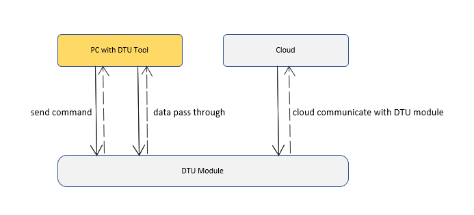

## Query and Configure Parameters

| Function           | Description                                                  |
| ------------------ | ------------------------------------------------------------ |
| Query IMEI Number  | Get the IMEI number of the device                            |
| Query Phone Number | Get the phone number of the SIM card in the DTU device |
| Query Signal Strength | Get the CSQ value. Range: 0–31. A larger value indicates a stronger signal strength. |
| Restart Device | Restart the DTU device                                    |
| Get Current Parameter Settings | Get the current parameter settings of the DTU device and redirect to the parameter setting and display page |
| Restore Factory Settings | Restore the factory settings and restart the DTU device |
| Save Parameter Settings | System configuration parameters: cloud platform type, firmware upgrade, script upgrade, historical data storage<br />Serial port configuration parameters: serial port number, baud rate, data bits, parity, stop bits, flow control, R485<br />Cloud configuration parameters: Alibaba Cloud, MQTT private cloud, Socket private cloud |

### Query IMEI Number

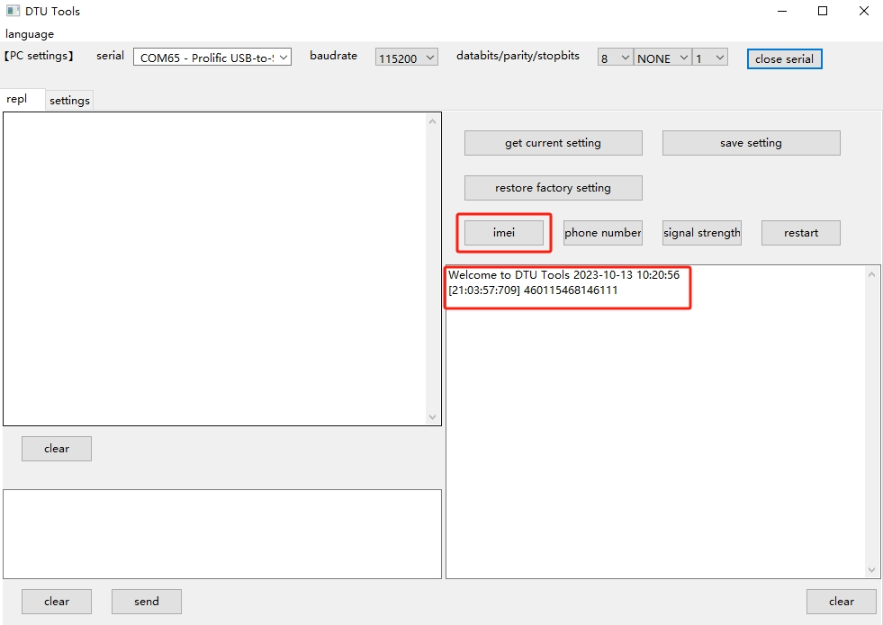

The left serial port data display box displays the detailed serial port data in string format, and the right command box displays the queried IMEI number.

### Query Phone Number

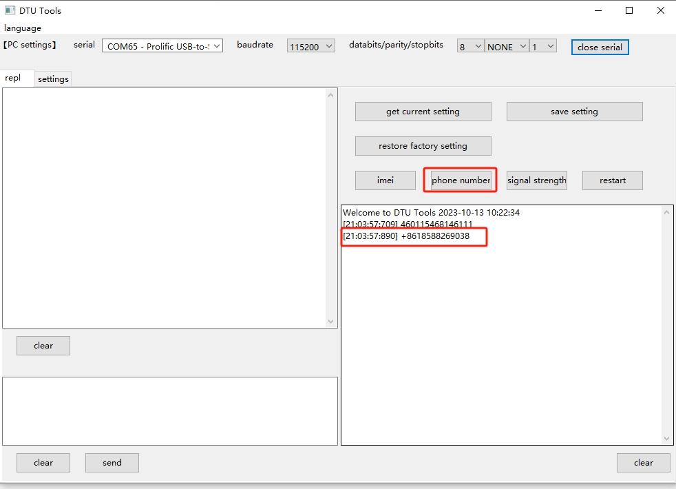

### Query Signal Strength

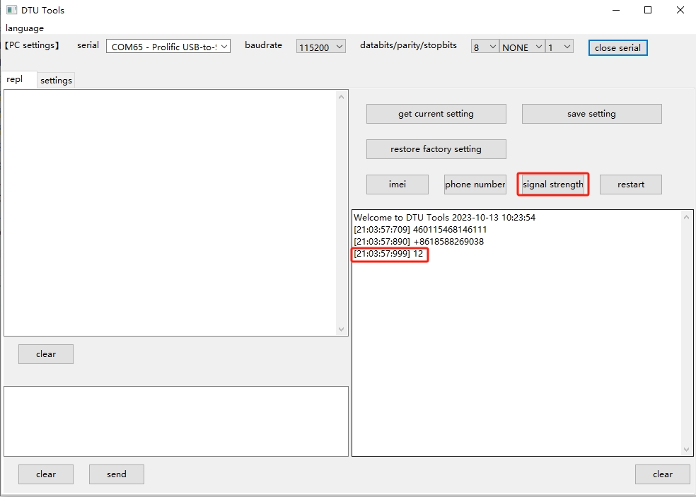

### Restart Device

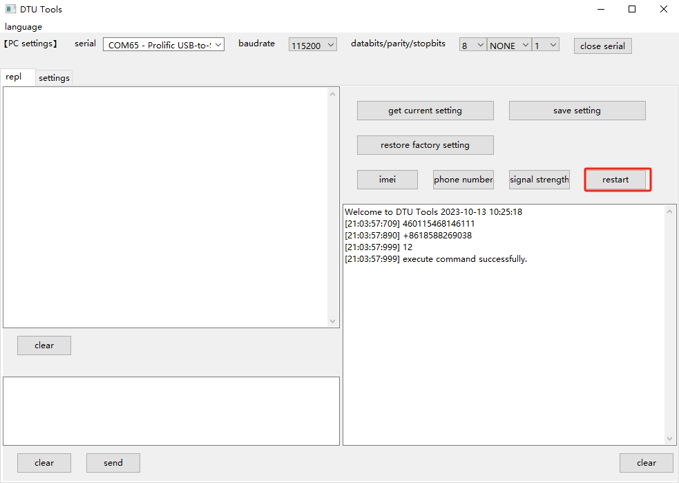

### Get Current Parameter Settings

In the command box, click **`get current setting`** to request the current parameter settings of the DTU device, and the tool will redirect to the parameter setting and display page

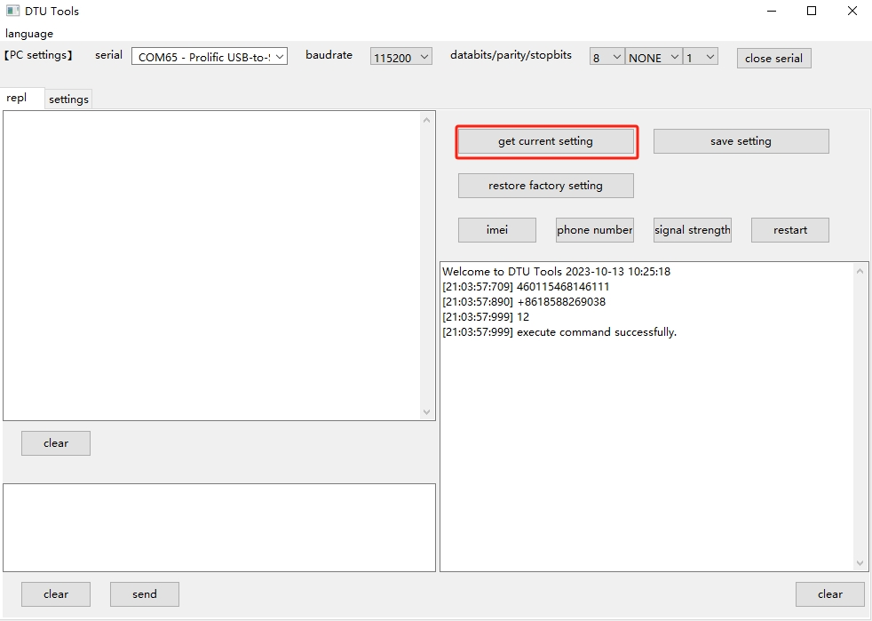

Parameter setting and display page

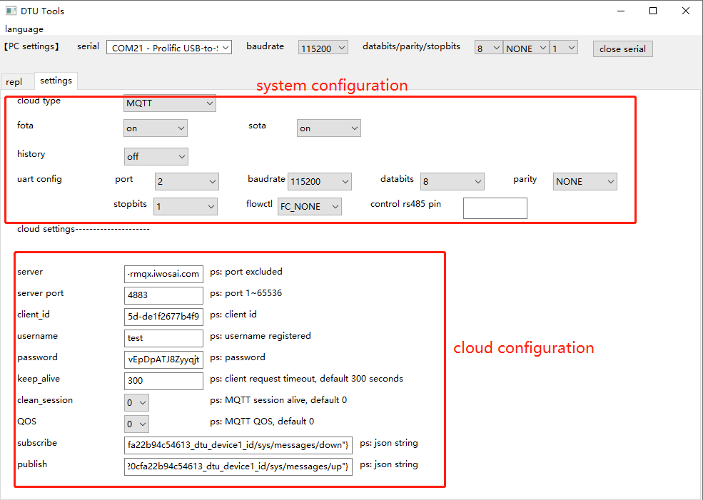

### Save Parameter Settings

After getting the current parameter settings, enter the parameter "settings" page, and modify the settings according to actual needs (You can also set the parameter directly without getting the current values).

After the modification is completed, return to the "repl" page and click **`save setting`** to save the settings.

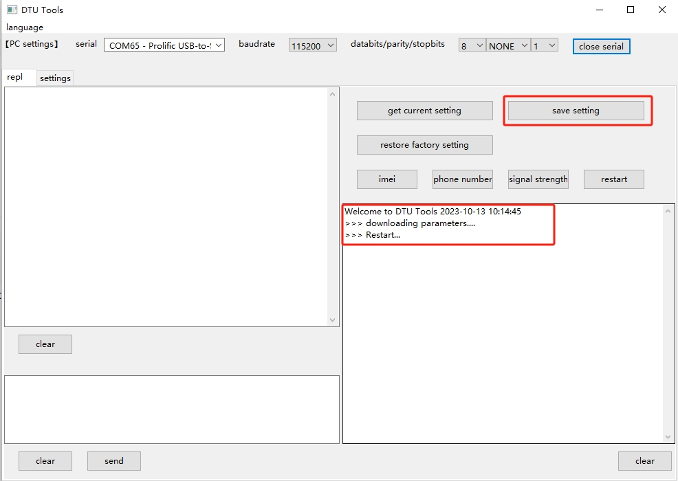

Click **`restore factory setting`** to restore the factory settings.

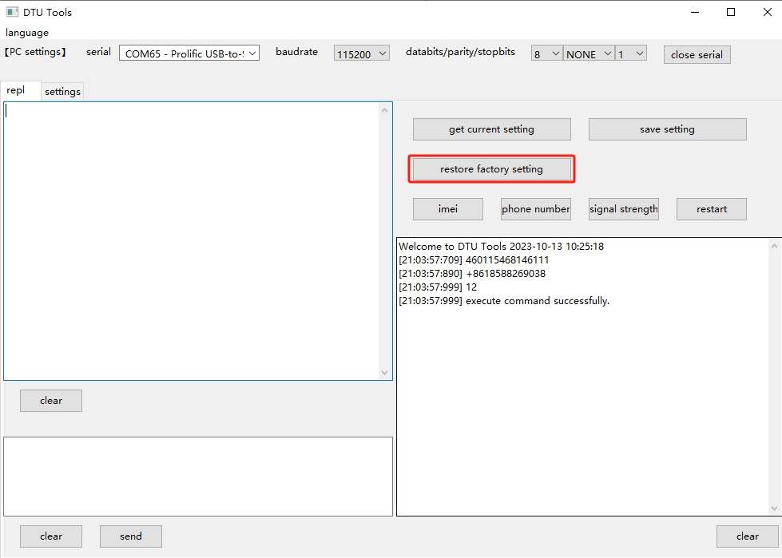

#### System Configuration Parameter

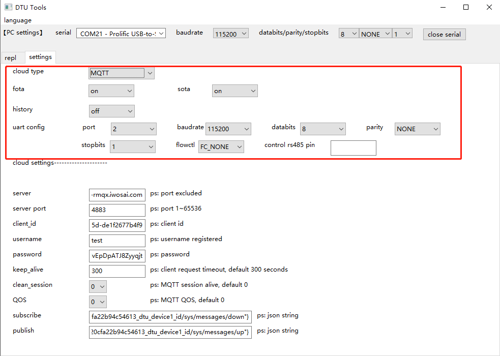

The basic configuration parameters are shown in the above figure.

| **Parameter** | **Description**                                              |
| ------------------ | ------------------------------------------------------------ |
| cloud type | `Alibaba Cloud` <br />`TCP Private Cloud` <br />`MQTT Private Cloud` |
| fota | Whether to enable firmware OTA upgrade                        |
| sota | Whether to enable project script OTA upgrade                  |
| history | When communication is abnormal and the DTU cannot send data to the cloud, the data will be saved and sent again when communication is restored |
| port | Serial port number that the external MCU connects to the DTU. Option:  `0`,  `1` and `2`. |
| baudrate | Serial port baud rate                                        |
| databits | The number of data bits                                      |
| parity | Whether to set parity check |
| stopbits | Length of stop bit. Option:  `1` and `2`. |
| flowctrl | Hardware control flow. Option: `FC_NONE` and `FC_HW`. |
| control rs485 pin | Pull up and pull down the specified GPIO before and after sending data through the serial port to indicate the direction of 485 communication. For example, `1 ` represents `UART.GPIO1` and `2` represents `UART.GPIO2`. |

#### Cloud Configuration Parameter

The cloud configuration parameters vary with the selected `cloud type`. When the `cloud type` is MQTT, the cloud configuration parameters are as follows:

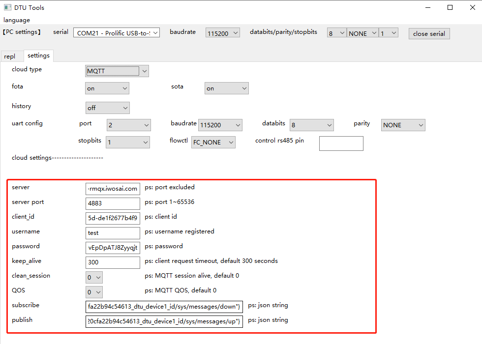

> The subscription topic and publishing topic are both in the format of "**<font color='red'>JSON format with the topic ID as the key and the topic string as the value</font>**".
>
> For example: the parameter `{"0":"/F79933DC83A4/connect_packet/adv_publish"}` indicates that the topic with ID `"0"` is `"/F79933DC83A4/connect_packet/adv_publish"`.

## DTU Data Transmission and Debugging

Data format requirements for the data transmission box: The data transmission format is consistent with the communication format between MCU and DTU. Depending on the different communication protocols with the cloud, the communication protocol between the module and external devices (such as MCU) will also be different. When the module communicates with the cloud over the TCP protocol, because both TCP and serial ports are in the form of data streams, the data is transparently transmitted without any processing. When the module communicates with the cloud over the MQTT protocol, in order to distinguish different data frames, the module's serial port adopts a simple data frame for external protocol: `<topic_id>,<msg_len>,<msg_data>`.

**Example messages**

Upstream message: `"1,6,abcedf"`

Downstream message: `"1,6,ijklmn"`

Both the uplink and downlink messages between the module and the external device (MCU) are in string format, with data items separated by `","`.

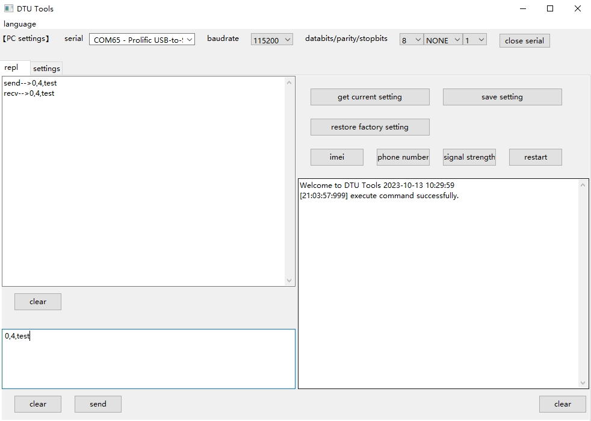

## Secondary Development

The DTU Tool is developed based on the graphical framework *wxPython*. At this stage, it has been compiled into *`dtu_tool.exe`* and only supports the Windows system. You can configure the Python environment and install *wxPython* on Linux or macOS, and then run *`dtu_tool.py`* directly or compile the corresponding version of the binary program by yourself (compilation script: *`dtu_tool/build.sh`*).

> DTU Tool source code repository link: <https://github.com/QuecPython/DTU-tool.git>
>
> wxPython official website: <https://www.wxpython.org>

### Install Dependencies

After configuring the Python development environment, use the *`pip`* tool to install the following dependencies:

```shell
Pypubsub==4.0.3
wxPython==4.1.1
pubsub==0.1.2
pyserial==3.5
```

### Execute Script

```shell
python dtu_tool.py
```

### Interface Display

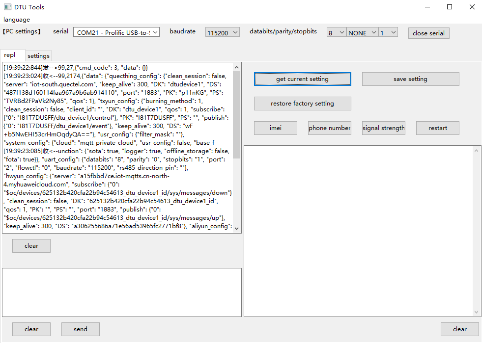

> Note: Before debugging, please start the DTU device, select the serial port for communication with the DTU device in the "PC settings" area of the DTU Tool, and open the serial port.