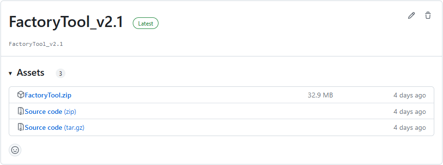
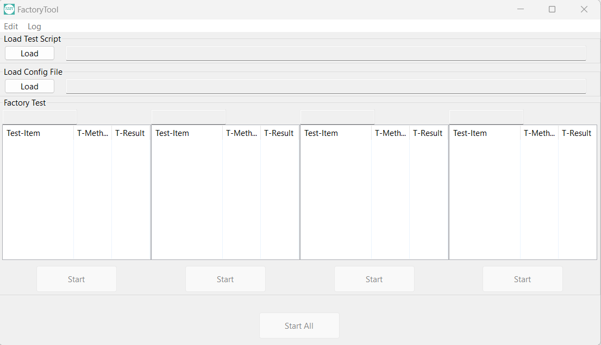
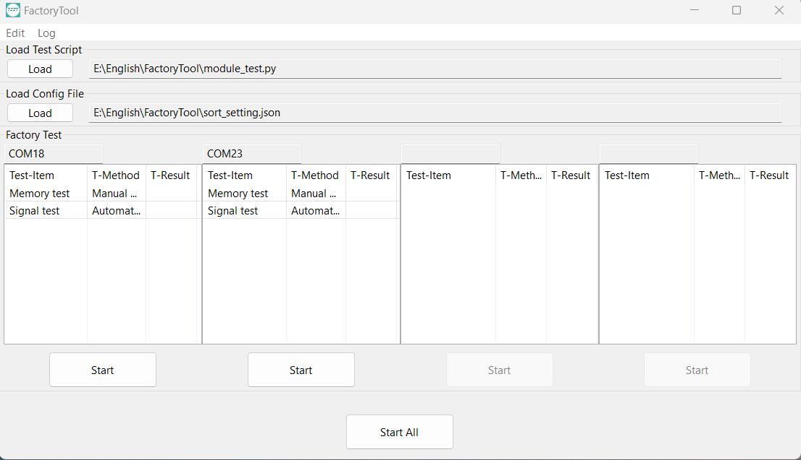
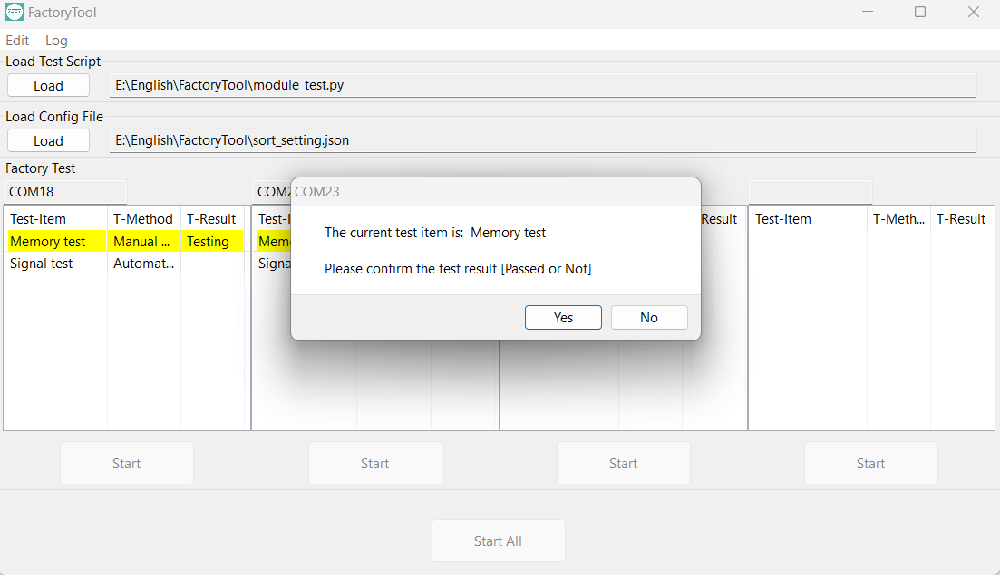
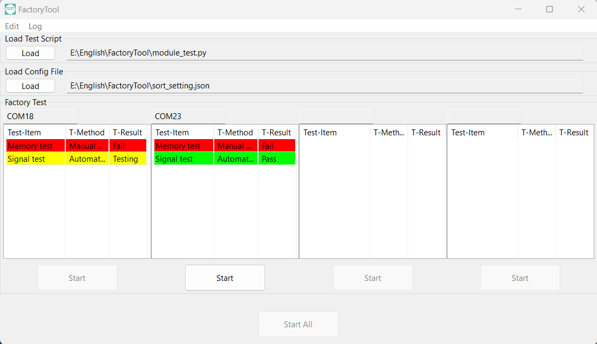

# Factory Tool User Guide

## Overview

The QuecPython Factory Tool (referred to as Factory Tool) is used to perform production testing on products developed based on QuecPython. This tool is applicable to Windows 7 and above.

The basic features of the Factory Tool are as follows:

- Load test scripts and configuration files
    - You are required to write test scripts that can be run in the product, with each unit test function as a unit.
    - You can bind test information for each test item in the configuration file, including the test item name, test function name, and test method.

- Support both automatic and manual testing
    - The automatic testing does not require manual intervention. Factory Tool automatically tests items in the order specified in the configuration file, and automatically saves the test results, until encountering manual testing items.
    - In manual testing, a window will pop up when the current item test is completed, allowing the tester to manually confirm the test result. Factory Tool will save the manually confirmed result.

- Support displaying test details and viewing test reports
    - The main interface will display the test results of each item in different colors.
    - The complete test report will be saved in the root directory of the tool for overall viewing.

- Support testing 4 devices simultaneously.

## Obtain the Tool

[Click here to enter the download page](https://github.com/QuecPython/FactoryTool/releases) to obtain the Factory Tool package: `FactoryTool.zip`.



## Page Introduction

- **Menu Bar**: "Edit" menu and "Log" menu.
- **Edit**: Used to edit test scripts and Excel log files.
  
- **Log**: Used to view test log files and tool running log files.
  
- **Loading Area**: "Load Test Script" and "Load Config File".
    - **Test Scripts**: A collection of test functions.
    - **Configuration File**: Binds test information for each test item, including the test item name, test function name, and test method.

- **Testing Area**: Includes device connection ports, test item names, test methods, and test results. The tool has four testing columns, allowing simultaneous testing of up to four devices, or individual testing of a specific device.

> **The interactive ports of the modules being tested cannot be blocked, otherwise, the tests will fail.**



## Test Scripts

When writing test scripts, it is important not to modify the structure of the original template code. It is recommended to manually run the test in the module after writing it to confirm whether the running result meets expectations. There are two places in the test script template that need to be modified:

**Import Modules**: Import the Python libraries used in the test.

**Test Functions**: Write test functions and customize the function name. The test functions must be **static methods** and no parameters are required to be specified. The content of the function body can be customized according to the test requirements. Return values in **boolean type** are required.

Example of a test script:

```python
# Write the modules that need to be imported here
import sim
import net
import uos
import utime

class TestBase(object):
    # ------This area is for testing code------
    @staticmethod
    def det_signal():
        utime.sleep(2)
        if sim.getStatus() == 1:
            if net.getConfig()[0] == 5:
                return True
            else:
                return False
        else:
            return False

    @staticmethod
    def det_file_space():
        utime.sleep(2)
        if uos.statvfs('usr')[3] > 5:
            return True
        else:
            return False
    # ------This area is for testing code------
```

## Configuration File
The configuration file is a JSON file that needs to be configured with three parameters: test item name, test function name, and test method (1: Manual testing. 0: Automatic testing).

Example of a configuration file:

```json
//            Test Item Name       Test Function Name      Test Method: 1 for manual testing, 0 for automatic testing
{
    "info": [["Memory test", "det_file_space", 1],
             ["Signal test", "det_signal", 0]]
}
```


## Testing Principle

The Factory Tool tests the business functions of QuecPython products by using Python scripts. Factory Tool executes test scripts through REPL. You can adjust the test scripts to achieve the functionality of production testing according to the test requirements.

1. Obtain module parameters and running status by calling QuecPython APIs.
2. Obtain the running status of the business by accessing objects in the running business codes.
3. Test business functionality or hardware functionality by calling APIs provided by the business code.
4. Transmit configuration files or write product parameters by calling QuecPython APIs.

## Testing Steps

**Step 1**: Edit test scripts and configuration files

Edit the testing script ***module_test.py*** and the configuration file ***sort_setting.json***. Examples of a test script and configuration file are shown in the above figure.

**Step 2**: Open Factory Tool and select test scripts and configuration files

After opening the tool, click "**Load**" to select the edited test code and configuration file. If a serial port is detected, the test item name and test method will be displayed under that serial port.



**Step 3**: Start testing

- Click "**Start All**": Start testing all imported modules.

- Click "**Start**": Start testing the corresponding module.

If it is a manual test, a pop-up window will prompt whether the test is successful. The tester can manually click "**Yes/No**" to confirm the result.


**Step 4**: View test results

The test results can be directly viewed in the test result column:
1. Pass: Green color, test result column marked as "Pass".
2. Fail: Red color, test result column marked as "Fail".
3. Testing: Yellow color, indicating that the test item is being tested.



**Step 5**: View test logs

Generate the ***Test-Result.xlsx*** file in the same directory as the tool, which includes the test project and test result logs.

## Test Results

The test results of each module will be written into an Excel file for export. You can open the Excel file by selecting "**Edit** -> **Edit Excel File**" from the menu bar.

Each test will generate a test record in the Excel file, regardless of whether the test is successful or not. Multiple tests will have multiple records, distinguished by the COM port of the test device.

The file will be saved in the same directory as the tool and will be automatically appended during the testing process.

## Secondary Development of Factory Tool

### Clone the Repository

If you have secondary development requirements, you can directly clone the code repository.

```shell
git clone --recurse-submodules 
https://github.com/QuecPython/FactoryTool.git -b interventionable
```

### Configure Environment

**Install Dependencies**

```shell
pip install -r requirements.txt -i 
https://pypi.tuna.tsinghua.edu.cn/simple
# If the above installation fails, you can try separate installation
pip install wxpython -i https://pypi.tuna.tsinghua.edu.cn/simple
pip install pypubsub -i https://pypi.tuna.tsinghua.edu.cn/simple
```

**Run the Code**

```shell
python main.py
```

### Compile Project

Execute the following code to compile the Factory Tool functionality implemented in Python into a system executable file.

```shell
# If you have adopted separate installation, install the pyinstaller library
pip install pyinstaller -i https://pypi.tuna.tsinghua.edu.cn/simple
# Compile the Factory Tool code into an exe program, and the output exe directory is under ./dist/
pyinstaller -F -w --win-private-assemblies --icon images/quectel.ico -w ./main.py
```