# ASR Platform Log Tool User Guide

This document introduces how to use the log tools *CATStudio* and *QWinLog* to capture AP and CP logs on the ASR platform. It also explains how to use *CATStudio* to export dump files and pcap files.

## Overview

### Tool Introduction

*CATStudio* is a software tool used for real-time monitoring and capturing ASR series module logs. It has rich functionality, and the most commonly used features for users are capturing AP/CP logs, exporting dump files, and exporting pcap files.

*QWinLog* is a tool specifically designed for log capturing. It currently supports capturing AP/CP logs of Qualcomm and ASR platforms.

### Software Installation

Either *CATStudio* or *QWinLog* is a portable software tool, so you only need to depress the tool's zip to a directory on your computer. Please note that the decompression path cannot contain any Chinese characters, otherwise, the tool cannot run properly.

### System Requirements

*CATStudio* is compatible with Windows XP/7/10 system, with a minimum of 512 MB RAM and a dual-core processor.

*QWinLog* is compatible with the Windows 7/10 system.

## Hardware Connection

Before capturing logs, please make the following preparations:

* Install the USB driver for the ASR series modules.

* Connect the module to the computer using a USB data cable.

* Power on the module.

Go to the "Device Manager" interface on your computer. If the USB driver is loaded correctly, you should see several ports as shown in the following figure.


The functions of the ports are as follows:

* Quectel USB AT Port: Used for sending AT commands.

* Quectel USB DIAG Port: Used for capturing logs.

* Quectel USB REPL Port: For QuecPython firmware, this port is the REPL port for Python, where you can execute Python codes. Please note that the REPL port name may vary on different platforms. If you are unsure which port is the Python REPL port, you can contact Quectel Technical Support for confirmation.

The ports highlighted in red in the above figure are the ones you need to use when capturing logs using *CATStudio*.

## User Guide

After preparing the hardware environment, follow the steps below to proceed.

### Capture AP and CP Logs

#### Using *CATStudio*

**Step 1: Select Configuration File**

Open *CATStudio*, and the following window will pop up by default. Select "**Generic Target Online**" and click "**OK**".

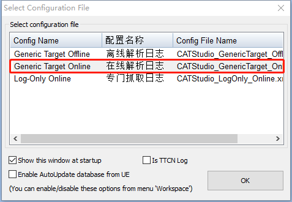

**Step 2: Select and Configure Communication Port**

After finishing "Step 1", you will enter the following interface. Click "**Device Communication**" in the lower right corner to open the corresponding configuration window. By default, select "**Device 0**" and click "**Settings**".

<div style="display: flex; justify-content: space-between; align-items: center;">    <!-- Resize the first image to a width of 200px -->   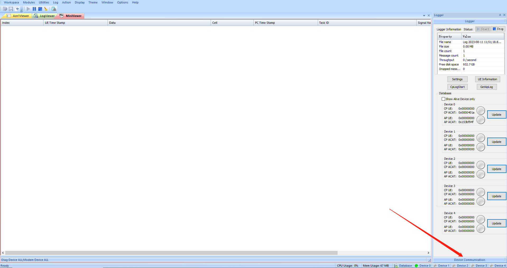    <!-- Resize the second image to a width of 300px -->   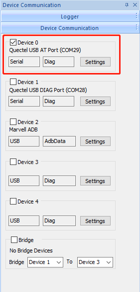  </div>

In the following interface, select "**Serial**" and click the drop-down button of the "Serial Port" selection box. Choose "**Quectel USB DIAG Port**", and leave the baud rate as default. Click "**OK**", and you can see the window start outputting logs.

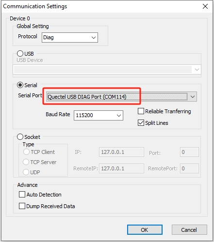

> If the main window of *CATStudio* does not output any logs after this step, you may need to restart your computer and reopen *CATStudio*.

**Step 3: Match DB Files**

When no DB file is matched, many logs on the *CATStudio* interface will remain undecoded. To better view logs, you can match the DB file corresponding to the module firmware. DB files are usually contained in the corresponding firmware package, as shown below.

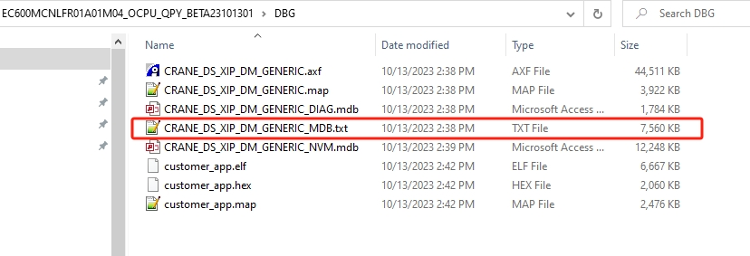

> If the *DBG* directory is not available in your firmware package, you can provide the firmware version number to Quectel Technical Support to obtain the corresponding DB file.

If there is no matched DB file, you will see a red indicator light on the tool interface, as shown in the following figure.

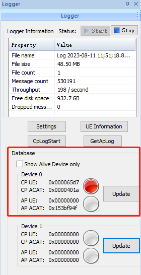

Click "**Update**" next to the red indicator light to enter the following interface, and then follow the steps below.

* Select "**TEXT**" at position ①.

* Click "**...**" at position ②, and in the file selection window, navigate to the path where the module firmware package is located, and then go to the *DBG* directory in the firmware package to select the corresponding DB file.

* Click "**Update**" at position ③. If the selected DB file matches the firmware in the module, you will see the indicator light on the right side of the CP section turn green.
* After successfully matching the DB file, click "**Close**" at position ④ to return to the log output interface. At this point, the indicator light for Device 0 should also turn green.

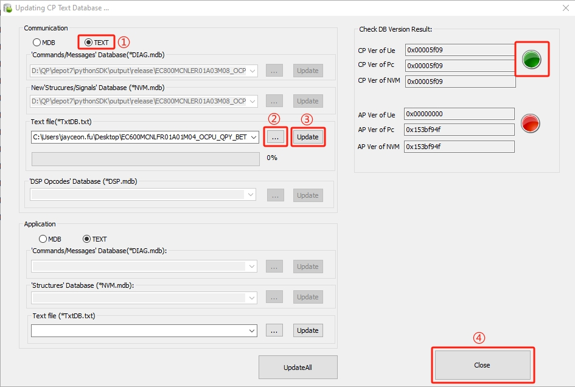

> It is not necessary for you to match the DB file. If you only need to capture logs and provide them to Quectel Technical Support for analysis, "Step 3" can be skipped. Quectel Technical Support will match the DB file itself.

**Step 4: Export Log Files**

After capturing logs, you need to export the log file and provide it to Quectel Technical Support or software engineers for analysis. Follow the steps below to export the log file.

* Click "**Log**" in the menu bar, and then click "**Export Log-File**" in the drop-down list to open the "ExportLog" window.

* In the "ExportLog" window, click "**Select Path(P)**" to choose the path for saving logs.

* Click "**Output**" and wait for the log file to be exported.

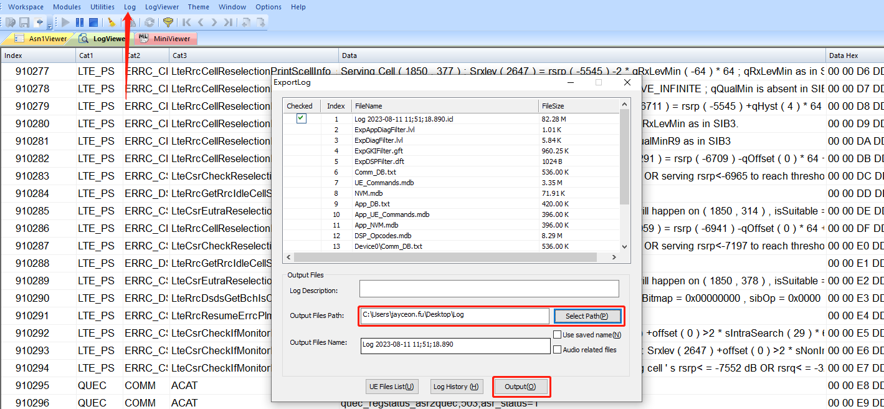

The exported log file contains both AP and CP logs. If you need any assistance in analyzing related issues, please provide the exported log file to Quectel Technical Support or software engineers.

#### Using *QWinLog*

**Step 1: Open *QWinLog***

Navigate to the root directory of *QWinLog*, double click *QWinLog.exe* to open the tool, and you will see the interface as shown in the figure below.

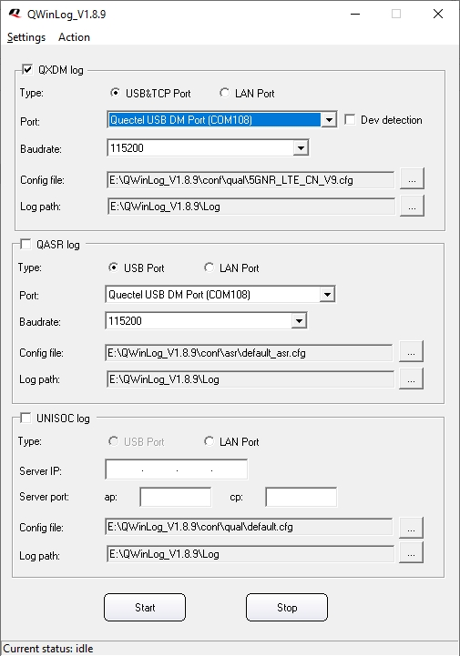

**Step 2: Configure Parameters**

Since you are using *QWinLog* to capture logs of the ASR platform, you only need to configure parameters related to the ASR platform, as shown in the figure below.

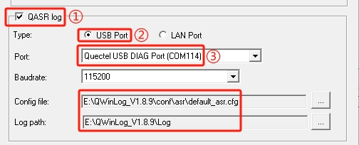

Follow the steps below.

- Tick "**QASR log**" at position ①.

- Select "**USB Port**" at position ②.

- Click the drop-down button of the "Port" selection box at position ③ and choose "**Quectel USB DIAG Port**," which is the port for capturing AP and CP logs on the ASR platform.

- "Config file" is the configuration file used by *QWinLog* for log capture. You can use the default configuration file provided by the tool or contact Quectel Technical Support for the configuration file.

- "Log path" is the path where the captured logs will be saved. You can keep the default setting or modify it as needed.

**Step 3: Capture Logs**

Click "**Start**" on the *QWinLog* interface to start capturing logs. Click "**Stop**" to stop capturing logs.

**Step 4: Package Log Files**

After capturing the required logs, click "**Stop**" to stop capturing, and then you can find the saved log files in the directory specified in the "Log path" option, as shown in the figure below.

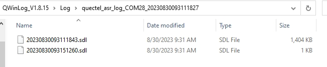

You only need to compress these log files into a zip and send it to Quectel Technical Support or software engineers.


### Export Dump Files

If you encounter dump issues while using the ASR platform modules, you can export dump files using *CATStudio* and then send the dump files to Quectel software engineers for analysis.

**Step 1: Configure Dump Mode**

By default, ASR platform modules will reboot when a dump occurs, making it impossible to export dump files. To export dump files, you need to configure the module's dump mode by sending the following AT commands when the module runs normally to ensure the module will not reboot automatically when a dump occurs but stays in dump status.

```
AT+QDUMPCFG=0,0
AT+QDUMPCFG=2,1
AT+log=19,1
```

While the module is running normally, you need to open *QPYcom*, select "**Quectel USB AT Port**" for "COM Port," and click "**Open port**". Then, send the three AT commands above one by one, as shown in the figure below.

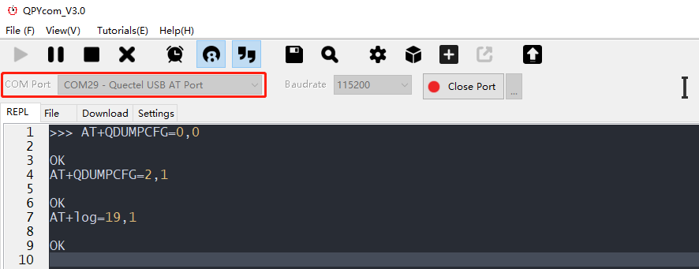


**Step 2: Reproduce Dump Issue**

After finishing "Step 1" to configure the dump mode and sending the AT commands, you need to reproduce the issue that led to the dump. When the dump issue occurs, you will see a dump port in your computer's device manager, as shown below.

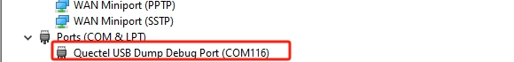


**Step 3: Select Configuration File**

Open *CATStudio*, and the following window will pop up by default. Select **"Log-Only Online**" and click "**OK**".

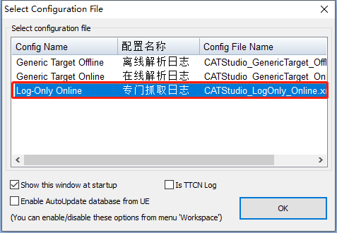


**Step 4: Configure Parameters and Export Dump Files**

After following "Step 3", a window will pop up as shown below. Click "**Dump**" at position ① to open the dump export page, and configure the parameters as indicated by the numbers in the figure.

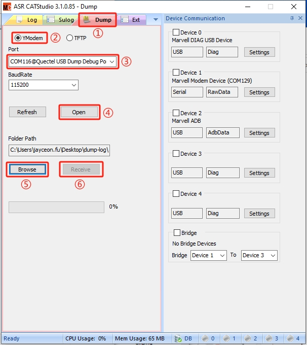

- Select "**YModem**" at position ②.
- Click the drop-down button at position ③ and select the dump port you identified in "Step 2".
- Click "**Open**" at position ④ to open the corresponding port.
- Click "**Browse**" at position ⑤ to select the path where you want to save the dump file.
- Click "**Receive**" at position ⑥ to start exporting the dump file. Until the export is completed, a window will pop up, and you can click "**OK**."

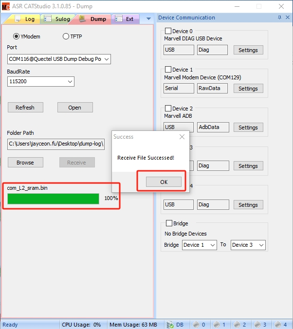

After executing these steps, the dump files have been successfully exported. You can compress the exported dump files into a single zip and provide it to Quectel Technical Support or software engineers for analysis.


### Export Pcap Files

Pcap files are commonly used for storing network data and are typically used with popular network analysis tools like Wireshark and tcpdump to monitor and analyze issues related to network applications, such as data transmission over MQTT and HTTP.

*CATStudio* supports the export of pcap files. Follow the steps below to export pcap files using *CATStudio*.

**Step 1: Export AP and CP Logs**

Follow the steps in the [Capture AP and CP Logs](./ASR.html#Capture AP and CP Logs) section to export log files for later use.

**Step 2: Select Configuration File**

Open *CATStudio*, and the following window will pop up by default. Select "**Generic Target Offline**" and click "**OK**".

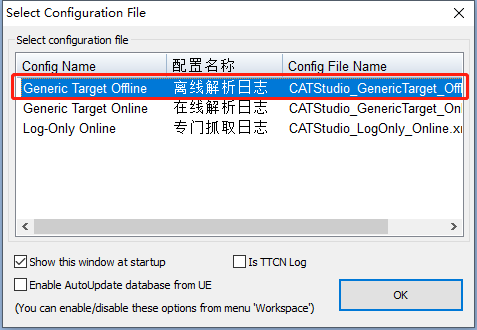

> Please note that in this case, you should select "Generic Target Offline". In the *Capture AP and CP Logs* section, you should select "Generic Target Offline".

**Step 3: Load Log Files**

After entering the *CATStudio* main interface, click "**Open ZIP/ICL...**" in the upper right corner. In the pop-up window, select the log file zip you exported earlier and wait for the zip to be decompressed and loaded.

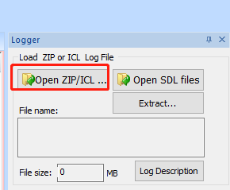

If, during the file loading process, you see the window below, it means that the selected log file zip is relatively large and exceeds the default file size limit. In this case, click "**Cancel (Load whole file)**," which means loading the whole file.

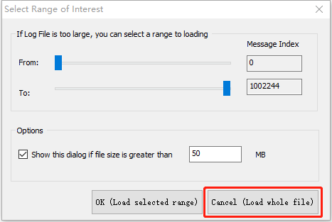

**Step 4: Match DB Files**

If you have already matched DB files during the log export process, you can skip this step and proceed directly to "Step 5". Otherwise, follow the instructions provided earlier to match DB files.

**Step 5: Export Pcap Files**

Click "**Action**" in the menu bar, then select "**Export SN Trace to pcap file**" from the drop-down list. A window will pop up as shown below.

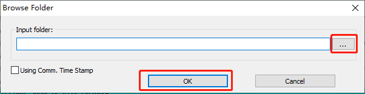

In this window, select the location where you want to save the export file, then click "**OK**". Until the export is completed, a window will pop up, and you can click "**OK**."

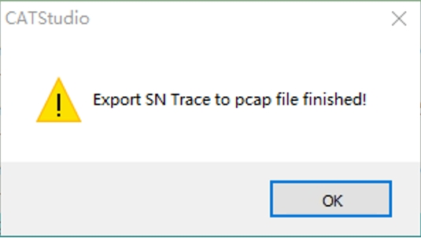


## FAQ

**Q1**: Why did I fail to capture logs using *QWinLog* with a window like the one shown below popped up?

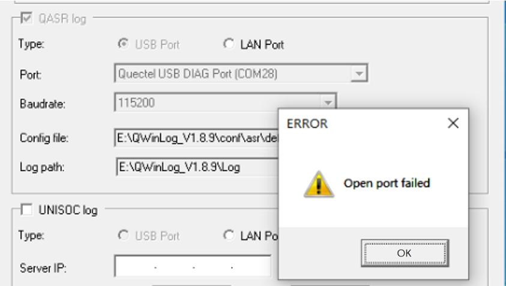

There may be two reasons:

**Reason 1:** Another program occupies "Quectel USB DIAG Port". You can check whether the port is occupied. If the port is occupied, close the program occupying the port and try to capture logs again.

**Reason 2:** The USB driver has loaded abnormally. You can disconnect the module from the computer, and then reconnect the module with the computer via a USB cable, or power cycle the module. If the issue still exists, restart your computer.

