# OpenClaw Skill Configuration and Usage Tutorial

## 1.Core Concepts and Interrelationships 

- ### OpenClaw


OpenClaw is a local-first, open-source AI intelligent agent framework, not merely a chatbot or a large model. Its core capability is to break down natural language instructions into executable tasks, call various tools/services to complete the execution and provide feedback results. It supports local deployment (Windows 11 / server), integration with local large models, invocation of local / external tools (Shell, serial port, API, etc.), and also possesses features such as multi-channel interaction and persistent memory. 

- ### QuecPython-dev


QuecPython-dev is the general term for a set of tools / development kits centered around the development scenarios of QuecPython. It covers a series of development auxiliary capabilities such as module debugging, script development, firmware management, and device interaction, and is the core support system for developers to develop IoT applications based on QuecPython. 

- ### Core Relationship Among the Two

QuecPython-dev-skills is an exclusive skill plugin developed based on the OpenClaw framework. As an AI execution agent, OpenClaw can convert natural language instructions into specific operations for QuecPython development scenarios (such as module information detection, script deployment and running, firmware query and download, serial port interaction, etc.) by loading the QuecPython-dev-skills skills. This enables the automation and intelligence of the QuecPython development process, allowing developers to complete QuecPython-related development tasks without having to manually execute cumbersome debugging and operation commands. They can simply complete these tasks through natural language. 

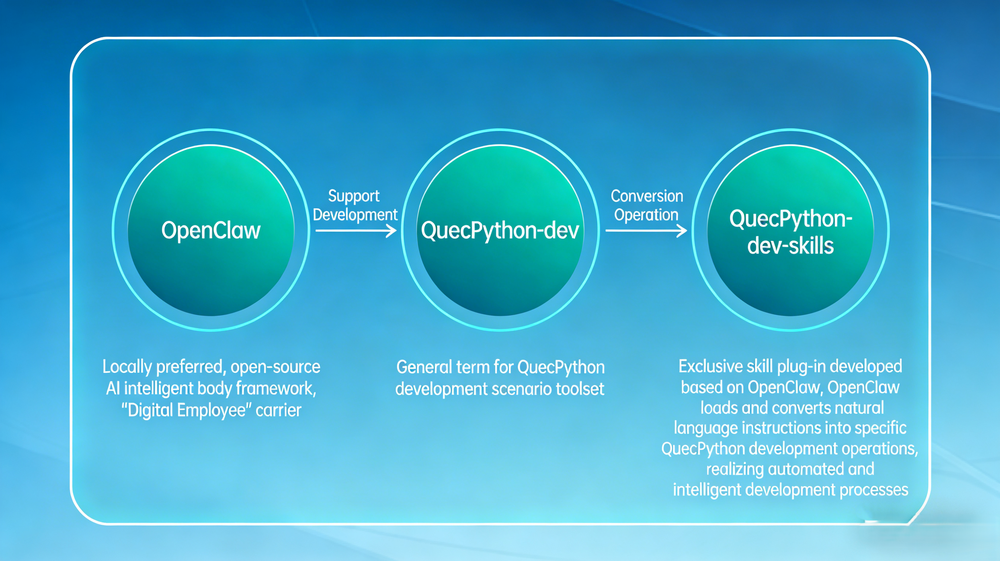In simple terms: **OpenClaw serves as the "digital employee" platform, while QuecPython-dev-skills are the "exclusive skills" tailored for QuecPython development. Together, they enable the full automation of the QuecPython development process.**


## 2.Install OpenClaw

### Install wsl (Windows' Linux Subsystem)

Run powershell as an administrator to prevent environment configuration issues caused by permission problems during deployment

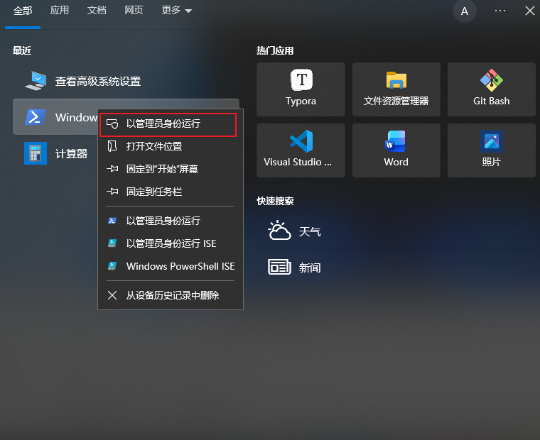

Use the command: 'wsl.exe --install' to install. After it is installed, we need to restart the computer


After restarting the computer, we continue to open powershell as an administrator and use the command: 'wsl --install Ubuntu-24.04' to follow Ubuntu (the distribution of Linux), which is the system officially recommended by openclaw.

After setting it up, a colored command line will appear


### Update System Dependencies and Install Required Tools

Run the following commands to update the system software sources and install basic tools like curl and git for subsequent installation:

```
sudo apt update
sudo apt install -y curl git ca-certificates build-essential jq
```

### Install Node.js 22

OpenClaw officially requires a Node.js version of **22 or higher**. Execute the following commands to complete the installation:

```
curl -fsSL https://deb.nodesource.com/setup_22.x | sudo -E bash -
sudo apt install -y nodejs
```

After installation, verify the version meets requirements:

```
node -v   # Expected output: v22.x.x or higher
npm -v    # Expected output: 10.x.x or higher 
```

### Install OpenClaw

Install the latest version of OpenClaw globally via npm and verify the installation:

```cmd
sudo npm install -g openclaw@latest
openclaw --version
```

> Installation typically takes 5–10 minutes, depending on your network download speed.

### Initialize OpenClaw

After the first installation, you must complete the configuration wizard; otherwise, OpenClaw cannot run properly. Execute the following command to launch the configuration wizard and install the gateway daemon:

```cmd
openclaw onboard --install-daemon
```

The gateway daemon (a launchd/systemd user service) ensures OpenClaw runs persistently in the background.

Configuration Wizard Screenshots (For Reference Only)

1. Enter the installation confirmation screen, select [Yes], and press Enter;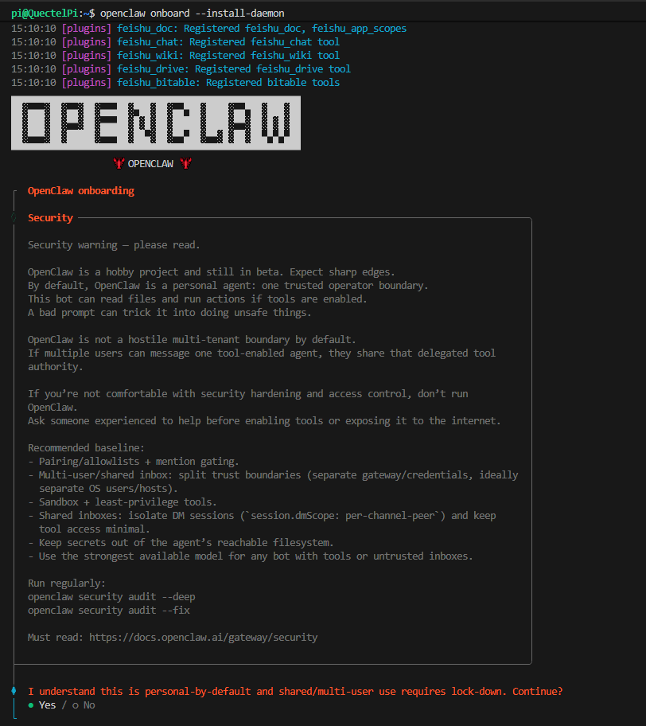

2. Select [QuickStart] in the [Onboarding mode] option;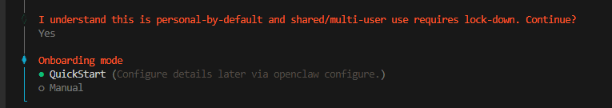

3. Select [Qwen] in the [Model/auth provider] option and press Enter;

   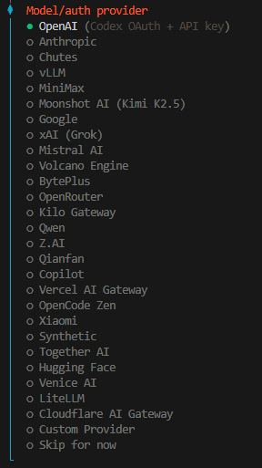

4. Open the specified website to log in to the qwen-code platform and complete identity authentication;

   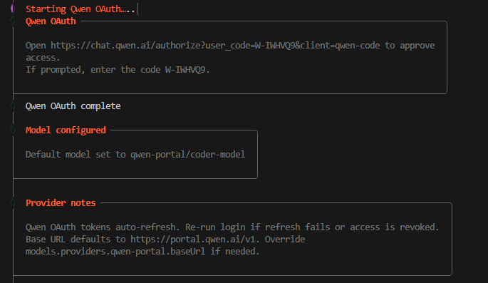

   

After configuration, restart the gateway to apply the settings:

```linux
openclaw gateway restart
```

## 3. Add QuecPython-dev-skills

**1. Install the Skill**

Clone the repository and place it in your Skills directory (path as specified by the tool):

```
git clone https://github.com/QuecPython/quecpython-dev-skill.git
```

**2. Install and Start SSH Service on Linux**

```
sudo apt update
sudo apt install openssh-server
```

**3. Establish SSH Connection Between Linux and Windows**

```
Windows:

ssh [WSL username]@[IP address]
```

**4. Install Serial Port Drivers on Windows**

Open Windows Terminal as Administrator:

```
winget install usbipd
```

List USB devices:

```
usbipd list
```

Bind the serial port module:

```
usbipd bind --busid [BUSID you see]
```

Attach to WSL2:

```
usbipd attach --wsl --busid [BUSID]
```

## 4. The practice of QuecPython-dev-skill automated development process

### Tool Application Workflow:

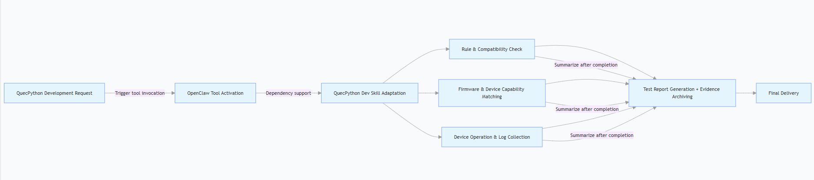

### QuecPython-Dev-Skill Core Capability Matrix

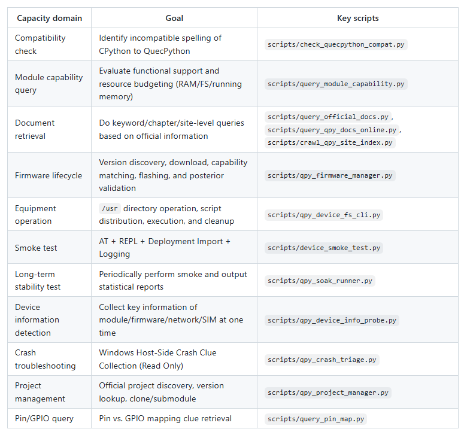

### Function Demonstrations:

Note: Minimum recommended input context:

1. Quectel module model (e.g., `EC800KCNLC`)

2. Firmware versions (current and target)

3. Device serial port and baud rate

4. Deployment target path (e.g., `/usr/_main.py`)

   

#### **Device Operations ( `/usr` directory operations, script deployment, execution, and cleanup):**

1. Input requirements

   

2. OpenClaw activates the QuecPython-Dev-Skill to control qpycom on the local Windows device via SSH to download and run the script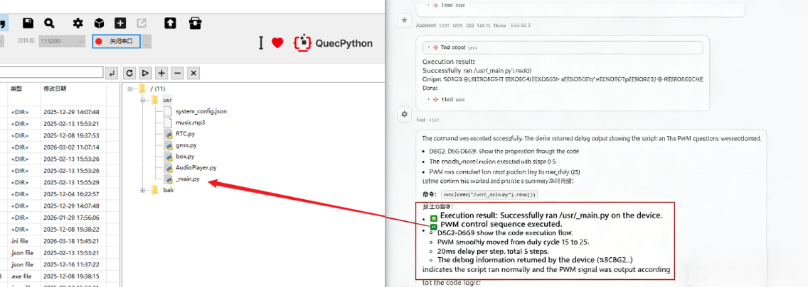

3. If script execution fails, OpenClaw automatically fixes script bugs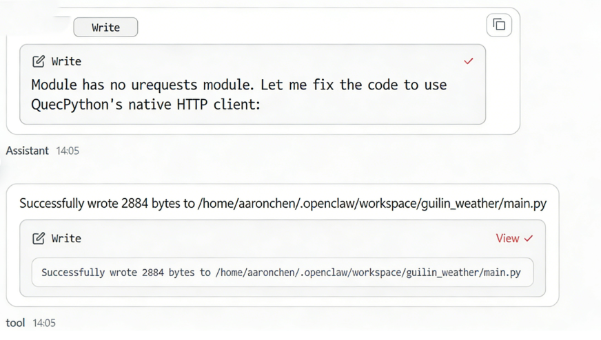


#### **Device Information Detection:**

1. Input requirements                  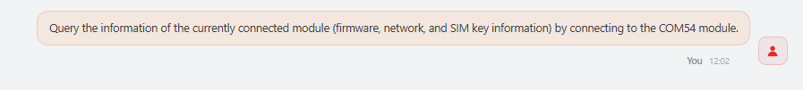

2. OpenClaw outputs the script → download the script 

3. Automatic script validation

   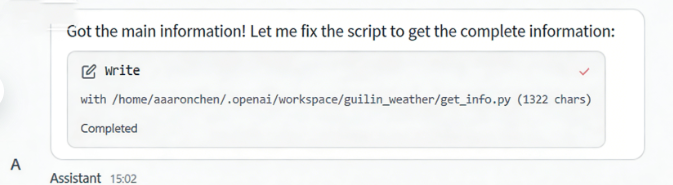

4. Output module query results

    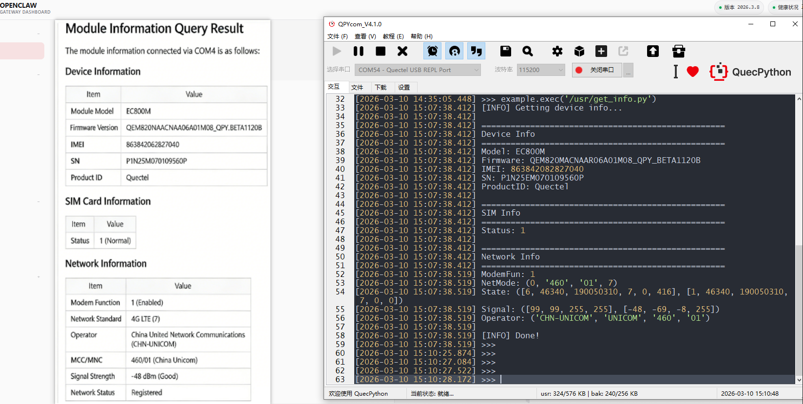


#### Development Resource Query:

1. Input requirements

   ```
   "Help me query and download the firmware for EC800MCNLF from the QuecPython official website to my local machine"
   ```

2. OpenClaw filters resources

   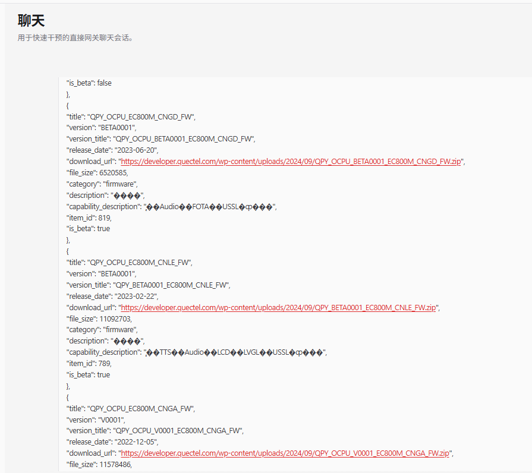

3. Automatic resource download

    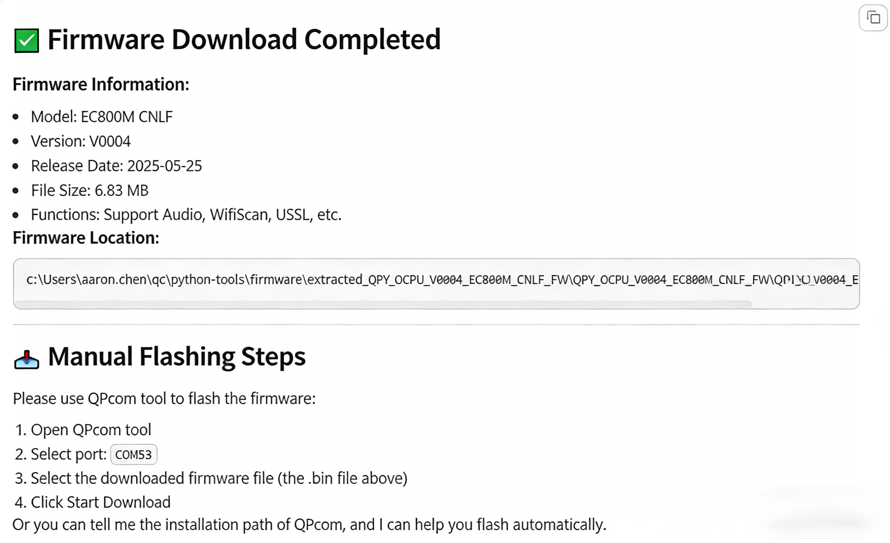

## 5. Frequently Asked Questions (FAQs)

**1. WSL fails to recognize Windows ports**: Switch to Ubuntu 1 in PowerShell to directly control Windows ports:

```
wsl --set-version Ubuntu 1
Openclaw gateway run
```

 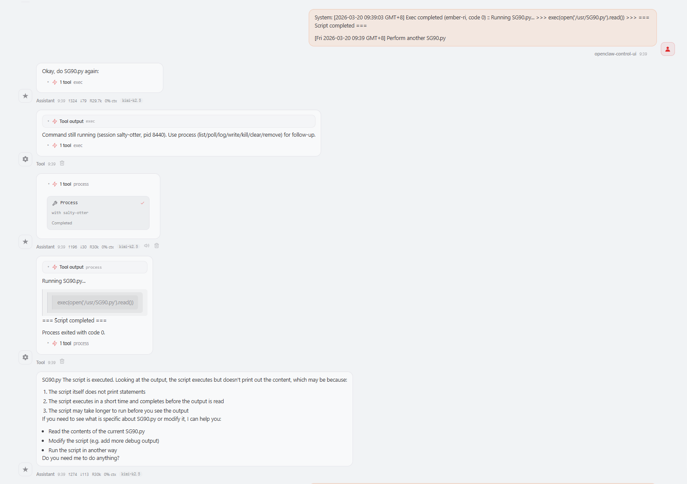

**2. Token quota exhausted (need to switch agents)**:

```
Openclaw config
```

**3. Skill directory not found**:

First, ask OpenClaw to download common skills in the AI interaction interface. The download path will be displayed in the printed logs – check this path to locate the Skills directory.

**4. OpenClaw does not respond after sending messages**:

High server load on OpenClaw – try using it during off-peak hours.


## 6.Support

High server load on OpenClaw – try using it during off-peak hours.

OpenClaw official website: https://openclaw.ai/

OpenClaw Chinese community: https://clawd.org.cn/

QuecPython-Dev-Skill repository: https://github.com/QuecPython/quecpython-dev-skill

Solution for default permission changes and tool invocation failures in v2026.3.2: https://cloud.tencent.com/developer/article/2634142

Complete tutorial for integrating OpenClaw with QQ Bot: https://tbbbk.com/openclaw-qq-bot-setup-guide-2026/