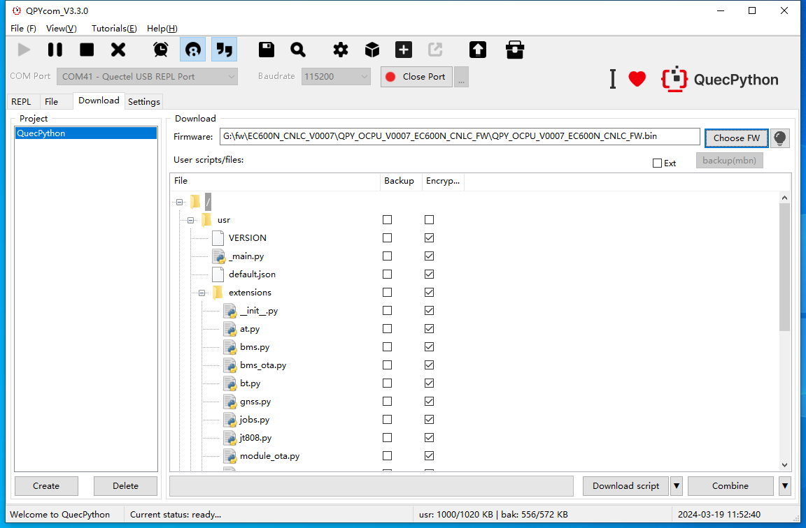
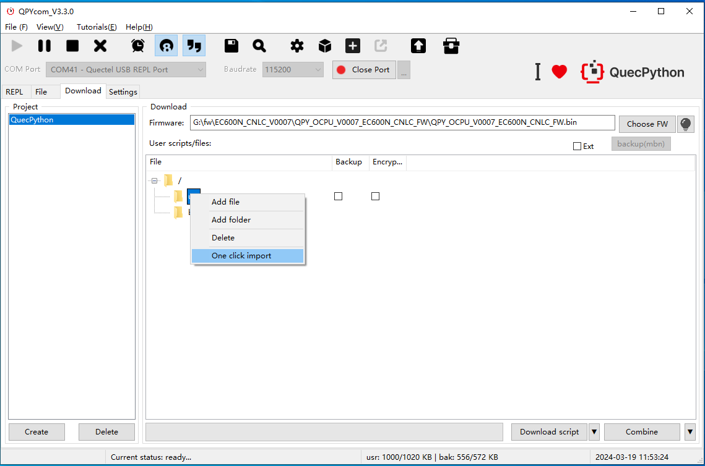
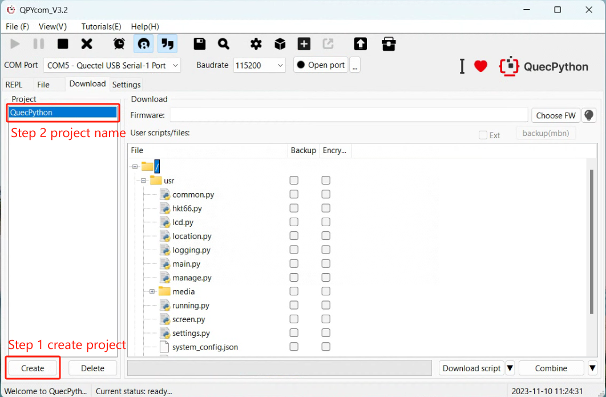
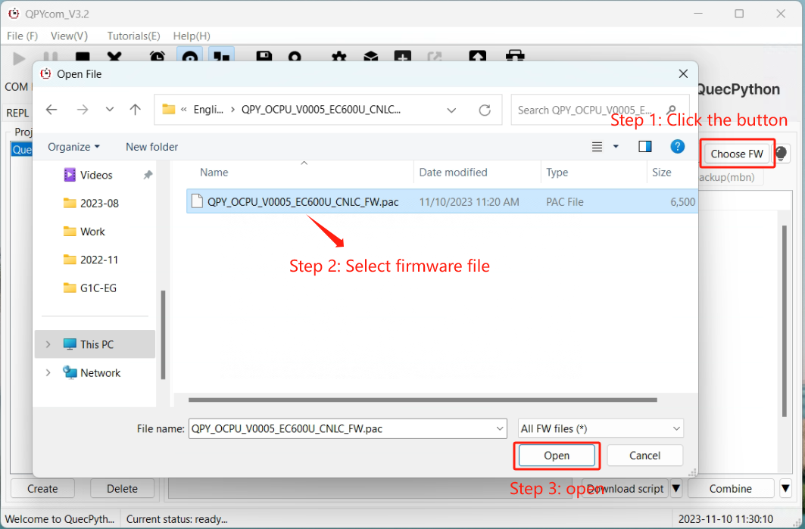
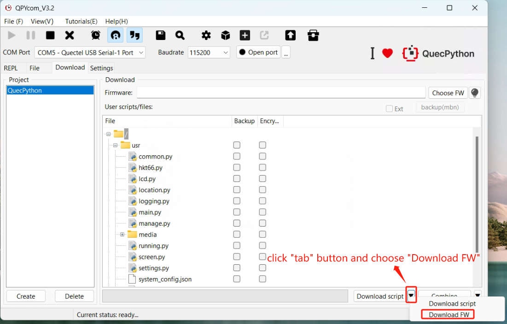
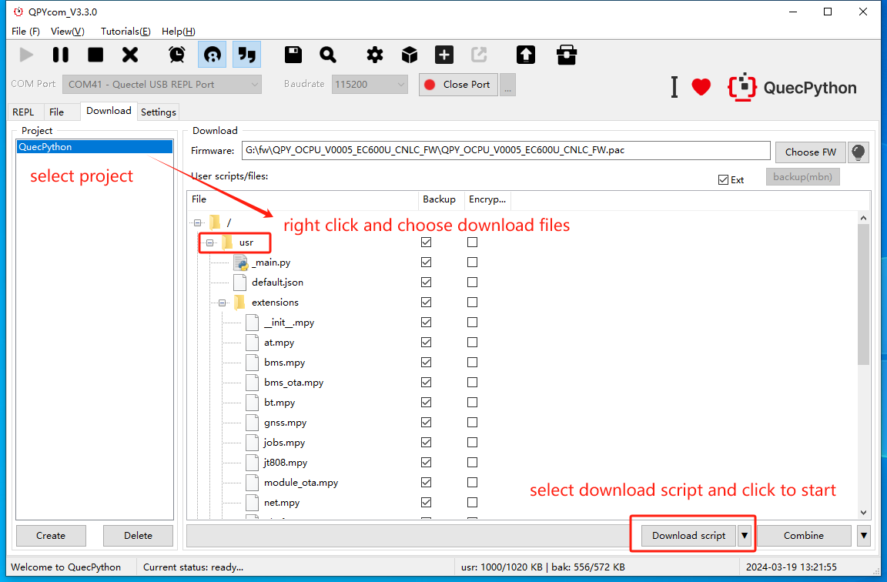

# Firmware & Script Download

## Download Firmware Script

Click the "**Download**" tab to enter the "Download" page, where you can upload Python script files in batches and download firmware to modules. The operation steps are as follows:

-   Create a project on the left navigation bar.

-   Click "**Choose FW**" to choose the firmware from the local disk. You can also download the firmware corresponding to the module model from QuecPython official website. Please note that the firmware format can be either .zip or .bin.

-   Select the script to download as indicated in the image below. You can also select a script and  click "**-**" in the lower left corner to delete it.

-   Switch between "**Download script**" and "**Download FW**" by clicking the inverted triangle icon in the lower right corner.

-   As shown in the images:

### Download Firmware

-   On the "Download" page, click "**Create**" to create a project for downloading firmware.

-   Select the firmware.

-   Left-click the inverted triangle and select "**Download FW**".

-   Wait for the progress bar to complete, and a pop-up will appear to notify you of the successful firmware download.

### Download Script

There are two methods to upload local Python script files to the module.

**Method 1: **

-   **Step 1: Open Serial Port**

First, select the module's communication port and click "**Open port**".

-   **Step 2: Download via Buttons**

You can upload and delete files by clicking "**+**" and "**-**" on the right side of the "File" page.

-   **Step 3: Download via Drag and Drop**

You can also directly drag and drop the local files displayed on the left side of the "File" page to the module on the right side (You can also drag and drop folders).

-   **Step 4: Download Progress and Result**

The file name and progress will be displayed in the status bar during the download process.

**Method 2:**

-   **Step 1: Create Project**

Click "**Create**" to create a project according to your needs.

-   **Step 2: Configure the File to Download**

Select the script to be downloaded to the module (Add the script by right-clicking it in the "User script/files" section).

-   **Step 3: Set Download Mode**

Left-click the inverted triangle and select "**Download script**".

-   **Step 4: Start Downloading Script**

Click "**Download script**" to start downloading the script. The download progress will be displayed in the progress bar.