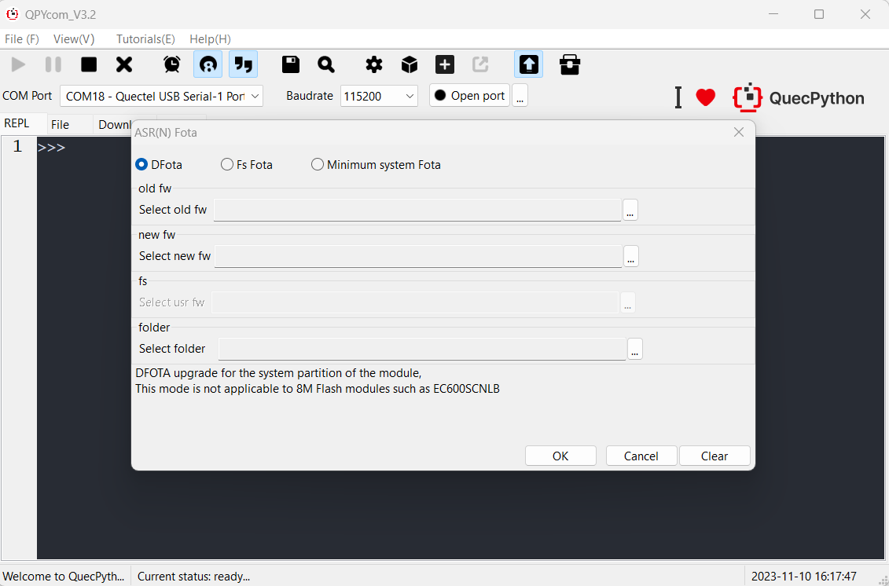
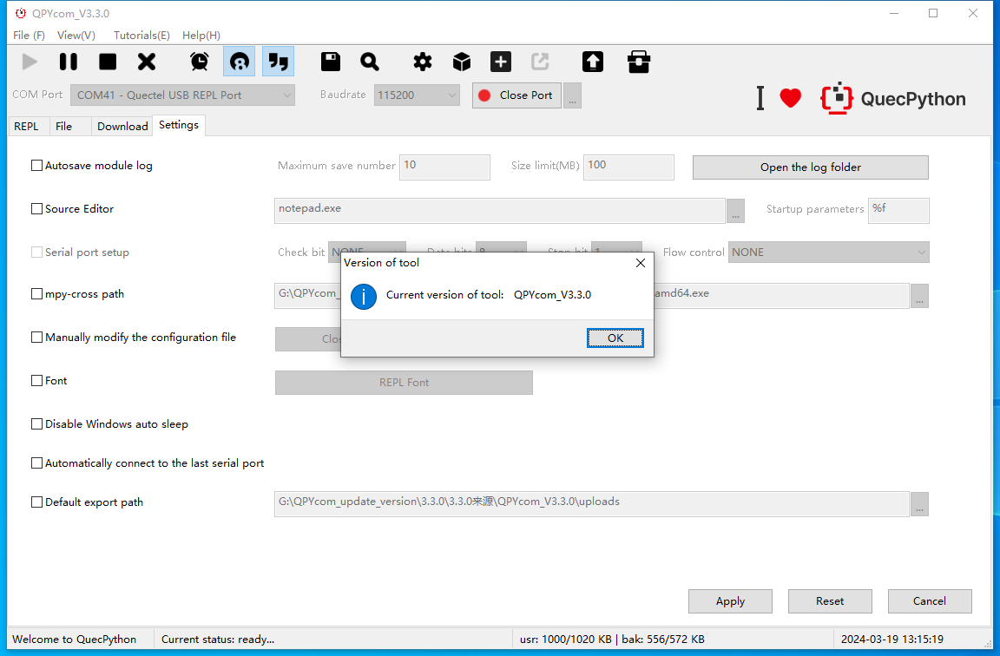
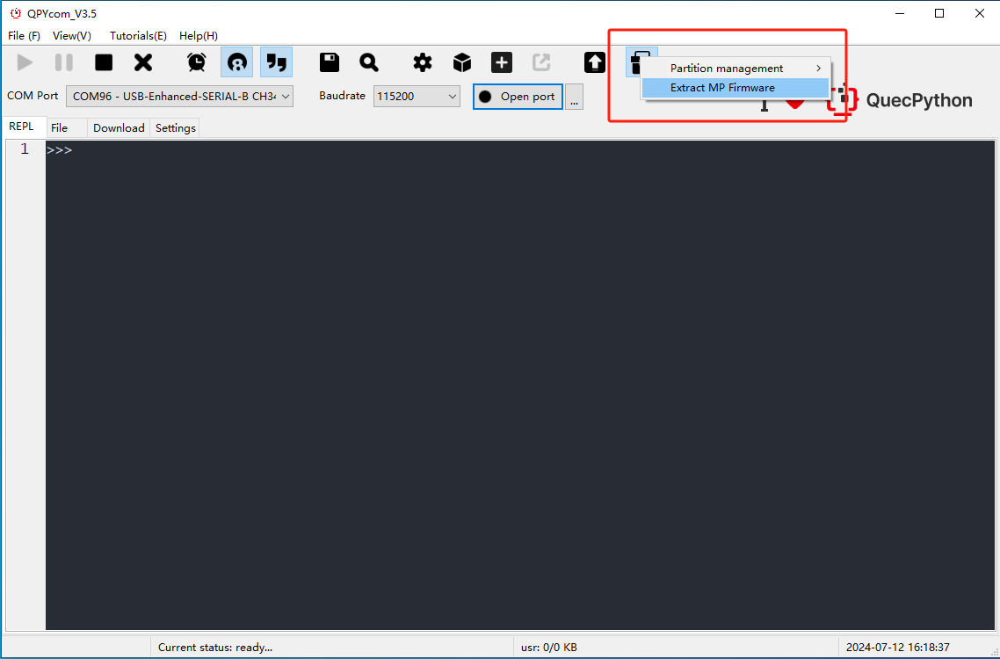

# Extension Function

## FOTA Upgrade Package Making Process

After clicking "**Make fota files**", three options will pop up, ASR Fota, Unisoc Fota and 200A Fota.

**ASR FOTA Upgrade Package Making**

Step 1: Select the new and old firmware packages for delta package making.

Step 2: Click "**OK**" to generate the delta package. The generated delta package will be located in the specified folder. If not specified, the package will be stored in the *exes/ASR_Fotatools* directory.

**Unisoc FOTA Upgrade Package Making**

Step 1: Select the new and old firmware packages for delta package making.

Step 2: Click "**OK**" to generate the delta package.

` The implementation principle refers to [FOTA](../../firmware-upgrade/firmware-ota.md). `

**200A_FOTA Upgrade Package Making**

Step 1: Select the new and old firmware packages for delta package making.

Step 2: Click "**OK**" to generate the delta package.

## QPYcom OTA Upgrade

There are two ways to trigger the upgrade:

Method 1: Click "**Help > Check update**", the version upgrade detection will start. If there is a new version, an upgrade confirmation window will pop up.

You can choose to upgrade, ignore this upgrade or ignore this pop-up.

Method 2: When QuecPython uploads a new version to the official website, it will push the latest version upgrade notification to users. Similarly, users can choose to upgrade, ignore this upgrade or ignore this pop-up.

As shown in the figure:

## Toolkit

Click "**The toolkit**" and select an option in the sub-menu to quickly execute the configured codes.

## Add quickCMD

You can configure the common code and add it to the toolkit, where it can be executed by one click.

## Extract MP Firmware

When you need to use other tools (such as Qflash tool, QMulti_DL tool, etc.) to burn the firmware, if the firmware suffix does not match the burning tool, you need to use this function to extract the mass production firmware.

