# GUI

## Tool Acquisition

## Main Interface Functions

This chapter mainly introduces the main functions of the QPYcom tool's main interface. For detailed operation instructions, please refer to [Extension Function](./qpycom-ext.md).

After obtaining the tool in the previous steps, unzip the downloaded *QPYcom.zip* file and enter the unzipped directory to find *QPYcom.exe*.
With this tool, you can download your Python scripts to the module, interact with the module through the command line, and QPYcom supports firmware download and combination, update detection, and other functions. You can use the specific function according to your needs.

The main pages of the tool are shown in the following figures:
1. REPL: Interaction with the module

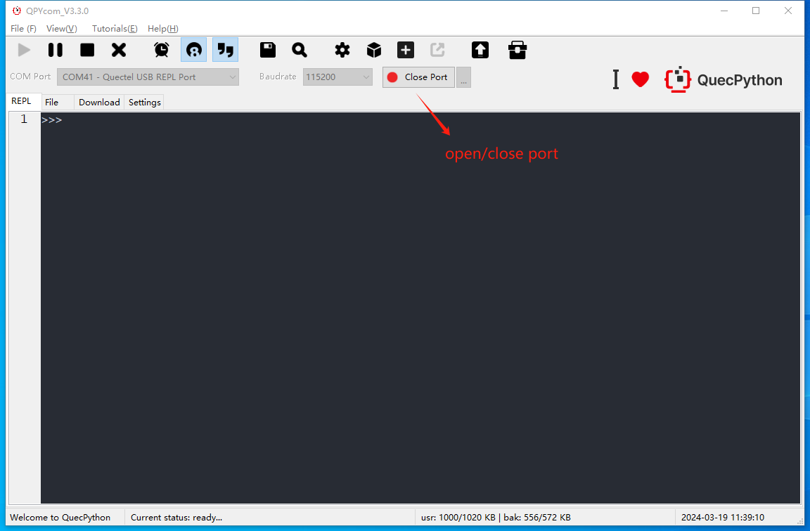

2. File: Operation of module files

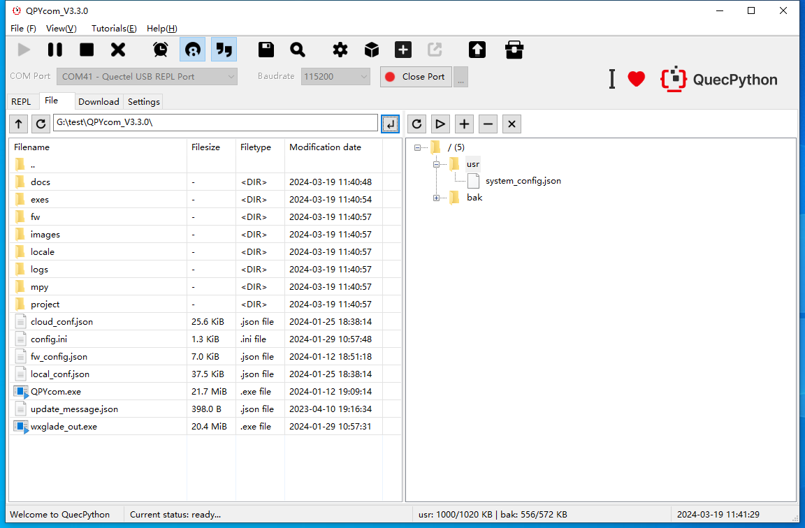

2. Download: Firmware and Python script download

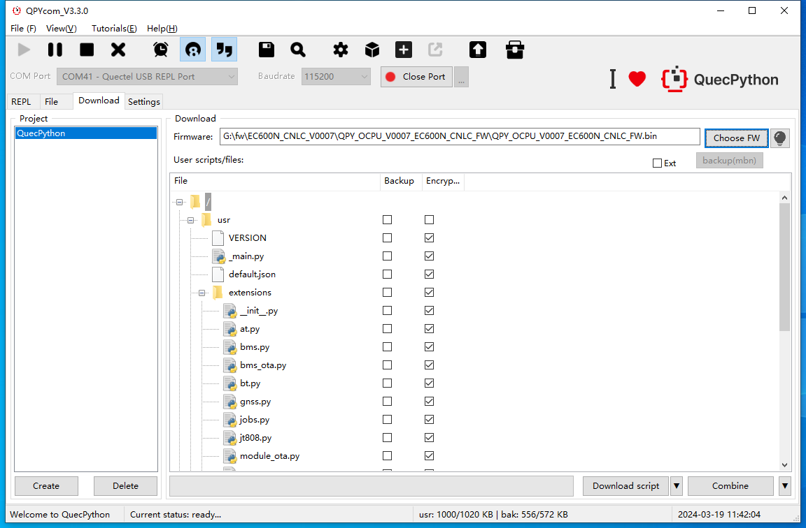

3. Setting: Tool settings

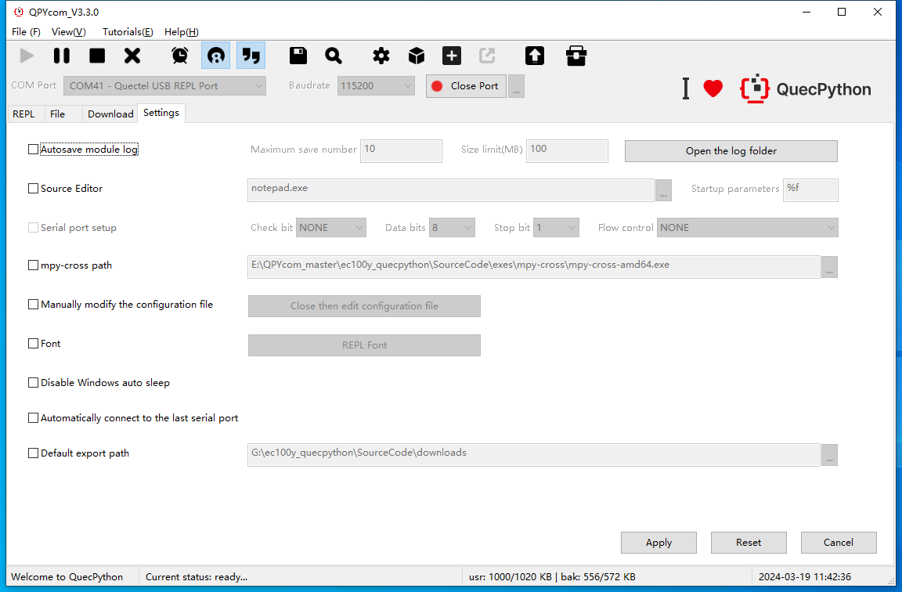

## REPL Buttons

The buttons on the REPL page are explained as follows:

-   
    Start interacting with the module through commands.

-   
    Pause interacting with the module through commands.

-   
    Stop interacting with the module through commands.

-   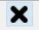
    Clear the screen print.

-   
    Display print time.

-   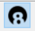
    Display line numbers.

-   
    Switch the theme of the main interaction interface (switch between black and white themes).

-   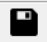
    Save the interaction log.

-   
    Search keywords in the interaction logs.

-   
    Module log settings, serial port configuration, and other option settings.

-   
    Shortcut commands (configured in config.ini).

-   
    Configure shortcut commands in the toolkit. You can configure the commands as needed. Please note that the maximum number of commands is 16, and the maximum length of command names is 16 characters.

-   
    Post the tool on top.

-   
    Make FOTA upgrade packages.

-   
    Function box, currently only has the function of modifying partitions.

## "File" Tab in Toolbar

### Save

-   Click "**Save**" to select the path for saving logs. 

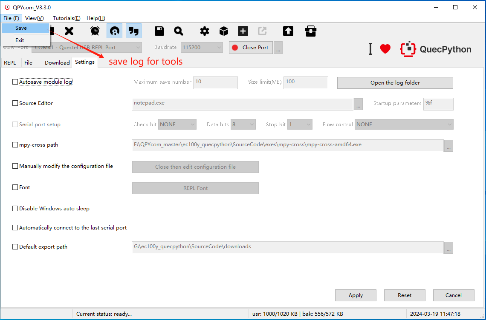

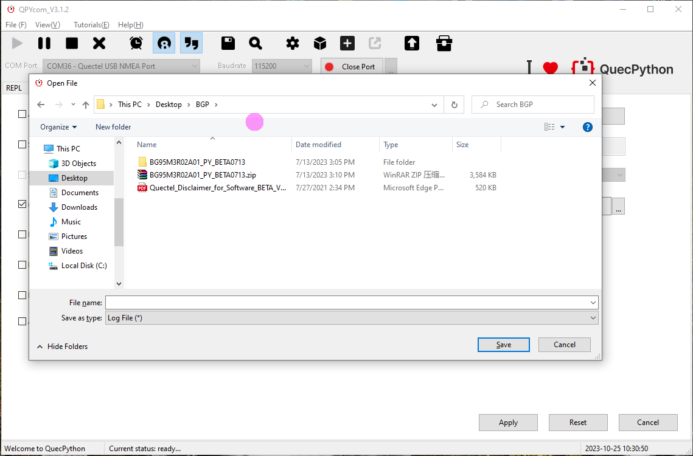

### Exit

-   Click "**Exit**" to exit the tool application.

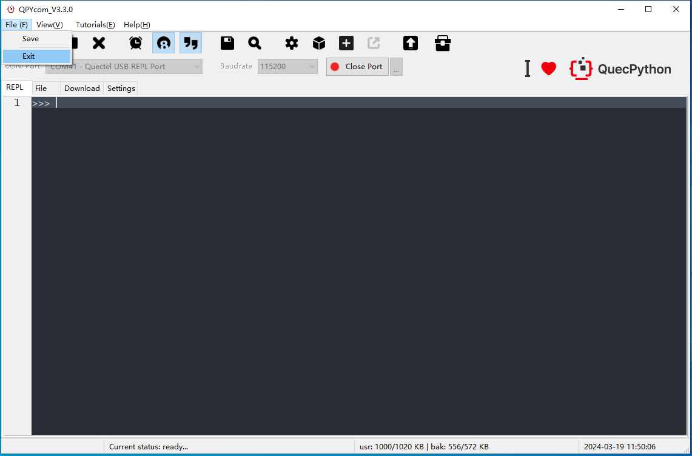

## "View" Tab in Toolbar

The "View" tab includes functions "**Interactive command line**", "**File browsing**", "**FW/script download**", "**Software setting**", "**Language**", "**Module log**", and "**Download log**".

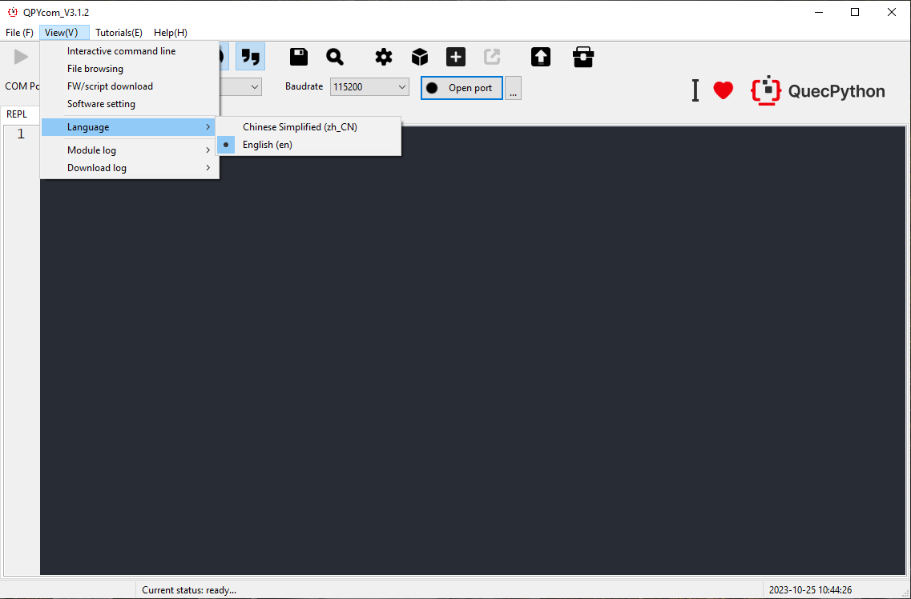

### Interactive Command Line

By clicking "**View > Interactive command line**", you can enter the "REPL" page, where you can manually send commands to interact with the module through the interactive window. The "REPL" page is shown below.

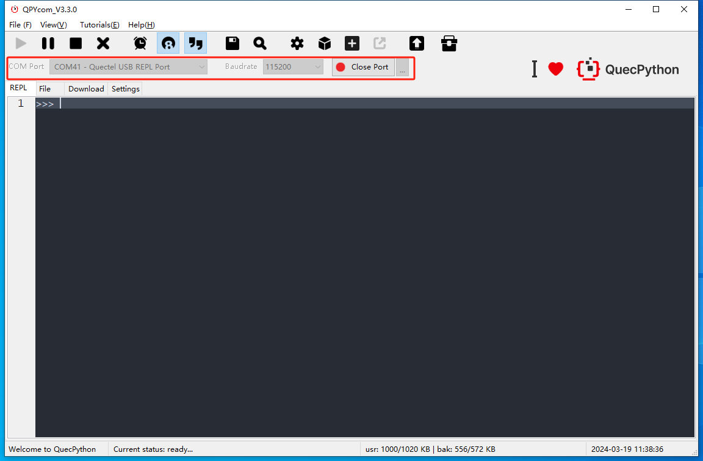

### File Browsing

By clicking "**View > File browsing**", you can enter the "File" page, where you can upload, view, add, and delete the Python files in both your local disks and the module.

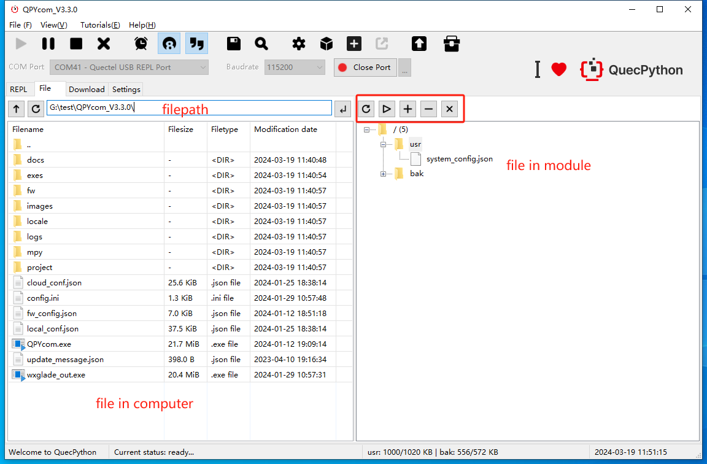

In addition to uploading files by clicking "**+**" on the page, you can also upload a local file to the module by drag-and-drop. Select the local file on the left and drag it to the folder on the right to upload the file. The download progress will be displayed in the status bar. Note that files can only be dragged and dropped into folders. If you drop a file to a wrong location, an error will be prompted. You can call `uos.mkdir()` to create a new folder in the module and then drag and drop the local file to the new folder in the module. Note that files can only be dragged and dropped into folders indicated with "+" and "-". For folders with no symbols, refresh the page.

### FW/Script Download

By clicking "**View > FW/script download**", you can upload Python script files in batches and download firmware to modules. The operation steps are as follows:

-   Create a project on the left navigation bar.
-   Click "**Choose FW**" to choose the firmware from the local disk. The firmware is located in the *firmware* directory of the SDK. Note that the firmware format can only be .zip.
-   Select the script to download as indicated in the figure below. You can also select a script and click "**-**" in the lower left corner to delete it.
-   Switch between "**Download script**" and "**Download FW**" by clicking the inverted triangle icon in the lower right corner.
-   After selecting the firmware and the required script files, click "**Combine**" to generate the file for mass production. During the combination process, all controls except the progress bar are disabled. Please make sure that the USB AT Port is not occupied during the download progress.
-   Note that on the "Download" page in the versions 1.6 and above, scripts have been downloaded as files in a directory format to the module. The original buttons have been removed. You can right-click a file or folder for addition, deletion and modification. You can also drag and drop a file from the local disk to the QPYcom. Click "Download script" to download the script to the module.

As shown in the figure:

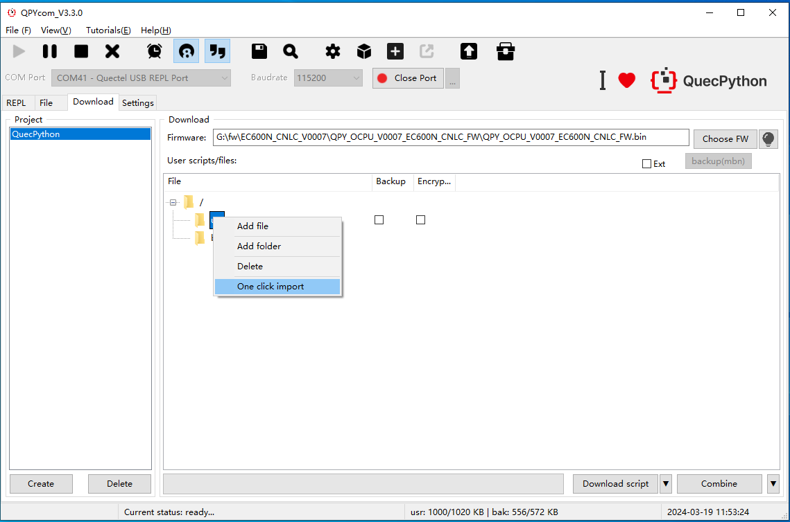

### Software setting

By clicking "**View > Software setting**", you can enter the "Settings" page, where you can set whether to automatically save the module log, the size limit of a single log for saving, the maximum number of logs that can be saved, serial port parameters (including the parity bit, data bit, stop bit and flow control), *mpy-cross* path, and the font for the "REPL" page. These settings can be saved persistently. 

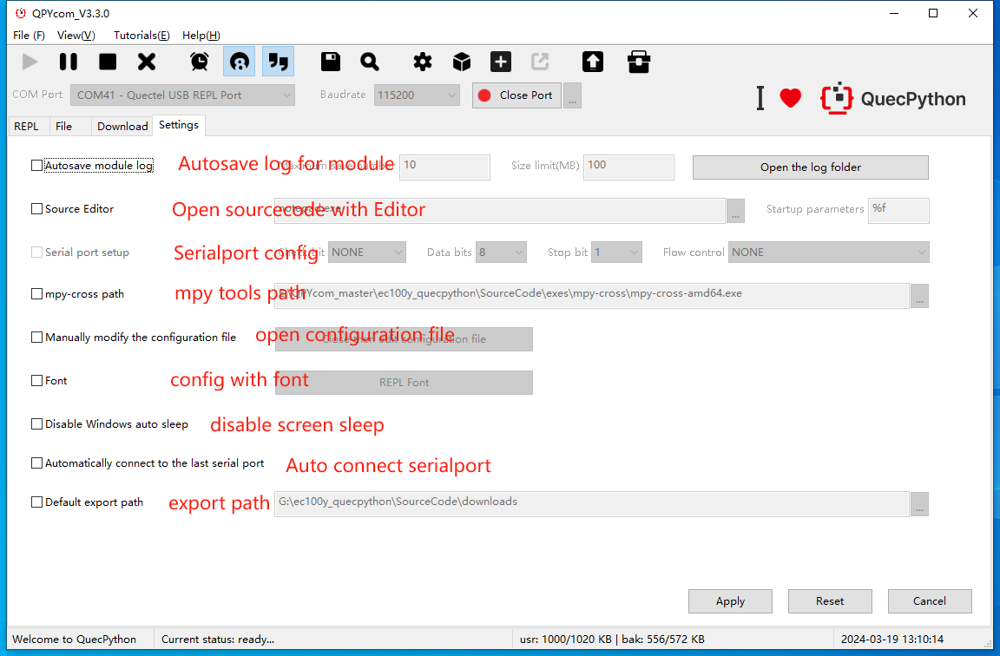

### Language

-   By clicking "**View > Language**", you can switch the tool's language. Currently, only simplified Chinese and English are supported.

### Module Log

-   By clicking "**View > Module log**", you can view module logs and select a new path for saving the module logs.

### Download Log

-   By clicking "**View > Download log**", you can view download logs and select a new path for saving the download logs.

## "Tutorials" Tab in Toolbar

### Official Website

-   By clicking "**Tutorial > Official Website**", you can access QuecPython official website.

### Online Wiki

-   By clicking "**Tutorial > Online wiki**", you can access QuecPython wiki tutorials.

### Online Tutorial

-   By clicking "**Tutorial > Online tutorial**", you can access QuecPython video tutorials.

### Online Communication

-   By clicking "**Tutorial > Online communication**", you can access QuecPython online community.

### Data Download

-   By clicking "**Tutorial > Data download**", you can access the QuecPython resource download center.

## "Help" Tab in Toolbar

By clicking the sub-menus in the "Help" tab, you can check the version and whether there is any update, and access the QuecPython official website and Quectel official website.

### Check Updates

If you click "**Help > Check updates**", the tool will check whether there is a new version. If there is no new version, the notification that the current version is already up to date will pop up. If there is a new version, the update content and version number will pop up.

-   For a mandatory update pop-up, if you select to update, the update progress will start. If you select to cancel, you will exit QPYcom directly.

-   For an optional update which can be ignored this time, if you select to ignore this pop-up, it will pop up again the next time you start QPYcom, but no longer pop up this time. If you select to update, the update progress will start.

-   For an optional update which can be ignored this time, if you select to ignore this update, it will no longer pop up even the next time you start QPYcom. If you select to update, the update progress will start.

-   During the update process, a progress bar and update logs will be displayed. The tool cannot be operated during the update process.

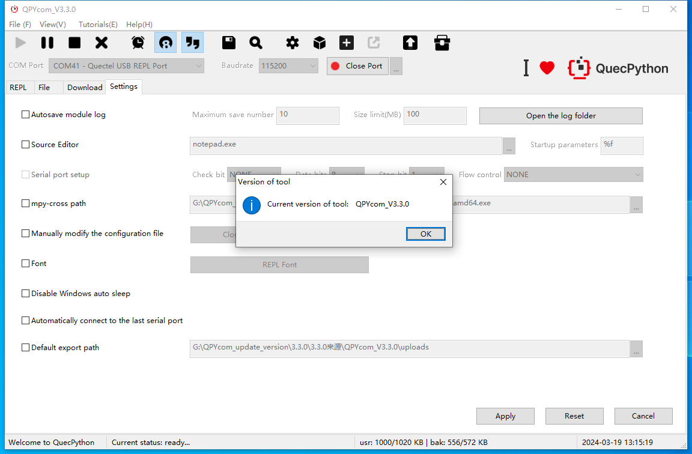

### Changelog

-   By clicking "**Help > changelog**", you can open the tool's changelog and view the revision history. The changelog file is located in the tool's root directory.

### Application Guide

-   By clicking "**Help > application guide**", you can enter the document center and view the tool's user manual.

### About Quectel

-   By clicking "**Help > About Quectel**", you can visit the Quectel official website.

### About QuecPython

-   By clicking "**Help > About QuecPython**", you can visit the QuecPython official website.

### Version

-   By clicking "**Help > Version**", the current version number of QPYcom will be displayed.