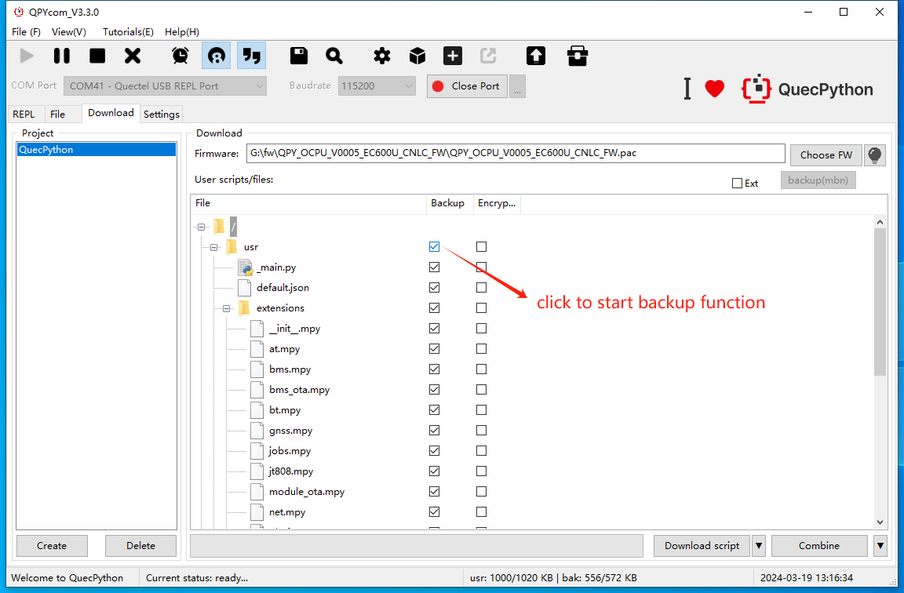
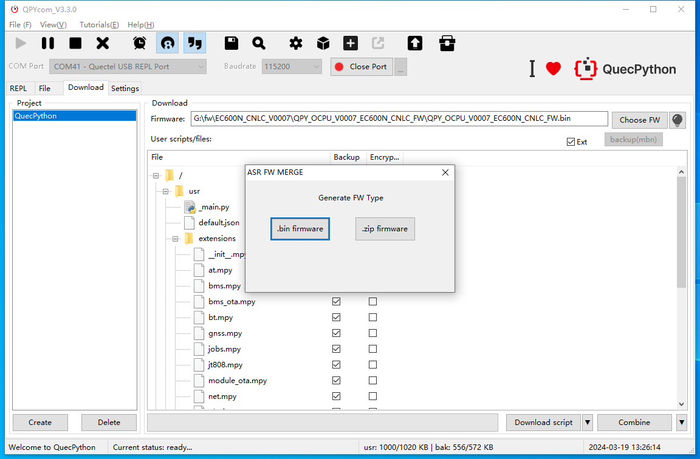
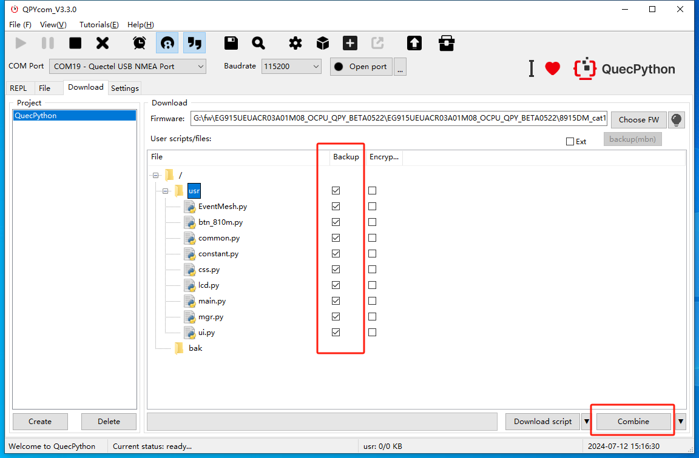
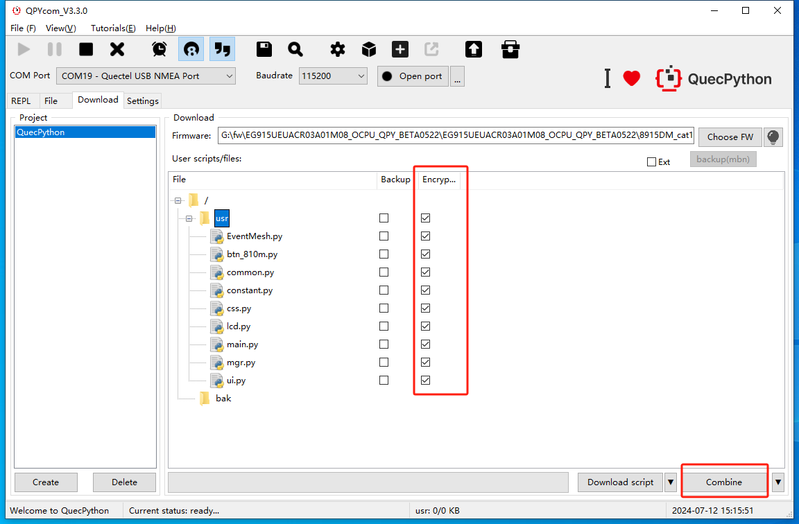
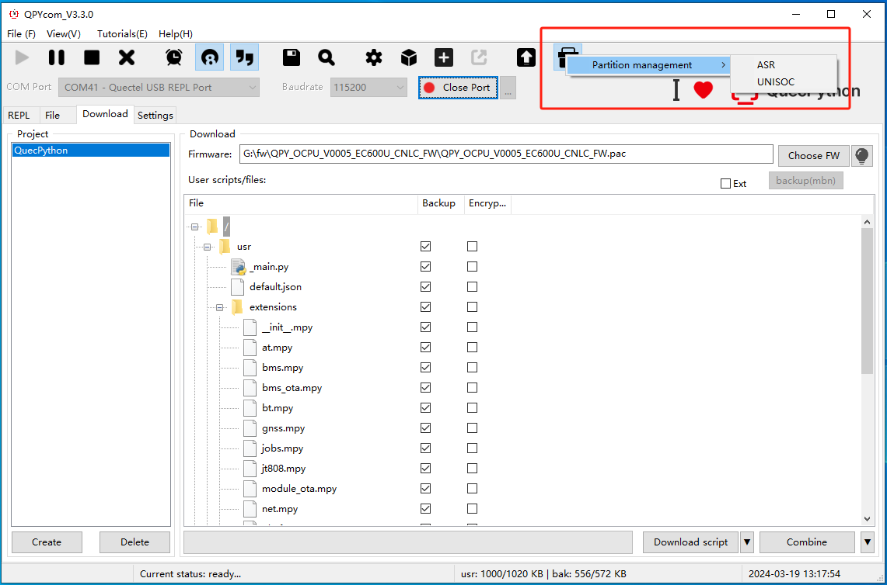
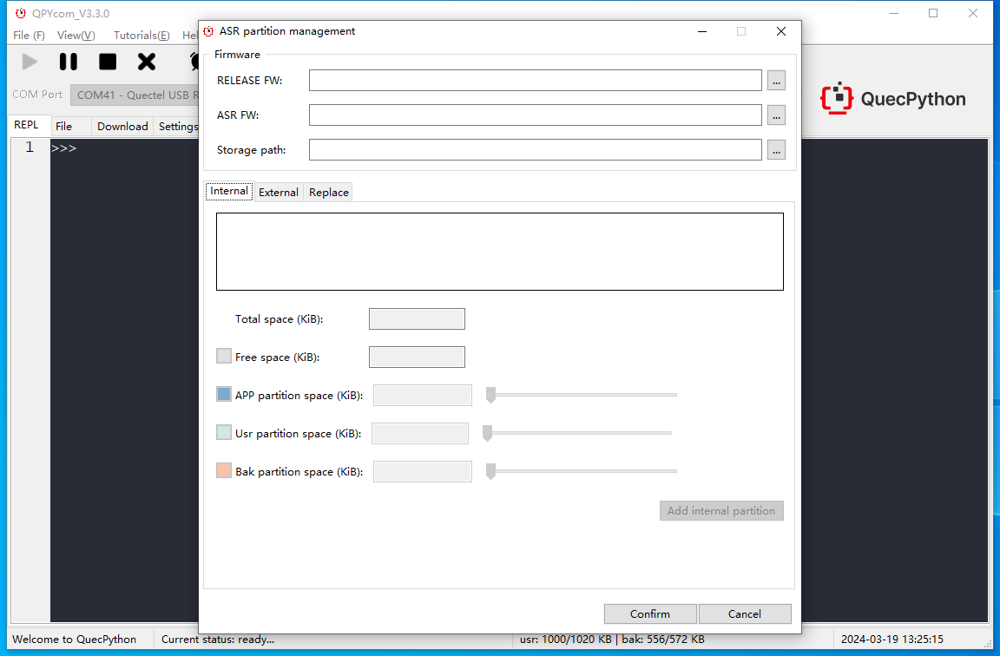
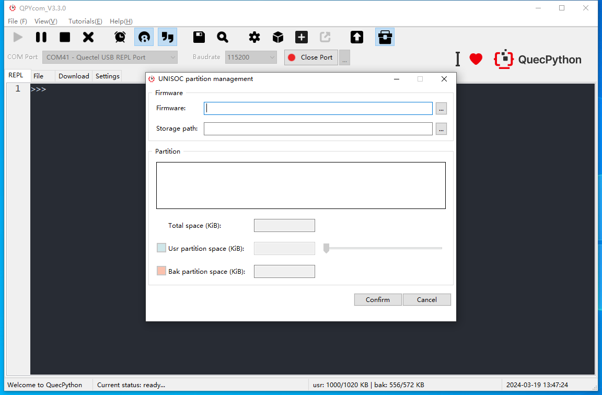
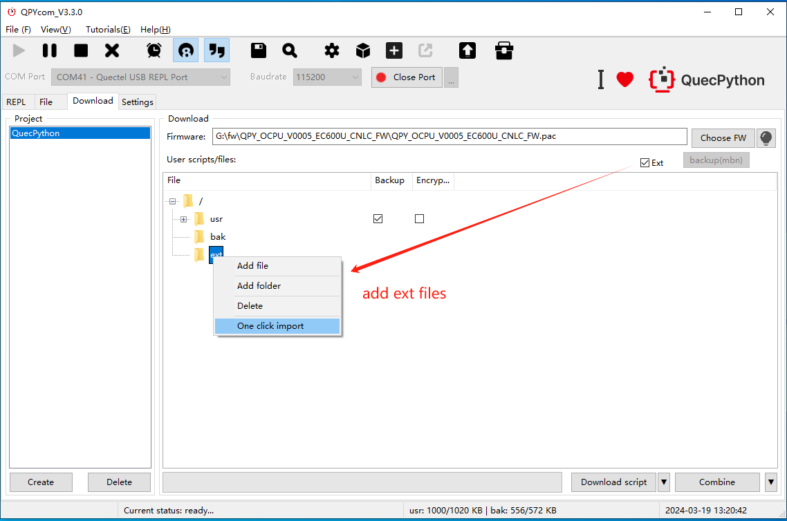

# Combination of Firmware and Script

## Combine Firmware and Script

On the ''**Download**" page, you can combine local Python script files with firmware to generate the files for mass production. The steps are as follows:

- Create a project in the left navigation bar.

- Click "**Choose FW**" to choose the firmware from the local disk.

- Select the scripts to be combined as indicated in the figure below. You can right-click a specified script file and click "**Delete**" to delete the file. You can also import an entire directory to combine projects with complex directory structures by clicking "**One click import**".

- You can select "**Encryption**" and "**Backup**" to enable file backup and encryption.

- After selecting "Backup" (The *bak* or *usr* partition must be empty or non-existent), *usr* will be automatically imported into the *bak/usr* directory.

- Any files added to *usr* will only exist in the *usr* partition and will not be restored from the *bak/usr* directory. Similarly, any files added to *bak* will only exist in the *bak* partition and will not be restored from the *bak/usr* directory.

- For the ASR firmware combination, you can select one file format from .zip and .bin (supported in QPYcom 2.9 and above).

- Note:

  1. If "**Backup**" is not selected, both the *usr* partition and the non-usr part of *bak* partition will be combined with the firmware and neither will be backed up.
  2. Files will only be backed up if they exist in both *usr* and *bak/usr* and the "**Backup**" option is selected.

## Backup File

### Overview of Backup File

The tool can back up the files to be merged during the firmware merging process

If the backed-up files are accidentally deleted, they can be restored by restarting the virtual machine

### Backup Steps

1. Follow the firmware and script merging process above, after selecting the firmware and script to be merged, enable the backup function by checking the backup checkbox

2. After checking the backup, click the merge button, and the selected script will be backed up before merging

## Encrypt Code

### Overview of Python Script Encryption

QPYcom can encrypt the *.py* scripts to *.mpy* files during the firmware combination process to meet the requirement of code security.

The encrypted *.mpy* files cannot be read, but can still be used by importing the library. However, you cannot execute the script by clicking "**Run**" on QPYcom.

During the script encryption process, QPYcom will skip the *main.py* file. The general coding convention is to use *main.py* as the entry file to call other code.

For example, after being encrypted, *user.py* will become *user.mpy*. We can directly use *user.mpy* instead of the original *user.py* file to achieve the same purpose.

### Encryption Steps

1. Following the steps of "Combine Firmware and Script", after selecting the firmware and scripts to be combined, select "**Encryption**" to enable the file encryption.

2. After selecting "**Encryption**", click "**Combine**". The selected scripts will be encrypted before being combined to ensure all combined scripts in the firmware are in *.mpy* format. After the combination is completed, you can find the generated *.mpy* file in the *mpy* folder in the directory.

### Separate Encryption Script

If you do not want to encrypt along with the firmware package, you can encrypt individual scripts using an encryption tool. The tool can be obtained by contacting YiYuan.

Place the encryption tool and the script in the same folder (do not include special characters). Use the CMD command to encrypt the script.

Example (encrypting user.py): mpy-cross-amd64.exe -o user.mpy -mno-unicode user.py

## Adjust Image Partition

### Adjust User and Backup Partition Sizes

1. Click the **Function Box** button and select asr or unisoc.

### Combine External Partitions

1. If you need to add an external partition image when combining firmware and creating a file system, you can combine external partitions.

2. Select "**Ext**" on the "**Download**" page. Then a directory named "ext" will be added to the "User scripts/files" window.

3. Add files to this directory and continue the combination process to combine the firmware with the external partition.

> Note: Only custom firmware that supports external partitions can support the combination of external partitions.