# Thonny IDE User Guide

## Introduction

Thonny is a Python IDE that is very suitable for beginners. It has many user-friendly features such as an easy-to-use interface, syntax checking, and auto-completion.

To support QuecPython development on Thonny, QuecPython team has developed `QuecPython-Kits` plugin. You can install the plugin in Thonny to use it.

This document introduces the features and usage of Thonny, as well as the installation and usage of the `QuecPython-Kits` plugin.

## Setting Up Thonny Environment

### Download

Thonny supports three mainstream operating systems: Windows, macOS, and Linux.

Visit the Thonny official website (<https://thonny.org/>).

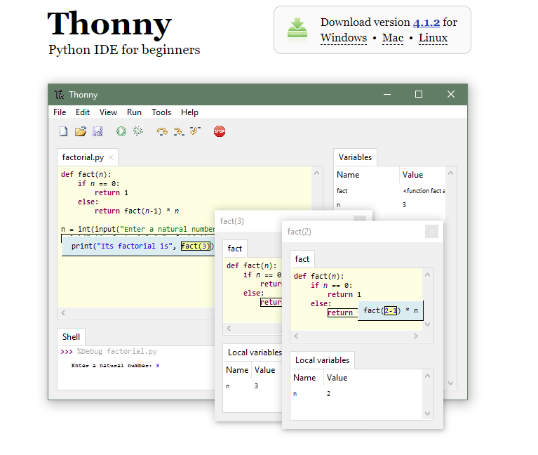

According to the corresponding operating system in the upper right corner of the screen, you can see the following installation options (taking Windows as an example).

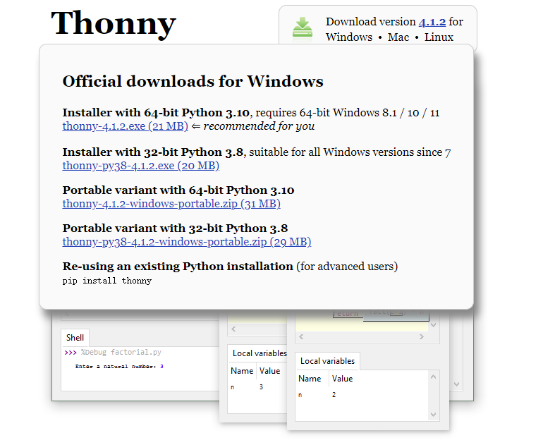

### Installation Methods

There are two installation methods for Thonny:

- Install Thonny+Python bundle —— This option essentially bundles Python environment and Thonny together for quick installation and use. It is convenient and recommended for beginners. There are two ways to install the bundle, corresponding to the above image.
  - Install using the installer
    - `Installer with 64-bit Python 3.10` —— 64-bit Python 3.10 installer
    - `Installer with 32-bit Python 3.8` —— 32-bit Python 3.8 installer
  - Portable variant
    - `Portable variant with 64-bit Python 3.10` —— 64-bit Python 3.10 portable version (available after decompression)
    - `Portable variant with 32-bit Python 3.8` —— 32-bit Python 3.8 portable version (available after decompression)
- Install Thonny separately —— Thonny is essentially a Python package. If you already have a Python environment, you can install Thonny separately using `pip install thonny`. This option is more suitable for developers, corresponding to the above image.
  - `Re-using an existing Python installation (for advanced user)`

### Installation using the Installer

Taking the `64-bit Windows 10` environment as an example, install the program `Installer with 64-bit Python 3.10`. After downloading the installer *`thonny-4.1.2.exe`*, double-click to run it and click "**`Next`**" to complete the installation. After installation, find the desktop application icon to run it.

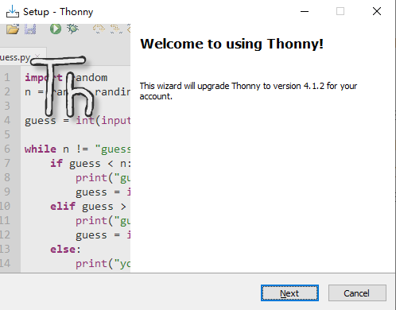

### Installation of the Portable Variant

Taking the `64-bit Windows 10` environment as an example, use the `Portable variant with 64-bit Python 3.10`. Download the installation package `thonny-4.1.2-windows-portable.zip`, extract it, and double-click *`thonny.exe`* to run it.

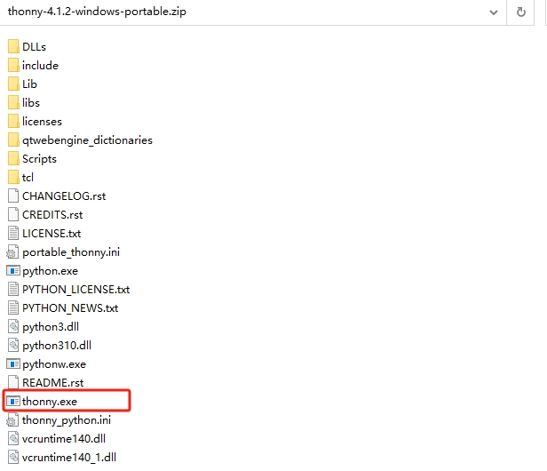

### Installation using PIP

> Note:
>
> 1. This method is for developers. If you install Thonny using this method, you need to have a Python environment. Go to the Python official website (<https://www.python.org/downloads/>) to download and install the Python development environment.
>
> 2. `pip` is a package manager for Python. With this program, you can install Python application packages in the shell environment.

After setting up the Python environment, install Thonny using `pip install thonny`.

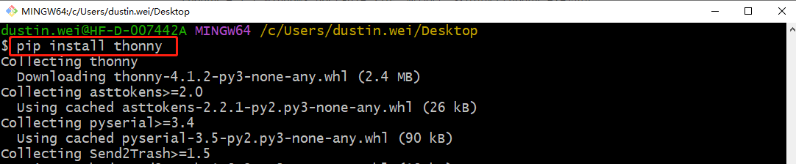

After installation, you can use `pip list` to view the installed Thonny package (`thonny==4.1.2`).

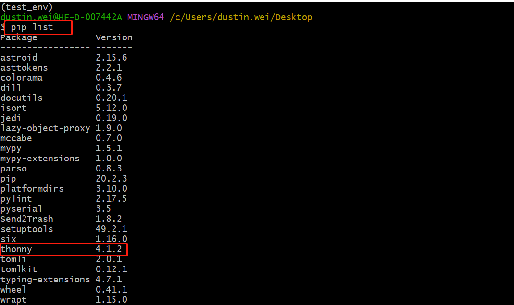

Run Thonny by executing `python -m thonny`, and the Thonny window will appear.

> Command Explanation: In `python -m <package>`, `-m` is followed by a module/package name. The module/package is run as a script.

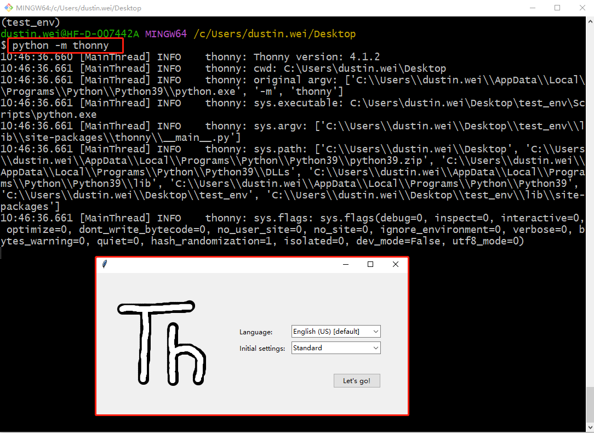

## Write and Run Scripts

### Select and Configure Interpreter

In the menu bar, select "**`Run`**" --> "**`Configure interpreter`**".

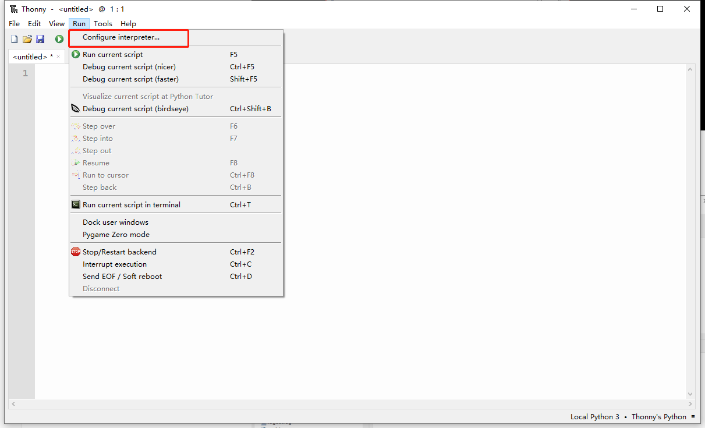

In the pop-up dialog box, select the Python interpreter `Local Python3` for the local Python environment. In the "`Python executable`" field below, select the *`python.exe`* path. If you installed Thonny+Python bundle, the path is already configured by default. If you installed Thonny separately, you need to specify the path to the local Python interpreter.

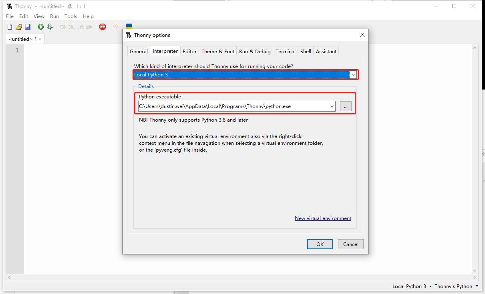

### Run the First Script

In the Thonny text editing area, edit the Python script.

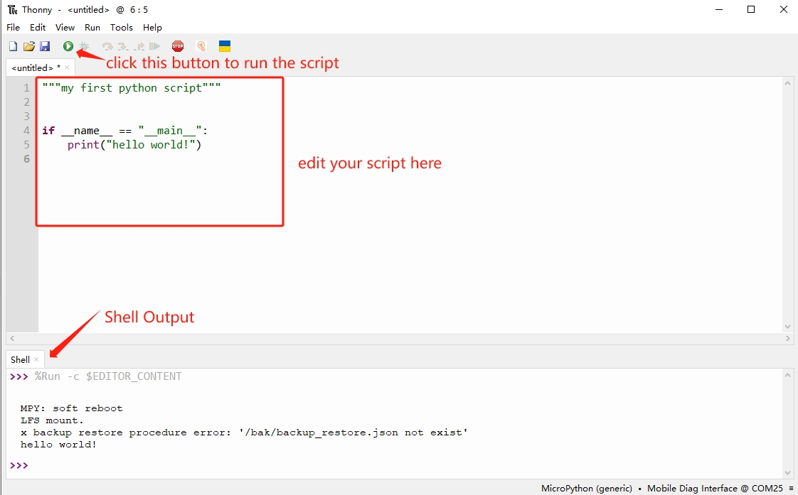

> Press "**`Ctrl + S`**" and select a path in the pop-up window to save the current Python script file.

## Set Up QuecPython Environment

### Download and Install the QuecPython-Kits Plugin

#### Installation using the Thonny Interface

In the menu bar, select "**`Tools`**" --> "**`Manage plug-ins`**" to open the plugin management interface.

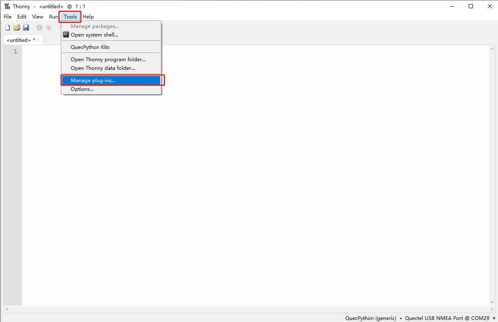

In the search bar, search for `thonny-quecpython`.

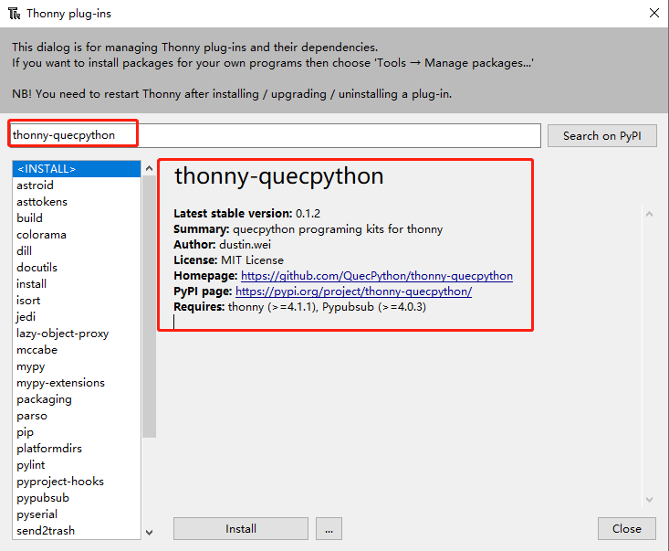

Click  "**`Install`**" to download and install the plugin (Note: After downloading, you need to restart Thonny for the changes to take effect).

#### Installation using PIP

```shell
pip install thonny-quecpython -i {pip mirror}
```

Recommended pip mirror

| Source   | URL                                            |
| -------- | ---------------------------------------------- |
| Tsinghua | https://pypi.tuna.tsinghua.edu.cn/simple/      |
| Ali      | http://mirrors.aliyun.com/pypi/simple/         |
| NTES     | https://mirrors.163.com/pypi/simple/           |
| Baidu    | https://mirror.baidu.com/pypi/simple/          |
| USTC     | https://pypi.mirrors.ustc.edu.cn/simple/       |
| Tencent  | https://mirrors.cloud.tencent.com/pypi/simple/ |

#### Open the Plugin Interface

In the menu bar, select "**`Tools`**" --> "**`QuecPython Kits`**" to open the plugin interface. The sub-interface will appear at the bottom of the screen, as shown in the following image.

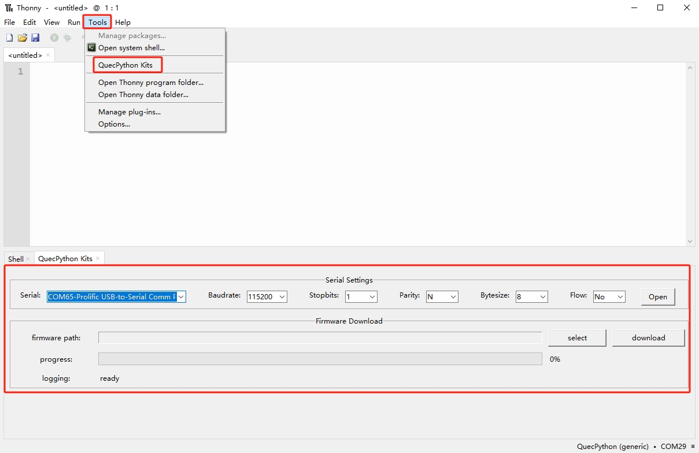

## Download QuecPython Firmware

Click "`select`" in the plugin bar to choose the firmware file you want to download. Then click "`download`" to start the module firmware download process. The information will pop up after the module is successfully downloaded as shown in the following image.

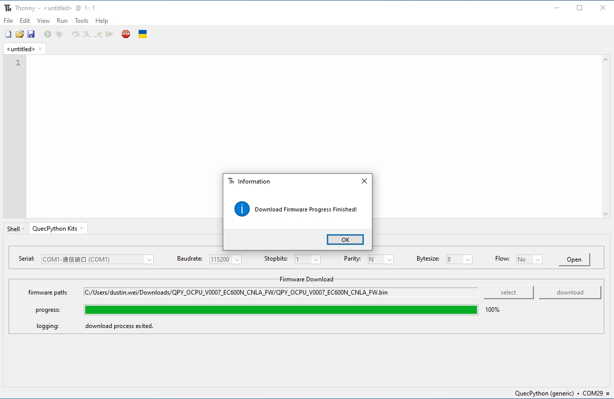

> Before downloading the firmware, make sure the module is connected to the computer.

## Run QuecPython Script

With Thonny, you can directly write and debug code through the REPL, or edit script files for execution and debugging.

### Select & Configure Interpreter 

In the menu bar, select "**`Run`**" --> "**`Configure interpreter`**" --> "**`QuecPython(generic)`**"

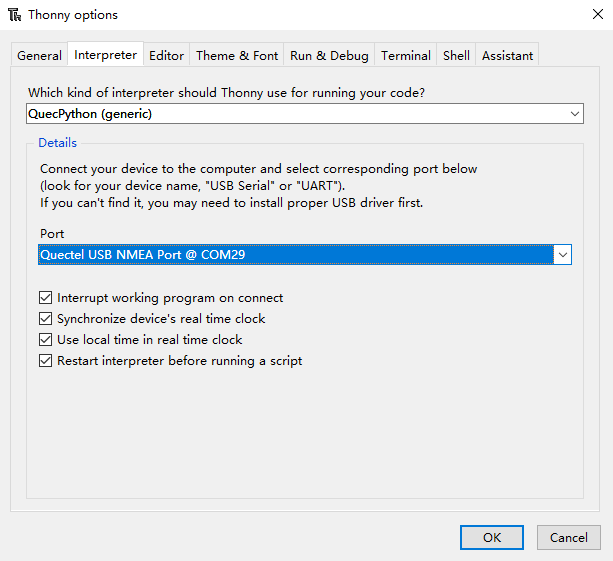

> This document uses the `EG912U-GL` module for testing, with the interactive port as `Quectel USB NMEA Port @ COM29`.

After selecting the interactive port, the Thonny main interface will display the Quecpython welcome message in the shell sub-interface at the bottom. You canenter the **`uos.uname()`** command in the shell to view information about the current module model and version.

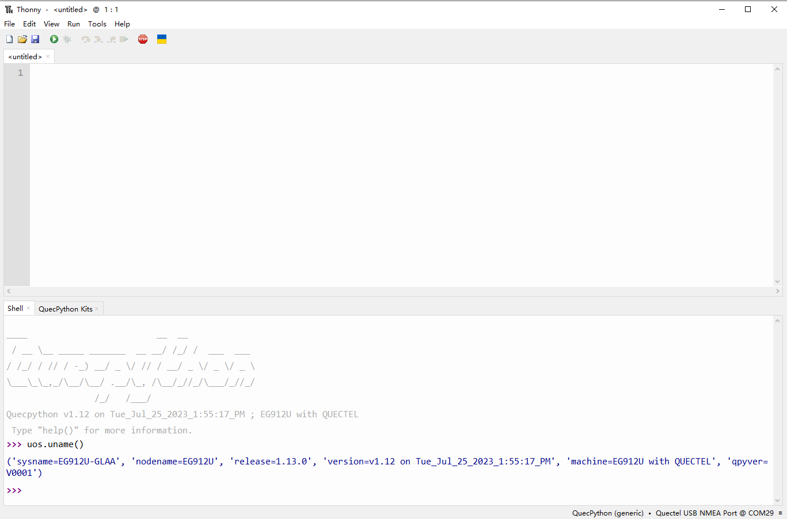

### Edit and Run Script

Edit the QuecPython script code in the editor, and click "**Run**" to automatically run the script on the module. View the script's print output in the shell interface.

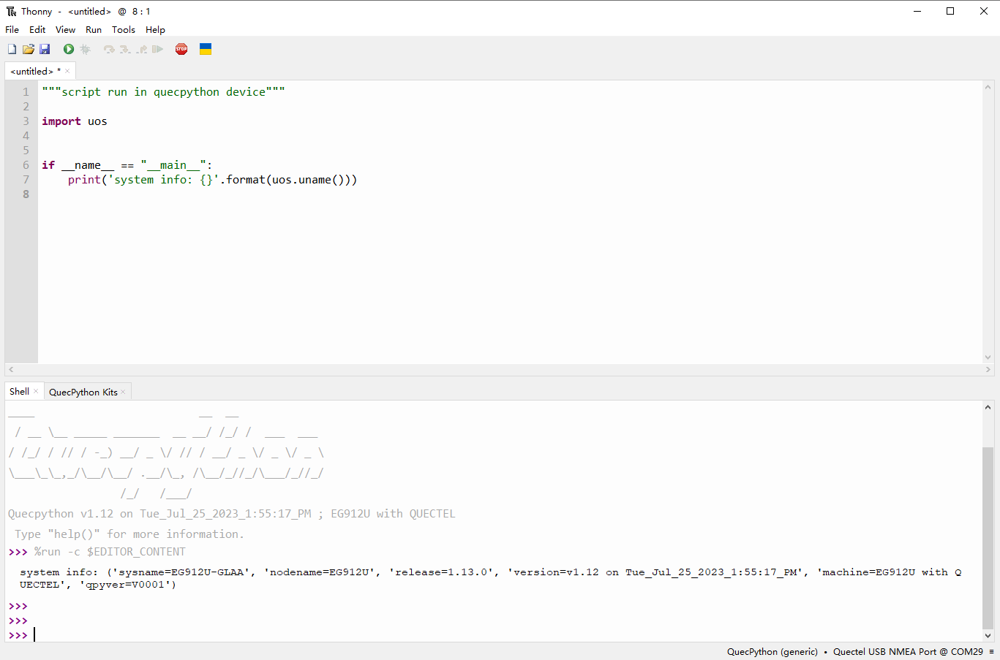

### Save Script File

Thonny allows you to save script files locally or on the device module.

After editing the script file in the editor, press "**`Ctrl+S`**" or click the "save" icon in the upper left corner. A dialog box will pop up for you to choose whether to save the file to the device or locally.

"Save" dialog box:

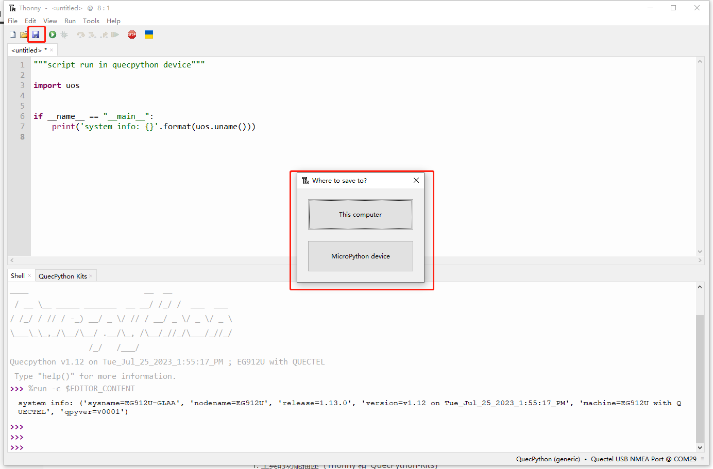

Enter the file name and choose the file system path on the device (`/usr`):

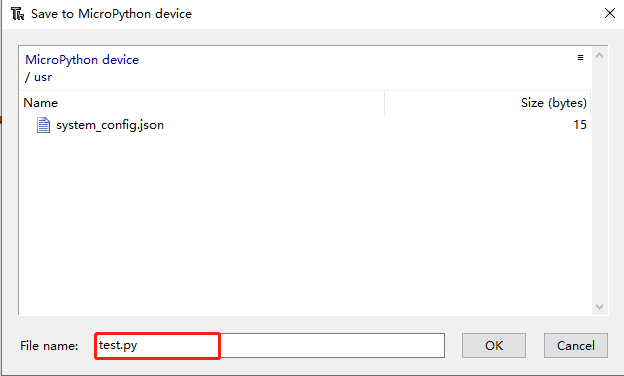

You can open the left sidebar by selecting "**`View`** --> **`Files`**", which will display the local and device file system directory structure. In the following image, you can see the script file you just saved at *`/usr/test.py`*. You can also double-click on a script file in the device to open and display it in the Thonny editor for direct editing and debugging.

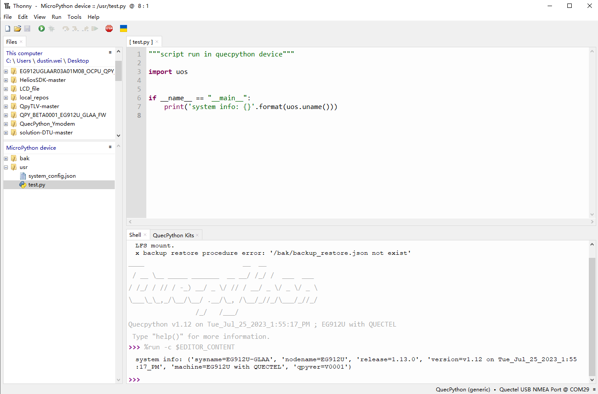

## Download the Open-source Code of QuecPython-Kits Plugin 

The open-source project of `QuecPython-Kits` is named *`thonny-quecpython`*. 

GitHub repository link: <https://github.com/QuecPython/thonny-quecpython>.

`Thonny` open-source project repository link: <https://github.com/thonny/thonny>.