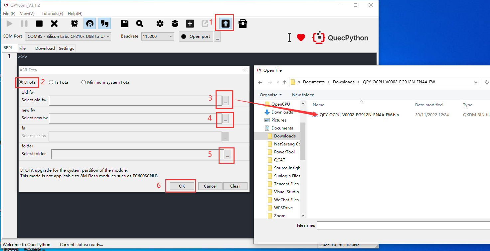
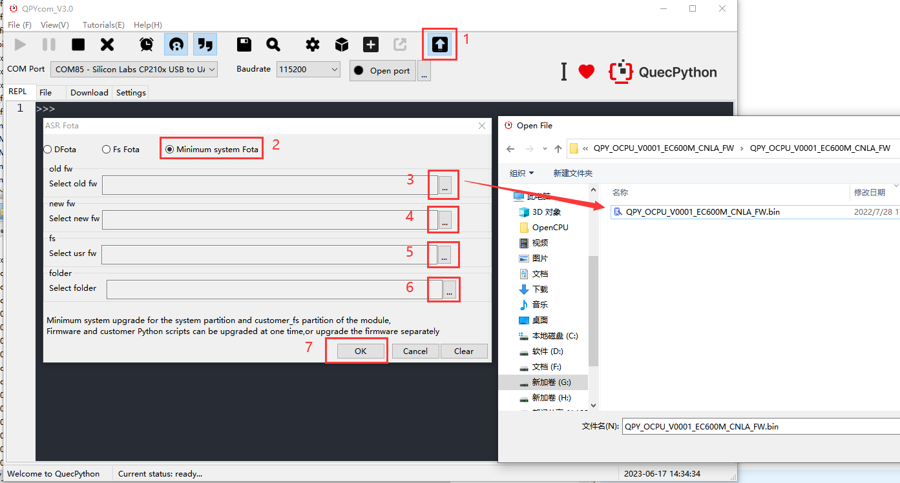
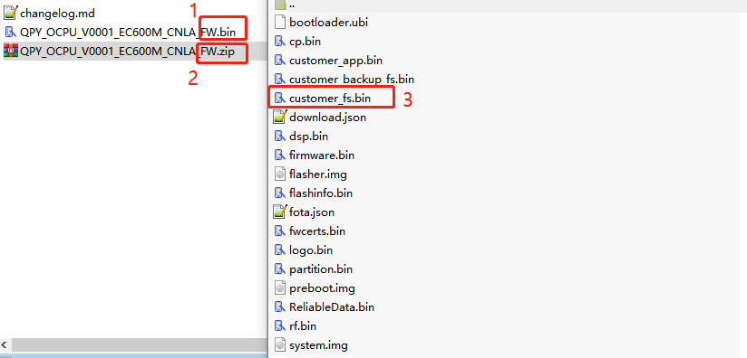
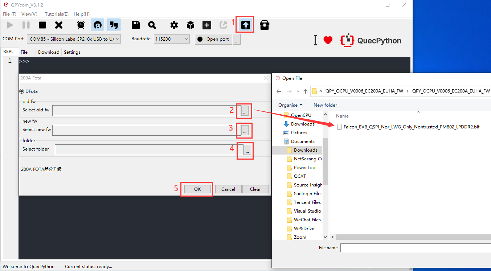
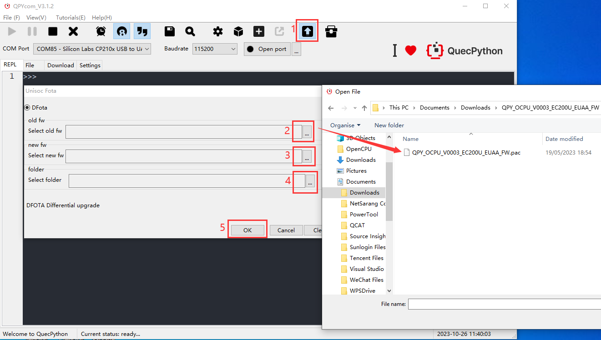
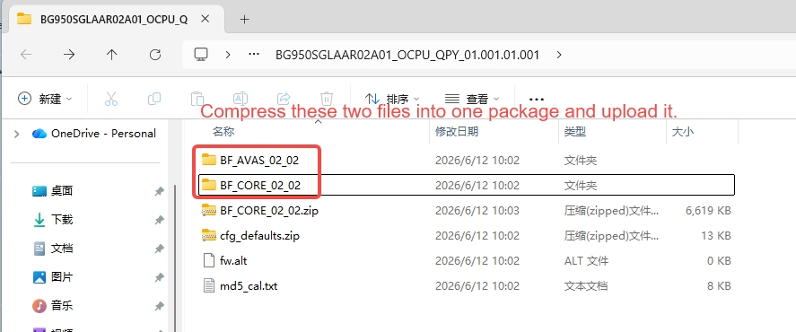
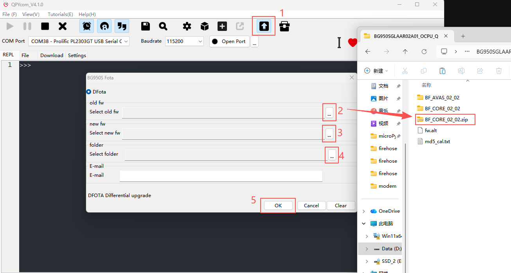

# Firmware OTA Delta Package Making Guide

This document introduces the method of making QuecPython FOTA upgrade packages.

## ECx00N & EG91xN Series

### DFOTA Upgrade Solution 

1. Click the "upgrade" icon and select "**ASR Fota**".

2. In the pop-up window, select "**DFota**".

3. Select the current firmware file.

4. Select the target firmware file.

5. Select the output folder for the upgrade package.

6. Click "**OK**" to generate the upgrade package.

## ECx00M&EGx00M Series

### MiniFOTA Upgrade Solution 

1、Click the "upgrade" icon and select "**ASR Fota**".

2、In the pop-up window, select "**Minimum system Fota**".

3、Select the current firmware file.

4、Select the target firmware file.

5、Select the file system bin file, i.e., the partition storing user files. You need to select the `customer_fs.bin` from the firmware package after merging user files. Refer to the following steps for how to obtain it. (Optional)

6、Select the output folder for the upgrade package.

7、Click "**OK**" to generate the upgrade package.

Method to Obtain the File System Bin File from the Firmware Package:

1.If the merged firmware has a `.bin` suffix, manually rename it to a `.zip` suffix. If it is already a `.zip` file, skip this step.

2.Use decompression software to extract the firmware package with the `.zip` suffix.

3.Obtain the `customer_fs.bin` file from the firmware package, which serves as the file system bin file.

## EC200A Series

### DFOTA Upgrade Solution

1. Click the "upgrade" icon and select "**200A Fota**".

2. Select the *.blf* file in the current firmware folder.

3. Select the *.blf* file in the target firmware folder.

4. Select the output folder for the upgrade package.

5. Click "**OK**" to generate the upgrade package.

## ECx00U & EGx00U &ECx00G Series

### DFOTA Upgrade Solution 

1. Click the "upgrade" icon and select "**Unisoc Fota**".

2. Select the *.pac* file in the current firmware folder.

3. Select the *.pac* file in the target firmware folder.

4. Select the output folder for the upgrade package.

5. Click "**OK**" to generate the upgrade package.

## BG950S & BG770S Series

### DFOTA Upgrade Solution 

Method for obtaining compressed files：

Compress the BF_AVAS_02_02 and BF_CORE_02_02 files in the original firmware package into one compressed file, and obtain the compressed file of this firmware package.

1. Click the "upgrade" icon and select "**Unisoc Fota**".

2. Select the *compressed* file in the current firmware folder.

3. Select the *compressed* file in the target firmware folder.

4. Select the output folder for the upgrade package.

5. Click "**OK**" to generate the upgrade package.

## ECx00E Series

### DFOTA Upgrade Solution

To be supplemented after QPYCOM tool support.

## BG95&BG600L Series

### DFOTA Upgrade Solution

There is a specific tool for making DFOTA upgrade packages, which is not open to the public. You can apply to Quectel for the upgrade package of the corresponding version