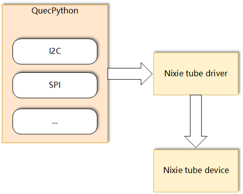
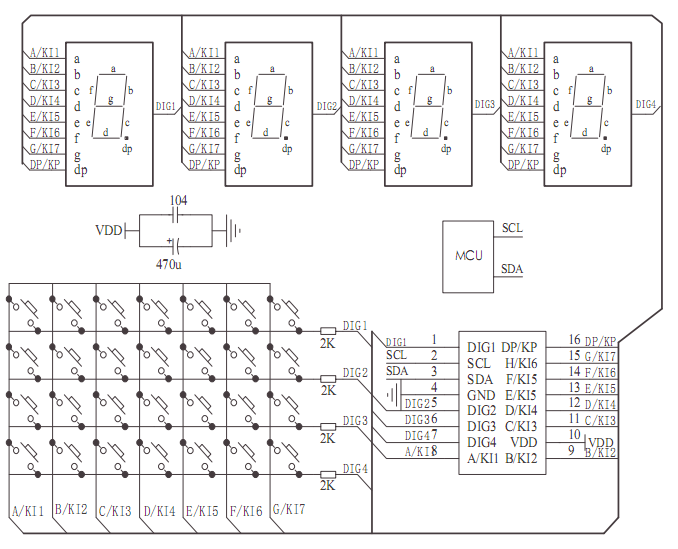

## Digital Displays

Digital displays or LED dot matrix displays are common display solutions in embedded systems. This solution consumes fewer pins and memory resources compared to LCD screens, making it simpler to implement and suitable for applications that require single-digit or character displays, such as timers, counters, and status indicators.

Digital displays come in various types, including LED, LCD and VFD digital displays.

1. **LED Digital Displays**
- **Working Principle**: LED digital displays are based on the principle of light emission when the PN junction of a light-emitting diode (LED) conducts. These displays typically consist of 7 or 14 LED segments, and they can display various numbers or characters by controlling the brightness of these segments using a controller.
   - **Features**: LED digital displays are known for their high brightness, wide viewing angles, long lifespan, and excellent vibration resistance. However, they consume relatively higher power.
   - **Applications**: LED digital displays are widely used in electronic devices and instruments such as digital watches, timers, calculators, and alarm clocks.

2. **LCD Digital Displays**

   - **Working Principle**: LCD digital displays utilize the property of liquid crystal materials to change the transmission of light under the influence of an electric field. Typically, they consist of 7 or 14 LCD segments controlled by a controller to display various numbers or characters.
   - **Features**: LCD digital displays are characterized by low power consumption, a soft display effect, and strong adaptability to environmental conditions. However, they have limited viewing angles and are sensitive to temperature changes.
   - **Applications**: LCD digital displays find widespread use in portable and low-power electronic devices such as wristwatches, electronic dictionaries, and mobile phones.

3. **VFD Digital Displays**

   - **Working Principle**: VFD digital displays generate light using the principle of gas discharge. These displays typically consist of 7 or 14 fluorescent emitters controlled by a controller to display various numbers or characters.
   - **Features**: VFD digital displays are known for their high brightness, rich display colors, wide viewing angles, and fast response. However, they consume higher power and have a shorter lifespan compared to other types.
   - **Applications**: VFD digital displays are commonly used in household appliances and entertainment devices such as televisions, DVD players, and stereo systems.

### Driver Block Diagram



1. **Microcontroller (MCU)**: The microcontroller is the core of the system and is responsible for processing and executing all operations. It sends commands to the display driver IC through an interface based on the information to be displayed.
2. **Display Driver IC**: The display driver IC (also known as a digital  display driver IC) is an integrated circuit specifically designed to drive digital displays. It receives commands from the microcontroller and drives the digital display to display the corresponding numbers or characters based on these commands.
3. **Interface (SPI, I2C, etc.)**: The interface is the communication path that connects the microcontroller and the display driver IC. The microcontroller sends commands to the display driver IC through the interface.
4. **Digital Display**: The digital display is the display device driven by the display driver IC. It displays the corresponding numbers or characters based on the commands from the display driver IC.

In a basic digital display system, the relationship between these components can be summarized in the following steps:

- The microcontroller generates commands based on the information to be displayed.
- The microcontroller sends the commands to the display driver IC through the interface.
- The display driver IC receives these commands and drives the digital tube to display the corresponding numbers or characters.

This is the working principle of a basic digital display system. Different digital display systems may have different specific implementations, but most systems follow this basic pattern.

### Compatibility Information

The QuecPython series modules is compatible with the following device:

| Name   | Function                                                     | Interface | Driver             |
| ------ | ------------------------------------------------------------ | --------- | ------------------ |
| TM1650 | LED driver control chip with keyboard scanning, supports 8-segment × 4 digits and 7-segment × 4 digits | I2C       | [tm1650.py](../../media/hardware/display/tm1650.zip) |

#### TM1650

TM1650 is a dedicated circuit for LED (light-emitting diode display) driver control with a keyboard scanning interface. It integrates MCU input/output control digital interface, data latch, LED driver, keyboard scanning, brightness adjustment, and other circuits.

It supports two display modes: 8-segment × 4 digits and 7-segment × 4 digits.

It can communicate with QuecPython series modules through I2C.



The [tm1650 script](https://github.com/QuecPython/QuecPython_lib_bundles/blob/master/libraries/TM1650/tm1650.py) has encapsulated the basic operations of TM1650, and users can directly call interfaces such as *Tm1650.show_num*, Tm1650.show_str, *Tm1650.show_dp*, etc. to display on the digital tube.

[Example](https://github.com/QuecPython/QuecPython_lib_bundles/blob/master/libraries/TM1650/tm1650.py)

```
from usr.tm1650 import Tm1650
tube = Tm1650(Pin.GPIO13, Pin.GPIO12) #600U PIN60,PIN59
tube.on()
tube.all_show()
utime.sleep(1)
tube.clear_bit(3)
utime.sleep(1)
tube.all_clear()
utime.sleep(1)
tube.show_dp(3)
utime.sleep(1)
tube.show_str("PPJ")
utime.sleep(1)
tube.show_num(-537)
utime.sleep(1)
tube.show_num(8537)
utime.sleep(1)
tube.circulate_show("AbCdEFH")
```

### Frequently Asked Questions

- The digital display is not lit up: This may be a power supply issue, such as poor contact of the power line or insufficient power supply voltage. It may also be a problem with the digital display itself, such as internal circuit damage. In addition, if a controller-driven digital display is used, there may be issues with the driver program or the hardware of the controller.
- The digital display does not display completely or displays incorrectly: This is usually a problem with the driver circuit or control program. For example, if the driver program does not set or update the display data correctly, it may result in display errors.
- The digital tube is flickering: If the digital tube is flickering unintentionally, it may be the reason of unstable power supply or the driver program issues. For example, if the power supply voltage is unstable, it may cause the brightness of the digital tube to constantly change, resulting in flickering. Additionally, if the driver program does not refresh the display data correctly, it may also cause the digital display to flicker.
- Uneven brightness or inconsistent color of the digital tube: This may be caused by the quality issues with the digital display itself or problems with the driver circuit. For example, if some LEDs of the digital display age unevenly, it may result in uneven brightness or inconsistent color.