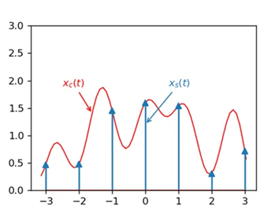
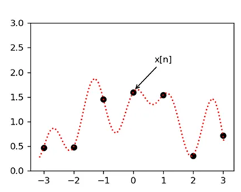
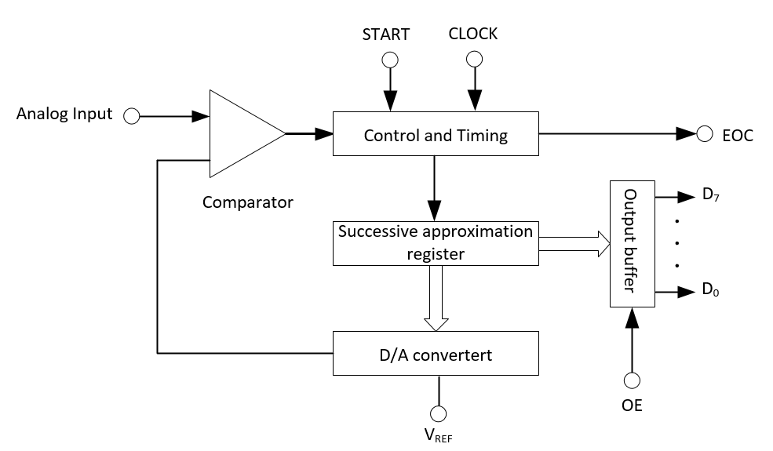
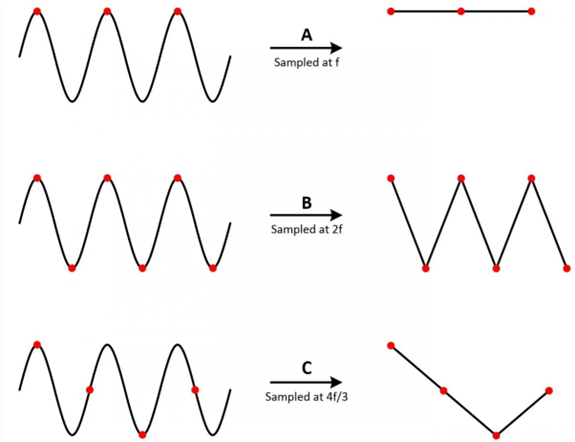
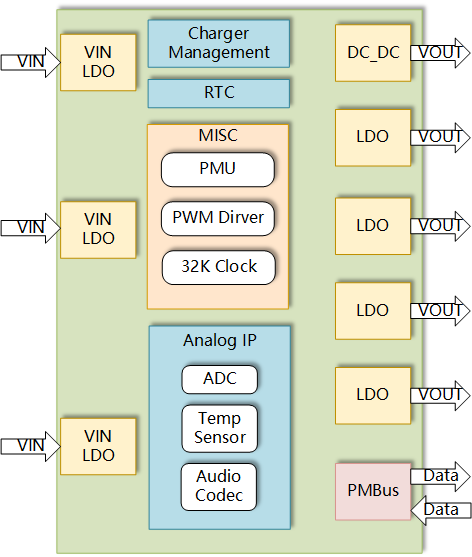
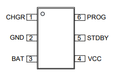
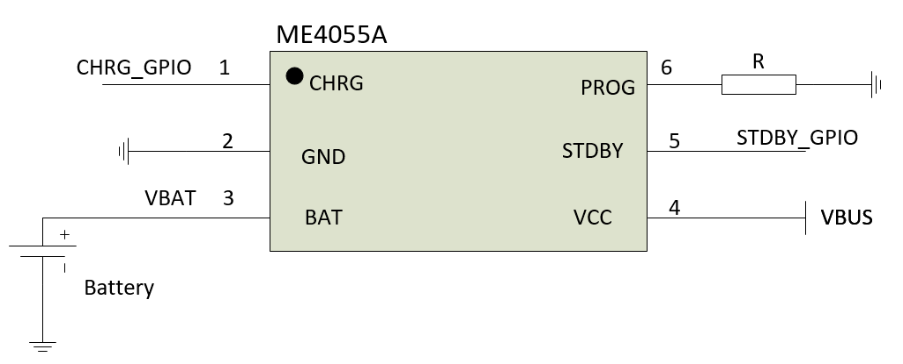
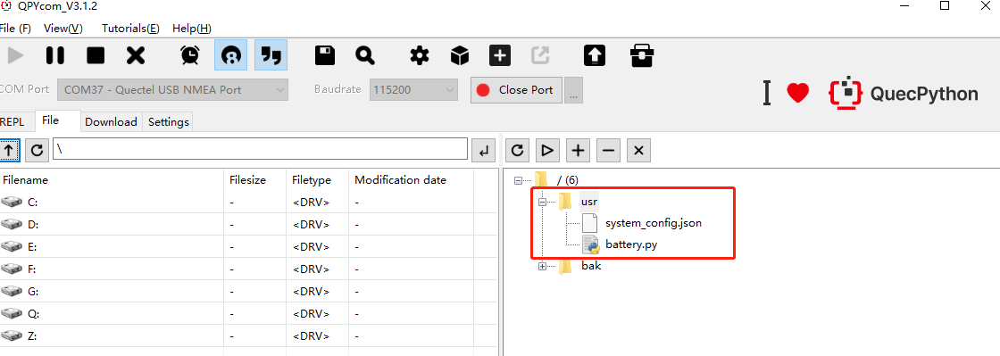
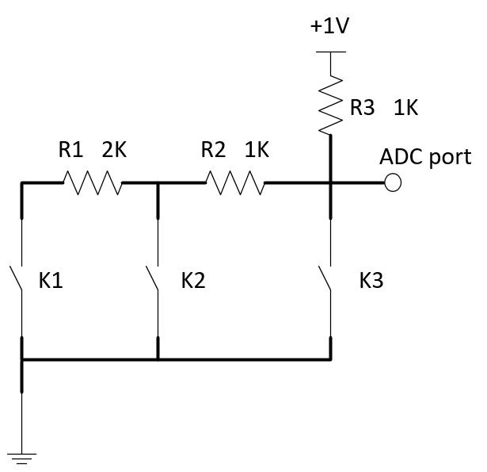
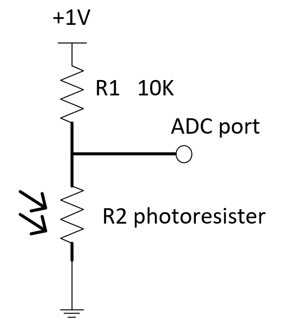

# ADC- Analog-to-Digital Converter

## ADC Principles and Common Applications

Analog signals are signals that have a continuous mathematical form in the time domain, with signal values continuously varying at different time points. They convey information about continuously changing physical quantities such as temperature, humidity, pressure, length, current, and more. Different types of data need to be converted into corresponding analog signals for transmission.

Digital signals, on the other hand, are signals where both the independent and dependent variables are discrete. They can be understood as signals that are discrete both in the time domain and in amplitude, meaning they are not continuous. Digital signals are stored and processed in computers using binary representation.





Using a processor with a working voltage of 3.3V as an example, it generates rectangular wave electrical signals during its operation, which are either 0V (logic 0) or 3.3V (logic 1). In the physical world, a voltage signal of 1V cannot be directly recognized by the CPU; it must be converted into a digital signal by a device called an ADC before it can be recognized by the CPU.

ADC, short for Analog-to-Digital Converter, plays the role of transforming analog signals that computers cannot directly recognize in the physical world into binary digital signals that can be recognized by the CPU.

The basic working principle of ADC involves sampling and quantization. First, ADC samples the analog signal, which means it measures the value of the analog signal at regular time intervals. Then, the sampled analog signal is quantized, which means it is discretized into a series of discrete numerical values. These numerical values are typically represented in binary.



The resolution of an ADC represents its ability to quantify analog signals with precision. It refers to the number of discrete values that the ADC can represent. Resolution is typically measured in bits, such as 8-bit, 10-bit, 12-bit, and so on. For example, an 8-bit ADC can divide the input range into 2^8 (256) different discrete levels, while a 12-bit ADC can divide it into 2^12 (4096) discrete levels. Higher resolution means that the ADC can more accurately quantify analog signals.

The sampling rate of an ADC is the number of times it samples per second. A higher sampling rate results in a more faithful representation of the original analog signal. According to the Nyquist Sampling Theorem, the sampling rate must be at least twice the maximum frequency of the signal being measured to avoid distortion in the sampled waveform. In practical applications, the sampling frequency is often much higher, sometimes even up to 10 times or more the maximum frequency of the signal being sampled.



The input voltage range of an ADC (Analog-to-Digital Converter) refers to the range of analog signal voltages it can accept. It is typically expressed in voltage units, such as 0V to 5V or -5V to +5V. Ensuring that the input signal does not exceed the ADC's input range is crucial to avoid signal distortion or damage.

ADCs can be triggered in two main ways: software-triggered and hardware-triggered. In software triggering, the ADC starts the conversion immediately when a conversion command is issued in software. In hardware triggering, the ADC waits for a specified external event to occur before starting the conversion. The choice of triggering method depends on the specific application and requirements.

ADCs find wide-ranging applications in various fields, including data acquisition, sensor interfacing, audio processing, communication systems, and more. They are essential components for converting analog signals into digital format, allowing analog signals to interact with and be processed by digital systems.

## ADC Descriptions for Various Platforms

ADCs are typically located on the PMU (Power Management Unit) and are part of the Analog IP. A typical structure diagram of the PMU is shown below:



The differences in ADC specifications for various platforms are summarized in the following table:

| Platform   | Number of Channels Supported | Bit Width | Input Voltage Range (in volts) |
| ------ | -------- | ---- | --------------------- |
| EC600N | 1        | 10   | 0~1.3                 |
| EC600M | 2        | 12   | 0~1.2                 |
| EC800N | 1        | 10   | 0~1.8                 |
| EC600U | 4        | 12   | 0~VBAT                |
| EC200U | 3        | 12   | 0~VBAT_BB             |
| EC200A | 2        | 12   | 0~VBAT_BB             |
| BG95   | 1        | 16   | 0~1.8                 |
| EG915U | 2        | 12   | 0~VBAT                |
| EC800M | 2        | 12   | 0~1.2                 |
| EG912N | 2        | 12   | 0~VBAT_BB             |

> - VBAT: Module power supply voltage.
> - VBAT_BB: Module baseband and RF power supply.
> - When VBAT is not powered, do not connect any voltage to the ADC pins.

## ADC API Description

> - Do not exceed the upper limit of the allowed voltage range for input voltages. If the voltage exceeds the upper limit, use voltage dividers as needed.
> - The reference voltage Vref is generated internally by the module and does not require additional provision.

### Create an ADC Object

```python
from misc import ADC
adc = ADC()
```

Create an ADC object. To use ADC functionality, you need to create an object first.

### Initialize ADC

```python
adc.open()
```

After creating the object, call this interface to initialize it.

### Read Voltage from a Specific Channel

```python
adc.read(ADCn)
```

To read from the ADC, use this interface. It reads the voltage from a specified channel. When you call this interface, it triggers the ADC for data acquisition, reads the conversion result after the conversion is completed, and returns the voltage value.

`ADCn` specifies the ADC channel. For example, `adc.read(ADC.ADC0)` reads the voltage from ADC channel 0, and the returned value is in millivolts (mV).

> - The returned voltage value represents the voltage at the module's pin. For certain module models, there may be internal voltage dividers, and the returned value is the voltage at the pin before the internal voltage divider.
> - When ADC pins are left floating, the read voltage may be a random value. It is advisable not to leave them floating.
> - Reading from the interface can be time-consuming, so avoid frequent calls.

### Close ADC

```python
adc.close()
```

Close the ADC when it is not in use.

## Application Scenarios

### Battery Voltage Acquisition and Charging Detection

Materials Needed: Battery, EC600U Module, ME4055A.

Principle: 

ME4055A is a dedicated battery charging chip designed to provide constant current or constant voltage linear charging for a single battery. Its packaging is as shown below. 

The CHRG pin is the charging status indicator pin. When the battery is charging, the CHRG pin is pulled low by the internal circuit. Otherwise, the CHRG pin is in a high-impedance state.

The BAT pin is the battery connection pin, where the positive terminal of the battery is connected. The voltage output at the BAT pin is constant at 4.2V.

The VCC pin is the power supply input pin, providing power to ME4055A.

The STDBY pin is the charging completion indicator pin. When charging is complete, STDBY is pulled low by the internal circuit. Otherwise, STDBY is in a high-impedance state. The module determines the charging status by monitoring the levels of the CHRG and STDBY pins.

The PROG pin is used for charging current setting and detection. When the PROG pin is connected to ground through a resistor R~PROG~, the charging current I~BAT~=(V~PROG~/R~PROG~)*1100, where V~PROG~=0.1V in pre-charge mode, and V~PROG~=1V in constant current charging mode.



The principle of battery voltage detection involves using the voltage divider method with resistors. In hardware, two resistors are used to proportionally divide the battery voltage, and the divided voltage is sent to the module's ADC pin for detection. The software calculates the battery voltage based on the voltage value read by the module's ADC, using conversion calculations.

Hardware Connection: As shown in the diagram below, ME4055A's CHRG and STDBY are connected to the module's GPIO pins, BAT is connected to the positive terminal of the battery, and VCC is connected to the power supply. By dividing the battery voltage and connecting it to the module's ADC pin, the battery voltage is measured.



You can download `battery.py` by [clicking this link](https://github.com/QuecPython/QuecPython_lib_bundles/blob/master/libraries/battery/battery.py). `battery.py` implements functions for battery voltage acquisition, charging status detection, charging event reporting, and battery capacity calculation. Below are the scripts for charging status detection and battery voltage acquisition:

Script for Charging Status Detection: Charging status is determined by reading the status of the CHRG and STDBY pins of ME4055A.

```python
def __update_charge_status(self):
    """Update Charge status by gpio status"""
    if not self.__usb:
        chrg_level = self.__chrg_gpio.read()
        stdby_level = self.__stdby_gpio.read()
        if chrg_level == 1 and stdby_level == 1:
            # Not charge.
            self.__charge_status = 0
        elif chrg_level == 0 and stdby_level == 1:
            # Charging.
            self.__charge_status = 1
        elif chrg_level == 1 and stdby_level == 0:
            # Charge over.
            self.__charge_status = 2
        else:
            raise TypeError("CHRG and STDBY cannot be 0 at the same time!")
    else:
        self.__usb_charge()

def charge_status(self):
    """Get charge status
    Returns:
        0 - Not charged
        1 - Charging
        2 - Finished charging
    """
    self.__update_charge_status()
    return self.__charge_status
```

Battery Voltage Acquisition: The script collects battery voltage by sampling multiple times at specified intervals, then takes the average after removing the maximum and minimum values as the returned data.

```python
def __get_adc_vbatt(self):
    """Get vbatt from adc"""
    self.__adc.open()
    utime.sleep_ms(self.__adc_period)
    adc_list = list()
    for i in range(self.__adc_period):
        adc_list.append(self.__adc.read(self.__adc_num))
        utime.sleep_ms(self.__adc_period)
    adc_list.remove(min(adc_list))
    adc_list.remove(max(adc_list))
    adc_value = int(sum(adc_list) / len(adc_list))
    self.__adc.close()
    vbatt_value = adc_value * (self.__factor + 1)
    return vbatt_value
```

After downloading `battery.py` to the module's usr partition, you can import the `Battery` class using the following:

```python
from usr.battery import Battery
```

Once you've imported the `Battery` class, you can create a `Battery` class object and use its related methods. The usr partition is a part of the Python virtual machine's file system where you can store user scripts.



The API documentation for `battery.py` is as follows:

> [Click here](https://github.com/QuecPython/QuecPython_lib_bundles/blob/master/libraries/battery/README.md) for the detailed API documentation.

**Instantiating an Object**

Example:

```python
from usr.battery import Battery
adc_args = (adc_num, adc_period, factor)
chrg_gpion = 0
stdby_gpion = 1
battery = Battery(adc_args=adc_args, chrg_gpion=chrg_gpion, stdby_gpion=stdby_gpion)
```

- `adc_num`: ADC channel
- `adc_period`: Number of ADC readings in a loop
- `factor`: Calculation factor
- `chrg_gpion`: GPIO connected to CHRG
- `stdby_gpion`: GPIO connected to STDBY

**Setting a Charging Event Callback Function**

Example:

```python
def charge_callback(charge_status):
    print(charge_status)
res = battery.set_charge_callback(charge_callback)
```

Callback parameter charge_status: 
- `0` - Not charging.
- `1` - Charging.
- `2` - Charging complete.

**Setting the Current Battery Temperature**

Example:

```python
res = battery.set_temp(20)
```

This sets the temperature to 20°C.

**Querying Battery Voltage**

Example:

```python
battery.voltage
```

The return value is in millivolts (mV).

**Querying Battery Capacity**

```python
res = battery.energy
```

The return value represents a percentage, ranging from 0 to 100.

**Querying Charging Status**

```python
battery.charge_status
```

Returns 0 for not charging, 1 for charging, and 2 for charging complete.

**Application Example:**

```python
from battery import Battery

# instantiation object
adc_args = (adc_num, adc_period, factor)
chrg_gpion = 0
stdby_gpion = 1
battery = Battery(adc_args=adc_args, chrg_gpion=chrg_gpion, stdby_gpion=stdby_gpion)

def charge_callback(charge_status):
    print(charge_status)

# set charge status callback 
battery.set_charge_callback(charge_callback)
# True

# set current temp
temp = 30
battery.set_temp(temp)
# True

# get battery volt
battery.voltage
# 3000

# get battery soc
battery.energy
# 100

# get charge status
battery.charge_status
# 1
```

### ADC-Based Button Detection

When IO resources are limited, you can use ADC to implement multi-button recognition with a single ADC pin.

Materials Needed: EC600U module, relevant hardware circuit.

Principle:

Different button presses are determined by the varying voltage levels at the ADC pin.

- When the upper end of R3 is connected to a voltage of 1V and no button is pressed, the voltage at the test point is 1V.
- When K1 is pressed, the voltage at the test point drops to 0.75V.
- When K2 is pressed, the voltage at the test point drops to 0.5V.
- When K3 is pressed, the voltage at the test point drops to 0V.

The software can periodically read the voltage at the ADC pin and use this information to determine which button is pressed. In practical applications, you can adjust the pull-up voltage, resistor values, and the number of switches as needed.

The hardware circuit is as shown in the diagram below, consisting of three buttons (K1, K2, K3) and three resistors. The ADC port in the diagram is connected to the module's ADC0 pin.



To improve the accuracy of ADC voltage measurements, it is recommended to ground the ADC interface during wiring.

Example:

```python
from misc import ADC
import utime
adc = ADC()
adc.open()
ADC_VALUE_1 = 100
ADC_VALUE_2 = 600
ADC_VALUE_3 = 900
while True:
    # Read ADC result
    adc_value = adc.read(ADC.ADC0)
    # Detect pressed key based on ADC result
    if adc_value < ADC_VALUE_1:
        # key3 pressed
        print("K3 is now pressed")
    elif adc_value < ADC_VALUE_2:
        # key2 pressed
        print("K2 is now pressed")
    elif adc_value < ADC_VALUE_3:
        # key1 pressed
        print("K1 is now pressed")
    else:
        # no key pressed
        print("no key is now pressed") 
    utime.sleep_ms(20)
```


### Light Sensor

Materials Needed: EC600U module, light-dependent resistor (e.g., GL5528)

Principle:

The resistance of a light-dependent resistor (LDR) changes with varying light intensity.

When the LDR is exposed to light, its resistance decreases.

When the light intensity decreases or there is no light, the resistance of the LDR increases, which affects the voltage at the test point.

By reading the ADC voltage values, you can calculate the resistance value of the LDR. Based on the relationship between the light intensity and the resistance of the LDR, you can determine the intensity of the light.

The hardware circuit is as shown in the diagram below: R2 is the LDR, R1 is 10K (you can choose the value of R1 based on the specific parameters of the LDR), and the ADC port is the test point connected to the module's ADC pin.



In this example, you can observe the impact of different light levels on the LDR by printing the ADC-measured voltage values and the resistance values of the LDR.

```python
from misc import ADC
import utime 
import _thread

# unit as kΩ
def Voltage_to_Resistance(Volt):
    resistance = (10 * Volt)/(1000 - Volt)
    return resistance

def Photoresistor_thread(delay, retryCount):
    	# creat a adc device
    	AdcDevice = ADC()
    	while retryCount:
            retryCount = retryCount - 1
            # get ADC.ADC0 value
            adcvalue = AdcDevice.read(ADC.ADC0)
            print("get ADC.ADC0 Voltage value as {0}mv".format(adcvalue))
            # Converted to resistance
            resistance = Voltage_to_Resistance(adcvalue)
            print("Photoresistor resistance as {0}Ω".format(resistance * 1000))
            utime.sleep(delay)
    	pass
    	
if __name__ == "__main__":
    	# creat a thread Convert ADC to Voltage
    	_thread.start_new_thread(Photoresistor_thread, (1, 10))
    	print("main thread has exit")

```

## FAQ

### ADC Voltage Range

1. The input voltage for each ADC interface pin must not exceed its allowed voltage range. When the measured voltage is greater than the input voltage range, it should be first reduced by resistor division before connecting it to the module's ADC pin.

2. In cases where the module's VBAT is not powered, to avoid damaging the module, ADC interfaces should not be directly connected to any input voltage.

### ADC Bit Width

ADC bit width refers to how many bits are used to represent the ADC conversion result. A larger bit width results in higher resolution and more precise measurements. For example, if a 1V voltage is converted by a 10-bit ADC, each bit represents 1/1024V. The module's ADC returns the processed voltage value.

### Does the Module Support Charging

The module currently does not support charging functions.

### How to Measure Battery Voltage

You can use the resistor division method to measure the voltage after division. If you want to obtain the module's own VBAT voltage, you can call the `Power.getVbatt()` interface, which returns the voltage in millivolts (mV).