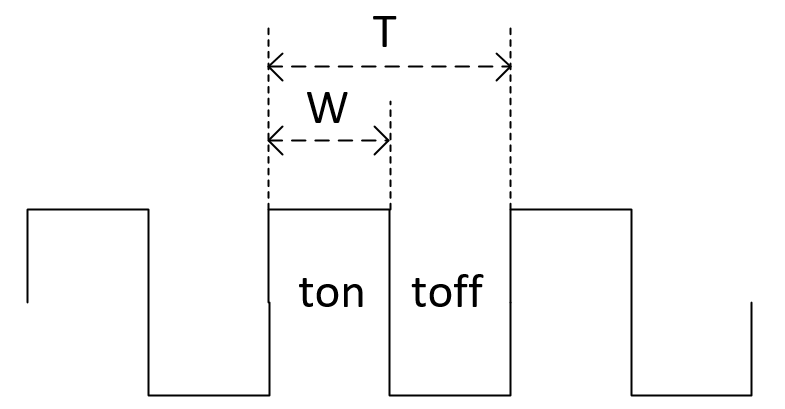
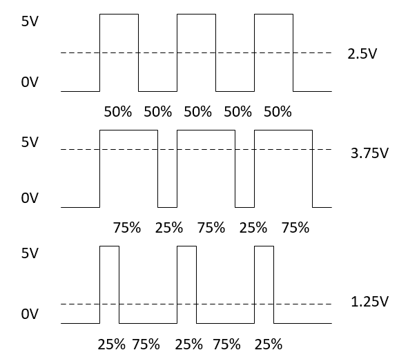

# PWM- Pulse Width Modulation 

## How PWM Works & Common Applications 

Pulse Width Modulation (PWM) is a very effective technology that uses the digital output of microprocessor to control analog circuits, widely used in measurement, communication, industrial control and so on. The frequency of PWM refers to the number of times in 1 second that the signal goes from a high level to a low level and back to a high level, that is the exact periods in a second PWM with Hz. The period unit of PWM is time, which refers to the time length of the signal from high level to low level and then to high level. The period is represented by **T=1/f**, while the **f** refers to the frequency. If the frequency is 50Hz,  the one period will be 20ms. As a result, there are 50 PWM periods per second. The pulse width with a unit of time is the duration of the high level in one period. Duty ratio refers to the ratio of the time of the high level to the entire period time in a pulse period, and the unit is % (0%-100%).

See following diagram 



In the figure above:

T: period, 

W: pulse width,

ton: high level stage, 

toff: low level stage, 

See following formulas

T=ton+toff, frequency f=1/T, duty ratio =W/T. 

For example, T is 10ms and W is 8ms, then the duty cycle is 8/10= 80%, which is a pulse signal with a duty ratio of 80%.

Under the appropriate signal frequency, the effective voltage output can be changed by changing the duty cycle. Assuming that the high level of the IO port is 5V and the low level is 0V, the analog voltage signal simulated by digital signal is obtained by changing the duty ratio of the square wave output from the IO port. At a certain frequency, the duty ratio is 50%, and the simulated output voltage of 2.5V can be obtained; When the duty ratio is 75%, the simulated output voltage of 3.75V can be obtained; When the duty ratio is 25%, a simulated 1.25V output voltage can be obtained. As shown in the picture below:



The PWM is widely used in motor control, steering manipulation, breathing light and screen back-light control. 

## PWM illustration on individual platform 

| Module | Channels                                | Frequency scope |
| ------ | --------------------------------------- | --------------- |
| EC600N | 4                                       | 1Hz~1MHz        |
| EC600M | 4                                       | 1Hz~1MHz        |
| EC800N | 4                                       | 1Hz~1MHz        |
| EC600U | 1                                       | 100Hz~1MHz      |
| EC200U | 1                                       | 100Hz~1MHz      |
| EC200A | 3                                       | 1Hz~1MHz        |
| EG915U | 1                                       | 100Hz~1MHz      |
| EC800M | 4                                       | 1Hz~1MHz        |
| EG912N | 4                                       | 1Hz~1MHz        |
| BG95   | 2                                       | 293Hz-600kHz    |

## PWM API Illustration 

### Create PWM object and initialize 

```python
from misc import PWM_V2
PWM_V2(PWM_V2.PWMn,frequency,duty)
```

It is necessary to create PWM object before deploying it. 

The PWMn refers to supported PWM number while the output frequency, whose unit is Hz, will be in a form of float (I.e. 100.0 indicates 100Hz). In terms of duty, it owns a input range 0~100. The 50 means the duty ratio is 50%. 

According to PWM clock source, target frequency and duty, the Clock divide factor, PRD value and duty register value will be calculated. 

The division factor is selected from minimum to maximum. Once the clock source is divided by n, if the maximum value of PRD is not bigger than target output frequency, the n division will be adapted. Assuming that the clock frequency in PWM is represented by f, then clock frequency will be f/n in a method of n division, the PRD value will be manifested by (f/n)/frequency and the duty register value is equal to PRD value *duty. 

The clock source of PWM will be 13 M or 26 M normally. When the output frequency is adjacent to clock source, the error in waveform will be fatal. Thus, it is suggested to control the frequency in 1MHz. 

###  Enable PWM output 

```python
PWM_V2.open([frequency], [duty])
```

This interface shall be called if it is needed to enable PWM output. The frequency and duty are optional parameters. If there is no need to upload parameter, it will output according to the parameter set in stage of creating object. It it is needed to upload both parameters, it will output in accordance with uploaded parameters. 

Example：

```python
from misc import PWM_V2
PWM = PWM_V2(PWM_V2.PWM0,2000.0,20) #set pwm frequency:2000Hz,duty20%
PWM.open() #enable output
PWM.open(100.0,50)#set pwm frequency:100Hz,duty50% and enable output
```

### Disable PWM output 

```python
PWM_V2.close()
```

This interface will be called if it is needed to stop PWM output. 

## Applicable Scenario 

### 1. Drive motor 

Necessary materials: EC600U module, Motor and Panel 

How it works：

Take 24V DC motor as an example, connect 24V DC power supply at both ends of the motor, the motor will rotate at full speed, if the 24V voltage is reduced to 2/3, that is, 16V, then the motor will run at 2/3 of the full speed. It is obvious that if it is needed to adjust the speed of the motor, you only need to control the voltage at both ends of the motor, the higher the voltage, the faster the motor speed.

For DC motor, when providing power to the motor, the motor will rotate, but it will speed up gradually. When suddenly stopping the power supply to the motor, the motor will not stop due to the effect of inductance to prevent current mutation, and maintain the original speed. As a result, the speed of the motor is the average voltage output during the cycle back and forth. So in essence, our speed regulation is to put the motor in a state that seems to stop and not stop, rotate in full speed and not full speed, then the average speed in a cycle is the speed of our duty ratio.

In summary, the PWM will output pulse of a certain frequency. The greater the duty ratio, the greater the average voltage provided to the motor, the higher the motor speed. On the contrary, the lower the duty cycle, the smaller the average voltage provided to the motor, and the lower the motor speed. The normal PWM frequency is 6~16kHz.

HW connection: Design circuit in accordance with specific motor interface 

Example: Control the speed from minimum to maximum 

```python
from misc import PWM_V2
import utime
DUTY = 1
pwm = PWM_V2(PWM_V2.PWM0,10000.0,DUTY)#set pwm frequency:10KHz
pwm.open()
while True:
    DUTY = DUTY + 1
    pwm.open(10000.0, DUTY)
    if DUTY >= 100:
        DUTY = 0
    utime.sleep_ms(100)
```

### 2. Adjust screen luminance

Necessary materials: EC600U module, LCD Display 

How it works : 

PWM light adjustment mode: The luminance of the back-light is actually fixed, it is to adjust the screen luminance by controlling the length of time that the back-light is turned on and off periodically. Take 75% luminance as a example, that means in each unduly short time period, the back-light will be on during 75% of the time and off in 25% of the time. Owing to the visual retention effect, It seems that the screen is always on at 75% luminance, but in fact it is blinking in a pace of "on→ off → on→ off" with 100% luminance. The luminance of the screen is controlled by adjusting the duty ratio to control the proportion of time between the screen on and off in specific period, 

HW Connection: Conduct circuit design according to specific LCD back-light interface. 

Example: Control screen luminance from dim to bright then to dim periodically.

```python
from misc import PWM_V2
import utime
DUTY = 1
flag = 0
pwm = PWM_V2(PWM_V2.PWM0,10000.0,DUTY)#set pwm frequency:10KHz
pwm.open()
while True:
    if flag == 0:
        DUTY = DUTY + 1
    else:
        DUTY = DUTY - 1
    pwm.open(10000.0,DUTY)
    if DUTY >= 100:
        flag = 1
    elif DUTY == 0:
        flag = 0
    utime.sleep_ms(100)
```

## FAQ

### 1. How to adjust duty dynamically？

After creating PWM object, it is available to adjust duty ratio via `PWM.open()` instead of creating object each time. E.g. It is valid to set the duty ratio as 50% via `PWM.open (100.0,50)` and 25% via `PWM.open(100.0,25)`.

### 2. Range of PWM Output frequency

EC200A/EC600N/EC800N/EG912N: 1Hz~1MHz

EC200U/EC600U/EG915U: 100Hz~1MHz

BG95：293Hz-600kHz.