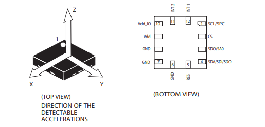
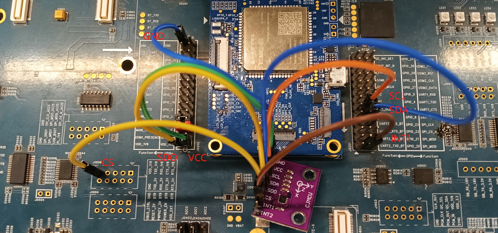

## Hardware Introduction

This section demonstrates how to debug an accelerometer sensor based on LTE OPEN-EVB_V1.1, EC600U TE-A EVB, and LIS2DH12TR sensor.

The LIS2DH12TR sensor is a high-performance 3-axis linear accelerometer sensor with digital I2C and SPI serial interface standard output. The sensor has ultra-low power consumption mode, which can achieve features such as advanced power saving, smart, sleep wake-up and sleep recovery. The LIS2DH12TR has a dynamic user-selectable full-scale range of ±2 g/±4 g/±8 g/±16 g and can measure acceleration with output data rates ranging from 1 Hz to 5 kHz. The device can be configured to generate interrupt signals through independent inertial wake-up/free-fall events and the device's position. The threshold and timing of the interrupt generator can be dynamically set by the end user.

### Package Specification

LIS2DH12TR sensor package specifications:

### Hardware Connection

Pin function introduction:

| Pin Number | Pin Name              | Description                                                  |
| ---------- | --------------------- | ------------------------------------------------------------ |
| 1          | SCL SPC          | I2C/SPI clock pin.                                           |
| 2          | CS                    | SPI enablement pin, used to control the chip communication mode. 1: I2C communication; 2: SPI communication. |
| 3          | SDO SA0          | Data output pin in SPI mode; Device slave address selection pin in I2C mode. 1: 0x19; 0: 0x18. |
| 4          | SDA SDI SDO | Data pin in I2C mode; Data input/output pin in SPI mode;  |
| 5          | RES                   | Ground.                                                      |
| 6          | GND                   | Ground.                                                      |
| 7          | GND                   | Ground.                                                      |
| 8          | GND                   | Ground.                                                      |
| 9          | Vdd                   | Power supply.                                                |
| 10         | Vdd_IO                | IO reference level pin.                                      |
| 11         | INT2                  | Interrupt pin 2.                                             |
| 12         | INT1                  | Interrupt pin 1.                                             |

In this section, we use the I2C interface for communication, and the power supply voltage is 1.8 V. The specific wiring is as follows: connect VCC to pin 2 of J0202, GND to pin 30 of J0202, SCL to pin 17 of J0201, SDA to pin 14 of J0201, SDO/SA0 to pin 1 of J0202, CS to pin 9 of J1006, and INT1 to pin 2 of J0201. The wiring diagram between the LIS2DH12 sensor and the EVB is as follows:

The SDO/SA0 pin is at a high level, so it can be confirmed that the slave address of the accelerometer sensor is 0x19.