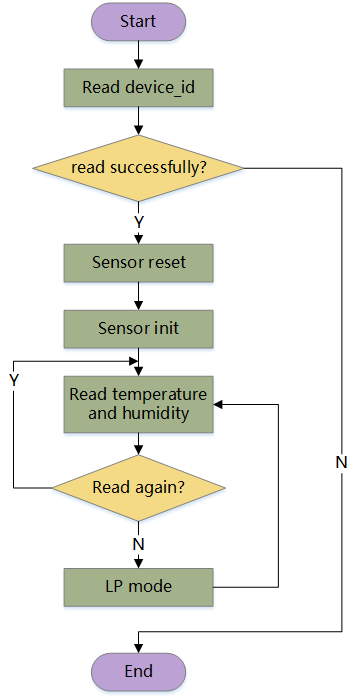
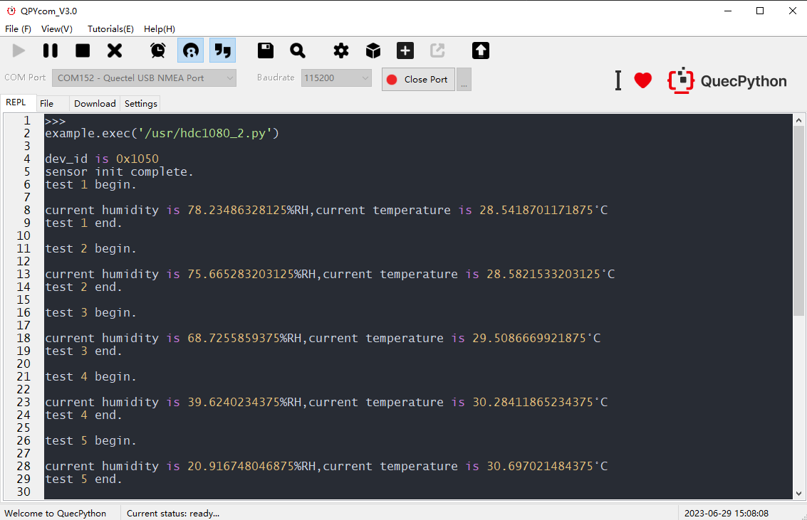

# Temperature and Humidity Sensor

The temperature and humidity sensor uses high-precision sensing technology to monitor real-time changes in temperature and humidity in the environment. Here are some typical application scenarios.

- Smart Home: The temperature and humidity sensor can be embedded in a smart home system to monitor the temperature and humidity in each room. The system can automatically control the operation of air conditioners, humidifiers, and other devices based on sensor data, providing a more comfortable living environment.
- Smart Agriculture and Greenhouse: In the field of agriculture, temperature and humidity sensors can be used to monitor the temperature and humidity of crop growth environments. This is important for controlling greenhouse conditions, providing suitable growth environments, and implementing smart irrigation.
- Industrial Automation: In the field of industrial automation, temperature and humidity sensors can be used to monitor environmental conditions on production lines. They can help control and regulate industrial equipment's operation, ensuring the production process's stability and product quality.

## Supported List

**List of Temperature and Humidity Sensor Models Supported by QuecPython**

| Model   | Bus  | Datasheet                                                    | Code Link                                                    |
| ------- | ---- | ------------------------------------------------------------ | ------------------------------------------------------------ |
| HDC1080 | I2C  | [HDC1080 Datasheet](https://github.com/QuecPython/QuecPython_lib_bundles/blob/master/libraries/HDC1080/hdc1080.pdf) | [Code Link](https://github.com/QuecPython/QuecPython_lib_bundles/blob/master/libraries/HDC1080/hdc1080.py) |
| HDC2080 | I2C  | [HDC2080 Datasheet](https://github.com/QuecPython/QuecPython_lib_bundles/blob/master/libraries/HDC2080/hdc2080.pdf) | [Code Link](https://github.com/QuecPython/QuecPython_lib_bundles/blob/master/libraries/HDC2080/hdc2080.py) |
| AHT10   | I2C  | [AHT10 Datasheet](https://github.com/QuecPython/QuecPython_lib_bundles/blob/master/libraries/aht10/AHT10.pdf) | [Code Link](https://github.com/QuecPython/QuecPython_lib_bundles/blob/master/libraries/aht10/aht10.py) |
| AHT20   | I2C  | [AHT20 Datasheet](https://github.com/QuecPython/QuecPython_lib_bundles/blob/master/libraries/aht20/AHT20-datasheet.pdf) | [Code Link](https://github.com/QuecPython/QuecPython_lib_bundles/blob/master/libraries/aht20/aht20.py) |

## Hardware

This section demonstrates how to debug a temperature and humidity sensor based on the LTE OPEN-EVB_V1.1, EC600U TE-A module and HDC1080 sensor.

See [HDC1080 Sensor Hardware Connection](./hdc1080.md) for details.

## Software Design

### Workflow

The following diagram shows a typical workflow of a temperature and humidity sensor.



### API Reference

The following APIs provide the functionality abstraction for the HDC1080 sensor. You can directly reference the HDC1080 class and call its APIs to write sensor applications.

> Different temperature and humidity sensors may have some differences in communication interfaces and temperature and humidity calculation methods. You can adjust these two points according to the datasheet to implement your sensor classes.

**Class Reference**

```python
from hdc1080 import Hdc1080
```

**Instantiation**

```python
i2c_dev = I2C(I2C.I2C1, I2C.STANDARD_MODE)
hdc = Hdc1080(i2c_dev)
```

**Parameter Description**

- `i2c_obj` – Object type. I2C object.
- `dev_addr` – Integer type. I2C slave device address. Default value: 0x40.

#### **`Hdc108.read`**

Reads humidity and temperature.

**Return Value**

- `(humidity,temperature)` – Tuple type. Humidity and temperature.

#### **`Hdc108.read_temperature`**

Reads temperature.

**Return Value**

- `temperature` – Float type. Temperature.

#### **`Hdc108.read_humidity`**

Reads humidity.

**Return Value**

- `humidity` – Float type. Humidity.

#### **`Hdc108.reset`**

Resets the sensor.

### Experimental Design

1. Initialize the HDC1080 sensor.
2. Read temperature and humidity 10 times in a loop and print the values.

### Experimental Code

The sensor class is designed as follows:

```python
class Hdc1080(object):
    '''
    HDC1080 sensor class
    '''
    def __init__(self,i2c,addr=HDC1080_ADDRESS):
        self._i2c = i2c
        self._i2c_addr = addr

        time.sleep_ms(15)
        dev_id = self._read_data(HDC1080_DEVICEID_REGISTER,2)
        dev_id = (dev_id[0] << 8) | dev_id[1]
        print("dev_id is 0x%4x"%dev_id)
        if dev_id != 0x1050:
            raise CustomError("HDC1080 manu id err.")

        self.reset()
        self._write_data(HDC1080_CONFIGURATION_REGISTER,[0x10,0x00])
        time.sleep_ms(15)
        print("sensor init complete.")

    def _write_data(self, reg, data):
        self._i2c.write(self._i2c_addr,
                           bytearray([reg]), len([reg]),
                           bytearray(data), len(data))
    
        def _read_data(self,reg, length):
        r_data = [0x00 for i in range(length)]
        r_data = bytearray(r_data)
        ret = self._i2c.read(self._i2c_addr,
                          bytearray([reg]), len([reg]),
                          r_data, length,
                          0)
        return list(r_data)

    def _read_data_delay(self,reg, length):
        r_data = [0x00 for i in range(length)]
        r_data = bytearray(r_data)
        ret = self._i2c.read(self._i2c_addr,
                          bytearray([reg]), len([reg]),
                          r_data, length,
                          150)
        return list(r_data)
    
    def reset(self):
        self._write_data(HDC1080_CONFIGURATION_REGISTER, [0x10, 0x00])

    def read_temperature(self):
        tem_data = self._read_data_delay(HDC1080_TEMPERATURE_REGISTER,2)
        tem_data = (tem_data[0] << 8) | tem_data[1]
        tem = (tem_data / 65536) * 165 - 40
        return tem

    def read_humidity(self):
        hum_data = self._read_data_delay(HDC1080_HUMIDITY_REGISTER,2)
        hum_data = (hum_data[0] << 8) | hum_data[1]
        hum = (hum_data / 65536) * 100
        return hum

    def read(self):
        return (self.read_temperature(),self.read_humidity())
```

> **Note**
>
> - If there is an error occurred when the device ID is read during the initialization process, it may be due to a bus communication failure or a mismatch between the device ID in the datasheet and the code.
> - If you are debugging a model that is not included in the supported list, please read the sensor datasheet carefully and develop the sensor according to the code above.

The main program for the experiment is designed as follows:

```python
if __name__ == "__main__":
    i2c_dev = I2C(I2C.I2C1, I2C.FAST_MODE)
    hdc=Hdc1080(i2c_dev)
    for i in range(10):
        print("test %d begin." % (i + 1))
        tem, hum = hdc.read()
        print("current humidity is {0}%RH,current temperature is {1}°C".format(hum, tem))
        print("test %d end." % (i + 1))
        time.sleep(1)
```

## Verification

Download the experimental code to the module and run it. You can use objects with different temperatures and humidity to contact the sensor and observe the changes in the measured values. The printed results are shown in the following figure.

