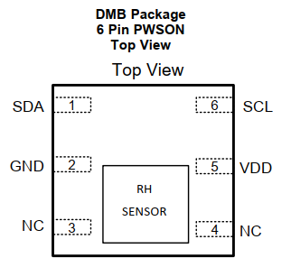
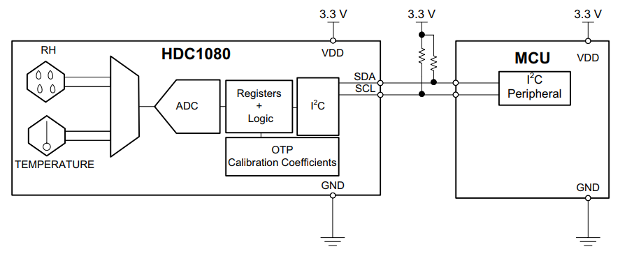
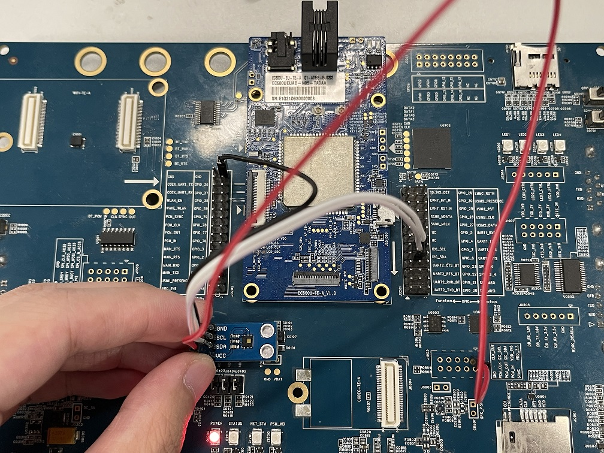

## Hardware Introduction

This section demonstrates how to debug a temperature and humidity sensor based on the LTE OPEN-EVB_V1.1, EC600U TE-A module and HDC1080 sensor.

### Package Specification

HDC1080 (6 pins) sensor package specification:

**Typical Application**

### Hardware Connection

Pin functionality:

| Pin Number | Pin Name | Description   |
| ---------- | -------- | ------------- |
| 1          | SDA      | I2C data pin  |
| 2          | GND      | Ground        |
| 3          | NC       | Vacant        |
| 4          | NC       | Vacant        |
| 5          | VDD      | Power supply  |
| 6          | SCL      | I2C clock pin |

In this experiment, the I2C interface is used for communication, and the supply voltage is 3.3V. The specific wiring is as follows: connect VCC to pin VDD_3.3 of the J1003, GND to pin 30 of the J0202, SCL to pin 17 of the J0201, and SDA to pin 14 of the J0201. The following figure shows the actual picture after the connection is completed.

