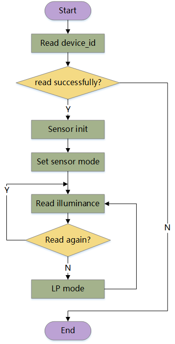
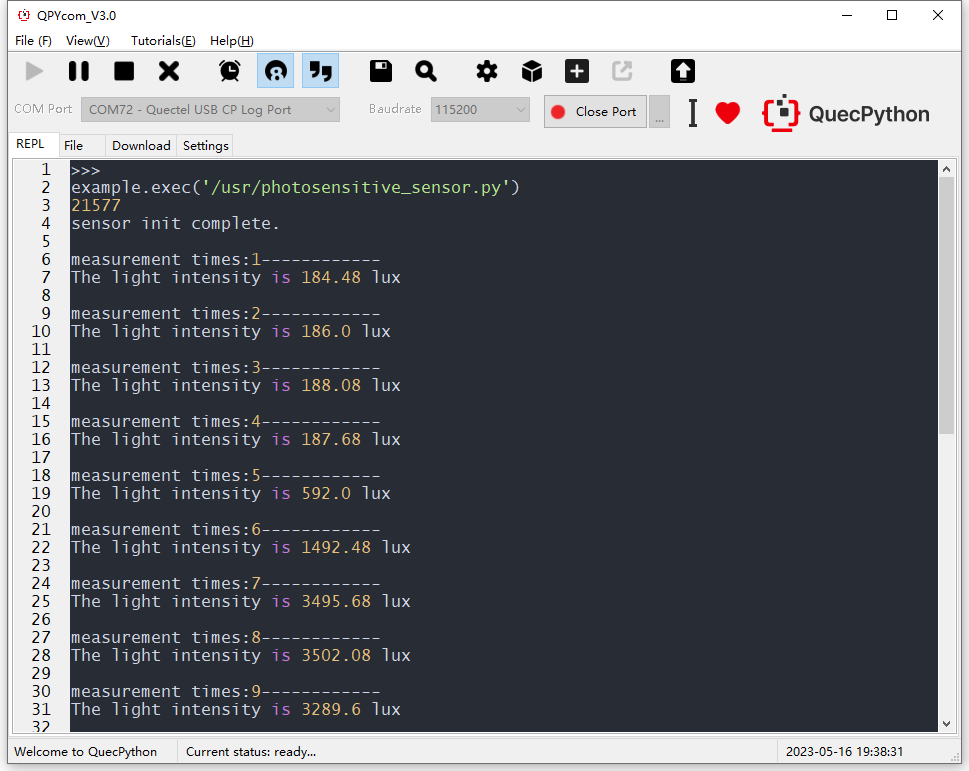

# Ambient Light Sensor

The ambient light sensor includes light intensity sensors, color sensors, ultraviolet sensors, and sensors with multiple functions. It can provide various data related to ambient light, including light intensity, color information, and ultraviolet radiation, providing the system with rich environmental perception capabilities. Here are some typical application scenarios.

- Smart Brightness Adjustment: The ambient light sensor can measure the ambient light intensity and automatically adjust the brightness of displays, backlights, or lighting devices based on the measurement results, which can achieve a comfortable visual experience for indoor and outdoor display devices and save energy.
- Smart Agriculture System: In the field of agriculture, light intensity sensors can be used to monitor the light level of the environment. Based on the measurement data, automatic dimming systems can be triggered or energy-saving measures can be implemented automatically.
- Health Monitoring Devices: Ultraviolet sensors can measure the intensity of ultraviolet radiation in the environment. When applied to wearable devices, they can monitor the level of ultraviolet radiation in outdoor environments in real time and remind users to take appropriate protective measures.

## Supported List

**List of Ambient Light Sensor Models Supported by QuecPython**

| Model   | Type                   | Bus  | Datasheet                                                    | Code Link                                                    |
| ------- | ---------------------- | ---- | ------------------------------------------------------------ | ------------------------------------------------------------ |
| OPT3001 | Light intensity sensor | I2C  | [OPT3001 Datasheet](https://github.com/QuecPython/QuecPython_lib_bundles/blob/master/libraries/OPT3001/opt3001.pdf) | [Code Link](https://github.com/QuecPython/QuecPython_lib_bundles/blob/master/libraries/OPT3001/opt3001.py) |
| BH1750  | Light intensity sensor | I2C  | [BH1750 Datasheet](https://github.com/QuecPython/QuecPython_lib_bundles/blob/master/libraries/BH1750(GY-302)/bh1750fvi-e-186247.pdf) | [Code Link](https://github.com/QuecPython/QuecPython_lib_bundles/blob/master/libraries/BH1750(GY-302)/BH1750.py) |
| GL5516  | Photoresistor          | ADC  | [GL5516 Datasheet](https://github.com/QuecPython/QuecPython_lib_bundles/blob/master/libraries/gl5516/GL55.pdf) | [Code Link](https://github.com/QuecPython/QuecPython_lib_bundles/blob/master/libraries/gl5516/gl5516.py) |
| GL5528  | Photoresistor          | ADC  | [GL5528 Datasheet](https://github.com/QuecPython/QuecPython_lib_bundles/blob/master/libraries/gl5528/GL55.pdf) | [Code Link](https://github.com/QuecPython/QuecPython_lib_bundles/blob/master/libraries/gl5528/gl5528.py) |

## Hardware

This section demonstrates how to debug an ambient light sensor based on the LTE OPEN-EVB_V1.1 and EC600U TE-A module and OPT3001 sensor.

See [OPT3001 Sensor Hardware Connection](./opt3001.md) for details.

## Software Design

### Workflow

The following diagram shows a typical workflow of a light intensity sensor.



### API Reference

The following APIs provide the functionality abstraction for the OPT3001 sensor. You can directly reference the OPT3001 class and call its APIs to write sensor applications.

> Different light intensity sensors may have some differences in communication bus and temperature and humidity calculation methods. You can adjust these two points according to the datasheet to implement your sensor classes.

**Class Reference**

```python
from opt3001 import Opt3001
```

**Instantiation**

```python
i2c_obj=I2C(I2C.I2C1,I2C.FAST_MODE)
opt = Opt3001(i2c_obj)
```

**Parameter Description**

- `i2c_obj` – Object type. I2C object.
- `dev_addr` – Integer type. I2C slave device address. Default value: 0x40.

#### **`Opt3001.set_measure_mode`**

Sets the measurement mode.

**Parameter Description**

- `mode` – Integer type. Measurement mode. Optional parameter.

  0: Sleep mode

  1: Single measurement mode

  2: Continuous measurement mode (Default)

**Return Value**

- `–1` – Failed execution
- `0` – Successful execution

#### **`Opt3001.read `**

Reads the illuminance value.

> **Note:** The conversion time is initialized to 800 ms, and the interval between two readings needs to be greater than 800 ms.

**Return Value**

- `illuminance` – Floating type. Illuminance.

### Experimental Design

1. Initialize the I2C Channel 1 of the EC600U series module and read OPT3001 data through I2C.

2. Configure the OPT3001 register.

3. Set the measurement mode to continuous measurement mode and convert the reading value to lux value.

### Experimental Code

The sensor class is designed as follows:

```python
class Opt3001(object):
    def __init__(self,i2c,dev_addr=I2C_ADDR):
        self._i2c = i2c
        self._i2c_addr = dev_addr

        manu_id = self._read_data(I2C_LS_REG_MANUFACTURERID, 2)
        manu_id = (manu_id[0] << 8)  | manu_id[1]
        print(manu_id)
        if manu_id != 0x5449:
            raise Exception("OPT3001 manu id err.")

        self._write_data(I2C_LS_REG_CONFIG, [0xcc,0x10])
        utime.sleep_ms(15)
        print("sensor init complete.")

    def _write_data(self, reg, data):
        self._i2c.write(self._i2c_addr,
                        bytearray([reg]), len([reg]),
                        bytearray(data), len(data))

    def _read_data(self, reg, length):
        r_data = [0x00 for i in range(length)]
        r_data = bytearray(r_data)
        ret = self._i2c.read(self._i2c_addr,
                             bytearray([reg]), len([reg]),
                             r_data, length,
                             0)
        return list(r_data)

    def set_measure_mode(self,mode=CONTINU_MODE):
        '''
        Set the measurement mode, continuous measurement and single measurement or shutdown
        :param mode: measurement mode 0-off 1-single 2-continuous
        :return: 0-success -1-mode wrong selection
        '''
        if mode not in range(3):
            return -1
        r_data = self._read_data(I2C_LS_REG_CONFIG, 2)
        r_data = (r_data[0] << 8) | r_data[1]
        print(r_data)
        w_data = (r_data & 0xf9ff) | (mode << 9)
        print(w_data)
        self._write_data(I2C_LS_REG_CONFIG, [(w_data >> 8), (w_data & 0xff)])
        utime.sleep_ms(20)
        return 0

    def read(self):
        '''
        The read value is converted into a lux value 
        please ensure that the measurement mode is not 0, otherwise it will get stuck
        @return: illuminance value, Unit:lux
        '''
        while 1:
            r_data = self._read_data(I2C_LS_REG_CONFIG, 2)[1]
            if (r_data & (1 << 7)):            #converted flag
                lux_ori = self._read_data(I2C_LS_REG_RESULT,2)
                lux_ori = (lux_ori[0] << 8) | lux_ori[1]
                #convert illuminance value
                mantisse = lux_ori & 0x0fff
                exponent = (lux_ori & 0xf000) >> 12
                lux = 2 ** exponent * mantisse * 0.01
                return lux

```

>  **Note**
>
> - If there is an error occurred when the device ID is read during the initialization process, it may be due to a bus communication failure or a mismatch between the device ID in the datasheet and the code.
> - If you are debugging a model that is not included in the supported list, please read the sensor datasheet carefully and develop the sensor according to the code above.

The main program for the experiment is designed as follows:

```python
if __name__ == "__main__":
    i2c_obj=I2C(I2C.I2C1,I2C.FAST_MODE)
    opt = Opt3001(i2c_obj)
    for i in range(20):
        opt.set_measure_mode(1)
        utime.sleep_ms(1000)  # at least 800ms
        print("measurement times:{}------------".format(i+1))
        lux = opt.read()
        print("The light intensity is {0} lux".format(lux))
```

## Verification

Download the experimental code to the module and run it. During the running process, you can cover the sensor with your hand or shine a flashlight on it to observe the changes in the illuminance value of the OPT3001 light sensor.

