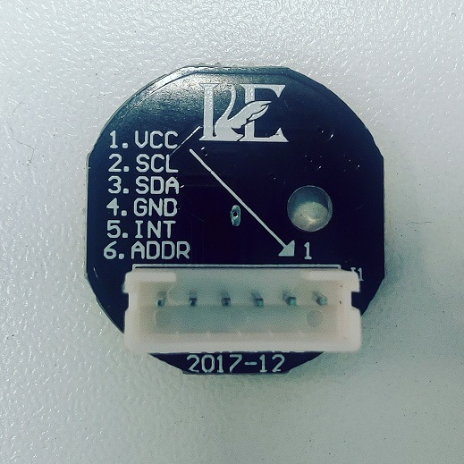
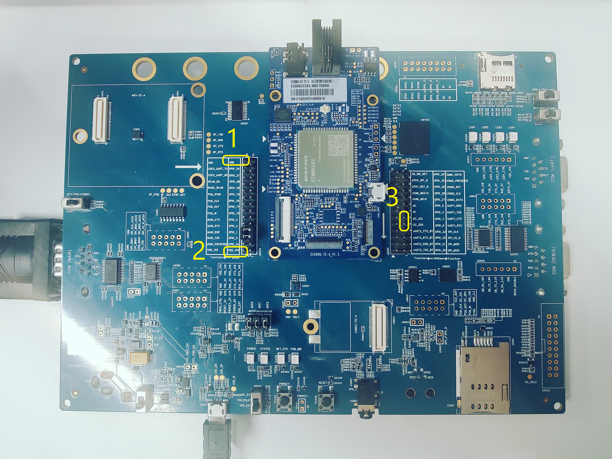
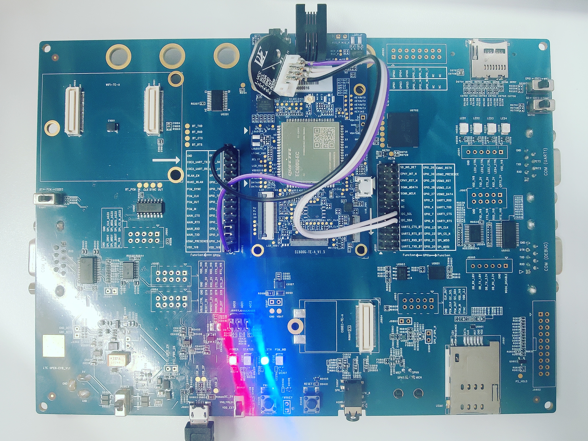

# Hardware Introduction

This section demonstrates how to debug an ambient light sensor based on the LTE OPEN-EVB_V1.1 and EC600U TE-A module and OPT3001 sensor.

OPT3001 is a low-power ambient light sensor used to measure the light intensity visible to human eyes. OPT3001 automatically collects conversion data but does not actively report it. We can control the sensor by reading and writing the registers of OPT3001 through the I2C protocol.

### Package Specification

OPT3001 (6 pins) sensor package specification:

| Pin Number | Pin Name | Description    |
| ---------- | -------- | -------------- |
| 1          | VDD      | Power supply.  |
| 2          | ADDR     | Address pin.   |
| 3          | GND      | Ground.        |
| 4          | SCL      | I2C clock pin. |
| 5          | INT      | Interrupt pin. |
| 6          | SDA      | I2C data pin.  |

### Hardware Connection

Picture of real product:

In this section, the OPT3001 sensor needs to be connected to the EVB with four wires. The specific wiring is as follows: connect GND to the ground, VCC to VDD_1V8 (as marked with "2" in the figure below), and SCL and SDA to I2C_SCL and I2C_SDA (GPIO_7 and GPIO_6, as marked with "3" in the figure below). INT does not need to be connected in this experiment.

The following figure shows the actual picture after the connection is completed.

