# Helios SDK Development Guide__Advanced

## 1. Executing Script Files from QuecPython File System

This section shows you how to import and run your own Python script files in the module.

### 1.1 Installing QPYcom

As shown in the figure below, you can visit the [official download page](https://developer.quectel.com/en/resource-download) to download QPYcom based on your computer's operating system:

- Use `QPYcom` for Windows systems.
- Use `QPYcom_linux` for Ubuntu systems.

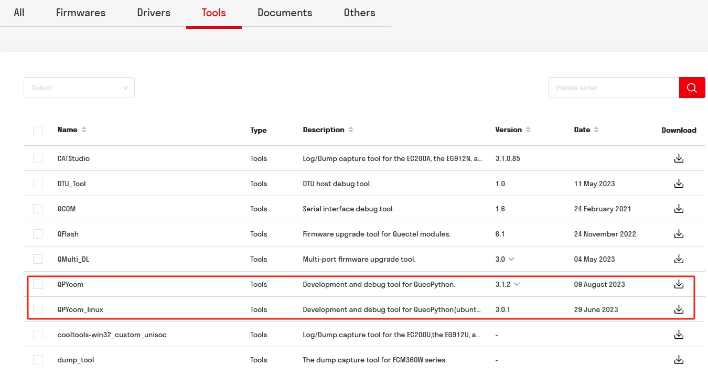

After downloading, unzip the file to use it.

[Click here](../dev-tools/QPYcom/README.md) for more information on how to use QPYcom.

### 1.2 Writing Python Script File

Write a script file named *quecPython_demo.py* on your PC with the following content:
```
import uos

print ('Hello, quecPython!')

root_list = uos.listdir('') # show file list under root dir
print ('root_list:', root_list)

usr_list = uos.listdir('usr') # show file list under /usr
print ('usr_list:', usr_list)
```

### 1.3 Importing Python Script File to QuecPython File System

**Step 1: Open QPYcom**

Double-click `QPYcom.exe` in the tool's root directory to open the tool.

**Step 2: Open USB Serial Port**

Follow ***Step 3*** in ***Section 3*** of *Helios SDK Development Guide__Intermediate* to select the corresponding port from the drop-down menu of `Ports` in QPYcom. In this example, it is COM5.

Click **`Open port`** to enter the command interaction interface by default. The interface is shown in the following figure:

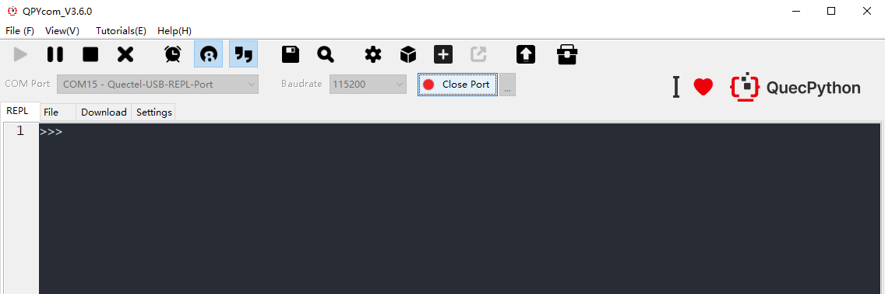

**Step 3: Enter File Transfer Interface**

Click  **`File`**  in the tab to enter the file transfer interface, as shown in the following figure:

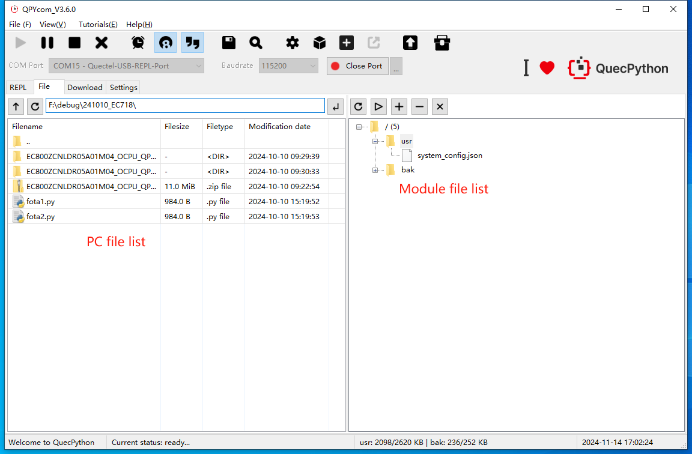

In the figure above, the left side of the interface is the file list on the PC, and the right side is the file list on the module. After QuecPython starts on the module, a file named *system_config.json* will be automatically generated. Users can temporarily ignore the purpose of this file.

**Step 4: Import Python Script File**

Click the **`+`** button above the file list on the module to transfer the file to the module.

As shown in the following figure, follow the order of 1, 2, and 3 to import the *quecPython_demo.py* file to the file system.

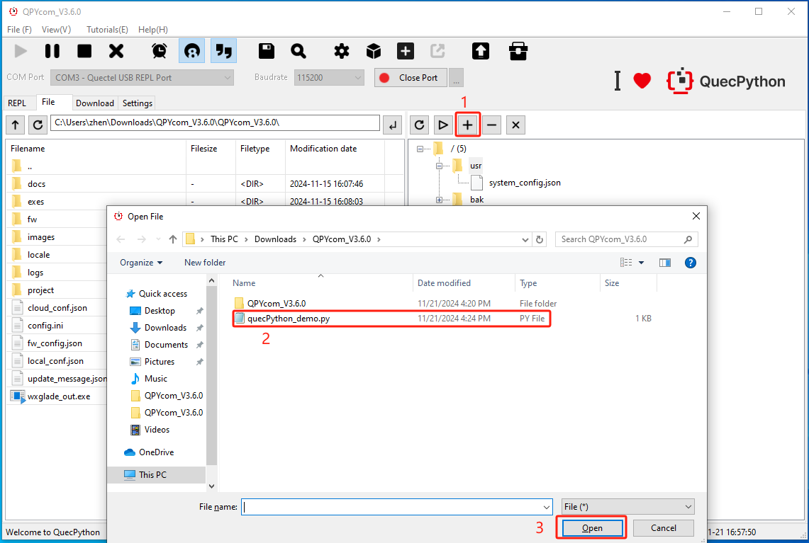

After the import is complete, the *quecPython_demo.py* file will appear in the file list on the module, as shown in the following figure:

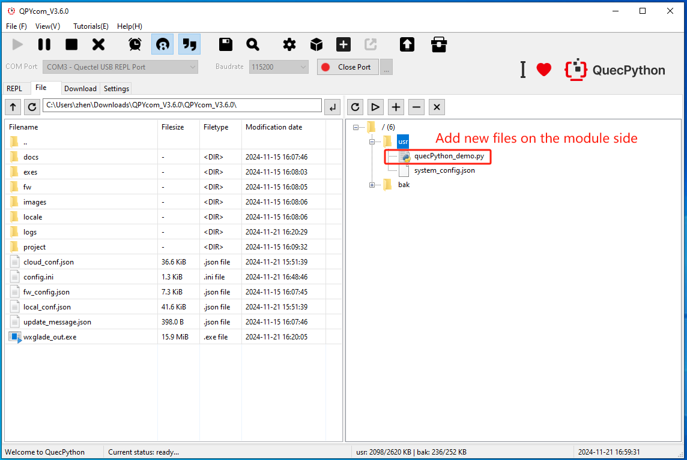

### 1.4 Executing Imported Script File

Click the **`REPL`** tab to enter the command interaction interface.

In the command interaction interface, enter the following two commands one by one:
```
import example
example.exec('/usr/quecPython_demo.py')
```

After the commands are executed, you can see the following output on the interface:

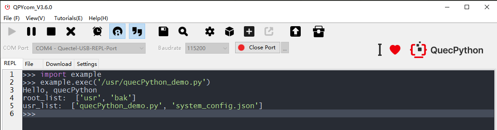

At this point, *quecPython_demo.py* has been successfully executed, and the newly imported script file is also displayed in *usr_list*.

### 1.5 Automatically Starting Application Script from main.py

Through the previous learning, you have learned how to import script files to the QuecPython file system and trigger the execution of the script through commands. However, QuecPython can automatically start the application script by executing *main.py* after startup.

**Step 1: Write the main.py File**

Write a script file named *main.py*  on your PC with the following content:
```
import utime

if __name__ == '__main__':
    while True:
        print('Hello, quecPython!')
        utime.sleep(1)
```

**Step 2: Import the main.py File to the Module File System**

Use the method in ***Section 1.3*** of this chapter to import the *main.py* file to the module file system.

**Step 3: Restart the Module**

Restart the module to automatically execute *main.py* after startup.

**Step 4: Reconnect the USB Serial Port**

After the module restarts, the USB serial port opened by QPYcom will be disconnected from the PC. Follow ***Step 2*** in ***Section 1.3*** of this chapter to reconnect the port.

**Step 5: Observe the Execution Result**

After reconnecting the USB serial port, the command interaction interface will periodically print `Hello, quecPython!` every 1 second. This indicates that the *main.py* script has been successfully auto-started.

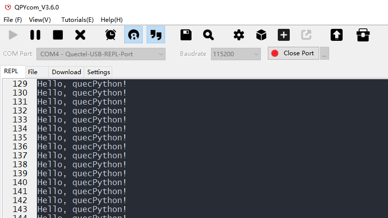

## 2. Writing Python Modules Based on Python Language

In QuecPython, the module based on the Python language are stored in the *services\microPython\ports\quectel\core* directory.

The following example demonstrates how to write a module named *hello.py* based on the Python language in QuecPython.

**Step 1: Create the hello.py File**

Create a file named *hello.py* in the *services\microPython\ports\quectel\core* directory.

**Step 2: Write the File Content**

In the newly created *hello.py* file, write the following content:
```
def say_hello(name):
    print ('Hello,', name)
```

**Step 3: Modify the Compilation Script**

Open *services\microPython\ports\quectel\core\Makefile* and add `$(BUILD)/hello.mpy \` to the dependency files and execution commands of `$(BUILD)/_frozen_mpy.c`, as shown in the following figure:

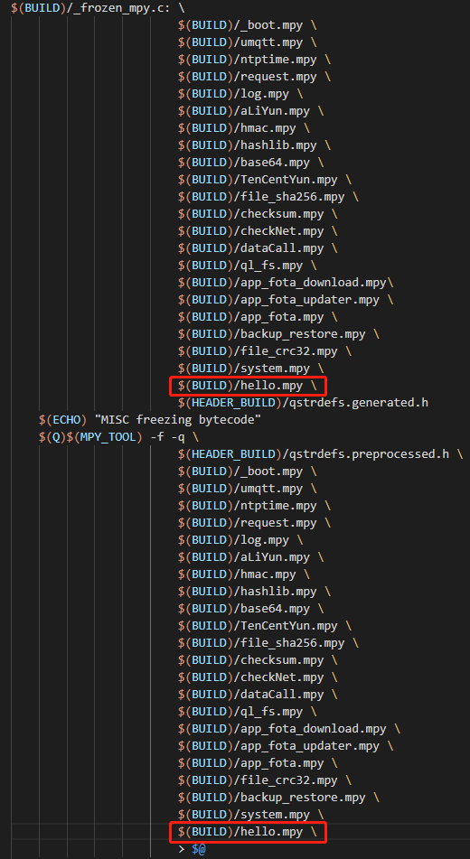

> Please note the backslash `\` at the end of `$(BUILD)/hello.mpy \`.
In the Makefile, when splitting one command into multiple lines, a backslash `\` needs to be added at the end, and no characters, including spaces, can appear after the backslash `\`.

**Step 4: Compile the QuecPython Firmware**

Because the script files under *services\microPython\ports\quectel\core* are compiled into the firmware package in binary form and exist as built-in libraries, the compilation command needs to be executed to compile a new firmware package.

Refer to ***Section 2*** of *Helios SDK Development Guide__Intermediate* for the compilation command.

**Step 5: Download Firmware and Verify Functionality**

After downloading the firmware to the module and restarting, open QPYcom.
Enter the following two commands in REPL:

```
import hello
hello.say_hello('quecPython')
```

The execution result is shown in the following figure:

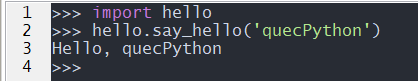

As shown in the figure, you have your own `hello` module, and the *hello.say_hello(name)* method is successfully executed.

## 3. Writing Python Modules in C

Some requirements may not be achieved by writing Python modules in Python, such as some algorithms that require fast execution speed or self-developed peripheral drivers.

This section demonstrates how to write the Python modules in C language.

### 3.1 Classification of Module Interface Levels

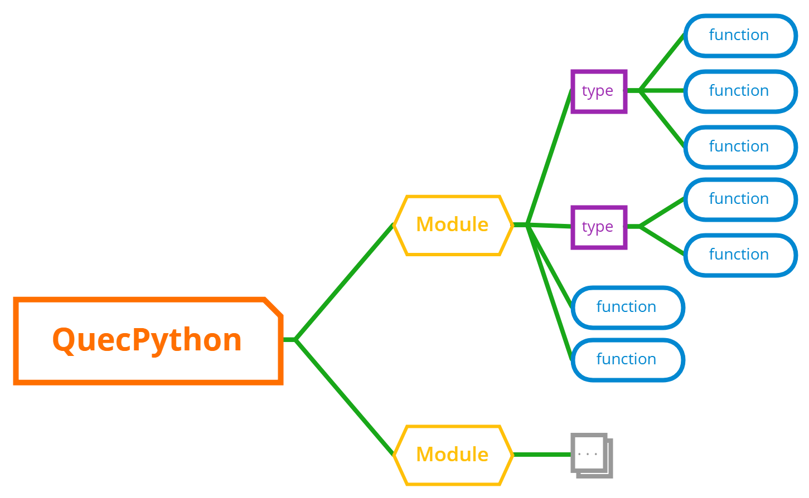

From the above figure, we can see that the QuecPython module interface can be divided into three categories: `module`, `type`, and `function`.

The hierarchical relationship between the three is also obvious:

- There can be multiple modules under QuecPython.
- Each module can have multiple types or functions.
- Each type can have multiple functions.

Taking the `machine` module as an example, *machine.Pin* and *machine.UART* belong to the type category.
Under the type category are the specific functions, such as *Pin.value()* used to set the high or low level of GPIO.

We can enter the following commands in the QPYcom REPL window to check their types:
```
import machine
type(machine)
type(machine.Pin)
type(machine.Pin.value)
```

The output result is shown in the following figure, which verifies the above statement.

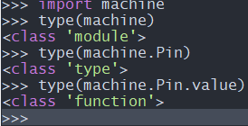

With the concept of hierarchical classification mentioned above, you can write C language Python modules with the templates provided by MicroPython.

### 3.2 Adding a Module

**Step 1: Create A File Named *modtest.c* **

Go to the *services\microPython\ports\quectel\core\source* directory and create the *modtest.c* file.

> The *services\microPython\ports\quectel\core\source* directory stores all the C language implementation of Python modules added by Quectel.

```
#include <stdint.h>
#include <stdio.h>

#include "obj.h"
#include "runtime.h"

/* Definition of the modtest global dictionary, where we add types and functions */
STATIC const mp_rom_map_elem_t modtest_globals_table[] = {
    {MP_OBJ_NEW_QSTR(MP_QSTR___name__), MP_ROM_QSTR(MP_QSTR_modtest)},   // This corresponds to the __name__ attribute in Python
};

/* Register the modtest_globals_table to mp_module_modtest_globals */
STATIC MP_DEFINE_CONST_DICT(mp_module_modtest_globals, modtest_globals_table);

/* Define a module type */
const mp_obj_module_t mp_module_modtest = {
    .base = {&mp_type_module},
    .globals = (mp_obj_dict_t *)&mp_module_modtest_globals,
};
```

From the above code, we can see that *modtest.c* mainly consists of three parts, which are required to add a module:

- `mp_rom_map_elem_t modtest_globals_table[ ]`
- `MP_DEFINE_CONST_DICT(mp_module_modtest_globals, modtest_globals_table)`
- `mp_obj_module_t mp_module_modtest`

**Step 2: Register the modtest Module to QuecPython**

Open *services\microPython\ports\quectel\core\source\mpconfigport.h*.

Find where `MICROPY_PORT_BUILTIN_MODULES` is defined, and make an external reference declaration for `mp_module_modtest` before it.

Refer to the format defined by  `MICROPY_PORT_BUILTIN_MODULES`, and register the `modtest` module.

The completed code is as follows:
```
extern const struct _mp_obj_module_t mp_module_wifiscan;

extern const struct _mp_obj_module_t mp_module_modtest; //Make an external reference declaration for mp_module_modtest

#define MICROPY_PORT_BUILTIN_MODULES \
		{ MP_OBJ_NEW_QSTR(MP_QSTR_uos), (mp_obj_t)&uos_module }, \
		{ MP_OBJ_NEW_QSTR(MP_QSTR_machine), (mp_obj_t)&mp_module_machine }, \
		{ MP_OBJ_NEW_QSTR(MP_QSTR_usocket), (mp_obj_t)&mp_module_usocket }, \
		{ MP_OBJ_NEW_QSTR(MP_QSTR_misc), (mp_obj_t)&mp_module_misc}, \
		{ MP_OBJ_NEW_QSTR(MP_QSTR_osTimer), (mp_obj_t)&mp_ostimer_type}, \
		{ MP_OBJ_NEW_QSTR(MP_QSTR_example), (mp_obj_t)&example_module }, \
		{ MP_OBJ_NEW_QSTR(MP_QSTR_dial), (mp_obj_t)&mp_module_dial}, \
		{ MP_OBJ_NEW_QSTR(MP_QSTR_modem), (mp_obj_t)&mp_module_modem}, \
		{ MP_OBJ_NEW_QSTR(MP_QSTR_utime), (mp_obj_t)&utime_module }, \
		{ MP_OBJ_NEW_QSTR(MP_QSTR_utils), (mp_obj_t)&mp_module_utils},\
		{ MP_OBJ_NEW_QSTR(MP_QSTR_hmacSha1), (mp_obj_t)&mp_module_hmacSha1}, \
		{ MP_OBJ_NEW_QSTR(MP_QSTR_sms), (mp_obj_t)&mp_module_sms}, \
		{ MP_OBJ_NEW_QSTR(MP_QSTR_sim), (mp_obj_t)&mp_module_sim}, \
		{ MP_OBJ_NEW_QSTR(MP_QSTR_pm), (mp_obj_t)&mp_module_pm}, \
		{ MP_OBJ_NEW_QSTR(MP_QSTR_net), (mp_obj_t)&mp_module_net}, \
		{ MP_OBJ_NEW_QSTR(MP_QSTR_cellLocator), (mp_obj_t)&mp_module_celllocator}, \
		{ MP_OBJ_NEW_QSTR(MP_QSTR_wifiScan), (mp_obj_t)&mp_module_wifiscan},\
		{ MP_OBJ_NEW_QSTR(MP_QSTR_modtest), (mp_obj_t)&mp_module_modtest }, /* Register the modtest module/ \
		MICROPY_PORT_BUILTIN_MODULES_FOTA \
		MICROPY_PORT_BUILTIN_MODULES_LVGL
```

The lines with comments in the provided code are the parts that have been added:

>

- The C macro definition `MICROPY_PORT_BUILTIN_MODULES` is used to define content. Due to the lengthy content, line breaks are implemented using the backslash `\`. It's important to note that there should be no characters, including spaces, following the `\`. This method of line continuation using the backslash is consistent with what was described earlier regarding the Makefile. If comments are needed, they should be enclosed in `/* */` and placed in front of the `\`.
- The format of the last two lines of the `MICROPY_PORT_BUILTIN_MODULES` macro definition is different from the previous lines. This is done to facilitate the trimming of related functionalities using macro definitions. If you are interested, you can further explore this concept.

**Step 3: Add *modtest.c*  to the Compilation Script**

Open Makefile in *services/microPython/ports/quectel/core/Makefile*. Add the *modtest.c* file according to the following code snippet, similar to Line 7:

```
SRC_QSTR += source/moduos.c \
			source/quecpython.c \
			source/utf8togbk.c \
			... \
			source/modlvgl.c \
			source/modwifiscan.c \
			source/modtest.c # Add the modtest.c file

ifeq ($(strip $(PLAT)),ASR)
SRC_QSTR += source/modfota.c
endif
```

> Note: If the current line in the "Makefile" contains a line continuation character `\`, and the next line is not blank, **do NOT** add comments in front of the `\`. Otherwise, the make system will consider all lines concatenated with a trailing "\" as comments.

Open the *microPython.mk* file in *services/microPython/microPython.mk*. Append the value *ports/quectel/core/source/modtest.c* to the *$(NAME)_SRCS* variable, as shown in the code snippet (Line 7):

```
$(NAME)_SRCS = \
	extmod/modubinascii.c \
	extmod/moducryptolib.c \
	extmod/moductypes.c \
	... \
	ports/quectel/core/source/modwifiscan.c \
	ports/quectel/core/source/modtest.c \
	ports/quectel/core/build/_frozen_mpy.c \
	...
```

**Step 4: Compile the Firmware**

Refer to ***Section 2*** of *Helios SDK Development Guide__Intermediate* for compiling the new QuecPython firmware.

**Step 5: Download the Firmware and Verify Functionality**

Refer to *Quectel_QFlash_User_Guide* for instructions on downloading the firmware.

After downloading, restart the module, open QPYcom, and enter the following commands:

```
import modtest
type(modtest)
dir(modtest)
```

You will receive an output in QPYcom similar to what is shown in the image in the guide.

On QPYcom, you can see the command output.

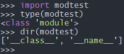

From the output, it's clear that the `modtest` module has been successfully added, but no types or functions have been added yet.

### 3.3 Adding Functions to the Module

Functions can be divided into two categories: those with no parameters and those with parameters. In the following steps, examples of adding both a function without parameters and a function with parameters to the `modtest` module will be shown. In Python, they correspond to two methods: *modtest.func_noargs()* and *modtest.func_withargs(argv)*.

#### 3.3.1 Function Without Parameters

Here adds a method `mp_obj_t modtest_func_noargs(void)` implemented by C function. Its purpose is to respond to the command **modtest.func_noargs()** by outputting the string `here we go`.

**Step 1: Modify the Code**

Open the *services\microPython\ports\quectel\core\source\modtest.c* file and make the following modifications.

The complete code is as follows.

```
#include <stdint.h>
#include <stdio.h>
#include <string.h>

#include "obj.h"
#include "runtime.h"

#include "mphal.h"

/* Definition of modtest module without parameters */
STATIC mp_obj_t modtest_func_noargs(void)
{
    mp_hal_stdout_tx_strn("here we go\n", strlen("here we go\n"));
    return mp_const_none; //No data is required to be returned in python. Here returns mp_const_none
}

/* Register the function object modtest_obj_func_noargs */
STATIC const MP_DEFINE_CONST_FUN_OBJ_0(modtest_obj_func_noargs, modtest_func_noargs);

/* Definition of the modtest global dictionary, where we add types and functions */
STATIC const mp_rom_map_elem_t modtest_globals_table[] = {
    {MP_OBJ_NEW_QSTR(MP_QSTR___name__), MP_ROM_QSTR(MP_QSTR_modtest)}, //This corresponds to the __name__ attribute in Python
    {MP_OBJ_NEW_QSTR(MP_QSTR_func_noargs), MP_ROM_PTR(&modtest_obj_func_noargs)}, //Register the newly added modtest_obj_func_noargs object to modtest
};

/* Register modtest_globals_table to modtest mp_module_modtest_globals */
STATIC MP_DEFINE_CONST_DICT(mp_module_modtest_globals, modtest_globals_table);

/* Define a module type */
const mp_obj_module_t mp_module_modtest = {
    .base = {&mp_type_module},
    .globals = (mp_obj_dict_t *)&mp_module_modtest_globals,
};
```

The difference comparison in the figure below shows the difference between this code and the code in section 3.2 (the current code is on the right, and the red part is the difference):

- Added the C language function *modtest_func_noargs* corresponding to the Python module `modtest` method *modtest.func_noargs()*. Any C language function corresponding to Python will return the `mp_obj_t` type. In this example, no value is returned from *modtest.func_noargs()*. Therefore, the corrsponding C function should return *mp_const_none* to inform Python that this method has no return value.
- Use the macro `MP_DEFINE_CONST_FUN_OBJ_0` to add a function object `modtest_obj_func_noargs`, which is the code on Line 18.
- Register the newly added `modtest_obj_func_noargs` object to modtest, which is the code on Line 23.

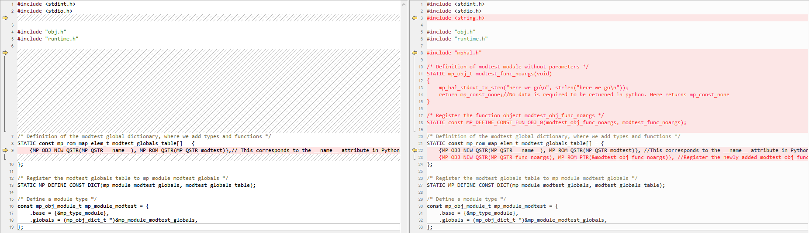

**Step 2: Verify the Functionality**

After completing ***Step 1***, you can compile and download the firmware directly without modifying the script file.

After downloading is complete, restart the module, open QPYcom, and enter the following commands:

```
import modtest
dir(modtest)
modtest.func_noargs()
```


The execution result is shown in the following figure:

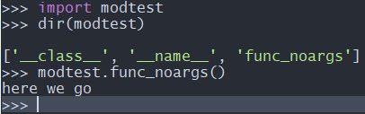

From the figure, it can be seen that the execution result of **dir(modtest)** has listed the *func_noargs* method.
Executing *modtest.func_noargs()* outputs the expected string *here we go*.

#### 3.3.2 Function With Parameters

Here add a method *mp_obj_t modtest_func_withargs(mp_obj_t argv)* implemented by C function. Its purpose is to respond to the command **modtest.func_withargs('Bingo')** by outputting the string `Bingo, here we go`.

**Step 1: Modify the Code**

Open the *services\microPython\ports\quectel\core\source\modtest.c* file and make the following modifications.

The complete code is as follows.

```
#include <stdint.h>
#include <stdio.h>
#include <string.h>

#include "obj.h"
#include "runtime.h"

#include "mphal.h"

/* Definition of modtest module without parameters */
STATIC mp_obj_t modtest_func_noargs(void)
{
    mp_hal_stdout_tx_strn("here we go\n", strlen("here we go\n"));
    return mp_const_none; //No data is required to be returned in python. Here returns mp_const_none
}

/* Register the function object modtest_obj_func_noargs */
STATIC const MP_DEFINE_CONST_FUN_OBJ_0(modtest_obj_func_noargs, modtest_func_noargs);

/* Definition of function with parameters in modtest module */
STATIC mp_obj_t modtest_func_withargs(mp_obj_t str)
{
    char reply_str[64] = {0};

    /*
     * Here, mp_obj_str_get_str(str) is used to extract the string that the user input from the Python layer in the str variable
     * If you expect the parameter passed from Python to be an integer, use mp_obj_get_int(data) to extract the integer value.
     */
    snprintf(reply_str, sizeof(reply_str), "%s, here we go\n", mp_obj_str_get_str(str));
    mp_hal_stdout_tx_strn(reply_str, strlen(reply_str));
    return mp_const_none;  //No return value
}

/*
 * In this case, the macro definition being used has a different name compared to the previous one. It has a "1" suffix instead of "0".
 * The number of the suffix is the parameter number the method carries
 */
STATIC const MP_DEFINE_CONST_FUN_OBJ_1(modtest_obj_func_withargs, modtest_func_withargs);

/* Definition of the modtest global dictionary, where we add types and functions*/
STATIC const mp_rom_map_elem_t modtest_globals_table[] = {
    {MP_OBJ_NEW_QSTR(MP_QSTR___name__), MP_ROM_QSTR(MP_QSTR_modtest)}, //This corresponds to the __name__ attribute in Python
    {MP_OBJ_NEW_QSTR(MP_QSTR_func_noargs), MP_ROM_PTR(&modtest_obj_func_noargs)}, //Register the newly added modtest_obj_func_noargs object to modtest
    {MP_OBJ_NEW_QSTR(MP_QSTR_func_withargs), MP_ROM_PTR(&modtest_obj_func_withargs)}, //Register the newly added modtest_obj_func_withargs object to modtest
};

/* Register modtest_globals_table to mp_module_modtest_globals */
STATIC MP_DEFINE_CONST_DICT(mp_module_modtest_globals, modtest_globals_table);

/* Define a module type */
const mp_obj_module_t mp_module_modtest = {
    .base = {&mp_type_module},
    .globals = (mp_obj_dict_t *)&mp_module_modtest_globals,
};
```

The difference comparison in the figure below shows the difference between this code and the code in ***Section 3.3.1*** (the current code is on the right, and the red part is the difference):

- Added the C language function *modtest_func_withargs* corresponding to the Python module `modtest` method *modtest.func_withargs(str)*. In this example, the string parameters that the user input from the Python layer is returned through *mp_obj_str_get_str(str)*.
- Use the macro `MP_DEFINE_CONST_FUN_OBJ_1` to add a function object `modtest_obj_func_withargs`, which is the code on Line 38.
- Register the newly added `modtest_obj_func_noargs` object to modtest, which is the code on Line 43.

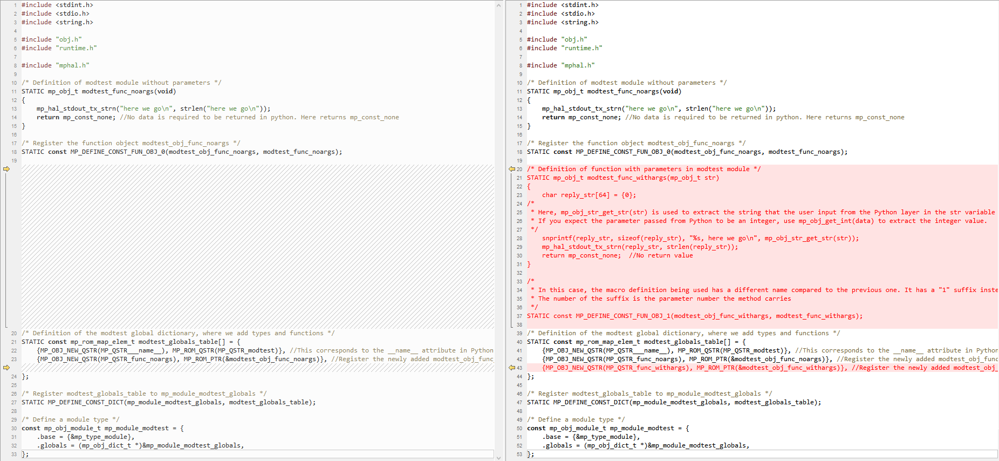

**Step 2: Verify the Functionality**

After completing ***Step 1***, you can compile and download the firmware directly without modifying the script file.

After downloading is complete, restart the module, open QPYcom, and enter the following commands:

```
import modtest
dir(modtest)
modtest.func_withargs('Bingo') # with argv: 'Bingo'
```


The execution result is shown in the following figure:

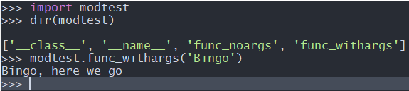

From the figure, it can be seen that the execution result of **dir(modtest)** has listed the *func_withargs* method.
Executing *modtest.func_withargs('Bingo')* outputs the expected string *Bingo, here we go*.

#### 3.3.3 Functions with Flexible Number of Parameters

Here we implement a function mp_obj_t modtest_func_args(size_t n_args, const mp_obj_t *args) using C. Its purpose is to add all arguments that are passed regardless of their number.

**Step 1: Modify the Code**

Open the *services\microPython\ports\quectel\core\source\modtest.c* file and add the following function.

```
/* Definition of function with flexible number of parameters in modtest module  */
STATIC mp_obj_t modtest_func_args(size_t n_args, const mp_obj_t *args) {
    int sum = 0;
    for(size_t i = 0 ; i < n_args; i++){
        sum += mp_obj_get_int(args[i]);
    }
    return mp_obj_new_int(sum);
}

/* Register the function object modtest_func_args */
STATIC MP_DEFINE_CONST_FUN_OBJ_VAR_BETWEEN(modtest_obj_func_args, 2, 3, modtest_func_args);

/* Modify the global dictionary to add this function alongside the others. */
STATIC const mp_rom_map_elem_t modtest_globals_table[] = {
    //...
    {MP_OBJ_NEW_QSTR(MP_QSTR_func_args), MP_ROM_PTR(&modtest_obj_func_args)}, // Register modtest_func_args function
    //...
};

```

Macro `MP_DEFINE_CONST_FUN_OBJ_VAR_BETWEEN` is used to add a function object. It allows the user to set the number of parameters that the function can receive. Here we set a minimum of 2 parameters and a maximum of 3 parameters. The actual number of passed arguments when the function is called is held in `n_args` variable and the arguments are stored in `mp_obj_t` array to which *args is pointing to.

>Note: the `MP_DEFINE_CONST_FUN_OBJ` macro can only create functions with up to 3 parameters. So if the function with greater number of parameters is needed `MP_DEFINE_CONST_FUN_OBJ_VAR_BETWEEN` should be used.

**Step 2: Verify the Functionality**

After completing ***Step 1***, you can compile and download the firmware directly without modifying the script file.

After downloading is complete, restart the module, open QPYcom, and enter the following commands:

```
import modtest
modtest.func_args(2,3)
modtest.func_args(2,3,4)
```

The result is shown in the following figure:

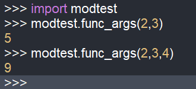

From the figure, it can be seen that `func_args` function can be called with different number of arguments passed.

#### 3.3.4 Functions with Keyword Parameters

Here we add a method *modtest_func_keyword()* that uses keyword arguments.

**Step 1: Modify the Code**

Open the *services\microPython\ports\quectel\core\source\modtest.c* file and add the following function.

```
/* Definition of function with keyword parameters */
STATIC mp_obj_t modtest_func_keyword(size_t n_args, const mp_obj_t *pos_args, mp_map_t *kw_args) {
    /* Define the expected arguments */
    enum {ARG_greeting, ARG_message};
    static const mp_arg_t allowed_args[] = {
        { MP_QSTR_greeting, MP_ARG_REQUIRED | MP_ARG_OBJ, {.u_obj = MP_OBJ_NULL} },
        { MP_QSTR_message, MP_ARG_REQUIRED | MP_ARG_OBJ, {.u_obj = MP_OBJ_NULL} },
    };

    /* Function mp_arg_parse_all is used to parse all the arguments that are passed in the function and the results are put into args array. */
    mp_arg_val_t args[MP_ARRAY_SIZE(allowed_args)];
    mp_arg_parse_all(n_args, pos_args, kw_args, MP_ARRAY_SIZE(allowed_args), allowed_args, args);

    /* Retrieve the parsed arguments from the args array */
    const char *greeting = mp_obj_str_get_str(args[ARG_greeting].u_obj);
    const char *message = mp_obj_str_get_str(args[ARG_message].u_obj);
    
    mp_printf(&mp_plat_print, "%s, %s!\n", greeting, message);
    return mp_const_none;
}

/* Register the function object modtest_func_keyword */
STATIC MP_DEFINE_CONST_FUN_OBJ_KW(modtest_obj_func_keyword, 0, modtest_func_keyword);

/* Modify the global dictionary to add this function alongside the others. */
STATIC const mp_rom_map_elem_t modtest_globals_table[] = {
    //...
    {MP_OBJ_NEW_QSTR(MP_QSTR_func_keyword), MP_ROM_PTR(&modtest_obj_func_keyword)}, // Register modtest_func_keyword
    //...
};

```

Arguments that can be passed as keywords are defined in the `enum` and `allowed_args` array. The order of the arguments here must be the same. Flag `MP_ARG_REQUIRED` means that the argument must be passed when calling and function, and `MP_ARG_OBJ` means that the argument will be treated as a `mp_obj_t`.

The keyword arguments can be accessed with the `*kw_args` pointer and positional arguments with `*pos_args` pointer. These arguments can be parsed with the `mp_arg_parse_all()` function and the result will be put into a single array.

**Step 2: Verify the Functionality**

Compile the code and download the firmware onto the module. After the download is complete test the function with the following commands

```
import modtest
modtest.func_keyword(greeting="Hi", message="this is a message")
```

The execution result is shown in the following figure:

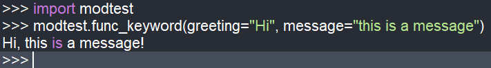

The arguments are passed using the keywords `greeting` and `message` which can be done in any order in the argument list.

### 3.4 Adding Types to the Module

This section introduces how to add a type called `math` to the `modtest` module.

**Step 1: Create A File Named *modtest_math.c***

Enter the *services\microPython\ports\quectel\core\source* directory and create a file named *modtest_math.c*.

```
#include <stdint.h>
#include <stdio.h>

#include "obj.h"
#include "runtime.h"

/* Define the local dictionary for this type */
STATIC const mp_rom_map_elem_t math_locals_dict_table[] = {
};

/* Register math_locals_dict_table into math_locals_dict */
STATIC MP_DEFINE_CONST_DICT(math_locals_dict, math_locals_dict_table);

/* Define the structure of mp_obj_type_t; note that this is different from the type used for modules */
const mp_obj_type_t modtest_math_type = {
    .base = { &mp_type_type },
    .name = MP_QSTR_math, // Define the type's name attribute here, not in the DICT
    .locals_dict = (mp_obj_dict_t*)&math_locals_dict, // Register math_locals_dict
};
```

In the code above, *modtest_math.c* consists of three main parts, which are essential for adding a type:

- `mp_rom_map_elem_t math_locals_dict_table[ ]`
- `MP_DEFINE_CONST_DICT(math_locals_dict, math_locals_dict_table)`
- `mp_obj_type_t modtest_math_type`

When comparing the code for adding a module, you'll find that:

- Both consist of three parts.
- The way the dictionary is defined and registered is identical, with the only difference being the variable names.
- The `mp_obj_module_t` structure is used to define a module, while the `mp_obj_type_t` structure is used to define a type.

**Step 2: Add *modtest_math.c* to the Compilation Script**

This step is exactly the same as ***Step 3*** in ***Section 3.2***.

Open Makefile in *services\microPython\ports\quectel\core\Makefile*. Add the *modtest_math.c* file according to the following code snippet, similar to Line 7 and 8:

```
SRC_QSTR += source/moduos.c \
			source/quecpython.c \
			source/utf8togbk.c \
			... \
			source/modlvgl.c \
			source/modwifiscan.c \
			source/modtest.c \
			source/modtest_math.c # Add modtest_math.c

ifeq ($(strip $(PLAT)),ASR)
SRC_QSTR += source/modfota.c
endif
```


> Note: When adding *source/modtest_math.c* to this script, you need to remove the comment after the previous line *source/modtest.c* and add a backslash `\`.

Open *microPython.mk* in the *services\microPython\microPython.mk* path and add the value `ports/quectel/core/source/modtest.c` to the `$(NAME)_SRCS` variable, as shown on Line 8 below.

```
$(NAME)_SRCS = \
	extmod/modubinascii.c \
	extmod/moducryptolib.c \
	extmod/moductypes.c \
	... \
	ports/quectel/core/source/modwifiscan.c \
	ports/quectel/core/source/modtest.c \
	ports/quectel/core/source/modtest_math.c \
	ports/quectel/core/build/_frozen_mpy.c \
	...
```

**Step 3: Register `modtest_math_type` for `modtest`**

Open the *services\microPython\ports\quectel\core\source\modtest.c* file.

Add a reference declaration for `modtest_math_type` before `mp_rom_map_elem_t modtest_globals_table[]`.

Register `modtest_math_type` within `mp_rom_map_elem_t modtest_globals_table[]`.

The modified code is as follows:

```
/* Definition of the modtest global dictionary, where we add types and functions */
extern const mp_obj_type_t modtest_math_type;
STATIC const mp_rom_map_elem_t modtest_globals_table[] = {
    {MP_OBJ_NEW_QSTR(MP_QSTR___name__), MP_ROM_QSTR(MP_QSTR_modtest)}, // This corresponds to the __name__ attribute in Python
    {MP_OBJ_NEW_QSTR(MP_QSTR_func_noargs), MP_ROM_PTR(&modtest_obj_func_noargs)}, // Register the newly added modtest_obj_func_withargs object to modtest
    {MP_OBJ_NEW_QSTR(MP_QSTR_func_withargs), MP_ROM_PTR(&modtest_obj_func_withargs)}, // Newly added `modtest_obj_func_withargs` object registered in `modtest`
    {MP_OBJ_NEW_QSTR(MP_QSTR_math), MP_ROM_PTR(&modtest_math_type)}, // Register modtest_math_type
};
```


Compared to the original code, only lines 2 and 7 of the above code are added.

**Step 4: Verify the Functionality**

After completing ***Step 3***, you can compile and download the firmware.

After downloading, restart the module. Open QPYcom and enter the following commands:

```
import modtest
dir(modtest)
type(modtest.math)
```


The execution result is shown in the following image:

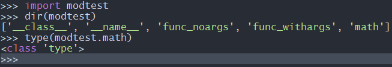

From the image, we can see that a type named `math` is added.

### 3.5 Adding a Function to the Type

This section demonstrates how to add a function to the type.
Similar to the procedure of adding a function to a module, there are two types: functions without parameters and functions with parameters.

#### 3.5.1 Function Without Parameters

Here, we add a C function called `mp_obj_t math_nothing(void)`.
Functionality: When entering `modtest.math.nothing()` in the command prompt, it outputs the string `do nothing in this function`.

Here adds a method *mp_obj_t math_nothing(void)* implemented by C function. Its purpose is to respond to the command **modtest.math.nothing()** by outputting the string `do nothing in this function`.

**Step 1: Modify the Code**

Open the *services\microPython\ports\quectel\core\source\modtest_math*.c file and make the following modifications.

The complete code is as follows:

```
#include <stdint.h>
#include <stdio.h>
#include <string.h>

#include "obj.h"
#include "runtime.h"

#include "mphal.h"

/* Definition of the function without parameters under modtest_math_type */
STATIC mp_obj_t math_nothing(void)
{
    mp_hal_stdout_tx_strn("do nothing in this function\n", strlen("do nothing in this function\n"));
    return mp_const_none; // Return mp_const_none if no data needs to be returned in the Python function
}

/* Register the function object math_nothing_obj */
STATIC MP_DEFINE_CONST_FUN_OBJ_0(math_nothing_obj, math_nothing);

/* Define the local dictionary for the type */
STATIC const mp_rom_map_elem_t math_locals_dict_table[] = {
    { MP_ROM_QSTR(MP_QSTR_nothing), MP_ROM_PTR(&math_nothing_obj) }, // Register the newly added math_nothing_obj object to modtest_math_type
};

/* Register math_locals_dict_table to math_locals_dict */
STATIC MP_DEFINE_CONST_DICT(math_locals_dict, math_locals_dict_table);

/* Define a structure of type mp_obj_type_t; note that this is different from the type used to define the module */
const mp_obj_type_t modtest_math_type = {
    .base={ &mp_type_type },
    .name = MP_QSTR_math, // The name attribute of the type class is defined here, not in the DICT
    .locals_dict = (mp_obj_dict_t*)&math_locals_dict, // Register math_locals_dict
};
```


The difference comparison in the figure below shows the difference between this code and the code before the modification (the current code is on the right, and the red part is the difference):

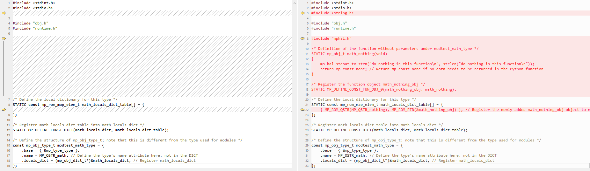

As can be seen from the figure, adding a function without parameters to the type is the same as adding it to the module, so no further explanation is needed.

**Step 2: Verify the Functionality**

After completing ***Step 1***, you can compile and download the firmware without modifying the script file.

After downloading, restart the module. Open QPYcom, and enter the following command:

```
import modtest
dir(modtest.math)
modtest.math.nothing()
```


The execution result is shown in the figure below:

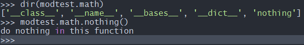

As can be seen from the figure, executing *modtest.math.nothing()* outputs the expected string *do nothing in this function*.

#### 3.5.2 Function with Parameters

Adding a function with parameters to the type is very different from adding it to the module.

The type in Python is a class, and you need to instantiate an object (e.g. *mymath=modtest.math()*) to operate a function with parameters. In C language, you must have corresponding space to be allocated space, the functions to create the objects, and the structures to represent objects.

Here, we implement the following functionality: create an object `mymath` in Python by *modtest.math()*, and execute its addition method *mymath.add(10, 20)*, expecting the output result `30`.

**Step 1: Define the `math_obj_t` Structure**

Add the *math_obj_t* structure to *services\microPython\ports\quectel\core\source\modtest_math.c* to represent the structure of the math object:

```
/* Define the math_obj_t structure */
typedef struct _math_obj_t
{
    mp_obj_base_t base;   // The object structure to be defined must include this member
    uint16_t value1;      // Add other members as needed
    uint16_t value2;
}math_obj_t;
```

**Step 2: Add  `.make_new`  to `modtest_math_type` And  Corresponding Function**

The code is as follows:

```
/* make_new creates a function of an instance object, corresponding to mymath = modtest.math() in Python, creating the mymath object */
const mp_obj_type_t modtest_math_type;
STATIC mp_obj_t modtest_math_make_new(const mp_obj_type_t *type, size_t n_args, size_t n_kw, const mp_obj_t *args)
{
    mp_arg_check_num(n_args, n_kw, 0, 0, true);   // Check the number of parameters
    math_obj_t *self = m_new_obj(math_obj_t);     // Create an object and allocate space
    self->base.type = &modtest_math_type;         // Define the type of the object
    return MP_OBJ_FROM_PTR(self);                 // Return the pointer to the object
}

/* Define the mp_obj_type_t structure; note that this is different from the type used to define the module */
const mp_obj_type_t modtest_math_type = {
    .base={ &mp_type_type },
    .name = MP_QSTR_math, // The name attribute of the type class is defined here, not in the DICT
    .make_new=modtest_math_make_new, // Add the make_new attribute
    .locals_dict = (mp_obj_dict_t*)&math_locals_dict, // Register math_locals_dict
};
```


**Step 3: Add the *math_add* method to `modtest_math_type`**

The code is as follows:

```
/* Define the math_add function */
mp_obj_t math_add(mp_obj_t self_in, mp_obj_t val1, mp_obj_t val2) {
    math_obj_t *self=MP_OBJ_TO_PTR(self_in); // Get the pointer to the object from the first parameter
    self->value1 = mp_obj_get_int(val1);  // Get the first parameter of the addition operation from the second parameter
    self->value2 = mp_obj_get_int(val2);  // Get the second parameter of the addition operation from the third parameter
	return mp_obj_new_int(self->value1+self->value2);  // Return the calculation result
}

/* Note: OBJ_3 is used here because the math_add() function has three parameters */
STATIC MP_DEFINE_CONST_FUN_OBJ_3(math_add_obj, math_add);/* Define the local dictionary of type */
STATIC const mp_rom_map_elem_t math_locals_dict_table[] = {
    { MP_ROM_QSTR(MP_QSTR_nothing), MP_ROM_PTR(&math_nothing_obj) }, // Register the newly added math_nothing_obj object to modtest_math_type
    { MP_ROM_QSTR(MP_QSTR_add), MP_ROM_PTR(&math_add_obj) },  // Register the newly added math_add_obj object to modtest_math_type
};
```

After completing the above three steps, let's see the differences between the code in this section and the code before the modification.
The red font in the following figure is all the code we added.

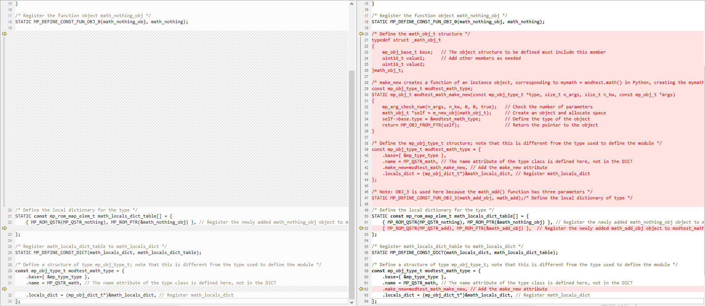

**Step 4: Verify the Functionality**

After completing the first three steps, you can directly compile and download the code without modifying the script file.

After downloading, restart the module. Open QPYcom, and enter the following commands:

```
import modtest
mymath = modtest.math() # Create a mymath object
mymath.add(10, 20) # Perform addition operation
```


The execution result is shown in the following figure:

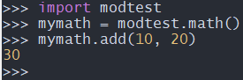

As shown in the above figure, the *mymath.add()* method is successfully executed.

#### 3.5.3 Static Functions

Here we add a static function `mp_obj_t math_max(mp_obj_t val1, mp_obj_t val2)` to the `math` type. This function calculates the maximum of two arguments that are passed.

**Step 1: Modify the Code**

Open the *services\microPython\ports\quectel\core\source\modtest_math*.c file and make the following modifications.

```
/* Definition of the static function under modtest_math_type */
STATIC mp_obj_t math_max(mp_obj_t val1, mp_obj_t val2)
{
    int num1 = mp_obj_get_int(val1);
    int num2 = mp_obj_get_int(val2);
    int max = (num1 > num2) ? num1 : num2;
    return mp_obj_new_int(max);
}

/* Register the function object math_nothing_obj */
STATIC MP_DEFINE_CONST_FUN_OBJ_2(math_max_obj, math_max);

/* Register the function object as a static method */
STATIC MP_DEFINE_CONST_STATICMETHOD_OBJ(math_max_static_obj, MP_ROM_PTR(&math_max_obj));

/* Define the local dictionary for the type */
STATIC const mp_rom_map_elem_t math_locals_dict_table[] = {
    { MP_ROM_QSTR(MP_QSTR_nothing), MP_ROM_PTR(&math_nothing_obj) }, // Register the newly added math_nothing_obj object to modtest_math_type
    { MP_ROM_QSTR(MP_QSTR_add), MP_ROM_PTR(&math_add_obj) },
    { MP_ROM_QSTR(MP_QSTR_max), MP_ROM_PTR(&math_max_static_obj) }, // Register the static function
};
```

The `MP_DEFINE_CONST_STATICMETHOD_OBJ` macro is used to define the function as a static method of the `math` type.

> Note: Similar to creating a static method for the type, class method can be created by using the `MP_DEFINE_CONST_CLASSMETHOD_OBJ` macro.

**Step 2: Verify the Functionality**

After completing ***Step 1***, you can compile and download the firmware without modifying the script file.

After downloading, restart the module. Open QPYcom, and enter the following command:

```
import modtest
modtest.math.max(2,3)
```

The execution result is shown in the figure below:

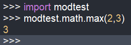

The static function can be called directly on the class. You don't need to create an instance like in the previous section.

## 4. Conclusion

With this, *Helios SDK Developemt Guide* comes to an end. I believe that everyone can successfully enter the world of QuecPython.
I hope that everyone can implement powerful functions based on QuecPython.

