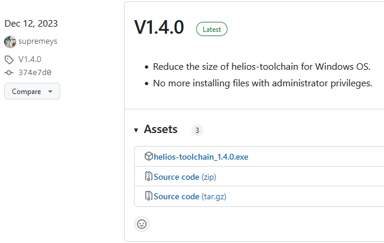
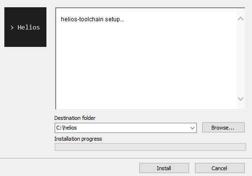
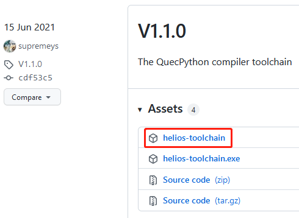
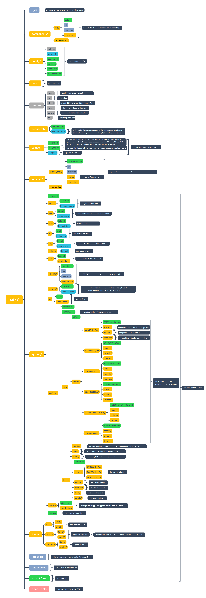
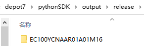
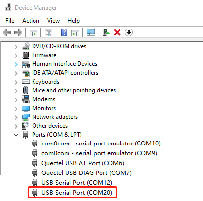
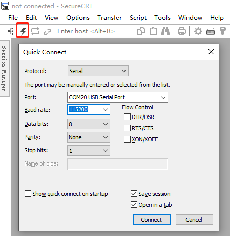
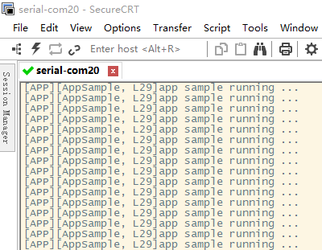

# Helios SDK Development Guide__Getting Started

## 1. SDK Overview

Helios SDK (hereinafter referred to as SDK; Helios, the ancient Greek sun god) is organized in a modular way, including system-level components, service-level components, peripheral components, and third-party components.

- System-level components  currently include OS, BSP, file system, various network protocol stacks, OTA, log output, etc.
- Service-level components currently include QuecPython functionalities.
- Peripheral components currently include camera, NOR Flash, LCD, etc.
- Third-party components currently includeLGVL, TTS, etc.

The dependency relationship between the components can be specified in the build management script within the component. Details are described below.
At the same time, the functionalities of each component can be configured through menuconfig, making it easy to trim the functionalities.

## 2. Environment Setup

### 2.1 Windows 10 Environment Setup

**Step 1: Download Toolchain**

Download the toolchain installation package [helios-toolchain.exe](https://github.com/quecpython/toolchain/releases/) for Windows 10 environment from the QuecPython official website, as shown in the following figure:



**Step 2: Install Toolchain**

Run helios-toolchain.exe as an administrator, as shown in the following figure, and click "**Install**" to install the toolchain.



> The target folder **must not** contain spaces.

### 2.2 Ubuntu 16.04 Environment Setup

**Step 1: Download Toolchain**

Download the toolchain installation package [helios-toolchain.linux](https://github.com/quecpython/toolchain/releases/) for Ubuntu 16.04 environment from the QuecPython official website, as shown in the following figure:



**Step 2: Install Toolchain**

Place the installation package in the same location as the target folder. Execute the following command to install the toolchain.
`sudo ./helios-toolchain`

**Step 3: Install Other Tools**

Enter the following command in the terminal to install `p7zip-full`, `git`, `make`, and `python3`.
```
sudo apt install p7zip-full git make python3
```

## 3. Code Retrieval

Please contact the [QuecPython technical team](https://developer.quectel.com/en/contact) for the source code of HeliosSDK, You can also get supports through email QuecPython@quectel.com.
## 4. SDK Directory Structure

The following figure shows the directory structure of the SDK. Different colors represent different meanings:

- Purple: GitHub related files and directories
- Yellow: Inherent folders of the SDK
- Green: Script files in the SDK
- Blue: Source code files in the SDK
- Pink: readme.md
- Gray: Generated folders that can be cleared
- Black: Comment information



## 5. Application Code Writing

>
- In theory, application code files can be created anywhere in the SDK directory.
- In practice, **for the sake of standardization**, it is recommended to create application code folders in the root directory of the SDK.
- Unit test code for functionalities is recommended to be placed in the *`test`* or `demo` folder in the directory where the functionality is located.
- It is recommended to use Microsoft's VSCode to open the SDK. Quectel will release a user-friendly plugin for VSCode in the future. Stay tuned.

Take the *`sample`* folder in the root directory of the SDK as an example:

**Step 1: Create Application Code Folder**

Create a *`sample`* folder in the root directory of the SDK.

**Step 2: Create Application Code Source File**

Enter the *`sample`* folder and create a file named *`sample.c`*.

**Step 3: Write Application Code**

- **Open** ***`sample.c`***

- **Include Header Files**
*`sample.c`* only needs to include the most basic header files, namely `helios.h`, `helios_debug.h`, and `*helios_os.h*`.
`*helios.h*` currently defines the API for adding self-startup items.
`*helios_debug.h*` defines the API  for logging.
*`helios_os.h`* defines the API for multi-threading.

 The code for including header files is as follows:
```
#include "helios.h"
#include "helios_debug.h"
#include "helios_os.h"
```

- **Customize Log Printing APIs**
> Explanation of logging APIs:
`helios_debug.h` provides the following log printing APIs:
`void Helios_Debug_Enable(void)`: Enable log printing functionality.
`void Helios_Debug_Disable(void)`: Disable log printing functionality.
`helios_debug(fmt, ...)`: General log output APIs.
`custom_log(tag, fmt, ...)`: Log output APIs with customizable tags. The tags will be output along with the logs.
 Log printing is enabled by default.

 Define a log output API with a customizable tag named `APP` in *`sample.c`*. The code is as follows:
```
#define app_debug(fmt, ...) custom_log(APP, fmt, ##__VA_ARGS__) // custom_log is defined in helios_debug.h
```

- **Implement Application Functionality**
Implement the functionality of logging once every second in *`sample.c`*. The code is as follows:
```
static void AppSample(void *argv)
{
    UNUSED(argv); // Defined in helios.h

    while (1)
    {
        app_debug("app sample running ...\r\n"); // Custom log output with tags
        Helios_sleep(1); // Defined in helios_os.h
    }
}
```

- **Add as a Auto-Startup Item**
After writing the application functionality code, call the following API, and the application functionality will start automatically after the system startup is completed:
```
application_init(AppSample, "AppSample", 2, 0); // defined in helios.h
```

> Usage of *`application_init`*
> Definition: *`application_init(entry, name, stack_size_kib, startup_prio)`*
> Parameter: `entry` - Application code entry address
> Parameter: `name` - Application name
> Parameter: `stack_size_kib` - Application thread stack size in KB (kilobytes)
> Parameter: `startup_prio` - Startup priority, where 0 represents the highest priority

**Step 4: Writing Compilation Control Scripts**

- **Create a .mk script file**
Create a`.mk` file with the same name as that in the application code root directory (in this example, it is the `sample` directory) in the application code root directory. Here takes the example of creating a `sample.mk` file.
- **Write the .mk script file**
> For detailed compilation control script, please refer to the `README.MD` file in the SDK root directory. Here, we will only explain it for `sample.c`.

```
NAME := SAMPLE # Component name. it is recommended to be consistent with the name of the component root directory to be all uppercase

$(NAME)_SRCS := sample.c # Add relative path of the source code that needs to be compiled (Relative to the component code root directory. In this case, it is relative to the sample directory.)

$(NAME)_INCS := . # Relative path of the header file that can only be referenced internally by the component (Relative to the component code root directory. In this case, relative to the sample directory. Actually there is no header file in the sample directory, this line can be deleted.)

$(NAME)_COMPONENTS := # Relative paths of other components that the current component depends on (Relative to the SDK root directory. Delete this line when it is empty.)
```

At this point, the application code is complete.

## 6. Compilation and Flashing

**Step 1: Check the usage of the compilation commands**

In the command line started in the SDK directory, type `helios` and press "**Enter**" to view the usage of the helios command.
The output is as follows:

```
Usage: helios <action> [<app>] [<at>] [<fw_name>]

These are common commands used in various situations:
   menuconfig                       - Do the project configuration
   make <app> [[<at>] [<fw_name>]]  - Do the compilation work
   private_clean                    - Clean the app private target
   clean                            - Clean the output directory
   git [<args>]                     - Git commands execution
   help                             - Show this help page
```

> For detailed usage of the compilation command, please refer to  `README.MD` in the SDK root directory.

**Step 2: Compile the firmware**

Taking the EC200UEU_AB module as an example, type the following command in the command line and press  "**Enter**":
```
helios make sample @EC200UEU_AB EC200UEUABR03A01M08
```

- `helios`: Trigger the compilation process.
- `make`: Compile the firmware.
- `sample`: Application entry address (relative to the SDK root directory).
- `@EC200UEU_AB`: Specify the target module model, which can be omitted. The default value is `@EC200UCN_AA`.
- `EC200UEUABR03A01M08`: Firmware version name, which can be omitted. The default value is the root directory name of the specified application code.

To clean the compilation target, type the following command in the command line and press "**Enter**":
```
helios clean
```

**Step 3: Check the compilation target**

The generated firmware package is stored in the *`output/release`* folder in the SDK root directory, as shown in the following figure.



**Step 4: Flash the firmware**

Please refer to *Quectel_QFlash_User_Guide* for firmware flashing.

## 7. Function Testing

**Step 1: Connect the PC and the module**

Connect the module's Debug serial port to the PC with a serial cable.

**Step 2: Check the Debug serial port number on the PC**

Open the Device Manager on the PC. In this example, the Debug serial port number is COM20.



**Step 3: Open the serial debugging tool on the PC**

Here takes SecureCRT as an example. Click the icon of quick connect button in the following figure to open the "Quick Connect" window.
Click the drop-down menu of the "Port" option and select COM20. Strictly follow the configuration in the figure for other parameters.
Click the "**Connect**" button in the lower right corner to open the serial port.



**Step 4: Start the module program**

Reset the module and start the program.

**Step 5: Check the module's running log**

Check the running log in the serial data reception area of SecureCRT, as shown in the following figure:



From the above figure, we can see that the log output format includes the custom tag `APP`, the function name *`AppSample`* that outputs the log, the file line number `L29`, and the log content `app sample running ...`.