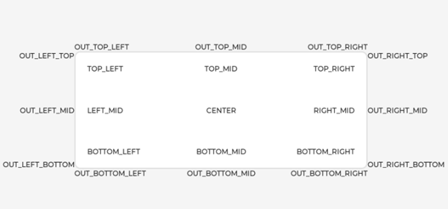

# LVGL - Widgets

LVGL library provides a series of widgets for building basic elements of the user interface. These widgets include but are not limited to buttons, labels, text boxes, lists, sliders and charts. Each widget has unique functionality and style, and you can customize their appearance and behavior by setting properties and styles to meet the specific requirements of application scenarios.

The following introduces the commonly used widgets in LVGL. Using these widgets can fulfill the majority of interface requirements. If you want to learn about all the widgets and their API documentation, you can visit [LVGL Documentation](https://docs.lvgl.io/8.3/examples.html#widgets) for more information.

## LVGL Base Object

### Overview

The `Base Object` implements the basic properties of widgets on the screen, such as:

- Coordinates

- Parent object

- Children based on the parent object

- Contains the styles

- Attributes like *Clickable*, *Scrollable*, etc.

The `Base Object` is the base class from which all other objects in LVGL are inherited.

The `Base Object` can be used directly as a simple widget: it is a rectangle. When no parent object is specified, a base object alone constitutes an LVGL interface. When a parent object is specified, it becomes a container.

#### Coordinates

##### Size

The object size can be modified on individual axes with `set_width(new_width)` and `set_height(new_height)`, or both axes can be modified at the same time with `set_size(new_width, new_height)`.

##### Position

You can set the position relative to the parent with `set_x(new_x)` and `set_y(new_y)`, or both axes at the same time with `set_pos(new_x, new_y)`.

##### Alignment

You can use the `align` property to set the alignment of a control relative to its parent container. Quecpython provides the following two methods:

- `obj.align(lvgl.ALIGN.type,x,y)`
- `obj.set_align(lvgl.ALIGN.type)`

> If you want to set it to center, use a shortcut method `obj.center()`.

LVGL supports the following alignment types:



For example, the following code will shift the object by 10;20 px from the center of its parent:

```python
import lvgl as lv

obj = lv.obj(lv.scr_act())

obj.set_align(lv.ALIGN.CENTER);
obj.set_pos(10, 20);

//Or in one function
obj.align(lv.ALIGN.CENTER, 10, 20);
```

#### Parents and Children

Except for interface objects, all LVGL widget objects have a parent object.

Parent objects and child objects have the following characteristics:

- They move together.
- Child objects are only visible within the range of the parent object.

When a widget object is created, the parent object needs to be specified. You can set a new parent for an object with `obj.set_parent(new_parent)`. To get the current parent, use `obj.get_parent()`.

To get a specific child of a parent, use `obj.get_child(idx)`. Here are some examples of idx:

- `0`: Get the first child object created.
- `1`: Get the second child object created.
- `-1`: Get the last child object created.

The children of a parent can be iterated as follows:

```python
for i in range(obj.get_child_cnt()):
	child_obj = obj.get_child(i)
```

`obj.get_index()` returns the index of the object in its parent object.

You can bring an object to the foreground or send it to the background with `obj.move_foreground()` and `obj.move_background()`.

#### Display and Screens

At the highest level of the LVGL object hierarchy is the `display` which represents the driver for a display device (physical display or simulator). [Association of LVGL and Display Device](./lvgl_flow.md) has been described in the previous chapters and will not be repeated here. A display can have one or more interfaces associated with it. Each interface contains an object hierarchy of graphical widgets.

When you have created a screen like  `screen = lv.obj()`, you can activate it with `lv.scr_load(screen)`.

The `lv.scr_act()` function returns the currently active screen.

#### Events

To set an event callback for an object, use `obj.add_event_cb(event_cb, lv.EVENT.type, user_data)`.

To manually send an event to an object, use `lv.event_send(obj, lv.EVENT.type, param)`.

Please read [Event overview](https://docs.lvgl.io/8.3/overview/event.html) for more details.

#### Styles

You can use `obj.add_style(new_style, selector)` to add a new style to an object.

`Selector` is an ORed combination of part and state(s). For example, `lv.PART.SCROLLBAR | lv.STATE.PRESSED`.

The base objects use `lv.PART.MAIN` style properties and `lv.PART.SCROLLBAR` with the typical background style properties.

Please read [Styles overview](https://docs.lvgl.io/8.3/overview/style.html) for more details.

#### Flags

There are some attributes that can be enabled/disabled by `obj.add/clear_flag(lv.obj.FLAG.type)`. `lv.obj.FLAG.type` can be found in the API constants.

### API

> **Note:** This section only introduces some common APIs. For all APIs, please visit the [LVGL official website](https://docs.lvgl.io/8.3/examples.html#widgets).
>
> The following descriptions assume `import lvgl as lv`.

#### Constructor

##### `lv.obj(parent)`

Create a base object (rectangle).

**Parameter**

- `parent` - Object type. Parent object. If this parameter is not specified,  a screen will be created.

#### Methods

##### `obj.add_style(style_obj,selector)`

Add a style to an object.

**Parameter**

- `style_obj` - Style_obj type. Style object. The style to be added.
- `selector` - Constant type. Selector, an OR-ed value of parts and state to which the style should be added. can be combined. The main part in the pressed state and the scrollbar part in the default state can be used together. For example, `lv.PART.SCROLLBAR | lv.STATE.PRESSED`.

##### `obj.add_flag(type)`

Set one or more flags

**Parameter**

- `type` - Constant type. The type of flag to be added.

##### `obj.clear_flag(type)`

Clear one or more flags

**Parameter**- Constant type. The type of flag to be cleared.

##### `obj.add_state(state)`

Add one or more states to the object. The other state bits will remain unchanged. If specified in the styles, transition animation will be started from the previous state to the current.

**Parameter**

- `state` - Constant type. The state to be added.

##### `obj.clear_state(state)`

Clear one or more states of the object. The other state bits will remain unchanged. If specified in the styles, transition animation will be started from the previous state to the current.

**Parameter**

- `state` - Constant type. The state to be cleared.

##### `obj.get_state()`

Get the state of an object.

#### Constants

##### `flag`

Macro switch

- `lv.obj.FLAG.HIDDEN` Make the object hidden.
- `lv.obj.FLAG.CLICKABLE` Make the object clickable by the input devices
- `lv.obj.FLAG.CLICK_FOCUSABLE` Add a focused state to the object when clicked
- `lv.obj.FLAG.CHECKABLE` Toggle checked state when the object is clicked
- `lv.obj.FLAG.SCROLLABLE` Make the object scrollable
- `lv.obj.FLAG.SCROLL_ELASTIC` Allow scrolling inside but with a slower speed
- `lv.obj.FLAG.SCROLL_MOMENTUM` Make the object scroll further when "thrown"
- `lv.obj.FLAG.SCROLL_ONE` Allow scrolling only one snappable child
- `lv.obj.FLAG.SCROLL_CHAIN` Allow propagating the scroll to a parent
- `lv.obj.FLAG.SCROLL_ON_FOCUS` Automatically scroll the object to make it visible when focused
- `lv.obj.FLAG.SNAPPABLE` If scroll snap is enabled on the parent it can snap to this object
- `lv.obj.FLAG.PRESS_LOCK` Keep the object pressed even if the press slid from the object
- `lv.obj.FLAG.EVENT_BUBBLE` Propagate the events to the parent too
- `lv.obj.FLAG.GESTURE_BUBBLE` Propagate the gestures to the parent
- `lv.obj.FLAG.ADV_HITTEST` Allow performing a more accurate hit (click) test. E.g. consider rounded corners.
- `lv.obj.FLAG.IGNORE_LAYOUT` Make the object position-able by the layouts
- `lv.obj.FLAG.FLOATING` Do not scroll the object when the parent scrolls and ignore the layout

##### `PART`

- `lv.PART.MAIN` A background like rectangle
- `lv.PART.SCROLLBAR` The scrollbar(s)
- `lv.PART.INDICATOR` Indicator, e.g. for slider, bar, switch, or the tick box of the checkbox
- `lv.PART.KNOB` Like handle to grab to adjust the value
- `lv.PART.SELECTED` Indicate the currently selected option or section
- `lv.PART.ITEMS` Used if the widget has multiple similar elements (e.g. table cells)
- `lv.PART.TICKS` Ticks on a scale, e.g. for charts or gauges
- `lv.PART.CURSOR` Mark a specific place e.g. for text area's cursor or on a chart
- `lv.PART.CUSTOM_FIRST` Extension point for custom widgets

##### `state`

- `lv.STATE.DEFAULT` Normal, released state, default state
- `lv.STATE.CHECKED` Toggle or selected state
- `lv.STATE.FOCUSED` Focused via keypad or encoder or clicked via touchpad/mouse
- `lv.STATE.FOCUS_KEY` Focused via keypad or encoder but not via touchpad/mouse
- `lv.STATE.EDITED` Edited by an encoder
- `lv.STATE.HOVERED` Hovered by mouse (not supported now)
- `lv.STATE.PRESSED` Being pressed
- `lv.STATE.SCROLLED` Being scrolled
- `lv.STATE.DISABLED` Disabled

##### `flex-flow`

- `lv.FLEX_FLOW.ROW` Place the children in a row without wrapping
- `lv.FLEX_FLOW.COLUMN` Place the children in a column without wrapping
- `lv.FLEX_FLOW.ROW_WRAP` Place the children in a row with wrapping
- `lv.FLEX_FLOW.COLUMN_WRAP` Place the children in a column with wrapping
- `lv.FLEX_FLOW.ROW_REVERSE` Place the children in a row without wrapping but in reversed order
- `lv.FLEX_FLOW.COLUMN_REVERSE` Place the children in a column without wrapping but in reversed order
- `lv.FLEX_FLOW.ROW_WRAP_REVERSE` Place the children in a row with wrapping but in reversed order
- `lv.FLEX_FLOW.COLUMN_WRAP_REVERSE` Place the children in a column with wrapping but in reversed order

## Label

### Overview

A label is the basic object type that is used to display text.

### Parts and Styles

- `lv.PART.MAIN` Uses all the typical background properties and the text properties. The padding values can be used to add space between the text and the background.
- `lv.PART.SCROLLBAR` The scrollbar that is shown when the text is larger than the widget's size.
- `lv.PART.SELECTED` Tells the style of the selected text. Only `text_color` and `bg_color` style properties can be used.

### Usage

#### Set Text

ou can set the text on a label at runtime with `label.set_text("New text")`.

Newline characters are handled automatically by the label object. You can use `\n` to make a line break. For example: `"line1\nline2\n\nline4"`.

#### Long Mode

By default, the size of the label is automatically expanded to the text size. If the width or height is explicitly set (using `label.set_size`, for example, or through layout), the lines wider than the label's width can be manipulated according to several long mode policies. Similarly, the policies can be applied if the height of the text is greater than the height of the label.

- `lv.label.LONG.WRAP` The text is too long and will be clipped. (Default)
- `lv.label.LONG.DOT` Replaces the last 3 characters from the bottom right corner of the label with dots (`.`)
- `lv.label.LONG.SCROLL` If the text is wider than the label scroll it horizontally back and forth. If it's higher, scroll vertically. Only one direction is scrolled and horizontal scrolling has higher precedence.
- `lv.label.LONG.SCROLL_CIRCULAR` If the text is wider than the label scroll it horizontally continuously. If it's higher, scroll vertically. Only one direction is scrolled and horizontal scrolling has higher precedence.
- `lv.label.LONG.CLIP` Clip the parts of the text outside the label.

You can specify the long mode with `label.set_long_mode(type)`.

#### Events

No special events are sent by the Label. You can use `lv.obj.FLAG.CLICKABLE` to make a label clickable, so that it behaves like a transparent button and can have click events attached to it.

### API

> **Note:** This section only covers some common APIs. For a complete list of APIs, please refer to the [LVGL documentation](https://docs.lvgl.io/8.3/examples.html#widgets).

#### Constructor

##### `lv.label(parent)`

Create a label.

**Parameter**

- `parent` - Object type. Parent object of the new label. Required.

#### Method

##### `label.set_text(text)`

Set a new text for a label.

**Parameter**

- `text` - String type. The text to be displayed.

##### `label.set_long_mode(type)`

Set the long text mode for the label.

**Parameter**

- `type` - Constant type. The long text mode.

##### `label.get_text()`

Get the text of a label.

**Return Value**

- `text` - String type. The text of the label

#### Constants

##### `LONG`

Long text modes.

- `lv.label.LONG.WRAP` The text is too long and will be clipped. (Default)
- `lv.label.LONG.DOT` Replaces the last 3 characters from bottom right corner of the label with dots (`.`)
- `lv.label.LONG.SCROLL` If the text is wider than the label scroll it horizontally back and forth. If it's higher, scroll vertically. Only one direction is scrolled and horizontal scrolling has higher precedence.
- `lv.label.LONG.SCROLL_CIRCULAR` If the text is wider than the label scroll it horizontally continuously. If it's higher, scroll vertically. Only one direction is scrolled and horizontal scrolling has higher precedence.
- `lv.label.LONG.CLIP` Clip the parts of the text outside the label.

## Image

### Overview

Images are the basic object to display images from flash (as arrays) or from files. Images can display symbols (`LV_SYMBOL_...`) too.

### Parts and Styles

- `lv.PART.MAIN` - A background rectangle that uses the typical background style properties and the image itself using the image style properties.

### Usage

#### Image Source

To provide maximum flexibility, the source of the image can be:

- A file from the file system.
- A symbol icon.

To set the source of the image, use `img.set_src(src)`.

To use a file from the file system, download the image file to the file system and use `img.set_src("U:/my_img.jpg")`.

You can also set symbols similar to labels. In this case, the image will be rendered as text according to the *font* specified in the style. It enables to use of light-weight monochrome "letters" instead of real images. You can set symbols like `img.set_src(lv.SYMBOL.OK)`.

#### Transformations

Using the `lv_img_set_zoom(img, factor)` the images will be zoomed. Set `factor` to `256` or `LV_IMG_ZOOM_NONE` to disable zooming. A larger value enlarges the images (e.g. `512` double size), a smaller value shrinks it (e.g. `128` half size). Fractional scale works as well. E.g. `281` for 10% enlargement.

To rotate the image use `lv_img_set_angle(img, angle)`. Angle has 0.1 degree precision, so for 45.8° set 458.

By default, the pivot point of the rotation is the center of the image. It can be changed with `lv_img_set_pivot(img, pivot_x, pivot_y)`. `0;0` is the top left corner.

The quality of the transformation can be adjusted with `lv_img_set_antialias(img, true/false)`. With enabled anti-aliasing the transformations are higher quality but slower.

Note that the real coordinates of image objects won't change during transformation. That is `lv_obj_get_width/height/x/y()` will return the original, non-zoomed coordinates.

#### Events

No special events are sent by image objects.

You can make the image clickable by using `lv.obj.FLAG.CLICKABLE`, so that it behaves like an image button and can have click events attached to it.

> **Note:** The image can use the image cache mechanism, so it is recommended to use the image instead of the image button.

### API

> **Note:** This section only covers some common APIs. To view all APIs, please visit [LVGL Documentation](https://docs.lvgl.io/8.3/examples.html#widgets).

#### Constructor

##### `lv.img(parent)`

Create an image object.

**Parameter**

- `parent` - Object type. Parent object of the new image. Required.

#### Methods

##### `img.set_src(src)`

Set the image data to display on the object

**Parameter**

- `src` - 1)  String type. Path to an image file. 2) `SYMBOL` (e.g. `lv.SYMBOL.OK`)

##### `img.set_offset_x(x)`

Set an offset for the source of an image so the image will be displayed from the new origin.

**Parameter**

- `x` - Integer type. The new offset along x axis.

##### `img.set_offset_y(y)`

Set an offset for the source of an image. so the image will be displayed from the new origin.

**Parameter**

- `y` - Integer type. The new offset along y axis.

##### `img.set_angle(angle)`

Set the rotation angle of the image.

**Parameter**

- `angle` - Integer type. Rotation angle in degree with 0.1 degree resolution.

##### `img.set_zoom(factor)`

Set the zoom level for the image.

**Parameter**

- `factor` - Integer type. Zoom level, 256 for the original size, 512 for double size.

##### `img.set_pivot(x, y)`

Set the rotation center of the image. The image will be rotated around this point.

**Parameter**

- `x` - Integer type. Rotation center x of the image
- `y` - Integer type. Rotation center y of the image

##### `img.set_antialias(antialias)`

Enable/disable anti-aliasing for the transformations (rotate, zoom) or not. The quality is better with anti-aliasing looks better but slower.

**Parameter**

- `antialias` - Boolean type. 

  True: Anti-aliased

  False: Not anti-aliased

## Button

### Overview

Buttons have no new features compared to the base object. They are useful for semantic purposes and have slightly different default settings.

Buttons, by default, differ from base object in the following ways:

- Not scrollable
- Added to the default group
- Default height and width set to `LV_SIZE_CONTENT`

### Parts and Styles

- `lv.PART.MAIN` - The background of the button.

### Usage

There are no new features compared to the base object,

#### Events

`LV_EVENT_VALUE_CHANGED` when the `LV_OBJ_FLAG_CHECKABLE` flag is enabled and the object is clicked.

#### Events

Please note that the state of `lv.KEY.ENTER` is converted to `lv.EVENT.PRESSED/PRESSING/RELEASED`, etc.

Refer to the events of Basic objects.

### API

> **Note:** This section only covers some common APIs. To view all APIs, please visit [LVGL Documentation](https://docs.lvgl.io/8.3/examples.html#widgets).

#### Constructor

##### `lv.btn(parent)`

Create a button object.

**Parameter**

- `parent` - Object type. Parent object of the new button. Required.

## Other LVGL widgets

In addition to the widgets mentioned above, LVGL also provides the following widgets. Please choose the appropriate widget based on your needs.

| **widget** | Constructor     | Description                                                  | LVGL Official Website Link                                   |
| ---------- | --------------- | ------------------------------------------------------------ | ------------------------------------------------------------ |
| List       | `lv.list()`     | The List is basically a rectangle with a vertical layout to which Buttons and Texts can be added. | [Extra widgets - List](https://docs.lvgl.io/8.2/widgets/extra/list.html) |
| Window     | `lv.win()`      | The Window is container-like object built from a header with title and buttons and a content area. | [Extra widgets - Window](https://docs.lvgl.io/8.2/widgets/extra/win.html) |
| Arc        | `lv.acr()`      | The Arc consists of a background and a foreground arc. The foreground (indicator) can be touch-adjusted. | [Core widgets - Arc](https://docs.lvgl.io/8.2/widgets/core/arc.html) |
| Bar        | `lv.bar()`      | The bar displays progress.                                   | [Core widgets - Bar](https://docs.lvgl.io/8.2/widgets/core/bar.html) |
| Switch     | `lv.switch()`       | The Switch looks like a little slider and can be used to turn something on and off. | [Core widgets - Switch](https://docs.lvgl.io/8.2/widgets/core/switch.html) |
| Tile view  | `lv.tileview()` | Menu page available, with finger tracking effect compared with the animation for switching between interfaces. | [Extra widgets - Title view](https://docs.lvgl.io/8.2/widgets/extra/tileview.html) |
| Meter      | `lv.meter()`    | The Meter widget can visualize data in very flexible ways. In can show arcs, needles, ticks lines and labels. | [Extra widgets - Meter](https://docs.lvgl.io/8.2/widgets/extra/meter.html) |
| Chart      | `lv.chart()`    | Line chart, bar chart and scatter chart.                     | [Extra widgets - Chart](https://docs.lvgl.io/8.2/widgets/extra/chart.html) |
| Keyboard   | `lv.keyboard()` | Special button matrix that realizes a virtual keyboard to write texts into a text area. | [Extra widgets - Keyboard](https://docs.lvgl.io/8.2/widgets/extra/keyboard.html) |
| Menu       | `lv.menu()`     | Multi-level menu that automatically handles traversal between pages. | [Extra widgets - Menu](https://docs.lvgl.io/8.2/widgets/extra/menu.html) |