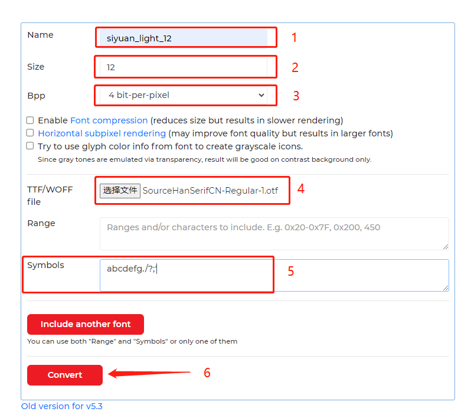
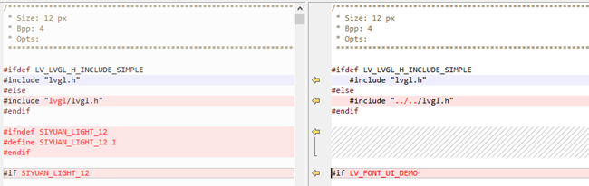
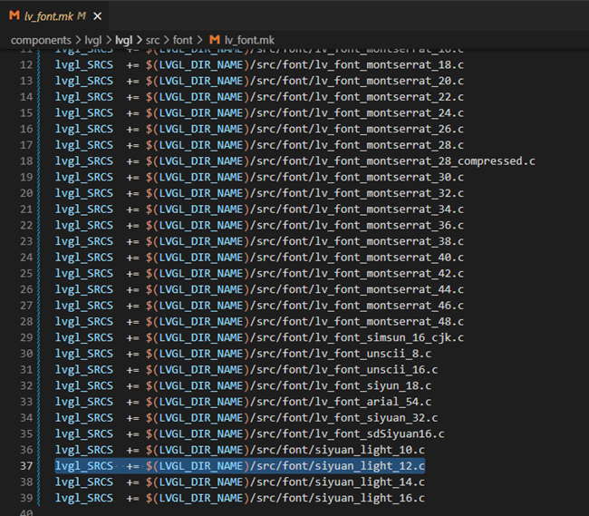
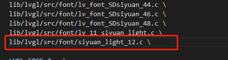
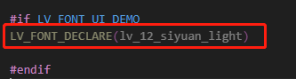
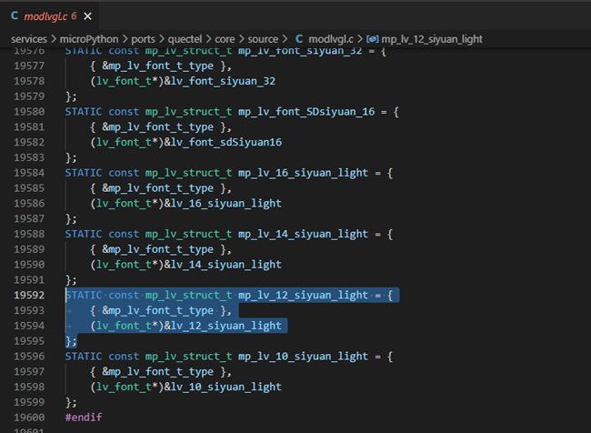

# LVGL - Font Library

## Overview

In LVGL, `fonts` are collections of bitmaps and other information required to render the images of the letters (glyph).

The `fonts` have a bpp (bits per pixel) property. It shows how many bits are used to describe a pixel in the font. The value stored for a pixel determines the pixel's opacity. This way, with higher *bpp*, the edges of the letter can be smoother. The possible *bpp* values are 1, 2, 4 and 8 (higher value means better quality).

The *bpp* also affects the required memory size to store the font. For example, *bpp = 4* makes the font nearly 4 times greater compared to *bpp = 1*.

## Font Categories

Since LVGL fonts are essentially bitmaps of glyph images, they are not categorized based on language.

The `Quecpython LVGLfonts` can be categorized as:

1. **Built-in Fonts**
2. **External Fonts**

> Note: Currently, external fonts are not supported.

## Built-in Fonts

### Overview

As the name suggests, built-in fonts are LVGL fonts that have been pre-compiled and integrated into the firmware. They can be used directly in the application code through `style_obj.set_text_font(lv.font_name)` or `obj.set_style_text_font(lv.font_name,0)`.

### Default Font

Quecpython LVGL comes with the `MONTSERRAT 14` as the default font, which includes all English characters and some common English symbols.

The default font can be obtained by `lv.font_default()` or directly by `lv.font_montserrat_14`.

### Add New Fonts

The default font may not meet the requirements of your project. If you are using the QuecPython SDK for development, you can follow the steps below to compile a new font into the firmware.

#### Add Fonts by Using the Online Font Converter

This method is relatively simple for adding new built-in fonts, but the font quality may be lower when using a smaller *bpp*.

##### Tool

[Online Font Converter](https://lvgl.io/tools/fontconverter)

##### Generate Font C Files

1. Give a name to the output font (A C file with the same name will be generated).
2. Specify the height in px.
3. Set the *bpp*. Higher value results smoother (anti-aliased) font.
4. Select a local TTF or WOFF font file (Make sure the font is free for commercial use), which is the target font you want to convert to.
5. Enter the characters that must be included in the font, including spaces, symbols, numbers, and letters.
6. After completing the above five steps, click "**Convert**" to perform the online conversion, and the font will be automatically downloaded to your local device.
7. Copy the generated C file to the *`pythonSDK\services\microPython\lib\lvgl\lvgl\src\font`* folder in your LVGL project directory.

You can follow the above steps to add multiple font C files to the font directory.

##### Modify the Font C File

To make the generated C file consistent with other font files, make the following modifications. If you want to use macros, add the corresponding macros for your project, such as `#if LV_FONT_UI_DEMO` in this figure.

#### Compile

After adding the font C files following the above steps, you also need to modify the files as shown below to compile the added font C files.

- Add the C file to *`pythonSDK\services\microPython\lib\lvgl\lvgl\src\font\lv_font.mk`*.

- Add the C file to *`pythonSDK\services\microPython\microPython.mk`*.

- Declare the added font in *`pythonSDK\services\microPython\lib\lvgl\lvgl\src\font\lv_font.h`*.

- Use the font in Quecpython.

With these modifications, the firmware has been compiled and downloaded into the module, and you can use the added internal font library.
