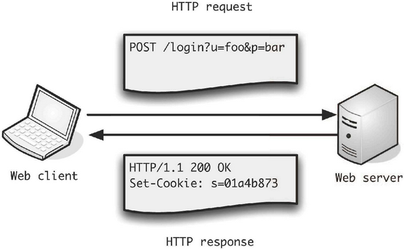
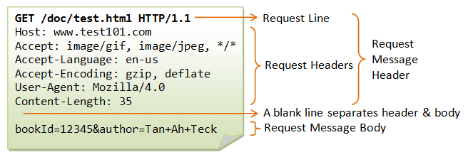
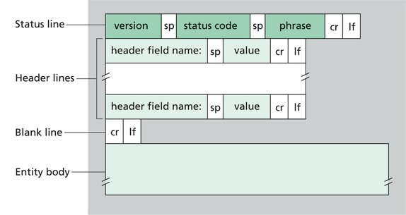
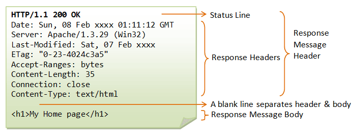

# HTTP Communication

## Introduction to HTTP

### HTTP Protocol

HTTP (Hyper Text Transfer Protocol) is a communication protocol that allows clients to request and access server resources through URLs (Uniform Resource Locators). This protocol is based on the client-server model and organizes requests and responses in text format. The communication model is as follows:



HTTP is commonly used for web page acquisition and form submission based on browsers, file upload and download, mobile applications, and data reporting for IoT devices.

### Request and Response Messages

#### Request Message

The format of an HTTP request message is as follows:


- `Request line`: The request line, which consists of the `method`, `URL`, and `Version` fields.
    - `method`: The request method, including GET, POST, PUT, HEAD and DELETE. See [below](#http_request_method) for more details.
    - `URL`: The Uniform Resource Locator, used to identify the path of the server resource.
    - `Version`: The protocol version. The commonly used version is `HTTP/1.1`.
- `Header lines`: The request header, which consists of one or more header fields, each in the format of `header field name: value`.
    - `header field name`: The name of the header field.
    - `value`: The value of the header field.
- `Entity body`: The message body, which contains the message content sent to the server.

> Note that `sp` represents a space, `cr` `lf` represents a carriage return and line feed. There must be a blank line between the request headers and the message body, i.e. the `Blank line` in the figure.

Here is an example of a request message:



#### Response Message

The format of an HTTP response message is as follows:



- `Status line`: The status line, which consists of the `version`, `status code`, and `phrase` fields.
    - `version`: The protocol version. The commonly used version is `HTTP/1.1`.
    - `status code`: The response status code. See [below](#http_status_code) for more details.
    - `phrase`: The reason phrase.
- `Header lines`: The response header, which consists of one or more header fields, each in the format of `header field name: value`.
    - `header field name`: The name of the header field.
    - `value`: The value of the header field.
- `Entity body`: The message body, which contains the content of the server's response.

> Note that `sp` represents a space, `cr` `lf` represents a carriage return and line feed. There must be a blank line between the response headers and the message body, as shown in the diagram.

Here is an example of a response message:



## <span id="http_request_method">HTTP Request Methods</span>

The commonly used HTTP methods include GET, POST, PUT, HEAD and DELETE.

- **GET**: The most commonly used method in HTTP requests, used to request resources from the server.

- **HEAD**: Verify the validity of a URL and retrieve information such as the last modified date of a resource, which is similar to the GET method, but without returning the message body.

- **PUT**: Upload resources to the server. Create a resource if no resource exists, otherwise, replace the resource.

- **POST**: Modify server resources. Create a resource if no resource exists, otherwise, update the resource.

- **DELETE**: Deletes a resource, opposite of the PUT method.

## <span id="http_status_code">HTTP Status Codes</span>

The first line of a server's response message is the status line, which includes the status code and reason phrase to inform the client of the result of the request.

| Status Code |   Category    |                        Reason Phrase                         |
| :---------: | :-----------: | :----------------------------------------------------------: |
|     1xx     | Informational |             Request received, continuing process             |
|     2xx     |    Success    | The action was successfully received, understood, and accepted |
|     3xx     |  Redirection  | Further action must be taken in order to complete the request |
|     4xx     | Client Error  |    The request contains bad syntax or cannot be fulfilled    |
|     5xx     | Server Error  |   The server failed to fulfil an apparently valid request    |

> - For more details about the HTTP protocol, please refer to the [official documentation](https://www.ietf.org/rfc/rfc2616.txt) of the Internet Engineering Task Force (IETF).
>
> - The difference and relation between HTTP and TCP protocols:
>
>     - HTTP is based on the TCP protocol.
>
>     - TCP is a byte stream protocol, and it is difficult for users to determine the boundaries of business data. While HTTP has a specific message format, and message length can be specified by `Content-Length: ${Length}` header, or the data encoding format can be specified by `Transfer-Encoding：chunked` header. Both can identify message boundaries. QuecPython modules support parsing both `Content-Length: ${Length}` and `Transfer-Encoding: chunked`.

## HTTP Application

### Network Connection

Before starting an HTTP application, make sure that the network connection is available.

QuecPython modules automatically connect to the cellular network after power-on. Therefore, in most cases, you only need to check the network status in the application, for example:

```python
import checkNet

if __name__ == '__main__':
    stage, state = checkNet.waitNetworkReady(30)
    if stage == 3 and state == 1:
        print('Network connection successful.')
    else:
        print('Network connection failed, stage={}, state={}'.format(stage, state))

```

> If there is an exception in the network connection, please refer to the data call application note for network reconnection.

### HTTP Request Code Example

#### HTTP GET Request

This section demonstrates the basic HTTP request coding with GET and POST as examples.

First, let's take a look at an example of a GET request:

```python
import request

# Construct an HTTP GET request
url = 'http://api.example.com/resource'

# Set the request header to JSON. if the header is not set, the default value is application/json
headers = {'Content-Type': 'application/json'}

# Send the HTTP GET request
response = request.get(url, headers=headers)

# Get the HTTP response status
status_code = response.status_code
print('GET status code:', status_code)

# Get the HTTP response data
data = response.json()
print('GET response data:', data)
```

#### <span id="http_post_exam">HTTP POST Request</span>

Since a GET request is used to request resources from the server, the request message usually does not contain a body.

While a POST request is used to push messages to the server and requires a message body. Here is an example of a POST request:

```python
import request
import ujson

# Construct an HTTP POST request
url = 'http://api.example.com/resource'

# Set the request header to JSON
headers = {'Content-Type': 'application/json'}

# Construct the request data
payload = {'key1': 'value1', 'key2': 'value2'}
json_payload = ujson.dumps(payload)

# Send the HTTP POST request
response = request.post(url, headers=headers, data=json_payload)

# Get the HTTP response status
status_code = response.status_code
print('POST status code:', status_code)

# Get the HTTP response data
data = response.json()
print('POST response data:', data)
```

The above two code samples demonstrate two main differences between GET and POST requests when coding:

1. The methods used after the `request`  are different, `request.get()` and `request.post()` respectively.
2. A POST request requires the construction of request data, while a GET request does not.

The rest of the programming logic is almost the same. After the server responds, the HTTP request returns a `response` object. Through the methods provided by `response`, you can obtain the HTTP response code, reason phrase, response message body, and other data.

### Common Interfaces of HTTP Requests

This section explains the usage of the `request.get()`, `request.post()`, and  the response object `response`.

- `request.get()` prototype: `request.get(url, data=None, **kwargs)`

- `request.post()` prototype: `request.post(url, data=None, **kwargs)`

- `response` type: `<class 'request.Response'>`

- Parameter
    - `url`: Positional parameter. The server URL in the request.
    - `data`: Default parameter. The message body of the request message.
    - `**kwargs`: Keyword parameter. Other related parameters of the HTTP request.
      
        - `headers`: Dictionary type. Request headers.
        
        - `decode`: Boolean type. Whether to decode the response result in UTF-8. Default value: `True`.
        
          True: Decode the response result in UTF-8
        
          False: Not decode the response result in UTF-8
        
        - `sizeof`: The size of the data block read from the buffer. Recommended range: 255–4096. Default value: 255. The larger the value, the faster the reading speed. Unit: byte.
        
        - `ssl_params`: SSL certificate parameters. Format: `{"cert": certificate_content, "key": private_content}`.
    
- Return Value
  
    `response` object of type `<class 'Response'>`. The properties and methods of this response object are as follows:
    
    - `status_code`: Integer type. The response status code.
    - `headers`: Dictionary type. The response headers.
    - `text`: The response message body as a string generator.
    - `json`: Convert the response's message body in JSON type to dictionary type.
    - `content`: The response message body as a bytes generator.

### HTTP Application Examples

#### Query Weather 

Amap Weather Query Open API: `http://restapi.amap.com/v3/weather/weatherInfo?key=2875b8171f67f3be3140c6779f12dcba&city=北京&extensions=base`

> `北京` can be replaced with the name of other cities in China.

You can use the HTTP GET method to query the weather of a specific city. Here is an example code ([Click here to download the complete code in github](https://github.com/QuecPython/examples/blob/main/network-comm/net-protocols/http/example_get_weather.py)):

```python
import request

# Weather query URL
url = 'http://restapi.amap.com/v3/weather/weatherInfo?key=2875b8171f67f3be3140c6779f12dcba&city=北京&extensions=base'

# Send the HTTP GET request
response = request.get(url)

# Get the raw data returned by the weather query website
data = ''
for i in response.text:
    data += i
print('raw data responsed from website:')
print(data)
```

Execution result:

```log
raw data responsed from website:
{"status":"1","count":"1","info":"OK","infocode":"10000","lives":[{"province":"北京","city":"北京市","adcode":"110000","weather":"阴","temperature":"36","winddirection":"东南","windpower":"≤3","humidity":"34","reporttime":"2023-07-02 18:40:39","temperature_float":"36.0","humidity_float":"34.0"}]}
```

To further process the data, such as nicely format the output, you can call the `json` method of `response` method ([Click here to download the complete code in github](https://github.com/QuecPython/examples/blob/main/network-comm/net-protocols/http/example_get_weather_json_resolve.py)):

```python
import request

# Weather query URL
url = 'http://restapi.amap.com/v3/weather/weatherInfo?key=2875b8171f67f3be3140c6779f12dcba&city=北京&extensions=base'

# Send the HTTP GET request
response = request.get(url)

# Get raw data from the website and parse it into a dict type by calling the json() method of response object
data = response.json()
data = data['lives'][0]
for k,v in data.items():
	print('%s: %s' % (k, v))
```

Execution result:

```log
province: 北京
city: 北京市
adcode: 110000
weather: 阴
temperature: 36
winddirection: 东南
windpower: ≤3
humidity: 34
reporttime: 2023-07-02 18:40:39
temperature_float: 36.0
humidity_float: 34.0
```

#### Download File 

Here is an example of downloading the html web page file of the Baidu-search homepage. The code for sending the request is as follows ([Click here to download the complete code in github](https://github.com/QuecPython/examples/blob/main/network-comm/net-protocols/http/example_file_download.py)):

```python
import request

# Baidu URL over HTTP protocol (not HTTPS)
url = 'http://www.baidu.com'

# Send the HTTP GET request
response = request.get(url)
```

Before reading the web page data, create a file named `baidu.html` in the `/usr` directory of the module with the `wb` mode:

```python
# Create file baidu.html
f = open('/usr/baidu.html', 'wb')    # 'wb' means writing binary data
```

The web page file may contain some characters beyond the ASCII range. When requesting the response data, it is recommended to use `request.content` instead of `request.text`.

Code:

```python
# Get web page content and write to the file
for i in response.content:
	f.write(i)

# Close the file after fetching the web page data
f.close()
```

At this point, the file download is complete.

To view the content of the downloaded file, execute the following code:

```python
# Open file baidu.html
with open('/usr/baidu.html', 'rb') as f:    # 'rb' means reading the file in binary mode
	r = f.read()
    while r:
        print(r)
        r = f.read()

# Close the file
f.close()
```

The printed file content is as follows:

```python
b'<!DOCTYPE html>\r\n<!--STATUS OK--><html> <head><meta http-equiv=content-type content=text/html;charset=utf-8><meta http-equiv=X-UA-Compatible content=IE=Edge><meta content=always name=referrer><link rel=stylesheet type=text/css href=http://s1.bdstatic.com/r/www/cache/bdorz/baidu.min.css><title>\xe7\x99\xbe\xe5\xba\xa6\xe4\xb8\x80\xe4\xb8\x8b\xef\xbc\x8c\xe4\xbd\xa0\xe5\xb0\xb1\xe7\x9f\xa5\xe9\x81\x93</title></head> <body link=#0000cc> <div id=wrapper> <div id=head> <div class=head_wrapper> <div class=s_form> <div class=s_form_wrapper> <div id=lg>  </div> <form id=form name=f action=//www.baidu.com/s class=fm> <input type=hidden name=bdorz_come value=1> <input type=hidden name=ie value=utf-8> <input type=hidden name=f value=8> <input type=hidden name=rsv_bp value=1> <input type=hidden name=rsv_idx value=1> <input type=hidden name=tn value=baidu><span class="bg s_ipt_wr"><input id=kw name=wd class=s_ipt value maxlength=255 autocomplete=off autofocus></span><span class="bg s_btn_wr"><input type=submit id=su value=\xe7\x99\xbe\xe5\xba\xa6\xe4\xb8\x80\xe4\xb8\x8b class="bg s_btn"></span> </form> </div> </div> <div id=u1> <a href=http://news.baidu.com name=tj_trnews class=mnav>\xe6\x96\xb0\xe9\x97\xbb</a> <a href=http://www.hao123.com name=tj_trhao123 class=mnav>hao123</a> <a href=http://map.baidu.com name=tj_trmap class=mnav>\xe5\x9c\xb0\xe5\x9b\xbe</a> <a href=http://v.baidu.com name=tj_trvideo class=mnav>\xe8\xa7\x86\xe9\xa2\x91</a> <a href=http://tieba.baidu.com name=tj_trtieba class=mnav>\xe8\xb4\xb4\xe5\x90\xa7</a> <noscript> <a href=http://www.baidu.com/bdorz/login.gif?login&amp;tpl=mn&amp;u=http%3A%2F%2Fwww.baidu.com%2f%3fbdorz_come%3d1 name=tj_login class=lb>\xe7\x99\xbb\xe5\xbd\x95</a> </noscript> <script>document.write(\'<a href="http://www.baidu.com/bdorz/login.gif?login&tpl=mn&u=\'+ encodeURIComponent(window.location.href+ (window.location.search === "" ? "?" : "&")+ "bdorz_come=1")+ \'" name="tj_login" class="lb">\xe7\x99\xbb\xe5\xbd\x95</a>\');</script> <a href=//www.baidu.com/more/ name=tj_briicon class=bri style="display: block;">\xe6\x9b\xb4\xe5\xa4\x9a\xe4\xba\xa7\xe5\x93\x81</a> </div> </div> </div> <div id=ftCon> <div id=ftConw> <p id=lh> <a href=http://home.baidu.com>\xe5\x85\xb3\xe4\xba\x8e\xe7\x99\xbe\xe5\xba\xa6</a> <a href=http://ir.baidu.com>About Baidu</a> </p> <p id=cp>&copy;2017&nbsp;Baidu&nbsp;<a href=http://www.baidu.com/duty/>\xe4\xbd\xbf\xe7\x94\xa8\xe7\x99\xbe\xe5\xba\xa6\xe5\x89\x8d\xe5\xbf\x85\xe8\xaf\xbb</a>&nbsp; <a href=http://jianyi.baidu.com/ class=cp-feedback>\xe6\x84\x8f\xe8\xa7\x81\xe5\x8f\x8d\xe9\xa6\x88</a>&nbsp;\xe4\xba\xacICP\xe8\xaf\x81030173\xe5\x8f\xb7&nbsp;  </p> </div> </div> </div> </body> </html>\r\n'
```


#### <span id="http_multipart_form_data">Submit Form in Multipart/Form-data Format</span>

The form submission in `multipart/form-data` type is commonly used in HTTP communication, especially for file uploads. It requires adding the `Content-Type: multipart/form-data;boundary=${Boundary}` header field in the request. The complete format is as follows:

```python
POST / HTTP/1.1
host: www.example.com
Content-Type: multipart/form-data; boundary=${Boundary}

--${Boundary}
Content-Disposition: form-data; name="text"

title
--${Boundary}
Content-Disposition: form-data; name="file"; filename="test.png"
Content-Type: image/png

<binary data of the image>
--${Boundary}--
```

 The above request is used to upload the file test.png and includes an additional form field `text` with the value `title`.

The format of the message is as follows:

- `${Boundary}`: A user-defined separator string, such as `----WebKitFormBoundaryrGKCBY7qhFd3TrwA`.

- The request message body consists of multiple form items separated by `--${Boundary}`, with each form item consisting of a request header and a message body. The format is as follows:

    ```http
    --${Boundary}
    Content-Disposition: form-data; name="parameter_name"
    
    Parameter value
    ```

    -  `--${Boundary}` is appended with a carriage return and line feed `cr` `lf`.

    - Each header line is also appended with `cr` `lf`.

    - A blank line (`cr` `lf`) is added between the request header and the message body.

- If the form item contains a file:

    - The Content-Disposition header needs to be appended with the filename field, such as `Content-Disposition: form-data; name="file"; filename="test.png"`, indicating that the form item contains file content with the file name "test.png".
    - The Content-Type header is added to indicate the file type, such as `Content-Type: image/png`.

- The message ends with `--${Boundary}--` after all the form items.

To implement this type of form in QuecPython, you need to organize the complete form format message body. The sample code is as follows ([Click here to download the complete code in github](https://github.com/QuecPython/examples/blob/main/network-comm/net-protocols/http/example_multipart_form_data.py)):

```python
import request

url = 'http://www.example.com'
boundary = '----WebKitFormBoundaryrGKCBY7qhFd3TrwA'
headers = {'Content-Type': 'multipart/form-data; boundary=' + boundary}

data = ''
data += '--' + boundary + '\r\n'
data += 'Content-Disposition: form-data; name="text"\r\n'
data += '\r\n'
data += 'title\r\n'
data += '--' + boundary + '\r\n'
data += 'Content-Disposition: form-data; name="file"; filename="test.png"\r\n'
data += 'Content-Type: image/png\r\n'
data += '\r\n'

data = bytes(data.encode())

with open('/usr/test.png', 'rb') as f:
    data += f.read()

data += b'\r\n'
data += b'--' + bytes(boundary.encode()) + b'--'

request.post(url, headers=headers, data=data)
```

#### Submit Form in application/x-www-form-urlencoded Format

Another common form format is `application/x-www-form-urlencoded`.

- Add the header `Content-Type: application/x-www-form-urlencoded; charset=utf-8` in the request header, where the character set encoding format can be adjusted as needed. Generally, network data transmission uses UTF-8 encoding, and adding this character set encoding has no side effects.
- The format of the message body is `key1=value1&key2=value2`.

It can be seen that the format of this form is very simple. A more complete example of the message is as follows:

```http
POST / HTTP/1.1
host: www.example.com
Content-Type: application/x-www-form-urlencoded; charset=utf-8

key1=value1&key2=value2
```

#### Submit Form in JSON Format

When IoT devices report data over HTTP, the most common format is JSON.

[Click here to view the reference code](#http_post_exam).

### FAQs About HTTP

**1. What if POST request to Baidu or other servers reports the error below?**

```log
Traceback (most recent call last):
  File "<stdin>", line 1, in <module>
  File "request.py", line 272, in post
  File "request.py", line 252, in request
NotImplementedError: Redirects not yet supported
```

QuecPython HTTP request does not support URL redirection yet. Please use the final valid URL for data submission.

**2. What is the relationship between the message body format of HTTP POST and the Content-Type header?**

| Content-Type Header Value                        | Message Body Format                     |
| ------------------------------------------------ | :-------------------------------------- |
| text/plain                                       | Plain text                              |
| text/html; charset=utf-8                         | HTML format                             |
| application/json                                 | JSON format                             |
| application/xml                                  | XML format                              |
| application/x-www-form-urlencoded; charset=utf-8 | key1=value1&key2=value2                 |
| multipart/form-data; boundary=${Boundary}        | [Click here](#http_multipart_form_data) |
| image/jpeg                                       | Image data in JPEG format               |
| audio/mpeg                                       | Audio data in MPEG format               |