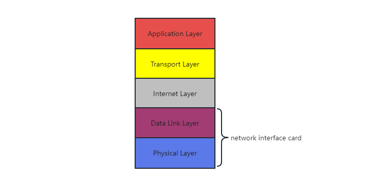
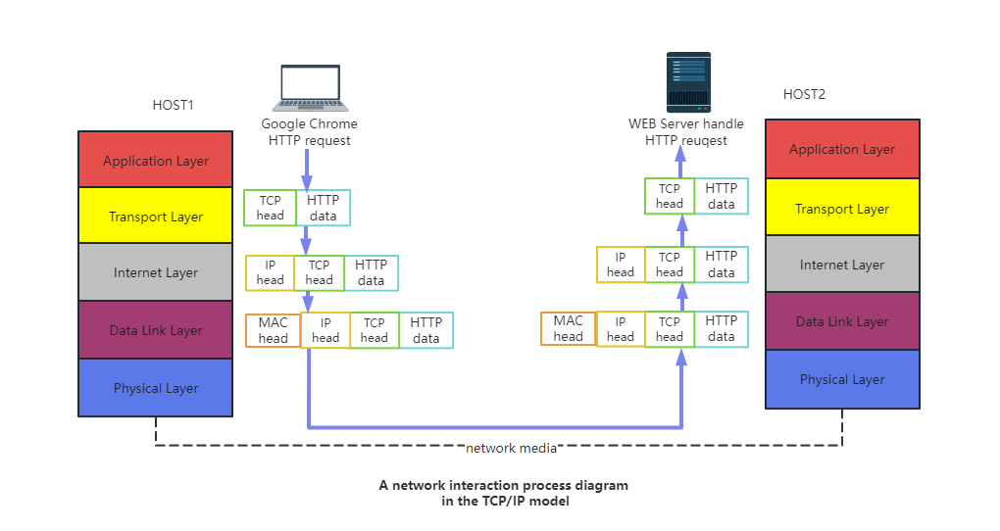

# Network Interface Card

NIC (Network Interface Card), also known as a network interface controller, network adapter, or local area network receiver, is a computer hardware device designed to enable computers to communicate on a computer network. An NIC is required for an independent device to enable network communication.

## Function

An NIC serves as the interface between a computer and the transmission medium in a local area network. It can not only establish the physical connection and match the electrical signals between the computer and the local area network transmission medium, but also send and receive frames, encapsulate and disassemble frames, control the access to medium, encode and decode data, and buffer data.

## Working Layer in TCP/IP Model

An NIC generally operates at the physical layer and data link layer of the TCP/IP model.
- The physical layer defines the electrical and optical signals, line status, clock reference, data encoding and circuits required for data sending and receiving, and provides standard interfaces to devices in the data link layer.
- The data link layer provides addressing mechanisms, frame construction, data error checking, transmission control, and standard data interfaces to devices in the network layer.

The following diagram illustrates the working layers of an NIC in the TCP/IP model:

## Data Flow in TCP/IP Model

During the process of data communication and forwarding, an NIC primarily handles data from the lwIP  (in network layer), forwards it through the network cable/electromagnetic waves to the local area network, or receives data from the local area network and forwards it to lwIP (in network layer). 
In network communication, an NIC serves as the bridge between the host and the medium, and the protocols in the application layer provide the foundation for information exchange.

The following diagram illustrates the transmission process of a network request between two hosts in the TCP/IP model:
