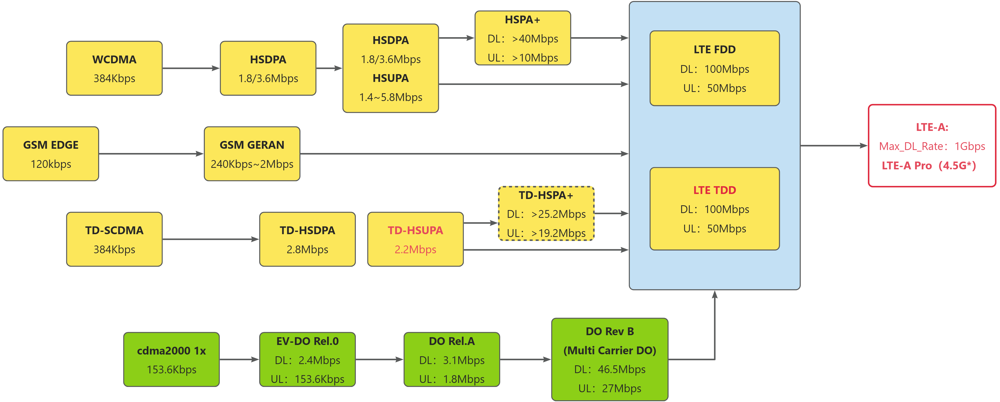
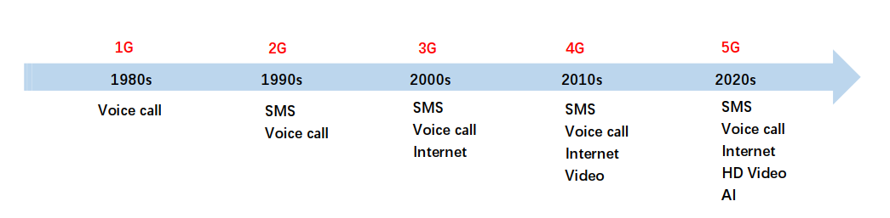
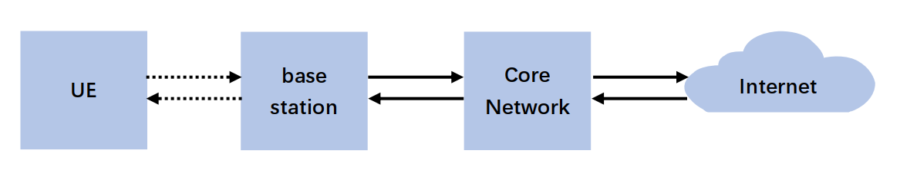
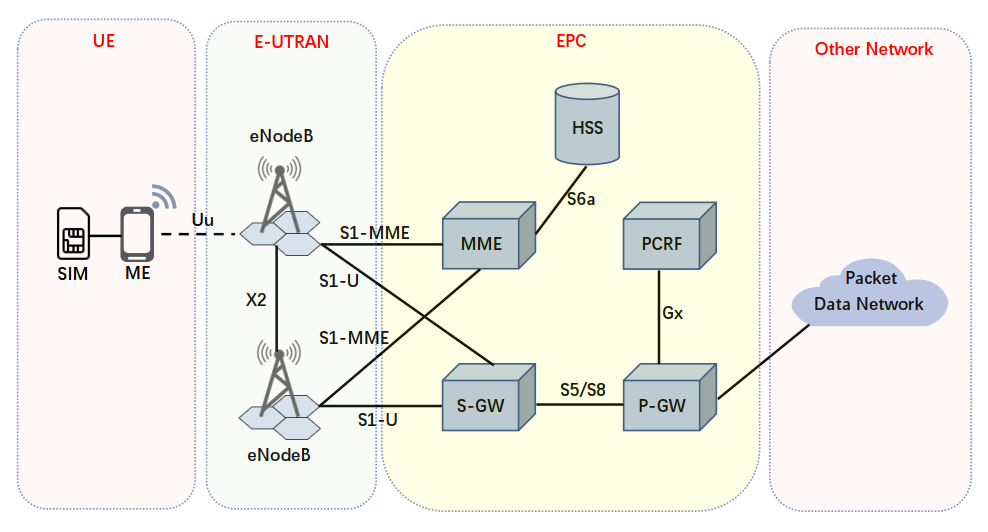

# Cellular Network

A cellular network, also known as a mobile network, is a wireless communication technology widely used in mobile communications. It is based on a cellular topology, dividing the service area into multiple cells, each covered by a wireless base station. The signal coverage of each communication base station forms a hexagonal shape and consists of a large number of interconnected cells, hence the name "cellular" network. Currently, the most widely used cellular network modes include GSM (2G), UMTS (3G), LTE (4G), and NR (5G).

## Development History

In the development of cellular wireless communication, GSM, UMTS, LTE, and other network technologies are not the only mobile communication technologies. They are just the mainstream ones, while there are other less common mobile communication technologies. You can refer to the following mobile communication technology evolution roadmap, which not only illustrates how mobile communication technology has evolved from 2G to 4G, but also shows the relationship and development roadmap of other mobile communication technologies and the current mainstream communication technologies.

【Note】 LTE-A Pro (4.5G*) :
In the 3GPP technical specification, 4.5G is named LTE-Advanced Pro and is the new construction benchmark for mobile broadband networks. It includes Release 13, which has already been released, and Release 14, which is coming next.

To make it easier for you to understand, the development roadmap of mobile communication technology is simplified as follows:

* 1G - Analog Era

  1G refers to the first generation of mobile communication technology, which was introduced in the early 1980s. It is a cellular wireless voice communication system based on analog technology. It mainly provides voice call functionality, with the iconic communication device being the "brick" phone.

* 2G - Digital Era

  2G refers to the second generation of mobile communication technology, which was introduced in the 1990s. It started using digital signal technology, greatly improving call quality and network capacity. Additionally, 2G introduced new services such as Short Message Service (SMS) and low-speed data transmission. GSM is the most widely used 2G standard.

* 3G - Broadband Era

  3G refers to the third generation of mobile communication technology, which was introduced in the early 21st century. 3G provides higher data transmission speeds, enabling basic data services such as web browsing and music streaming. UMTS was the earliest and most widely used 3G system.

* 4G - Smart Era

  4G refers to the fourth generation of mobile communication technology, which became widely used in the early 2010s, with LTE being the main technology. Compared to 3G, 4G provides faster data transmission speeds, enabling higher-quality audio and video streaming, as well as faster mobile Internet access.

* 5G - Internet of Things Era

  5G is the latest generation of mobile communication technology, gradually commercialized since 2019. With its higher data speeds, lower latency, and greater network capacity, 5G meets the requirements of the Internet of Things applications.

## Networking Mode

In a cellular network, the networking mode of mobile terminals involves data interaction through radio waves and base stations. The base stations send processed data to the operator's core network, and then the data is delivered to the external networks.

Taking the LTE network as an example, the networking mode of terminal devices is as follows:

