# Handle Network Exceptions

This document describes how to troubleshoot and handle network exceptions in QuecPython, and provides an example to demonstrate how to handle network exceptions during device operation.

## Common Network Exceptions

Three types of network exceptions may occur when the module starts up:

* SIM card exception

* Module network registration failure

* Cellular NIC (Network Interface Card) activation failure

The direct result of these three situations is that the module cannot connect to the network. Therefore, we refer to these situations as "network exceptions". Then how to troubleshoot and handle these three network exception situations is introduced below.

## Handle Network Exceptions

The following will explain in detail what may cause the above network exceptions and how to troubleshoot and solve these network exceptions.

### SIM Card Exception

There are three main types of SIM card exceptions:

#### Device does not detect SIM card

Check the status of the SIM card using the following method:

Step 1: Connect the module to the USB port of the computer with a USB cable.

Step 2: Open *QPYcom* on the computer, open the QuecPython REPL command port (NMEA Port in the figure), and enter REPL mode.

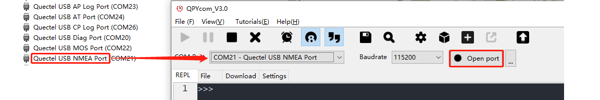

Step 3: In the command line, call the following API to check the network registration status.

```
import sim
sim.getStatus()
```

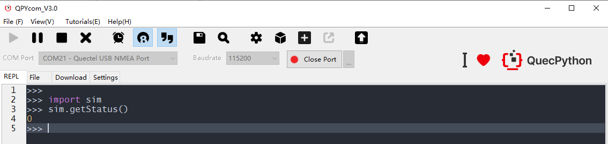

If the return value of `sim.getStatus()` is 0, it means that the module does not detect a SIM card. In this case, you need to determine if a SIM card is inserted. If you have inserted a SIM card and the status value is still 0 after rebooting the module, the possible reasons are as follows:

* The SIM card is not inserted properly, such as being inserted in the wrong way or not inserted tightly. You can re-insert the SIM card and reboot the device, then check the SIM card status again to see whether the return value is 1.

* The SIM card is damaged. You can insert another normal SIM card, reboot the module, and check the SIM card status again to see whether the return value is 1.

* The SIM card slot is damaged. If you confirm it is the damaged slot that makes the SIM card undetected, you can replace it with another card slot.

* There is a problem with the hardware circuit of the SIM card, such as poor contact, which prevents the device from recognizing the SIM card normally. You need a hardware engineer to check the circuit and confirm the problem.

You can troubleshoot the above situations one by one to identify the problem.

<br>

#### SIM Card Status Exception

SIM card status exception refers to the situation where the return value of `sim.getStatus()` is neither 0 nor 1. The most common values are 2 and 3.

* When the SIM card status value is 2

When the SIM card status value is 2, it means you have enabled PIN code verification for this SIM card. In this case, you need to enter the correct PIN code for verification, then disable the PIN code verification, and finally reboot the module. After booting, check the SIM card status again to see whether the return value is 1.

> How to know which PIN code should be used for the SIM card? Generally, the default PIN code is marked on the standard SIM card. If you cannot find the standard SIM card, you need to confirm with the SIM card operator. Do not enter the PIN code randomly. It is strongly recommended that do not use PIN code-related functions casually, because it may cause the SIM card to be permanently unusable due to misoperation.

If you are using a China Unicom SIM card whose default PIN code is "1234", when the PIN code verification is enabled and the queried status value is 2, you can follow the steps below to restore it:

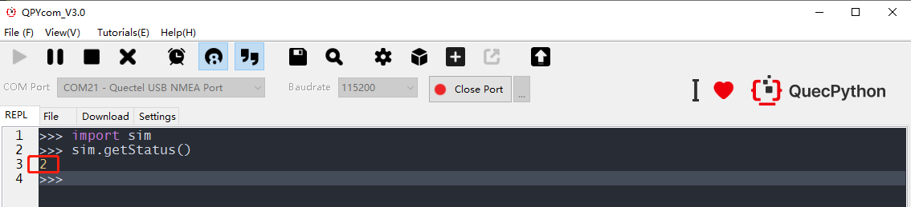

Step 1: Enter the PIN code for verification by calling the following function.

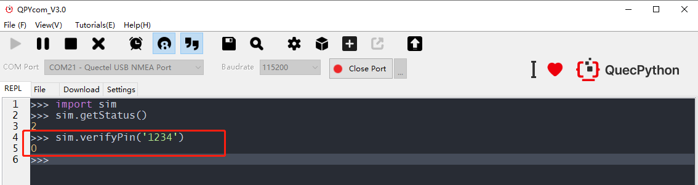

Step 2: Disable the PIN code verification.

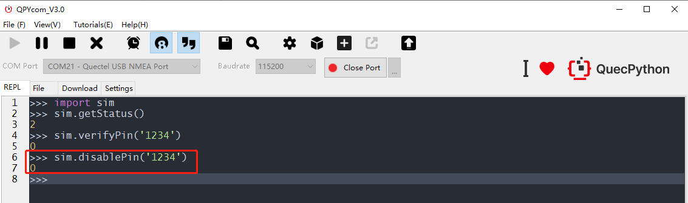

Step 3: Reboot the module and check the SIM card status again to see whether the return value is 1.

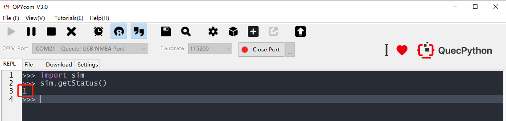


* When the SIM card status value is 3

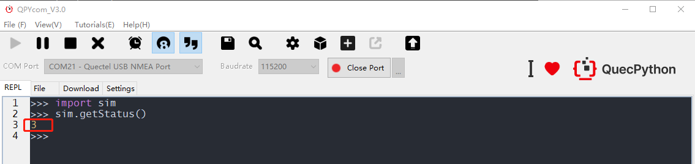

When the SIM card status value is 3, it means that this card has been locked. In this case, you need to use the PUK code to unlock it. The PUK code can usually be found on the standard SIM card, as shown in the following figure:

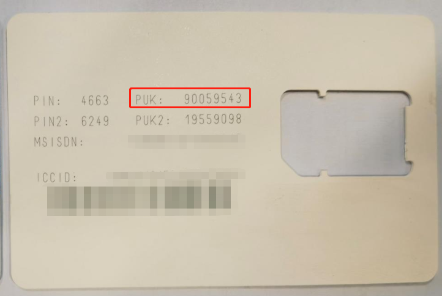

Please note that each SIM card has its PUK code. When unlocking the SIM card, you must make sure to enter the correct PUK code. If the PUK code is entered incorrectly multiple times (usually 10 times. You can contact the SIM card operator to query the specific number), the SIM card will be permanently locked and cannot be used again.

Once you have confirmed the PUK code, you can follow the steps below to unlock it:

Step 1: Enter the correct PUK code to unlock it and set a new PIN code.

Call the following function to unlock the SIM card. This function has two parameters: **puk** represents the PUK code, and **newPin** represents the new PIN code to be set. Generally, the reason why the SIM card is locked is that you enabled PIN code verification, but entered incorrect PIN codes three times. Therefore, when you use the PUK code to unlock the SIM card, you need to set a new PIN code.

```python
sim.unblockPin(puk, newPin)
```

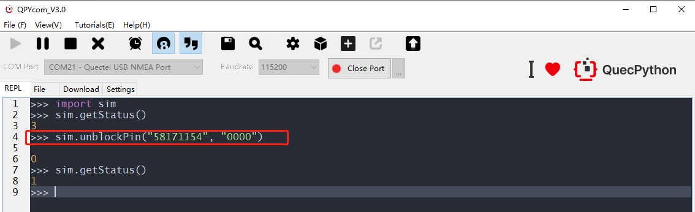

From the above image, you can see that the SIM card has been successfully unlocked and the SIM card status has changed to 1. However, at this time, you have unlocked the SIM card but do not disable the PIN code verification. When you reboot the module, the SIM card status value will still be 2, indicating that you need to enter the PIN code for verification. Therefore, you can first disable the PIN code verification feature and then reboot the module. Of course, you can also unlock the SIM card, reboot the module, enter the PIN code for verification, and then disable the PIN code verification feature after successful verification.

Step 2: Disable the PIN code verification feature.

Please note that you must enter the latest PIN code when performing PIN code verification and disabling PIN code verification because you have set a new PIN code when unlocking the SIM card.

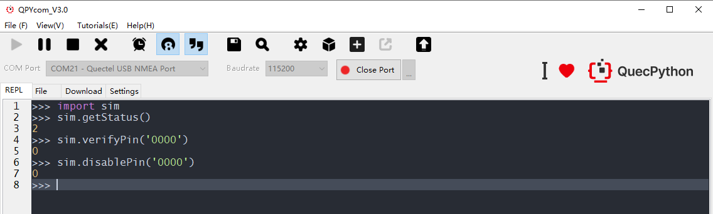

Step 3: Reboot the module and check whether the SIM card status is 1.


#### SIM Card in Arrears

That your SIM card is in arrears is somewhat special because the situation may vary for different operators, and it cannot be determined by a uniform standard. Generally, if the following two situations occur, you should check whether the SIM card is in arrears first.

Situation 1: The SIM card status value is 1, the module has successfully registered on the network, and the cellular NIC has also been activated successfully, but network services, such as sending or receiving data, cannot be performed.

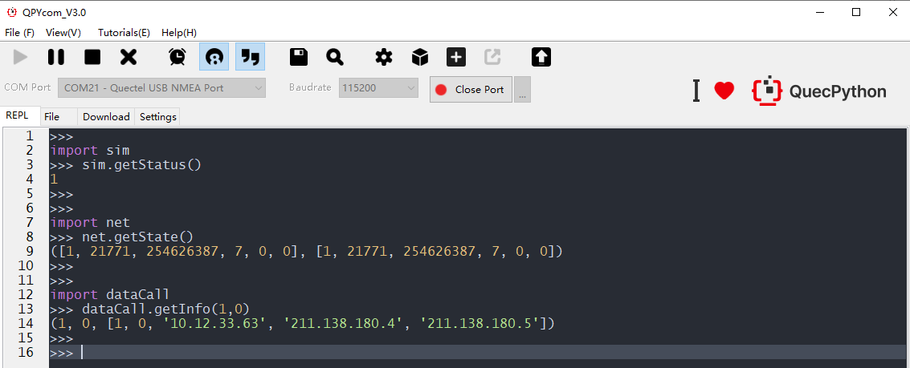

Situation 2: The SIM card status value is 1, but the network registration fails.

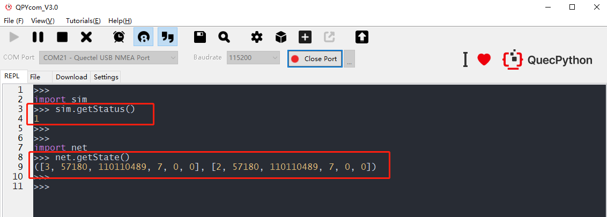

> Please note that the SIM card in arrears is just the possible not the necessary reason for situation 2.


### Module Network Registration Failure

Network registration failure refers to the scenario where the module has successfully detected the SIM card, that is, the return value of `sim.getStatus()` is 1, but the network registration status returned by `net.getState()` is neither 1 nor 5.


There are many reasons for this, common reasons include the following:

#### Poor RF performance

When the module has poor RF performance, messages may not be delivered to the base station or may not be received from the base station. As a result, the module fails to register on the network. In general, you can first check the CSQ signal strength of the module to make an initial judgment. If the CSQ value is less than 6, the module will have difficulty in network communication. You can call the following function to query the CSQ value.

```python
net.csqQueryPoll()
```

The operation is as follows:

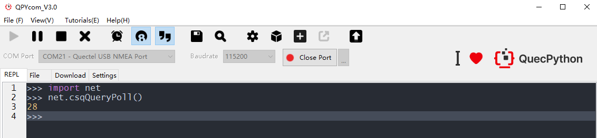

Many factors can affect the RF performance of the module, such as antenna absence, poor antenna performance, closed environment, lack of RF parameter calibration, hardware design flaws, or damaged RF components. Among these factors, you can directly check the following two:

* Antenna absence/poor antenna performance

  If you haven't connected an antenna, please connect a suitable one and check whether the module can successfully register on the network. If you have already connected an antenna, you can try another antenna and then query the CSQ again to see if there is any improvement.

* Closed environment

  A closed environment can also affect the RF performance of the module, causing the device to fail to communicate on the network. You can re-test the device in an open outdoor area.

For other situations, please contact Quectel FAEs for assistance.


#### No APN Configuration

In some countries and regions, a UE (User Equipment) must carry APN information when registering on the network, otherwise, it will be rejected by the core network and fail to register. When you find that the module cannot register on the network, please first check whether the correct APN is configured. If the APN is not configured or configured incorrectly, follow these steps to configure it:

Step 1: Confirm with the network operator which APN should be used for this SIM card.

Step 2: Check the APN configuration of the module to see whether APN configuration is required. If the current APN is not what you need, you need to configure it and reboot the module.

QuecPython module automatically activates the first cellular NIC at startup. Take the first cellular NIC as an example to show you how to configure the APN for the first NIC. If you are using a China Unicom SIM card and the APN is `3gnet`, the sample code is as follows:

```python
>>> import dataCall
>>> dataCall.getPDPContext(1)
(0, '', '', '', 0) # The parameter indicating APN in the return value is empty, which means the APN is not configured.
>>> dataCall.setPDPContext(1,0,'3gnet','','',0)
0
```

The above example is executed in the REPL mode of *QPYcom*. If you want to query and configure APN by python script file,   you can write it as follows:

```python
import checkNet
import usocket
import dataCall
from misc import Power

# Configure the APN information according to your actual needs
usrCfg = {'apn': '3gnet', 'username': '', 'password': ''}

def checkAPN():
    # Get the APN information of the first cellular NIC and check if the current one is the one you specified
    pdpCtx = dataCall.getPDPContext(1)
    if pdpCtx != -1:
        if pdpCtx[1] != usrCfg['apn']:
            # If it is not the APN you need, configure it as follows
            ret = dataCall.setPDPContext(1, 0, usrCfg['apn'], usrCfg['username'], usrCfg['password'], 0)
            if ret == 0:
                print('APN configuration successful. Ready to restart to make APN take effect.')
                print('Please re-execute this program after restarting.')
                # Make a data call according to the configured information after the module reboots
                Power.powerRestart()
            else:
                print('APN configuration failed.')
                return False
        else:
            print('The APN is correct and no configuration is required')
            return True
    else:
        print('Failed to get PDP Context.')
        return False


def main():
    checkpass = checkAPN()
    if not checkpass:
        return

    stage, state = checkNet.waitNetworkReady(20)
    if stage == 3 and state == 1:
        print('Network connected successfully.')
        # do something
    else:
        print('Network connected failed, stage={}, state={}'.format(stage, state))


if __name__ == '__main__':
    main()
```

The above sample code download link:[Download](https://github.com/QuecPython/examples/blob/main/network-comm/nic/cellular/example_network_exception_handle_set_apn.py)


#### No Network Coverage from SIM Card Operator

Each network operator may have different base station deployments in different locations, and the signal coverage of different base stations may also be different, which makes modules fail to register on the network in certain locations because there is no network coverage or the coverage is very weak. If the module cannot find a suitable cell when searching for available networks after rebooting, it fails to register on the network.

> "Coverage is very weak" means that the module is on the edge of a cell. In this case, the module may not be able to find the cell or occasionally find it when searching.

A common scenario is when the same module, with the same SIM card inserted, can successfully register on the network in location A, but fails to register or takes a long time to register on the network in location B.

It is highly possible because the module is in a location without coverage from the network operator or the coverage is very weak. In this case, you can test the module in a different location or with another SIM card from a different network operator to further confirm the reason.


#### SIM Card Only Supports Specific Network Modes

Some SIM cards only support specific network modes. For example, some SIM cards only support GSM networks, but the module is located in an area without GSM network coverage, which will prevent the module from registering to the network. In this case, you can take the following steps:

* Confirm with the SIM card operator whether the SIM card only supports specific network modes.

* Contact Quectel FAEs for assistance in capturing logs of the module's network registration process and provide the logs to Quectel FAEs or software engineers for further confirmation.


#### SIM Card Only Supports Specific Frequency Bands

Some SIM cards can only register to networks on specific frequency bands. In this case, you need to confirm the frequency bands in the following two ways:

* Confirm with the SIM card operator whether the SIM card only supports specific frequency bands, and if so, which frequency bands the method supports.

* Refer to the module specifications or contact Quectel FAEs to confirm which frequency bands the module supports. If the frequency band supported by the SIM card is not supported by the module, the module cannot register to the network. In addition, if the area where the module is located is not covered by the SIM-supported frequency bands, the module cannot register to the network, either.

The above are just some common reasons that may prevent the module from registering to the network. If you have used the solutions above but the cause of the network registration failure still cannot be determined, please contact Quectel FAEs for assistance in capturing the logs of the module's network registration process and provide the logs to Quectel FAEs or software engineers for further confirmation.


### Cellular NIC Activation Failure

Cellular NIC activation failure refers to the situation where the module has successfully registered to the network, but the NIC fails to be activated, that is, the module has successfully registered to the network, but did not get IP information. The return value is shown below.

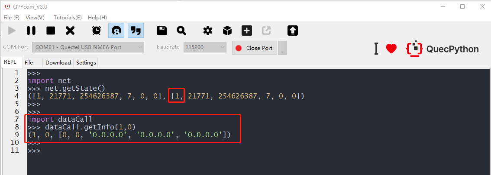

There may be three possible reasons for this situation:


#### No APN Configuration

If the NIC activation fails, you should first confirm whether the APN is configured, and if so, whether the configured APN is correct. You can call the following function to query the APN configuration.

```python
>>> import dataCall
>>> dataCall.getPDPContext(1) # Get the APN information of the first cellular NIC
(0, '', '', '', 0) # The parameter indicating APN in the return value is empty, which means the APN is not configured.
```

If the parameter indicating APN in the return value is empty or the returned APN is incorrect, you need to call the following function to configure the APN and reboot the module. Assuming the APN that needs to be set is "3gnet", call the following function.

```python
>>> dataCall.setPDPContext(1,0,'3gnet','','',0)
0
```

For more detailed examples of APN configuration, please refer to the *No APN Configuration* subsection in the *Network Registration Failure* section.


#### NIC Automatic Activation at Startup is Disabled

If the APN is configured correctly, you can check whether you have previously disabled the automatic activation of the NIC by calling `dataCall.setAutoActivate()` , or configured it to automatically activate the second or third NIC at startup. You can take the following steps to troubleshoot the problem.

Step 1: Check whether there is a *`datacall_config.json`* file in the *`usr`* directory in QPYcom.

If there is a *`datacall_config.json`* file in the *`usr`* directory as shown in the following figure, it means that you have configured automatic activation or automatic reconnection of the NIC. If the file does not exist, there is no need to proceed with the following steps.

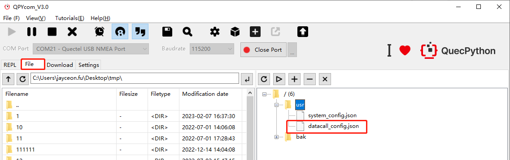

Step 2: Open the *`datacall_config.json`* file to further confirm the configuration of each NIC.

Execute the following code in the command line:

```python
>>> import ujson
>>> fd = open('/usr/datacall_config.json', 'r')
>>> cfg = ujson.load(fd)
>>> print(cfg)
{'1': {'autoConnect': 0, 'autoActivate': 0}, '3': {'autoConnect': 0, 'autoActivate': 0}, '2': {'autoConnect': 0, 'autoActivate': 0}}
```

Reorganize the format of `cfg`.

```
{
	'1': {'autoConnect': 0, 'autoActivate': 0}, 
	'2': {'autoConnect': 0, 'autoActivate': 0}, 
	'3': {'autoConnect': 0, 'autoActivate': 0}
}
```

At this point, the configuration of each NIC is explicit. If the result you got matches the above configuration, it means you have disabled the automatic activation of the NIC at startup. If the result you got is different from the above configuration, you need to confirm the value of `autoActivate` for the three NICs, because this value determines whether the NIC is automatically activated at startup. If the value is 0, it means the NIC is not activated at startup; if it is 1, it means the NIC will be activated at startup.

Step 3: Restore the automatic activation of the NIC at startup.

There are two solutions to restore the automatic activation of the NIC at startup:

* Solution 1: Delete the *`datacall_config.json`* file in the *`usr`* directory and reboot the module.

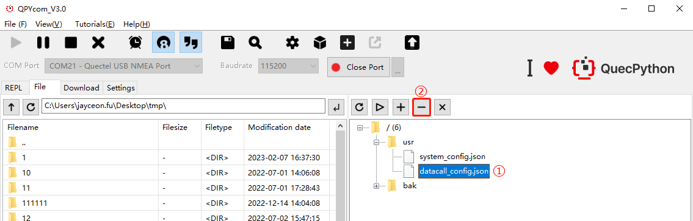

* Solution 2: Call `dataCall.setAutoActivate()` method to enable the automatic activation of a specific NIC at startup, and then reboot the module.

Here is an example of enabling the automatic activation and automatic reconnection of the first NIC.

```python
>>> import dataCall
>>> dataCall.setAutoActivate(1, 1) # Enable the automatic activation of the first NIC
>>> dataCall.setAutoConnect(1, 1) # Enable the automatic reconnection of the first NIC
```

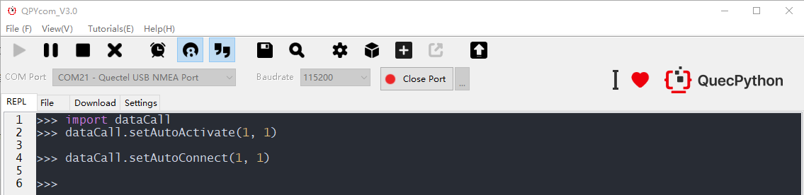


#### Insufficient Waiting Time

Another scenario for NIC activation failure is when the module has successfully registered to the network and is in the process of activating the NIC, but you call `dataCall.getInfo()` to query the activation result, the IP information will not return, either. This situation does not indicate a failure in NIC activation, but requires you to wait longer.

You can use `checkNet` feature of QuecPython to wait for the network to be ready and set a longer timeout period to avoid this situation. See the sample code below.

```python
import checkNet


def main():
    stage, state = checkNet.waitNetworkReady(30)
    if stage == 3 and state == 1:
        print('Network connected successfully.')
        # do something
    else:
        print('Network connected failed, stage={}, state={}'.format(stage, state))


if __name__ == '__main__':
    main()
```


## Handle Network Exceptions During Operation

After the cellular NIC is activated successfully, your application also needs to pay attention to one issue - the connection status between the device and the network. This is because, during the operation of the module, the connection between the module and the network may be closed due to some abnormal reasons (such as network anomalies, environmental interference, and poor signal). If your application does not pay attention to these network events, abnormal execution of network-related business in your application may occur, resulting in unforeseen problems.

QuecPython provides the network event listening feature. Your application can listen to network status change events by registering callback functions. When the connection status between the module and the wireless network changes, the system will automatically push the corresponding event to your application through the registered callback function.

Call the following function to register the network status callback function.

```python
dataCall.setCallback(fun)
```

Example of the callback function:

```python
def netCallback(args):
    profileID = args[0]
    netState = args[1]
    if netState == 0:
        print('### network {} disconnected.'.format(profileID))
    elif netState == 1:
        print('### network {} connected.'.format(profileID))
```

Parameters of the callback function form a tuple consisting of 3 elements. Currently, you only need to pay attention to the first two elements. The explanations of the first two parameters are as follows:

| Parameter | Type    | Explanation                                                  |
| --------- | ------- | ------------------------------------------------------------ |
| args[0]   | Integer | Cellular NIC number, indicating which NIC's network connection status has changed. |
| args[1]   | Integer | Network status. 0: Network is disconnected. 1: The network is connected. |

You are recommended to register this callback function to listen to network connection status, thus ensuring that your application can handle network status changes timely. You can refer to the following methods.

* After receiving the network connection status change event in the callback function, your application will send the network event to other threads for processing through the message queue. You can also use QuecPython's `sys_bus` feature instead of the message queue.

* When other threads receive the network event, if the event is a network disconnection, socket, MQTT, and other network-related businesses will be stopped. At the same time, the thread can choose to start a timer, such as setting the timer time to 60s. If the network is still not restored after 60 s, execute CFUN0/1 switching, and then check if the network connection can be restored.

  

> **What is CFUN0/1 switching?**
>
> According to the explanation of CFUN in the *Basic Concepts of Cellular Network* chapter, CFUN refers to the functional mode of the mobile terminal. CFUN0/1 switching means calling `net.setModemFun(0)` to switch the module functional mode to mode 0 (minimum functionality mode), and then calling `net.setModemFun(1)` to switch the module functional mode to mode 1 (full functionality mode). When the mode is 0, the entire RF network protocol stack of the module is disabled, and the SIM card gets no power supply; when the mode is switched to 1, the power supply to the SIM card is restored and the SIM card will be re-initialized, and the software and hardware functions related to RF will be re-enabled. At this time, the module will register on the network again.
>
> **Why do you need to perform CFUN0/1 switching?**
>
> QuecPython has an automatic reconnection feature. You may wonder that why the network cannot be automatically restored if a network exception occurs and the module is disconnected from the network and why you need to perform CFUN0/1 switching in the processing method mentioned above.
>
> You should know that QuecPython's automatic reconnection refers to automatically reactivating the NIC after the network connection is restored, rather than re-registering on the network. The network registration of the module is automatically controlled by the RF network protocol stack of the system. In theory, the RF network protocol stack will automatically initiate network registration after the network exceptions are handled. However, it is not ruled out that the device fails to re-register the network in time due to some reasons. At this time, because the module fails to register on the network, the NIC cannot be reactivated. Therefore, you need to perform CFUN0/1 switching. It's like when you use your mobile phone, sometimes when you encounter a poor network or no signal, you may turn off the mobile network first and then turn it on again. You can also reboot the module.

The following section introduces an example of handling network exception events.


## Example of Handling Network Exception Events

The following code provides an example of handling network exceptions that occur during the operation of the module. It is just for your reference, and you can also handle network exceptions according to your plan.

```python
import net
import dataCall
import _thread
import osTimer
import utime
import sys_bus


CFUN_SWITCH_TOPIC = 'cfun_switch_timer'
NETWORK_EVENT_TOPIC = 'network_event'

network_monitor = None

class NetworkConnectState:
    DISCONNECT = 0
    CONNECT = 1


class NetworkExceptionService:
    def __init__(self):
        self.timer_period = 1000 * 60 * 2  # 2 * 60s
        self.__cfun_timer = osTimer()

        sys_bus.subscribe(CFUN_SWITCH_TOPIC, self.__cfun_switch_timer_handle)
        sys_bus.subscribe(NETWORK_EVENT_TOPIC, self.__network_event_handle)

    def enable(self):
        dataCall.setCallback(self.__network_event_callback)

    def __cfun_switch_timer_callback(self, args):
        print('cfun switch timer.')
        sys_bus.publish(CFUN_SWITCH_TOPIC, 0)

    def __cfun_switch_timer_handle(self, topic, msg):
        print('recv event form cfun_switch_timer.')
        net.setModemFun(0)
        utime.sleep(5)
        net.setModemFun(1)

    def __network_event_callback(self, args):
        print('The state of the network connection has changed.')
        sys_bus.publish(NETWORK_EVENT_TOPIC, args)

    def __network_event_handle(self, topic, msg):
        print('recv event form network_event_callback.')
        profile_id = msg[0]
        conn_state = msg[1]
        if conn_state == NetworkConnectState.DISCONNECT:
            print('The network connection has been disconnected.')
            print('start cfun_switch_timer.')
            self.__cfun_timer.start(self.timer_period, 1, self.__cfun_switch_timer_callback)
        elif conn_state == NetworkConnectState.CONNECT:
            print('The network connection has been connected.')
            self.__cfun_timer.stop()
        else:
            print('unknown state value:{}.'.format(conn_state))


def main():
    global network_monitor
    network_monitor = NetworkExceptionService()
    network_monitor.enable()


if __name__ == '__main__':
    main()
```

The above sample code download link:[Download](https://github.com/QuecPython/examples/blob/main/network-comm/nic/cellular/example_network_exception_handle.py)