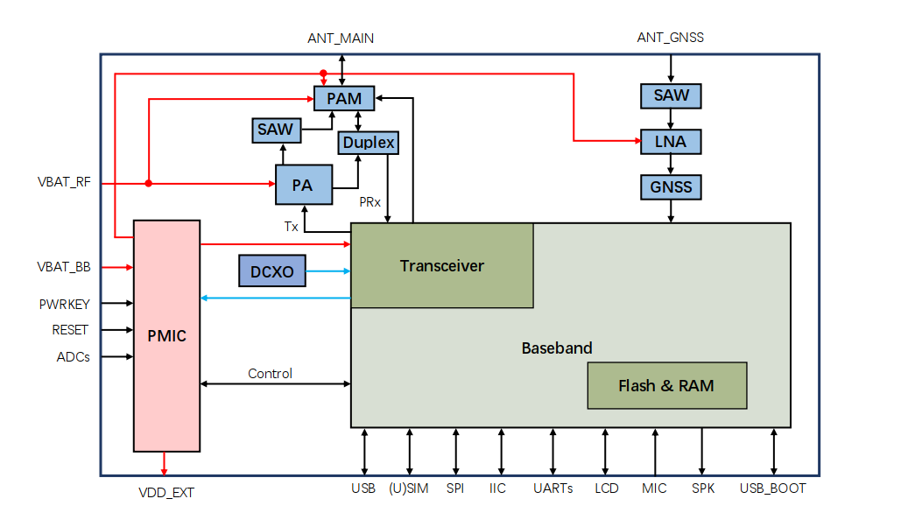
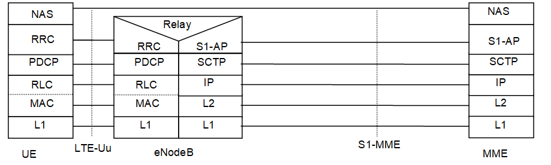
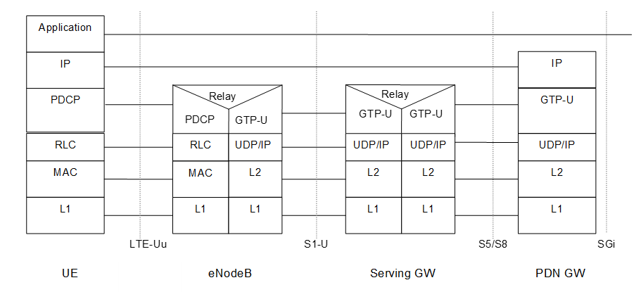
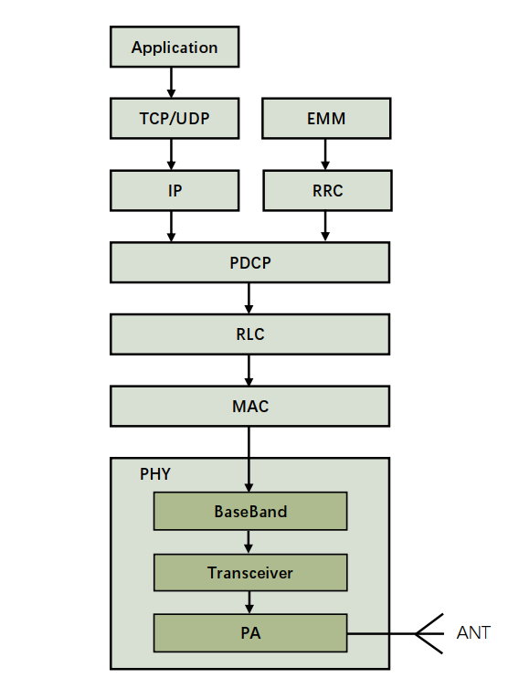
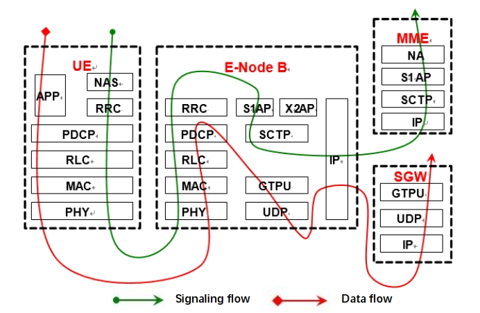

# Hardware Structure and Data Flow of Cellular NIC 

This document introduces the hardware structure and data flow of the module when the module works as a cellular NIC.

## Hardware Structure

As a cellular NIC, the hardware structure of the module mainly includes the following parts:

* PMIC
* Baseband
* RF transceiver
* Flash and RAM
* Peripheral interface

The hardware functional diagram is as follows:

> 1. The peripheral interfaces in the above diagram are for demo only. Different modules may support different hardware peripherals. Please refer to the corresponding module's hardware design manual for specific information.
>
> 2. GNSS functionality is optional and not all modules support it. Please refer to the corresponding module's hardware design manual for specific information.

The following explains several parts directly related to the cellular NIC:

* Baseband

  In a cellular NIC, the baseband is mainly responsible for encoding and decoding the data provided by the upper-layer network. It converts digital data into signals that can be transmitted on the physical medium (such as electromagnetic waves), or converts signals received from the physical medium into digital data. In addition, baseband processing also includes other features such as modulation and demodulation of RF signals.

* RF Transceiver

  The RF transceiver is mainly responsible for converting the electrical signals generated through the baseband processing into high-frequency electromagnetic waves (RF signals) and transmitting them through the antenna. At the same time, the RF transceiver also receives RF signals received by the antenna, converts them into electrical signals, and then hands them over to the baseband for processing. The main task of the RF transceiver is the transmission and reception of RF signals.

* PA

  PA (Power Amplifier) is mainly used to increase the power of the transmitted signal to ensure that the RF signal can cover a sufficient distance and improve signal quality.

## Cellular NIC Data Flow

Before the data flow introduction of the cellular NIC, you need to know the layered structure of mobile wireless networks, which can help you further understand the data flow direction of cellular NICs.

Taking LTE as an example, the LTE core network interface protocol is divided into the control plane (C-Plane) and the user plane (U-Plane).

* C-Plane: The C-Plane is mainly responsible for signal transmission, including the delivery of control information and network management. The C-Plane communication involves information such as call settings, route selection, network connection management and authentication, location update, and mobility management. Through the C-Plane, the network can effectively control and manage user devices.

* U-Plane: The U-Plane is mainly responsible for user data transmission. For example, all voice, video, text, or other forms of data are transmitted through the U-Plane. The main task of the U-Plane is to transmit user data effectively and ensure the integrity and reliability of the data.

In actual network communication, C-Plane and U-Plane communication usually occur simultaneously. For example, when you make a call on your mobile phone, the C-Plane manages call settings and route selection, while the U-Plane transmits the voice data.

### C-Plane Protocol Stack

The following diagram shows the layered structure of the C-Plane protocol stack in the LTE network architecture.

Because C-Plane is intangible for you and is not directly controlled by you, it will not be further described here. If you want to know more details, please refer to the "Control Plane" section of the [3GPP TS 23401](https://www.3gpp.org/ftp/Specs/archive/23_series/23.401) protocol document.

### U-Plane Protocol Stack

The following diagram shows the layered structure of the U-Plane protocol stack in the LTE network architecture. This diagram explains in detail how your applications communicate with cellular wireless networks. The "UE" in the diagram represents the terminal device (such as a mobile phone), and the rightmost part, after passing through the PDN GW, represents the application server on the Internet.

The application layer only exists in terminal devices and application servers and is based on IP transmission. Your data first goes through layers of processing in the cellular NIC, then is sent to the base station through the wireless interface after passing through the PDN GW for routing, and finally reaches the destination.

From the layered structure diagrams of C-Plane and U-Plane, you can see that they both include the following layers:

* PDCP (Packet Data Convergence Protocol) layer: It implements header compression, encryption, and integrity protection.

* RLC (Radio Link Control) layer: It provides reliable data transmission, and implements data segmentation, and the automatic repeat request mechanism.

* MAC (Medium Access Control) layer: It is responsible for data scheduling and fast retransmission.

* L1 (Layer 1): In a wireless communication system, the L1 usually refers to the physical layer (PHY). The main feature of the physical layer is channel coding and modulation, and data sending to the wireless interface.

### Data Flow

The above introduces the layered structure of cellular wireless networks. So how does your data reach the core network and the Internet step by step? This process can be illustrated by the following two diagrams.

#### Data Flow Based on Hardware Structure

The following diagram shows the data flow based on the hardware structure of the cellular NIC. You can see that your data passes through the TCP/UDP layer, IP layer, PDCP layer, RLC layer and MAC layer in software, and finally reaches the physical layer (i.e., the cellular NIC). When the data reaches the baseband, it is encoded and modulated, and then processed by the RF transceiver to convert it into electromagnetic waves, which are analog signals. Finally, after being processed by the power amplifier, the RF signals are sent out through the RF antenna and reach the base station. Together with the data flow diagram based on the layered structure of cellular wireless networks, you can clearly understand the process of how data reaches the destination from the UE.

#### Data Flow Based on Layered Structure

The following diagram shows the data and signaling flow based on the layered structure of cellular wireless networks.

