# 6.7 Network Configuration

> This section introduces how to configure and connect to the network in the QuecPython solution. QuecPython supports multiple types of NICs, each with different usage methods. This chapter will introduce them one by one to facilitate the understanding of network configuration applications.

---

**Contents**

[Network Configuration Introduction](#click_jump_6.7.1)  
&emsp;&emsp;[Cellular NIC](#click_jump_6.7.1.1)  
&emsp;&emsp;[Wi-Fi NIC](#click_jump_6.7.1.2)  
&emsp;&emsp;[Ethernet NIC](#click_jump_6.7.1.3)  
&emsp;&emsp;[USB Network Adapter](#click_jump_6.7.1.4)  
[Simple Scenarios](#click_jump_6.7.2)  
&emsp;&emsp;[Transfer Data Using Default Cellular NIC](#click_jump_6.7.2.1)   
&emsp;&emsp;[Transfer Data Using a Specified Cellular NIC](#click_jump_6.7.2.2)  
&emsp;&emsp;[Transfer Data Using Ethernet NIC](#click_jump_6.7.2.3)  
&emsp;&emsp;[Transfer Data Using Wi-Fi NIC](#click_jump_6.7.2.4)  
[Router Configuration](#click_jump_6.7.3)   
[Network Configuration with Multiple NICs](#click_jump_6.7.4)  
&emsp;&emsp;[Wi-Fi (AP) -> LTE (Single Data Call)](#click_jump_6.7.4.1)  
&emsp;&emsp;[Ethernet (LAN) -> LTE (Single Data Call)](#click_jump_6.7.4.2)  
&emsp;&emsp;[Wi-Fi (AP) -> LTE (Multiple Data Calls)](#click_jump_6.7.4.3)  
&emsp;&emsp;[Ethernet (LAN) -> LTE (Multiple Data Calls)](#click_jump_6.7.4.4)  
[Complex Scenario](#click_jump_6.7.5)  
[Frequently Asked Questions](#click_jump_6.7.6)  
&emsp;&emsp;[How to Bind Socket with NIC?](#click_jump_6.7.6.1)  
&emsp;&emsp;[How to Test Network Connectivity?](#click_jump_6.7.6.2)  

---

<a id="click_jump_6.7.1"></a>

## Network Configuration Introduction  

QuecPython supports various types of NICs. How can we configure the NICs to enable them to communicate over the network? This introduces NIC configuration to help you quickly use NIC devices to connect to the network.

QuecPython provides two ways to configure NICs:  
1. QuecPython APIs.
2. Built-in web service.
> Only cellular network modules cannot use the web service.  

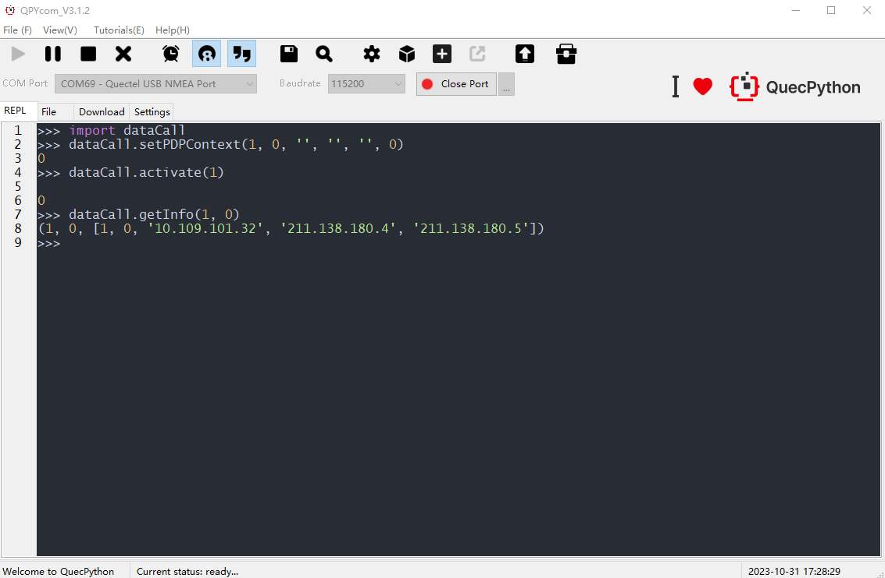

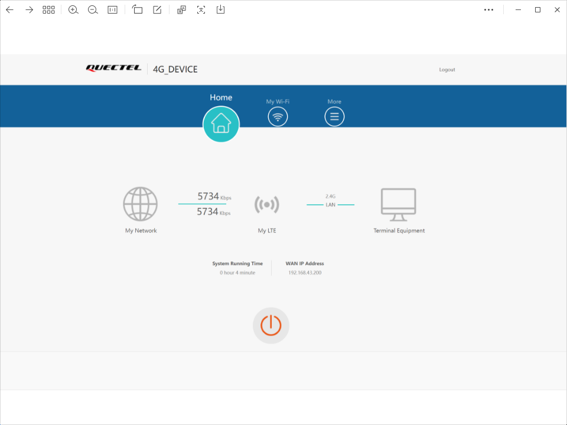

<a id="click_jump_6.7.1.1"></a>

### Cellular NIC

Cellular NICs rely on the network operator. A module must be integrated with a SIM card and be in the coverage of the network operator's base station to establish a network connection. QuecPython-supported cellular communication modules will automatically connect to the cellular network after power-on.

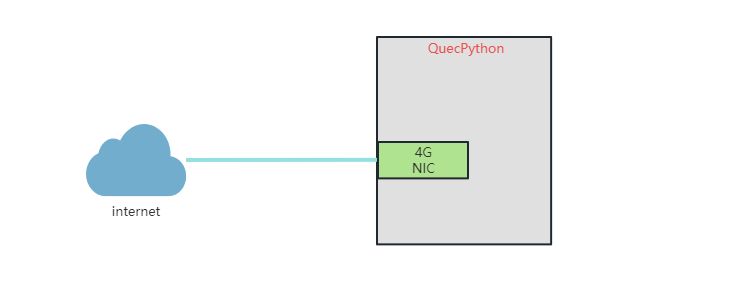

**Example**

```python
>>> import dataCall
>>> dataCall.setPDPContext(1, 0, '', '', '', 0) # Set NIC information
0
>>> dataCall.activate(1) # Activate the first channel of NIC
0
>>> dataCall.getInfo(1, 0) # Query the data call information for the first channel of NIC
(1, 0, [1, 0, '10.11.129.252', '211.138.180.4', '211.138.180.5'])

# The module can connect to the network through the 4G network.
```

<a id="click_jump_6.7.1.2"></a>

### Wi-Fi NIC

Wi-Fi NICs have different application scenarios in different working modes. In station mode, the NIC needs to connect to a Wi-Fi hotspot (such as a router) to connect to the network. In AP mode, the Wi-Fi NIC serves as a hotspot, accepting connections from other Wi-Fi devices and providing network services to them.

There are multiple ways to configure Wi-Fi NICs, such as directly entering the hotspot name and password, quick configuration, AP configuration and web page configuration. However, the ultimate goal is to successfully obtain the hotspot name and password. This chapter focuses on loading the Wi-Fi NIC and connecting to the hotspot directly. For other configuration methods, please refer to [Wi-Fi NIC](../nic/wifi/README.md).

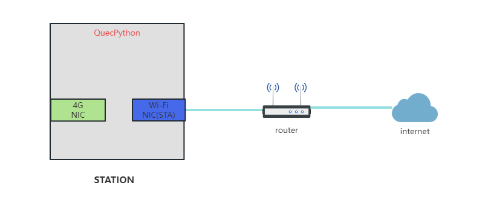

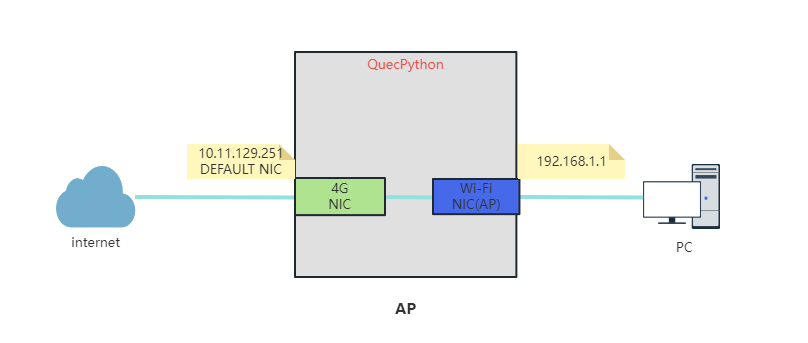

**Example**

General Wi-Fi NIC configuration

```python
>>> import network
>>> nic = network.WLAN(network.STA_IF) # Load the Wi-Fi NIC driver. For external devices, you need to confirm whether additional parameter configuration is required.
0
>>> nic.connect('ssid','password') # Connect to the Wi-Fi hotspot.
0
>>> nic.status() # Check the connection status. "5" indicates "connected".
5
>>> nic.ifconfig() # Query IP address.
('192.168.1.4', '255.255.255.0', '192.168.1.1', '192.168.1.1')

# The module can connect to the network through the Wi-Fi network.
```

External Wi-Fi NIC Configuration, taking ESP8266 as an example.

```python
>>> from usr.WLAN import ESP8266
>>> from machine import UART
>>> esp8266 = ESP8266(UART.UART2, ESP8266.STA) # Initialize ESP8266.
0
>>> esp8266.station('ssid', 'password') # Connect to the Wi-Fi hotspot.
0
>>> esp8266.set_dns('8.8.8.8', '114.114.114.114') # Configure DNS servers.
0
>>> esp8266.status() # Check connection status. "1" indicates "connected".
1
>>> nic.ipconfig() # Query IP address.
('172.16.1.2', '255.255.255.0', '172.16.1.1', 1500, '8.8.8.8', '114.114.114.114')
>>> esp8266.set_default_NIC('172.16.1.2') # Set the Wi-Fi NIC as the default NIC.
0

# The module can connect to the network through the Wi-Fi network.
```

<a id="click_jump_6.7.1.3"></a>

### **Ethernet NIC**

In different application scenarios, Ethernet NICs have different operating modes: WAN mode and LAN mode.

**WAN Mode**

In WAN mode, an Ethernet NIC serves as the WAN port to provide Internet access capability to the module, as shown in the following diagram.

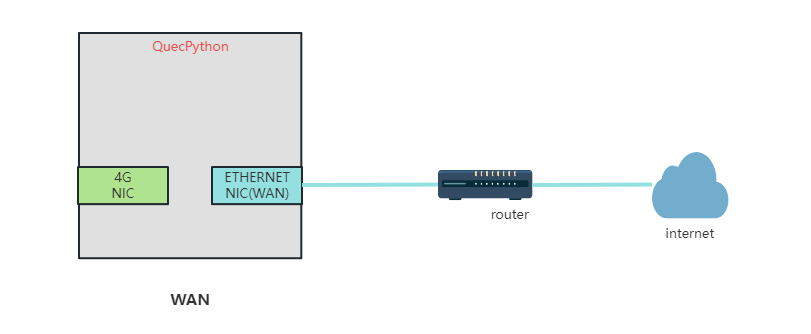

In this mode, you can get a dynamic IP address through DHCP or set a static IP address. 

Example of getting an IP address through DHCP:

```python
>>> import ethernet
>>> W5500 = ethernet.W5500(b'\x12\x34\x56\x78\x9a\xbc') # Load the Ethernet NIC driver. In actual use, you need to confirm whether to use the default configuration for hardware connection. If you want to customize the hardware connection configuration, complete the parameters of the Ethernet NIC initialization API.
0
>>> W5500.dhcp() # Get dynamic IP address. Ensure there is a DHCP server in the network environment, such as a connected router.
0
>>> W5500.ipconfig() # Query IP address.
[('12-34-56-78-9A-BC', 'W5500'), (4, '192.168.31.203', '255.255.255.0', '192.168.31.1', '192.168.31.1', '0.0.0.0')]
>>> W5500.set_default_NIC('192.168.31.203') # Set the Ethernet NIC as the default NIC.
0

# The module can connect to the network through Ethernet.
```

Example of setting a static IP address:

```python
>>> import ethernet
>>> W5500 = ethernet.W5500(b'\x12\x34\x56\x78\x9a\xbc', '192.168.2.100', '255.255.255.0', '192.168.2.1') # Load the Ethernet NIC driver. In actual use, you need to confirm whether to use the default configuration for hardware connection. If you want to customize the hardware connection configuration, complete the parameters of the Ethernet NIC initialization API. Adjust the static IP address configuration according to your network environment.
0
>>> W5500.dhcp() # Get dynamic IP address.
0
>>> W5500.ipconfig() # Query IP address.
[('12-34-56-78-9A-BC', 'W5500'), (4, '192.168.2.100', '255.255.255.0', '192.168.2.1', '8.8.8.8', '114.114.114.114')]
>>> W5500.set_default_NIC('192.168.2.100') # Set the Ethernet NIC as the default NIC. interface.
0

# The module can connect to the network through Ethernet.
```

**LAN Mode**

In LAN mode, an Ethernet NIC connects with another Ethernet device as a LAN port, thus providing Internet access capability for the device through 4G network, as shown in the following diagram.

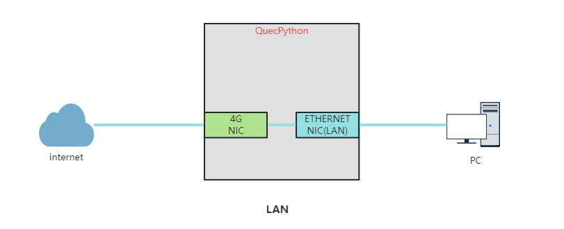

In this mode, the module will enable DHCP service by default to assign a dynamic IP address to the connected Ethernet device. 

Example:

```python
>>> import dataCall
>>> import ethernet
>>> info = dataCall.getInfo(1, 0) # Get the IP address of the current data call from the 4G NIC to ensure that the 4G network is normal.
>>> print(info)
(1, 0, [1, 0, '10.84.113.152', '211.138.180.2', '211.138.180.3'])
>>> W5500 = ethernet.W5500(b'\x12\x34\x56\x78\x9a\xbc', '192.168.43.1', '', '', -1, -1, -1, -1, 1) # Load the Ethernet NIC driver. In actual use, you need to confirm whether to use the default configuration for hardware connection. If you want to customize the hardware connection configuration, complete the parameters of the Ethernet NIC initialization API.
0
>>> W5500.set_default_NIC('10.84.113.152') # Set the 4G NIC as the default NIC.
0
>>> W5500.ipconfig() # Query IP address.
[('12-34-56-78-9A-BC', 'W5500'), (4, '192.168.43.1', '255.255.255.0', '192.168.43.1', '8.8.8.8', '114.114.114.114')]
>>> W5500.set_up() # Start the Ethernet NIC.
0

# The Ethernet device can connect to the network.
```

<a id="click_jump_6.7.1.4"></a>

### **USB Network Adapter**

Currently, the USB network adapter is used when the USB port serves as a LAN port to transfer data through the 4G NIC for Internet access. Both ECM and RNDIS protocols are supported by USB network adapter. You can select one according to your needs. RNDIS can be directly loaded in Windows, while ECM can be directly loaded in Linux/Android/iOS systems.

Cellular communication modules that support USB network adapter are connected to host devices that support ECM or RNDIS protocols via a USB port to provide Internet access for the host device through the 4G network, as shown in the following diagram.

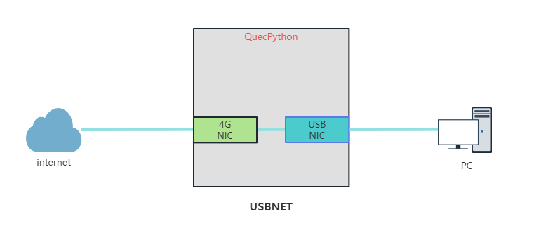

After calling `set_worktype(USBNET_Type)` to set the protocol type of the USB network adapter, call `USBNET.open()` to enable the USB network adapter.

**USBNET_Type** description:

- USBNET.Type_RNDIS: RNDIS protocol. Windows operating system supports RNDIS protocol by default.
- USBNET.Type_ECM: ECM protocol. Linux, Android, iOS, macOS, and other operating systems support ECM protocol by default.

Example:

```python
>>> from misc import USBNET
>>> USBNET.get_worktype() # Get USB network adapter working mode.
3
>>> USBNET.set_worktype(USBNET.Type_RNDIS) # Configure USB network adapter protocol to RNDIS. Please note that the configuration takes effect after the module is rebooted.
0
>>> USBNET.open() # Enable USB network adapter.
0

# The USB device can connect to the network through USB network adapter.
```

<a id="click_jump_6.7.2"></a>

## Simple Scenarios

This section introduces how to perform network communication by using different NICs, taking socket communication over TCP protocol as an example.

<a id="click_jump_6.7.2.1"></a>

### **Transfer Data Using Default Cellular NIC**

For a single cellular NIC, you do not need to bind another NIC for socket communication.

Example:

```python
# Import usocket
import usocket

if __name__ == '__main__':
    # Create a socket object
    sock = usocket.socket(usocket.AF_INET, usocket.SOCK_STREAM)
    sock.settimeout(5)
    # Resolve the domain name
    sockaddr = usocket.getaddrinfo('python.quectel.com', 80)[0][-1]
    print('start connect')
    # Connect to the TCP server
    sock.connect(sockaddr)
    # Send the data to the server
    ret = sock.send('GET /NEWS HTTP/1.1\r\nHost: python.quectel.com\r\nAccept-Encoding: deflate\r\nConnection: keep-alive\r\n\r\n')
    print('send %d bytes' % ret)
    # Receive data from the server
    data = sock.recv(1024)
    print('recv %s bytes:' % len(data))
    print(data.decode())

    # Close the connection
    sock.close()
```

<a id="click_jump_6.7.2.2"></a>

### **Transfer Data Using a Specified Cellular NIC**

When multiple SIM cards or multiplex data calls are supported, you need to specify which channel or SIM card to use for communication. 

The socket API provides the capability to bind to a specific NIC for data communication. The parameters in *socket.bind()* define an IP address and port number to specify the data transmission direction in multiple data calls.

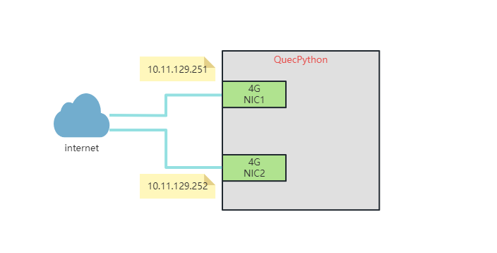

Example of using NIC1 for communication:

```python
# Import usocket
import usocket

if __name__ == '__main__':
    # Create a socket object
    sock = usocket.socket(usocket.AF_INET, usocket.SOCK_STREAM, usocket.TCP_CUSTOMIZE_PORT)
    sock.settimeout(5)
    sock.bind(("10.11.129.251", 0))
    # Resolve the domain name
    sockaddr=usocket.getaddrinfo('python.quectel.com', 80)[0][-1]
    print('start connect')
    # Connect to the TCP server
    sock.connect(sockaddr)
    # Send the data to the server
    ret=sock.send('GET /NEWS HTTP/1.1\r\nHost: python.quectel.com\r\nAccept-Encoding: deflate\r\nConnection: keep-alive\r\n\r\n')
    print('send %d bytes' % ret)
    # Receive data from the server
    data=sock.recv(1024)
    print('recv %s bytes:' % len(data))
    print(data.decode())

    # Close the connection
    sock.close()
```

Example of using NIC2 for communication:

```python
# Import usocket
import usocket

if __name__ == '__main__':
    # Create a socket object
    sock = usocket.socket(usocket.AF_INET, usocket.SOCK_STREAM, usocket.TCP_CUSTOMIZE_PORT)
    sock.settimeout(5)
    sock.bind(("10.11.129.252", 0))
    # Resolve the domain name
    sockaddr=usocket.getaddrinfo('python.quectel.com', 80)[0][-1]
    print('start connect')
    # Connect to the TCP server
    sock.connect(sockaddr)
    # Send the data to the server
    ret=sock.send('GET /NEWS HTTP/1.1\r\nHost: python.quectel.com\r\nAccept-Encoding: deflate\r\nConnection: keep-alive\r\n\r\n')
    print('send %d bytes' % ret)
    # Receive data from the server
    data=sock.recv(1024)
    print('recv %s bytes:' % len(data))
    print(data.decode())

    # Close the connection
    sock.close()
```

<a id="click_jump_6.7.2.3"></a>

### **Transfer Data Using Ethernet NIC**

Data transmission differs in different Ethernet NIC working modes, including LAN mode and WAN mode.

**LAN Mode**

In LAN mode, the 4G NIC provides network services for devices within the LAN, and the 4G NIC is the default NIC. If the module needs to communicate using the Ethernet NIC, call *socket.bind()* to specify which NIC to use for network communication.

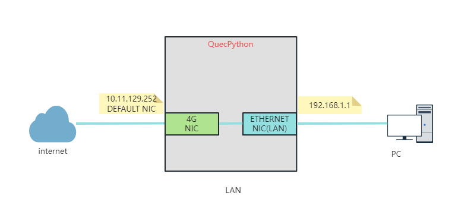

Example:

```python
# Import usocket
import usocket

if __name__ == '__main__':
    # Create a socket object
    sock = usocket.socket(usocket.AF_INET, usocket.SOCK_STREAM, usocket.TCP_CUSTOMIZE_PORT)
    sock.settimeout(5)
    sock.bind(("192.168.1.1", 0))
    # Resolve the domain name
    sockaddr = usocket.getaddrinfo('python.quectel.com', 80)[0][-1]
    print('start connect')
    # Connect to the TCP server
    sock.connect(sockaddr)
    # Send the data to the server
    ret = sock.send('GET /NEWS HTTP/1.1\r\nHost: python.quectel.com\r\nAccept-Encoding: deflate\r\nConnection: keep-alive\r\n\r\n')
    print('send %d bytes' % ret)
    # Receive data from the server
    data = sock.recv(1024)
    print('recv %s bytes:' % len(data))
    print(data.decode())

    # Close the connection
    sock.close()
```

**WAN Mode**

In WAN mode, the Ethernet port is configured specially for network communication and the Ethernet NIC is set as the default NIC. The Ethernet NIC can be used for communication without IP address binding.


Example:

```python
# Import usocket
import usocket

if __name__ == '__main__':
    # Create a socket object
    sock = usocket.socket(usocket.AF_INET, usocket.SOCK_STREAM)
    sock.settimeout(5)
    # Resolve the domain name
    sockaddr = usocket.getaddrinfo('python.quectel.com', 80)[0][-1]
    print('start connect')
    # Connect to the TCP server
    sock.connect(sockaddr)
    # Send the data to the server
    ret = sock.send('GET /NEWS HTTP/1.1\r\nHost: python.quectel.com\r\nAccept-Encoding: deflate\r\nConnection: keep-alive\r\n\r\n')
    print('send %d bytes' % ret)
    # Receive data from the server
    data = sock.recv(1024)
    print('recv %s bytes:' % len(data))
    print(data.decode())

    # Close the connection
    sock.close()
```

<a id="click_jump_6.7.2.4"></a>

### **Transfer Data Using Wi-Fi NIC**

Data transmission differs in different Ethernet NIC working modes, including station mode and AP mode.

**Station Mode**

In station mode, the Wi-Fi port is configured specially for network communication and the Wi-Fi NIC is set as the default NIC. The Wi-Fi NIC can be used for communication without IP address binding.


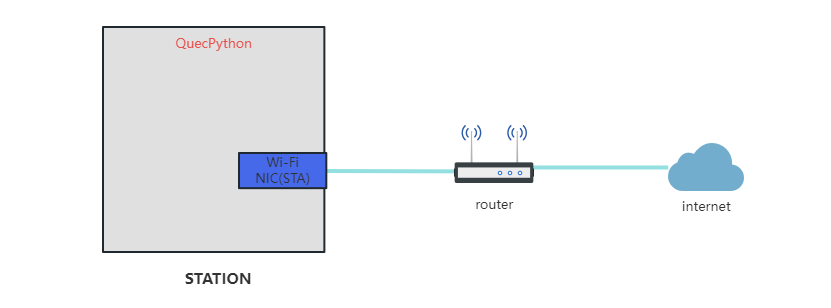

Example:

```python
# Import usocket
import usocket

if __name__ == '__main__':
    # Create a socket object
    sock = usocket.socket(usocket.AF_INET, usocket.SOCK_STREAM)
    sock.settimeout(5)
    # Resolve the domain name
    sockaddr = usocket.getaddrinfo('python.quectel.com', 80)[0][-1]
    print('start connect')
    # Connect to the TCP server
    sock.connect(sockaddr)
    # Send the data to the server
    ret = sock.send('GET /NEWS HTTP/1.1\r\nHost: python.quectel.com\r\nAccept-Encoding: deflate\r\nConnection: keep-alive\r\n\r\n')
    print('send %d bytes' % ret)
    # Receive the data from the server
    data = sock.recv(1024)
    print('recv %s bytes:' % len(data))
    print(data.decode())

    # Close the connection
    sock.close()
```

**AP Mode**

In AP mode, the 4G NIC provides network services for devices within the AP LAN, and the 4G NIC is the default NIC. If the module needs to communicate using the Wi-Fi NIC, call *socket.bind()* to specify which NIC to use for network communication.

> For single-NIC devices, IP address binding is not required.


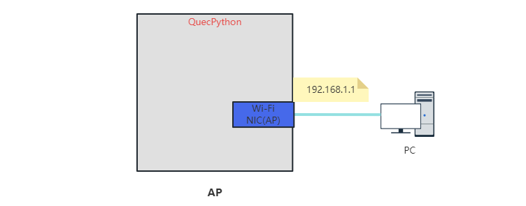

Example:

```python
# Import usocket
import usocket

if __name__ == '__main__':
    # Create a socket object
    sock = usocket.socket(usocket.AF_INET, usocket.SOCK_STREAM, usocket.TCP_CUSTOMIZE_PORT)
    sock.settimeout(5)
    sock.bind(("192.168.1.1", 0))
    # Resolve the domain name
    sockaddr=usocket.getaddrinfo('python.quectel.com', 80)[0][-1]
    print('start connect')
    # Connect to the TCP server
    sock.connect(sockaddr)
    # Send the data to the server
    ret=sock.send('GET /NEWS HTTP/1.1\r\nHost: python.quectel.com\r\nAccept-Encoding: deflate\r\nConnection: keep-alive\r\n\r\n')
    print('send %d bytes' % ret)
    # Receive the data from the server
    data=sock.recv(1024)
    print('recv %s bytes:' % len(data))
    print(data.decode())

    # Close the connection
    sock.close()
```

<a id="click_jump_6.7.3"></a>

## **Router Configuration**

We are optimizing this feature and will provide a unified standard later.

<a id="click_jump_6.7.4"></a>

## **Network Configuration with Multiple NICs**

As shown in the diagram below, the module integrates multiple NICs, each with different configurations and working modes to provide different network services. Among them, the 4G NIC, the Wi-Fi NIC in AP mode, the Ethernet NIC in WAN mode are used to access external networks, while the Wi-Fi NIC in station mode, the Ethernet NIC in LAN mode, and the USB NIC provide local area networks. How to choose which NIC to use and how to configure network forwarding to communicate in the desired way?

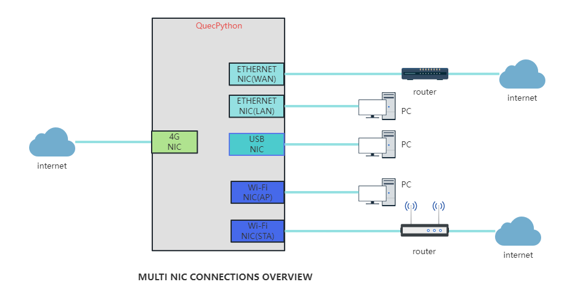

For the multi-NIC scenario, QuecPython provides the following two solutions:

1. Specify NIC for Data Transmission

In scenarios with multiple NICs, it is unclear which one will be used for network communication. But sometimes network services are in different LANs, requiring sending from a specified NIC. In this case, you can call *socket.bind()* to bind the IP address of the NIC to specify the NIC for TCP/UDP communication. As shown below, binding  `10.11.129.252` to perform network communication through the 4G NIC, while binding `192.168.1.100` to perform network communication through the Ethernet NIC.

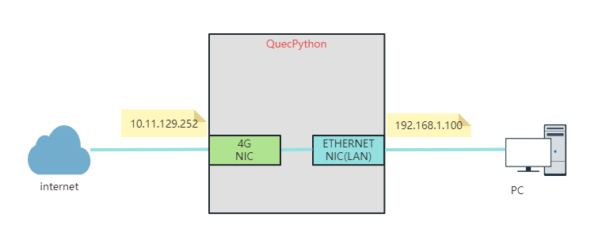

2. Configure NIC Forwarding

Call *nic.set_default_NIC(ip)* to set an NIC as the default for external network access. Then enable NAT to forward data from other NICs. As shown below, after calling `nic.set_default_NIC('10.11.129.252')`, data from the Ethernet NIC is forwarded through the 4G NIC.

> The interface for configuring the default NIC is mainly designed for users to maintain the default NIC, making it easy to switch network forwarding.  
> The 4G NIC is fixed as the default. After it makes a data call, it will be configured as the default again. Currently, 4G is mostly used as the default NIC for external forwarding, to avoid the uncertainty that leads to network unavailability.

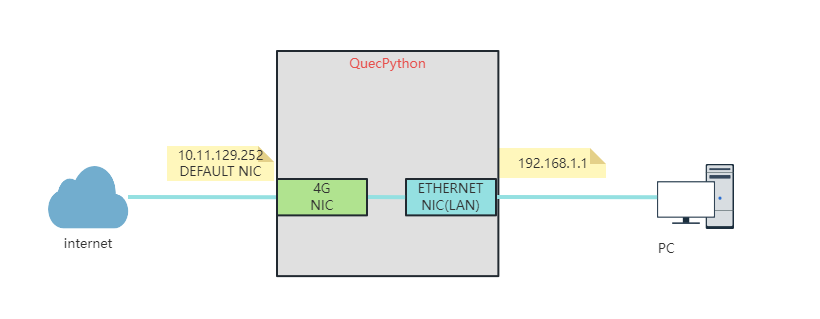

<a id="click_jump_6.7.4.1"></a>

### **Wi-Fi (AP) -> LTE (Single Data Call)**

With both a Wi-Fi NIC and a cellular NIC (4G), how to use the 4G network to connect to the external network through the Wi-Fi network? See the figure below for the working mode.


For multiple NICs, the configuration of forwarding relationships is not yet provided in QuecPython solution. Instead, you only need to configure the default NIC. Regardless of how many NICs, there is only one default NIC. By configuring the default NIC, NAT forwarding will be performed through the default NIC.

Example:

```python
# This example only demonstrates the configuration of the forwarding direction. For specific Wi-Fi NIC initialization configuration, please refer to the section of Wi-Fi NIC.
# "nic" refers to the specific NIC object. Currently, the default NIC configuration interface is inside the specific NIC functions. In the future, the interface will be placed as a basic interface under the network configuration APIs.

nic.set_default_NIC('10.11.129.251')

# Now the device in the Wi-Fi network can access the external network through the 4G network.
```

<a id="click_jump_6.7.4.2"></a>

### **Ethernet (LAN) -> LTE (Single Data Call)**

With both an Ethernet NIC and a cellular NIC (4G), how to use the 4G network to connect to the external network through the Ethernet? See the figure below for the working mode.


For multiple NICs, the configuration of forwarding relationships is not yet provided in QuecPython solution. Instead, you only need to configure the default NIC. Regardless of how many NICs, there is only one default NIC. By configuring the default NIC, NAT forwarding will be performed through the default NIC.

Example:

```python
# This example only demonstrates the configuration of the forwarding direction. For specific Ethernet NIC initialization configuration, please refer to the section of Ethernet NIC.
# "nic" refers to the specific NIC object. Currently, the default NIC configuration interface is inside the specific NIC functions. In the future, the interface will be placed as a basic interface under the network configuration APIs.

nic.set_default_NIC('10.11.129.252')

# Now the device in the Ethernet can access the external network through the 4G network.
```

<a id="click_jump_6.7.4.3"></a>

### **Wi-Fi (AP) -> LTE (Multiple Data Calls)**

With both a Wi-Fi NIC and two 4G NICs, how to configure the 4G NICs to make multiple data calls in which one NIC provides an LTE network to the Wi-Fi network and another NIC for internal communication? See the diagram below for the working mode.

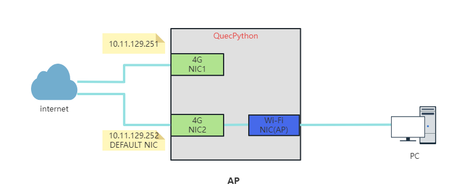

For multiple NICs, the configuration of forwarding relationships is not yet provided in QuecPython solution. Instead, you only need to configure the default NIC. Regardless of how many NICs, there is only one default NIC. By configuring the default NIC, NAT forwarding will be performed through the default NIC.

As shown in the diagram above, the IP address for the NIC1 is 10.11.129.251, and the IP address for the NIC2 is 10.11.129.252. We use the NIC1 for internal communication and the NIC2 for providing LTE network to the Wi-Fi network.

Example of using NIC1 for internal communication:

```python
# Import usocket
import usocket

if __name__ == '__main__':
    # Create a socket object
    sock = usocket.socket(usocket.AF_INET, usocket.SOCK_STREAM, usocket.TCP_CUSTOMIZE_PORT)
    sock.settimeout(5)
    sock.bind(("10.11.129.251", 0))
    # Resolve the domain name
    sockaddr=usocket.getaddrinfo('python.quectel.com', 80)[0][-1]
    print('start connect')
    # Connect to the TCP server
    sock.connect(sockaddr)
    # Send the data to the server
    ret=sock.send('GET /NEWS HTTP/1.1\r\nHost: python.quectel.com\r\nAccept-Encoding: deflate\r\nConnection: keep-alive\r\n\r\n')
    print('send %d bytes' % ret)
    # Receive the data to the server
    data=sock.recv(1024)
    print('recv %s bytes:' % len(data))
    print(data.decode())

    # Close the connection
    sock.close()
```

Example of using NIC2 for providing LTE network to the Wi-Fi network.

```python
# This example only demonstrates the configuration of the forwarding direction. For specific Wi-Fi NIC initialization configuration, please refer to the section of Wi-Fi NIC.
# "nic" refers to the specific NIC object. Currently, the default NIC configuration interface is inside the specific NIC functions. In the future, the interface will be placed as a basic interface under the network configuration APIs.

nic.set_default_NIC('10.11.129.252')

# Now the device in the Wi-Fi network can access the external network through the 4G network.
```

<a id="click_jump_6.7.4.4"></a>

### **Ethernet (WAN) -> LTE (Multiple Data Calls)**

With both an Ethernet NIC and two 4G NICs, how to configure the 4G NICs to make multiple data calls in which one NIC provides an LTE network to the Ethernet and another NIC for internal communication? See the diagram below for the working mode.

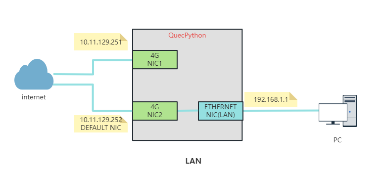

For multiple NICs, the configuration of forwarding relationships is not yet provided in QuecPython solution. Instead, you only need to configure the default NIC. Regardless of how many NICs, there is only one default NIC. By configuring the default NIC, NAT forwarding will be performed through the default NIC.

As shown in the diagram above, the IP address for the NIC1 is 10.11.129.251, and the IP address for the NIC2 is 10.11.129.252. We use the NIC1 for internal communication and the NIC2 for providing LTE network to the Ethernet.

Example of using NIC1 for internal communication:

```python
# Import the usocket module
import usocket

if __name__ == '__main__':
    # Create a socket instance
    sock = usocket.socket(usocket.AF_INET, usocket.SOCK_STREAM, usocket.TCP_CUSTOMIZE_PORT)
    sock.settimeout(5)
    sock.bind(("10.11.129.251", 0))
    # Parse the domain name
    sockaddr = usocket.getaddrinfo('python.quectel.com', 80)[0][-1]
    print('start connect')
    # Establish a connection
    sock.connect(sockaddr)
    # Send a message to the server
    ret = sock.send('GET /NEWS HTTP/1.1\r\nHost: python.quectel.com\r\nAccept-Encoding: deflate\r\nConnection: keep-alive\r\n\r\n')
    print('send %d bytes' % ret)
    # Receive messages from the server
    data = sock.recv(1024)
    print('recv %s bytes:' % len(data))
    print(data.decode())

    # Close the connection
    sock.close()
```

Example of using NIC2 for providing LTE network to the Ethernet.

```python
# This example only demonstrates the configuration of the forwarding direction. For specific Wi-Fi NIC initialization configuration, please refer to the section of Wi-Fi NIC.
# "nic" refers to the specific NIC object. Currently, the default NIC configuration interface is inside the specific NIC functions. In the future, the interface will be placed as a basic interface under the network configuration APIs.

nic.set_default_NIC('10.11.129.252')

# Now the device in the Ethernet can access the external network through the 4G network.
```

<a id="click_jump_6.7.5"></a>

## **Complex Scenario**

This section demonstrates a typical multi-NIC application scenario to help users understand the application of NICs in a multi-NIC environment and quickly get started.

**Case**

When a 4G NIC, an Ethernet NIC and a Wi-Fi NIC are used at the same time, you can configure different working modes for different NICs based on your needs. Once the NICs enter the normal working state, you can change the default NIC to switch the forwarding rules.

> For the use of Ethernet, Wi-Fi, and cellular networks, there is no fixed usage rule. It is recommended to use networks in the priority of Ethernet > Wi-Fi > cellular.

1. Set 4G NIC as the default NIC to forward Wi-Fi network and Ethernet data.

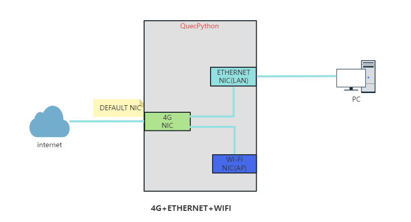

Example:

```python
# Import usocket
import dataCall
import network
import ethernet

if __name__ == '__main__':
    # Set the default NIC
    defalut_nic = None

    # Get the 4G NIC information
    lte = dataCall.getInfo(1, 0)
    print(lte)

    # Initialize the Wi-Fi NIC
    WiFi = network.ASR5803W(network.AP_IF)
    WiFi.config('ssid'='QuecPython', 'key'='quecpython')
    WiFi.active(True)
    print('Wi-Fi init success')

    # Initialize the Ethernet NIC
    eth = ethernet.YT8512H(b'\x12\x34\x56\x78\x9a\xbc','192.168.1.1')
    eth.set_up()
    print('ethernet init success')

    # Set the 4G NIC as the default NIC
    defalut_nic = lte[2][2]
    eth.set_default_NIC(defalut_nic)
```

2. Set Ethernet NIC as the default NIC to forward Wi-Fi network data.

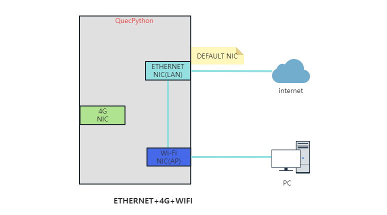

Here's an example code:

```python
# Import usocket
import dataCall
import network
import ethernet

if __name__ == '__main__':
    # Set the default NIC
    defalut_nic = None

    # Get the 4G NIC information
    lte = dataCall.getInfo(1, 0)
    print(lte)

    # Initialize the Wi-Fi NIC
    WiFi = network.ASR5803W(network.AP_IF)
    WiFi.config('ssid'='QuecPython', 'key'='quecpython')
    WiFi.active(True)
    print('Wi-Fi init success')

    # Initialize the Ethernet NIC. The Ethernet NIC will get a dynamic IP address through DHCP in WAN mode to connect to the network
    eth = ethernet.YT8512H(b'\x12\x34\x56\x78\x9a\xbc')
    eth.dhcp()
    eth.set_up()
    print('ethernet init success')

    # Set the Ethernet NIC as the default NIC
    defalut_nic = eth.ipconfig()[1][1]
    eth.set_default_NIC(defalut_nic)
```

<a id="click_jump_6.7.6"></a>

## **Frequently Asked Questions**

<a id="click_jump_6.7.6.1"></a>

### **How to bind socket with NICs?**

Please refer to [UDP/TCP Network Communication Application Note](../net-protocols/tcp-udp.md).

<a id="click_jump_6.7.6.2"></a>

### **How to test network connectivity?**

QuecPython provides `uping` to check network connectivity. By calling *uping.ping()* to ping packages to various networks, you can determine the link status. For example, an Ethernet NIC may get an IP address but fail to connect to the network. In this case, the entire network environment needs checking. Perhaps WAN port of the router is not connected to the external network, or the external network configuration restrictions make the network unavailable. You need `uping` for the entire link check.

```python
>>> import uping
>>> uping.ping('python.quectel.com')
uping.ping('python.quectel.com')

PING python.quectel.com (47.107.246.213): 64 data bytes

72 bytes from 47.107.246.213: icmp_seq=1, ttl=52, time=50.546000 ms
72 bytes from 47.107.246.213: icmp_seq=2, ttl=52, time=38.424000 ms

72 bytes from 47.107.246.213: icmp_seq=3, ttl=52, time=52.606000 ms

72 bytes from 47.107.246.213: icmp_seq=4, ttl=52, time=38.940000 ms
4 packets transmitted, 4 packets received, 0 packet loss
round-trip min/avg/max = 38.424/45.129/52.606 ms
```

