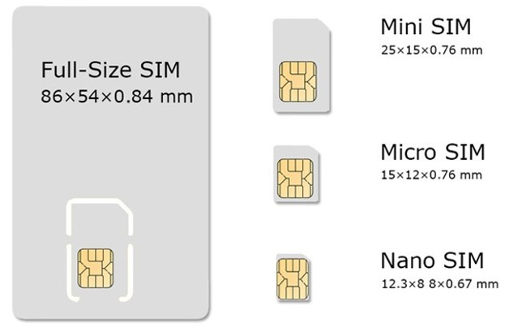
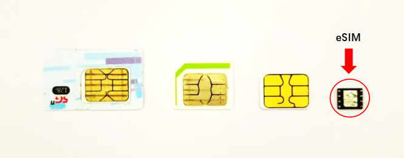

# Overview

This article provides an introduction to SIM card-related concepts and basic knowledge, aiming to help users gain a basic understanding of SIM cards.

## Definition of SIM Card

SIM card, the full name of Subscriber Identity Module, also known as user identity module, is widely used in mobile devices in global mobile communication systems. It is primarily used to store information related to mobile users and enable mobile devices to communicate with networks or other mobile devices.

## Functions of SIM Card

The functions of SIM cards are as follows:

* User identity verification: SIM cards contain an International Mobile Subscriber Identity (IMSI), which uniquely identifies each user in a mobile communication network. Mobile networks verify the IMSI on the SIM card to confirm the user's identity and grant them access to the network.

* Information storage: SIM cards can store various types of information, including phonebooks, text messages, and user settings.

* Mobility: Users can insert their SIM cards into any mobile device compatible with their network provider, enabling them to switch between devices freely.

* Security: SIM cards have features to prevent copying and eavesdropping. The data stored on SIM cards is encrypted and can only be accessed with specific keys.

## Types of SIM Cards

SIM cards come in various types based on different sizes and purposes. The following are some common types of SIM cards.

### Card SIM

Based on size, SIM cards can be categorized as standard SIM cards (also known as Mini SIM cards), Micro SIM cards, and Nano SIM cards. These three types of SIM cards have the same functionality but differ in size. The specific differences are shown in the following diagram:

### eSIM

eSIM (Embedded SIM) is a new technology compared to traditional SIM cards. It allows remote programming of SIM card information, eliminating the need for physical replacement when changing network operators. With this SIM card technology, SIM card information is packaged into an independent file called a profile. By downloading the profile file into the eSIM, it becomes a complete and usable SIM card. Therefore, changing network operators with eSIM is very convenient, as it only requires downloading different operators' profiles into the eSIM without physical replacement.

Usually, eSIMs are in the form of chips as shown in the above image. However, some eSIMs still use a plug-in SIM card form, which is indistinguishable from card SIMs in appearance.

### vSIM

vSIM (Virtual SIM) is a concept that converts physical SIM cards into software form, stored in the cloud, and enables the management and distribution of SIM card profile files in the cloud. When in use, the SIM card's profile file is downloaded to the device through the network and authenticated and activated on the device. It completely eliminates the physical storage medium for SIM card profile files, building upon the eSIM technology.

Compared to traditional SIM cards and eSIMs, vSIM offers better flexibility and convenience. It also saves costs for operators and manufacturers by eliminating the need for physical storage media for SIM cards and the space required on PCBs to accommodate SIM cards, which helps further reduce the size of integrated circuit boards.

It is important to note that the use of vSIM requires support from network operators and device manufacturers, as well as certain network conditions. Although vSIM has many advantages, it also has some potential issues, such as user privacy protection and network security. Currently, card SIMs and eSIMs are still the most widely used.

## Supported SIM Card Types

All QuecPython modules support card SIMs, and some platforms' modules support eSIMs with customized versions. QuecPython does not support vSIM. Currently, the platforms that support customized eSIMs are as follows:

| Supported Module Models         |
| ------------------------------- |
| EC200U/EC600U/EG912U/EG915U series |
| EC200A series                      |
| BG95M1/BG95M3/BG95M8            |