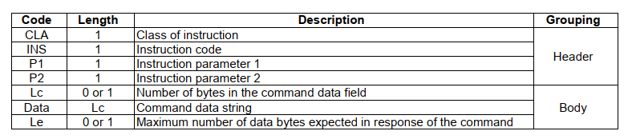
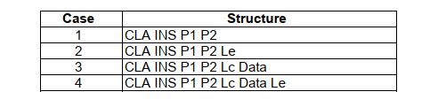
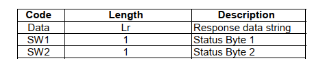

# APDU

This article mainly introduces the definition, function, and data structure of APDU.

## What is APDU

APDU (Application Protocol Data Unit) is the basic information unit used to transmit commands and responses between smart cards and devices.

APDU was originally defined by the ISO 7816 standard protocol and later referenced and expanded by ETSI's SIM card technical specifications and 3GPP protocols.

## The Function of APDU

APDU mainly plays the role of information transmission. It provides a standardized communication method for interaction between devices and SIM cards. Through APDU, devices can send commands to SIM cards, and SIM cards can return execution results to devices.

## The Format of APDU

In the ISO 7816 protocol, APDU is mainly divided into two types:

* Command APDU (C-APDU)

* Response APDU (R-APDU)

They have different data structures.

### Command APDU

The command APDU consists of two parts: the command header and the command body.


The command header is a required field and includes the following fields:

* CLA: 1 byte, used to indicate the category or group of the APDU, usually indicating some basic attributes of the command.

* INS: 1 byte, used to indicate the specific instruction or operation, such as reading data or updating data.

* P1 and P2: Each occupies 1 byte, used to provide more specific parameters for the instruction, such as the address of the object to be operated or other specific information. If there are no parameters to be carried, P1 and P2 are set to `00`.

The command body is an optional field and consists of the following three parts:

* Lc: 1 byte, if the command APDU contains a data field, this field is used to indicate the length of the data field.

* Data field: The length of this field is determined by Lc and contains the specific data required by the command.

* Le: 1 byte, this field is used to indicate the expected length of the response data. If this field is not present, the data field of the response APDU can be of any length.

According to the ETSI protocol document, the description is as follows:



Since the fields in the command body are all optional, according to the ETSI protocol document, the command APDU have the following four structures:



In the ETSI protocol document, the byte encoding of the command APDU is specified as follows:

| COMMAND               | CLA                  | INS        |
| --------------------- | -------------------- | ---------- |
| SELECT FILE           | '0X' or '4X' or '6X' | 'A4'       |
| STATUS                | '8X' or 'CX' or 'EX' | 'F2'       |
| READ BINARY           | '0X' or '4X' or '6X' | 'B0'       |
| UPDATE BINARY         | '0X' or '4X' or '6X' | 'D6'       |
| READ RECORD           | '0X' or '4X' or '6X' | 'B2'       |
| UPDATE RECORD         | '0X' or '4X' or '6X' | 'DC'       |
| SEARCH RECORD         | '0X' or '4X' or '6X' | 'A2'       |
| INCREASE              | '8X' or 'CX' or 'EX' | '32'       |
| RETRIEVE DATA         | '8X' or 'CX' or 'EX' | 'CB'       |
| SET DATA              | '8X' or 'CX' or 'EX' | 'DB'       |
| VERIFY PIN            | '0X' or '4X' or '6X' | '20'       |
| CHANGE PIN            | '0X' or '4X' or '6X' | '24'       |
| DISABLE PIN           | '0X' or '4X' or '6X' | '26'       |
| ENABLE PIN            | '0X' or '4X' or '6X' | '28'       |
| UNBLOCK PIN           | '0X' or '4X' or '6X' | '2C'       |
| DEACTIVATE FILE       | '0X' or '4X' or '6X' | '04'       |
| ACTIVATE FILE         | '0X' or '4X' or '6X' | '44'       |
| AUTHENTICATE          | '0X' or '4X' or '6X' | '88', '89' |
| GET CHALLENGE         | '0X' or '4X' or '6X' | '84'       |
| TERMINAL CAPABILITY   | '8X' or 'CX' or 'EX' | 'AA'       |
| TERMINAL PROFILE      | '80'                 | '10'       |
| ENVELOPE              | '80'                 | 'C2'       |
| FETCH                 | '80'                 | '12'       |
| TERMINAL RESPONSE     | '80'                 | '14'       |
| MANAGE CHANNEL        | '0X' or '4X' or '6X' | '70'       |
| MANAGE SECURE CHANNEL | '0X' or '4X' or '6X' | '73'       |
| TRANSACT DATA         | '0X' or '4X' or '6X' | '75'       |
| SUSPEND UICC          | '80'                 | '76'       |
| GET IDENTITY          | '8X' or 'CX' or 'EX' | '78'       |
| EXCHANGE CAPABILITIES | '80'                 | '7A'       |
| MANAGE LSI            | '80'                 | '7C'       |
| GET RESPONSE          | '0X' or '4X' or '6X' | 'C0'       |

### Response APDU

The Response APDU is a data structure returned by a smart card to the interface device (such as a card reader or a mobile phone) after receiving and processing a Command APDU (C-APDU). The Response APDU consists of two parts: the data field and the status field. The data structure is as follows:


The data field is optional and contains the result data of the command execution. For example, if the command is a file read operation, the data field will contain the content of the file being read. The length of the data field is variable. In the C-APDU, there is an optional field called Le, which specifies the expected length of the response data. If the C-APDU does not include the Le field, the data field of the R-APDU can have any length. However, the actual data length depends on the type of command and the execution result. For example, if the C-APDU is a read file operation, the data field of the R-APDU will contain the data read from the file, and the length will depend on the size of the file and the value of the Le field. If the size of the file exceeds the value of the Le field, only the first Le bytes of data will be returned. If the size of the file is smaller than the value of the Le field, the entire file data will be returned.

The status field is an essential part and consists of two bytes, SW1 and SW2, which represent the result status of the C-APDU execution.

In the ETSI protocol, the description of the Response APDU is as follows:



Below are some common explanations of Response APDU status values. For more information, please refer to the ISO 7816 standard protocol and the ETSI TS 102 221 protocol document.

| SW1 |SW2| Description |
| ---- | ---- | -------------------------------------- |
| '90' | '00' | Command executed successfully           |
| '93' | '00' | SIM application toolkit busy            |
| '62' | '00' | Operation failed, no further info given |
| '62' | '81' | Partial response may be corrupted       |
| '62' | '82' | File length less than Le                |
| '62' | '83' | Selected file invalid                   |
| '62' | '85' | File identifier has been invalidated    |
| '63' | '00' | Verification failed, invalid password or disabled value |
| '65' | '81' | Memory failure, unable to execute command |
| '67' | '00' | Length error                            |
| '68' | '81' | Unsupported logical channel             |
| '68' | '82' | Unsupported secure messaging            |
| '69' | '81' | Command incompatible with file structure (file type mismatch) |
| '69' | '82' | Security status not satisfied           |
| '69' | '83' | Authentication/PIN method blocked       |
| '69' | '84' | Referenced data invalid                 |
| '69' | '85' | Conditions of use not satisfied         |
| '6A' | '80' | Incorrect data segment parameters       |
| '6A' | '81' | Unsupported function                    |
| '6A' | '82' | File not found                          |
| '6A' | '83' | Record not found                        |
| '6A' | '84' | Insufficient memory space               |
| '6A' | '86' | Incorrect P1-P2 parameters              |
| '6A' | '88' | Referenced data not found               |

## Application Examples

Please refer to ETSI TS 102 221, ETSI TS 151 011, ISO/IEC 7816-4 documents for the following use cases.

Users can directly read ICCID and IMSI from the SIM card using APDU commands. The following operations are applicable to both eSIM and regular SIM cards. It is not recommended for users to directly manipulate the SIM card, as improper operations can easily cause SIM or eSIM card abnormalities, leading to network issues.

```
I. Read ICCID
# The packaging can refer to ISO/IEC 7816 and 3GPP documents.
# 1. Select file to read ICCID
# CLA		: 00
# SELECT 	: A4
# P1		: 08
# P2		: 04
# Lc		: 02
# data		: 2FE2
# Le		: 0A (expected length of response)

APDU command: 00A40804022FE20A

# 2. Read file content
# CLA		: 00
# READ BINARY 	: B0
# P1		: 00
# P2		: 00
# Le		: 0A (ICCID length)

APDU command: 00B000000A

II. Read IMSI
# 1. Select DF (GSM) file
# CLA		: 00
# SELECT 	: A4
# P1		: 00
# P2		: 00
# Lc		: 02
# data		: 7F20 (file identifier)
APDU command: 00A4000C027F20

# 2. Select IMSI file
# 1. Select DF (GSM) file
# CLA		: 00
# SELECT 	: A4
# P1		: 00
# P2		: 04
# Lc		: 02
# data		: 6F07 (file identifier)
APDU command: 00A40004026F07

# 3. Read IMSI file
# CLA		: 00
# READ BINARY 	: B0
# P1		: 00
# P2		: 00
# Le		: 09 (IMSI length)
APDU command: 00B0000009

```

For data interaction with eSIM cards, such as profile installation, it is necessary to open a logical channel first before performing profile installation operations. The following example shows the command to open a logical channel. It is not recommended for users to directly interact with eSIM cards using APDU commands.

```
# 1. Open logical channel
# CLA		: 00
# MANAGE CHANNEL 	: 70
# P1		: 00
# P2		: 00
# Le		: 01 (expected length of response)
APDU command: 0070000001

# After sending the above command, you will receive the logical channel ID and the result of the operation.
# 2. Close logical channel
# When the operation is completed, it is necessary to close the logical channel.
# CLA		: 00
# MANAGE CHANNEL 	: 70
# P1		: 08
# P2		: 01 (logical channel ID returned from step 1)
# Le		: 00
APDU command: 0070800100

```