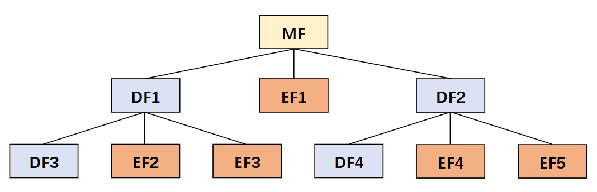
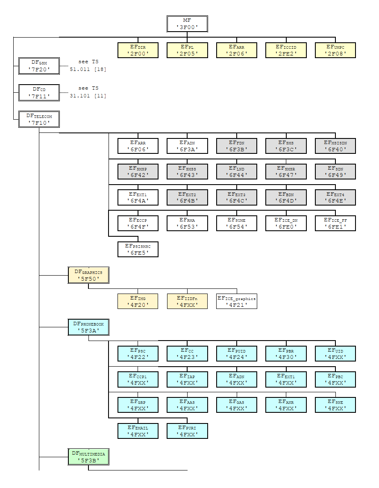

# SIM Card File System

The SIM card uses a file management system structure similar to that of a computer, where there are folders and files within a folder. This file system is used to store and organize various types of data, including service provider information, user identification information, phonebooks, messages and other data.

## File System Structure

The structure of the SIM card file system is as follows:

As shown, the SIM card file system is a tree structure that includes the following types of files:

* MF (Master File): This is the root of the file system and there is only one MF in a SIM card. It contains various DFs and EFs.

* DF (Dedicated File): This is the next level in the file system and can be seen as folders. Each DF contains a group of related EFs. For example, there may be a DF for storing the phonebook, which contains EFs for storing individual phone records. Common DFs include DF-GSM, DF-TELECOM, and ADF.

* EF (Elementary File): EF is the basic file used to store data. Each EF has a specific format and length for storing specific data. For example, there may be an EF for storing the IMSI (International Mobile Subscriber Identity), which can only be read by the device after selecting this EF.

In the SIM card file system, all files (including folders) have an ID, which is a two-byte hexadecimal number. The file ID is used as a parameter when the device sends a SELECT command to choose a file. To locate a specific file, the MFID, DFID, and EFID need to be determined. Once these IDs are determined, it is equivalent to determining the absolute path of a file.

Taking USIM as an example, referring to the 3GPP TS 31.102 protocol document, the USIM file system is defined as follows:

From the above diagram, it can be seen that each file has an ID, and the uniqueness of the file ID depends on its position in the file system tree. The file IDs of all direct child files (DF or EF) under the same parent file (DF or MF) are unique and cannot be repeated. In other words, there cannot be two files with the same file ID under the same DF. However, files with the same file ID can exist in different DFs. Therefore, to uniquely identify a file, it is necessary to specify the path from MF through which DFs can be reached to this file, and this path, along with the file ID, can uniquely determine a file.

## File Operation Commands

The ISO 7816 standard and 3GPP protocols define a series of commands for operating the SIM card file system. These commands are used to select, read, write, or update files within the SIM card. Here are some commonly used commands:

| Command        | CLA  | INS  | Description                                |
| -------------- | ---- | ---- | ------------------------------------------ |
| SELECT         | 'A0' | 'A4' | Select a file                              |
| READ BINARY    | 'A0' | 'B0' | Read the content of the currently selected binary transparent EF |
| UPDATE BINARY  | 'A0' | 'D6' | Update the content of the currently selected binary transparent EF |
| READ RECORD    | 'A0' | 'B2' | Read the content of the currently selected linear fixed EF or cyclic EF |
| UPDATE RECORD  | 'A0' | 'DC' | Update the content of the currently selected linear fixed EF or cyclic EF |
| STATUS         | 'A0' | 'F2' | Get information about the currently selected file |
| GET RESPONSE   | 'A0' | 'C0' | Get the response data of the command execution |

The `CLA` represents the class code, and `INS` represents the instruction code. This part will be explained in the next section about APDU.

## File Operation Command Response

After executing a SIM card command, the SIM card will return a response APDU, which consists of two or more bytes. The last two bytes are usually referred to as the status word (SW1 and SW2), which represent the result of the command execution. Here are some common status words for file operations:

| SW1  | SW2  | Description                              |
| ---- | ---- | ---------------------------------------- |
| '90' | '00' | Command executed successfully            |
| '6A' | '82' | File not found                           |
| '69' | '81' | Command incompatible with file structure (file type mismatch) |
| '62' | '83' | Selected file invalid                     |
| '6A' | '86' | P1-P2 parameter error                     |

### Application Scenarios

* When initializing the SIM card for network registration, it is necessary to read certain authentication data and the unique identifier of the SIM card from the SIM card file system, as well as PLMN blacklist records such as EFFPLMN.

* When storing SMS messages, they can be stored in the SIM card, and the  stored SMS messages in the SIM card is also in the SIM card file system.
* When the SIM card's SMS storage space is full, SMS data can be deleted from the SIM card file system.