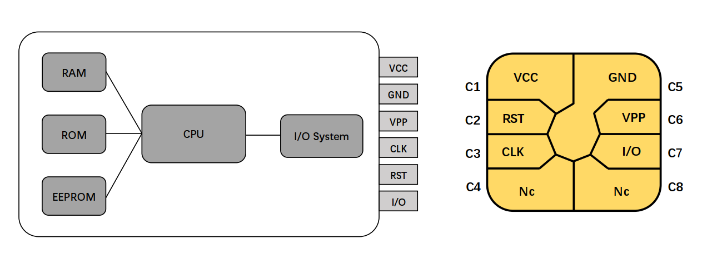

# Hardware Structure

This article mainly introduces the hardware structure, communication protocols and communication methods of the SIM card.

## Hardware Structure

The SIM card is actually a chip card with a microprocessor. It is designed according to the ISO 7816 standard and is divided into five parts according to the functional modules:

* Microprocessor (CPU)

  This is the core part of the SIM card, responsible for processing all calculations and logical operations, such as executing encryption algorithms, processing input/output data, etc.

* Program Memory (ROM)

  Stores the fixed information of the SIM card, such as the operating system and pre-installed applications. Once written, this information cannot be changed.

* Working Memory (RAM)

  Stores temporary data during complex calculations or task processing.

* Data Memory (EEPROM)

  A writable and readable storage space for storing variable information such as phonebooks, text messages, and user authentication keys. We often see "xxxk" marked on the SIM card, indicating the size of this storage area. For example, 128K means the size of the EEPROM storage area is 128K.

* Serial Communication Unit

  The only channel for the communication between the SIM card and the Mobile Equipment (ME), supporting half-duplex serial communication mode.

The hardware architecture is roughly as follows:

## SIM Card Electrical Contacts

The contact allocation of the SIM card follows the ISO 7816-2 protocol, as follows:

| Contact | Description   | Contact | Description         |
| ------- | ------------- | ------- | ------------------- |
| C1      | Power Voltage | C5      | Ground              |
| C2      | Reset         | C6      | Programming Voltage |
| C3      | Clock         | C7      | Input/Output        |
| C4      | Reserved      | C8      | Reserved            |

Generally, SIM cards have 8 contacts. During use, at least 5 contacts need to be connected to the device to ensure the normal operation of the SIM card. These 5 contacts are: VCC, GND, RST, CLK, and I/O.

* C1 Contact: Power Voltage (VCC), available in 1.2V/1.8V/3V/5V specifications. SIM cards powered by 5V are rarely used now. The main power supply for SIM cards is 1.8V and 3V.
* C2 Contact: Reset Signal (RST).
* C3 Contact: Clock Signal (CLK), with a frequency of 1~5MHz, provided by the terminal equipment. CLK should be maintained within ±10% of the frequency used during the reset response.
* C4 Contact: Reserved.
* C5 Contact: Ground (GND).
* C6 Contact: Programming Voltage (VPP), can be used as a power supply pin in SIM cards powered by 5V. In 1.8V and 3V SIM cards, this pin is usually left floating.
* C7 Contact: Data (I/O), the only communication channel between the SIM card and the terminal equipment, supporting half-duplex serial communication with two states: sending and receiving.
* C8 Contact: Reserved.

## Communication between SIM Card and Device

The communication between the SIM card and the device not only follows the ISO 7816 standard but also involves the STK (SIM Application Toolkit) protocol. eSIM is implemented through APDUM, which complies with the ISO 7816 standard.

### STK Protocol

STK stands for SIM Application Toolkit, which is a standard defined by the GSM Association for developing and deploying applications running on SIM cards.

The STK protocol defines a set of instructions that allow interaction between the SIM card and the mobile phone. Through STK, the SIM card can send commands to the phone to perform operations such as displaying menus, sending messages, and initiating calls.

APDU stands for Application Protocol Data Unit. Through APDU commands, functions such as reading, deleting, adding, updating eSIM data, managing logical channels, and reporting terminal capabilities can be achieved.

### Communication Method

The communication between the SIM card and the device is achieved by transmitting specific commands and data through APDUs between the SIM card's operating system and the device's operating system. These commands and data are defined according to specifications such as ISO 7816 and STK protocols.

ISO 7816-3 defines the electrical signals and transmission protocols to ensure secure and reliable data transmission between the SIM card and the device.

ISO 7816-4 defines the command and data structure, describing how to operate the SIM card through commands, such as reading data, writing data, and verifying passwords.

The STK protocol is based on ISO 7816-3 and ISO 7816-4 standards, adding some instructions specifically for interaction between the SIM card and the mobile phone. These instructions are exchanged between the SIM card and the mobile device, allowing the SIM card to perform complex operations and interactions.

This article does not go into detail about the specific commands and data structures specified in the ISO 7816 standard. They will be explained in the subsequent "APDU" section. Users can also refer to the ISO 7816 standard document, STK protocol, and ESTI standard specification documents on SIM cards for detailed understanding.