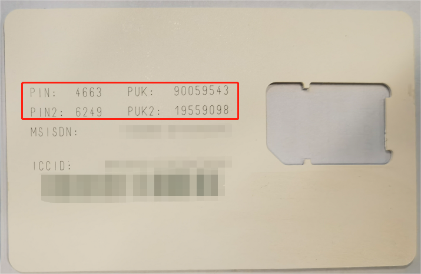

# Glossary of Terms

This article mainly introduces some professional terms related to SIM cards.

## IMSI

IMSI stands for International Mobile Subscriber Identity. It is used to uniquely identify mobile network subscribers worldwide and is an essential parameter in mobile networks.

IMSI has a maximum length of 15 digits and consists of three parts: MCC (3 digits) + MNC (2 digits) + MSIN. The three parts are explained as follows:

* MCC: Mobile Country Code, which represents the country code.
* MNC: Mobile Network Code, which represents the network code.
* MSIN: Mobile Subscriber Identification Number, which represents the user identification code.

IMSI is allocated and managed according to specifications and does not support private settings. IMSI has a crucial function, which is to provide the SIM card's IMSI to the operator's base station during network registration. The operator's network needs to verify the mobile user's identity and service eligibility through the IMSI.

## ICCID

ICCID stands for Integrated Circuit Card Identifier, which is a unique identification method for SIM cards established by the International Telecommunication Union (ITU). It is equivalent to the identity card of a SIM card. ICCID is written into the SIM card during production and cannot be changed.

ICCID usually consists of 19 to 20 numeric characters and is composed of the following three parts:

* Issuer Identification Number (IIN): The first 6 digits of ICCID, which contains the industry identifier, issuing country code, and issuing organization identification code.
* Individual Account Identification Code: This part is used to represent the individual account and its length depends on the issuing organization.
* Check Digit: This is the last digit of ICCID, used to verify the other parts of ICCID using the Luhn algorithm.

## PIN/PIN2

PIN and PIN2 are concepts related to SIM card security, and their main function is to protect the SIM card.

**PIN (Personal Identification Number)**: This is a 4 to 8-digit password used to secure the SIM card's data. If the user enables the PIN verification function of the SIM card, the PIN needs to be entered to unlock the SIM card when using it. If an incorrect PIN is entered consecutively (usually 3 times), the SIM card will be locked and requires the PUK to unlock.

**PIN2**: It represents the second personal identification number and is used to protect higher-level or more sensitive functions. When attempting to access or modify these special functions, PIN2 needs to be entered. For example, Fixed Dialing Number (FDN), etc. It should be noted that not all SIM cards support the PIN2 function.

## PUK/PUK2

PUK and PUK2 are concepts related to SIM card security, and their main function is to unlock the SIM card.

**PUK (Personal Unblocking Key)**: This is an 8-digit code used to unlock the SIM card after it has been locked due to multiple consecutive incorrect PIN entries. If the user enters an incorrect PUK multiple times (usually 10 times), the SIM card will be permanently locked and cannot be used again.

**PUK2**: This is the second personal unblocking key, similar to PUK but used to unlock the SIM card after it has been locked due to multiple consecutive incorrect PIN2 entries. Similarly, entering an incorrect PUK2 multiple times (usually 10 times) will permanently lock the SIM card. It should be noted that not all SIM cards support the PIN2 function.

PIN/PIN2/PUK/PUK2 are usually directly marked on the full-size SIM card. If users need to know this information for the SIM card they are using, they can check the full-size SIM. If there is no marking on the full-size SIM or the it is lost, users need to contact the operator for confirmation.

## Ki

Ki is a crucial authentication key stored in the SIM card. It plays a vital role in the communication between the mobile phone and the mobile network because it is used to verify the validity of the SIM card on the network and protect the user's communication security.

Each SIM card has a unique Ki, which is written into the SIM card during production and stored in the SIM card's secure chip, which cannot be read or modified externally. At the same time, the network operator's database also stores the Ki that matches the SIM card.

When the phone attempts to connect to the mobile network, the network operator sends a random number (RAND) to the phone. The SIM card in the phone uses Ki and RAND to generate a signature (SRES). Then, this signature is sent back to the network operator. The network operator also uses the Ki in its database and the same RAND to generate another signature. If these two signatures match, the SIM card is considered valid, and the phone can connect to the network. This process is called the authentication process.

## SIM/USIM

SIM (Subscriber Identity Module) and USIM (Universal Subscriber Identity Module) are both smart cards used for identity authentication and service access, but they have some differences in design, security, service support, etc.

**SIM card**: Originally used for GSM networks, the SIM card stores the user's identity information, including the IMSI (International Mobile Subscriber Identity) and Ki (Key Identifier). The SIM card interacts with the network using this information, allowing users to access the network and make calls, send messages, etc. The SIM card can also store other information, such as contacts and messages.

**USIM card**: This is a new type of SIM card originally designed for 3G UMTS networks and now used for 4G and 5G networks as well. Compared to SIM cards, USIM cards have improved security, privacy protection, and network access capabilities. For example, USIM cards support Advanced Encryption Standard (AES) encryption, while SIM cards usually only support relatively weaker COMP128 encryption. In addition, USIM cards have increased storage and management capabilities for more data, such as user personal settings, phone books, and messages. USIM cards also introduce new services and features, such as fixed dialing number (FDN) and personal number service.

In fact, in China, the SIM cards we use on mobile phones are mostly USIM cards. However, we habitually refer to them as SIM cards.

## MCC/MNC

**MCC (Mobile Country Code)**: Mobile Country Code consists of 3 digits and is used to uniquely identify the country and region where the SIM card is located. Each country or region has a unique MCC, which is allocated by the International Telecommunication Union (ITU). For example, the MCC for China is 460.

**MNC (Mobile Network Code)**: Mobile Network Code consists of 2 or 3 digits and is used to uniquely identify a specific mobile network operator in a particular country or region. For example, the MNC for China Mobile is 00 or 02, the MNC for China Unicom is 01 or 06, and the MNC for China Telecom is 03 or 05.

MCC and MNC combined can uniquely identify any mobile network operator worldwide. For example, 46001 represents China Unicom. MCC and MNC are not only used to identify mobile network operators but also used to identify Public Land Mobile Networks (PLMN) in mobile communication networks. PLMN is composed of MCC and MNC. In addition, the IMSI of the SIM card also contains MCC and MNC.

## PLMN

PLMN is the abbreviation for Public Land Mobile Network, which is composed of MCC and MNC and is mainly used to identify mobile networks. PLMN represents the entire network of a mobile operator, including base stations, mobile switching centers, databases storing user information, and core networks.

The SIM card stores the Home PLMN (HPLMN), which is used for the UE to search for the home network during network registration, i.e., to find the network of the operator to which the SIM card belongs. In addition to HPLMN, there are various types of PLMNs. Here are some common types of PLMNs:| 

| Name   | Description                                                  |
| ------ | ------------------------------------------------------------ |
| RPLMN  | Registered PLMN, the PLMN registered and saved by the terminal before the last shutdown or off-network. |
| HPLMN  | Home PLMN, the MCC, MNC contained in the IMSI of the USIM is consistent with the MCC, MNC of the HPLMN. |
| EHPLMN | Equivalent Home PLMN, generally refers to other PLMNs with the same priority as the HPLMN. |
| EPLMN  | Equivalent PLMN, a PLMN that is equivalent to the PLMN currently selected by the terminal. |
| UPLMN  | User-controlled PLMN, a parameter related to PLMN selection stored on the USIM card. |
| OPLMN  | Operator-controlled PLMN, a parameter related to PLMN selection stored on the USIM card. |
| FPLMN  | Forbidden PLMN, when a terminal is denied access to a certain PLMN, it will add it to the FPLMN list. |
| VPLMN  | Visited PLMN, when the terminal is not within the coverage of its corresponding operator network, the terminal may choose the network of another operator, which is the VPLMN. Of course, the premise is that the terminal and its USIM card support roaming. |

## ISO 7816

ISO 7816 is a set of international standards for smart cards developed by the International Organization for Standardization (ISO). This set of standards defines various aspects of smart cards, including their physical characteristics, electrical signals, transmission protocols, and command sets.

The ISO 7816 standard consists of multiple parts, each of which specifically describes a particular feature or protocol. They are as follows:

- ISO 7816-1: Defines the physical characteristics of smart cards, such as dimensions, weight, materials, etc.
- ISO 7816-2: Defines the positions and functions of the contact points on smart cards. This part of the standard is particularly important for SIM cards, as it ensures that SIM cards produced by different manufacturers can be used on any phone that complies with this standard.
- ISO 7816-3: Defines the electrical signals and transmission protocols of smart cards. This part of the standard ensures that data can be transmitted securely and reliably between the smart card and the device.
- ISO 7816-4: Defines the commands and data structures of smart cards. This part of the standard describes how to operate a smart card through commands, such as reading data, writing data, verifying passwords, etc.

In the field of mobile communications, the ISO 7816 standard is widely used in the design and manufacturing of SIM cards. By complying with this standard, SIM cards can be used securely and reliably on mobile devices worldwide, providing users with communication, storage, and other services.