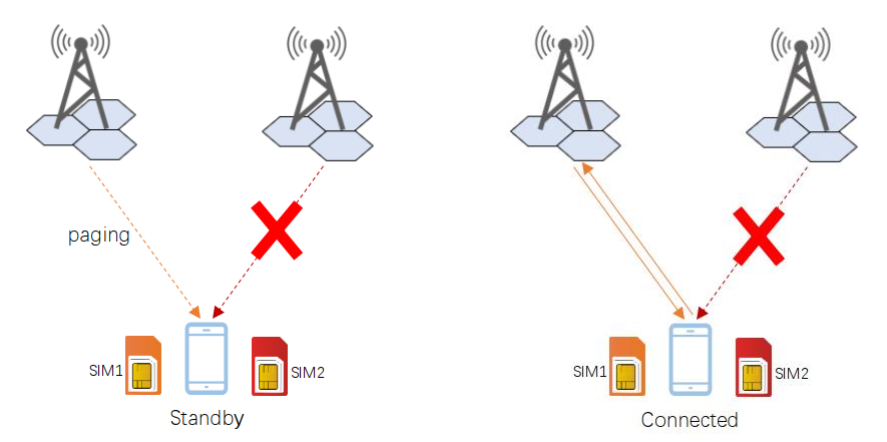
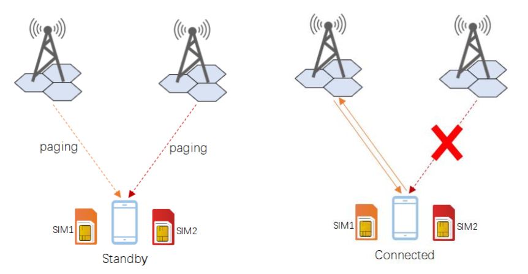
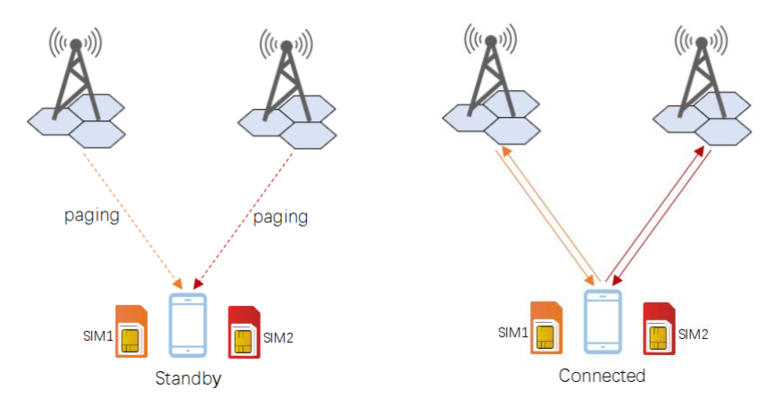

# Dual SIM Functionality

Dual SIM functionality refers to the feature of a device that allows the installation and use of two SIM cards. These two SIM cards can be from the same or different mobile network operators. The device can choose to use one SIM card or both SIM cards simultaneously. However, whether both SIM cards can be used simultaneously depends on whether the device supports dual SIM single standby or dual SIM dual standby.

## Standby and Connected States

Before introducing dual SIM functionality, let's briefly explain what standby and connected states are.

* Standby state: When the UE (User Equipment) is in standby state, there are no active data connections between the UE and the network. In other words, there are no ongoing calls or data transfers, but the UE needs to receive paging messages from the network.

* Connected state: In this state, the UE has one or more active data connections, meaning that the UE is making calls or transferring data. In the connected state, the UE needs to send and receive signals frequently to maintain the data connection. Therefore, the UE in the connected state usually consumes more battery power.

## Dual SIM Single Standby

Dual SIM Single Standby (DSSS) refers to the UE that supports two SIM cards but can only use RF resources from one SIM card at any given time. When SIM card 1 is using RF resources, whether in standby or connected state, SIM card 2 cannot use RF resources and is considered to be in a powered-off state from the network's perspective.

## Dual SIM Dual Standby

Dual SIM dual standby (DSDS) refers to the UE that supports two SIM cards and allows both SIM cards to be active simultaneously. DSDS can be further divided into dual SIM dual standby single active (DSDS-SA) and dual SIM dual standby dual active (DSDS-DA) modes.

### Dual SIM Dual Standby Single Active

In DSDS-SA mode, the device has only one set of RF resources that both SIM cards share. When one SIM card is in a connected state (making calls or using data services), the other SIM card cannot enter the connected state and cannot make calls or use data services. In other words, although both SIM cards are in standby state and can receive paging messages, only one active connection is allowed at a time. This mode is currently the most common dual SIM dual standby mode.

### Dual SIM Dual Standby Dual Active

Some devices have two sets of RF resources, with each SIM card using one set independently without affecting each other. In this type of device, both SIM cards can be in standby state simultaneously and can even be in a connected state at the same time. This means that one SIM card can be making calls or using data services while the other SIM card can also be using data services or making calls. This is known as dual SIM dual standby dual active mode.

Although dual SIM dual standby dual active mode offers powerful functionality, it consumes more power due to the simultaneous use of two sets of RF resources, and the device cost is also higher. Therefore, this mode is not widely used.

## QuecPython Dual SIM Support

Currently, QuecPython supports only dual SIM single standby mode for the following module models:

| Platform    | Module Model                                                 |
| ----------- | ------------------------------------------------------------ |
| Unisoc 8910 | EG912UGL_AA                                                  |
| ASR1606     | EC600MCN_CC/EC600MCN_LA/EC600MCN_LC/EC600MCN_LE/EC600MCN_LF/EC800MCN_LA/EC800MCN_LC/EC800MCN_LE |