# SIM Card Abnormalities

There are three main types of SIM card abnormalities:

## Device does not detect SIM card

We can check the status of the SIM card using the following steps:

Step 1: Connect the terminal device to the computer's USB port through the USB data cable.

Step 2: Open the QPYcom tool on the computer and open the QuecPython REPL command port to enter interactive mode.

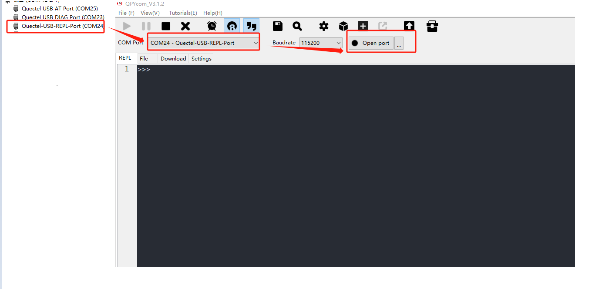

Step 3: In the command prompt, call the API to check the network registration status as follows:

```
import sim
sim.getStatus()
```

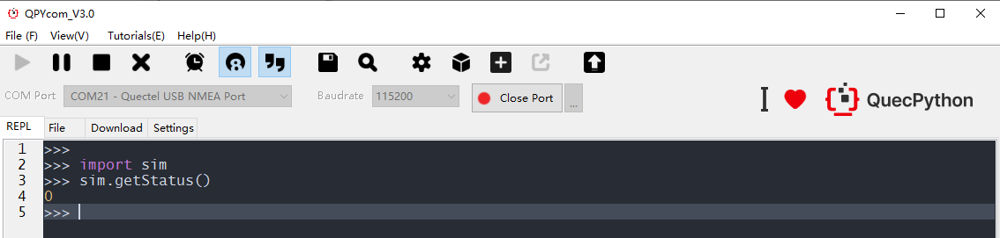

If the return value of `sim.getStatus()` is 0, it means that the device did not detect a SIM card. In this case, you need to make sure that the SIM card is inserted. If the user has already inserted the SIM card and restarted the device, and the status value is still 0, the possible reasons could be:

- The SIM card is not inserted properly, such as being inserted incorrectly or not inserted tightly. You can reinsert the SIM card, restart the device, and check the SIM card status again after turning on to see if it is 1.
- The SIM card itself is damaged. You can try inserting a different SIM card that is known to be working properly, restart the device, and check the SIM card status again to see if it is 1.
- The SIM card slot is damaged. If you confirm that this is the cause, you will need to replace the card slot.
- There is a problem with the hardware circuit of the SIM card, such as poor contact, which prevents the device from recognizing the SIM card properly. A hardware engineer will need to check the circuit to confirm the issue.

Users can troubleshoot the above situations one by one to identify the problem.

## SIM card status abnormal

SIM card status abnormal refers to the situation where the value obtained from `sim.getStatus()` is neither 0 nor 1, and is commonly 2 and 3.

- When the SIM card status value is 2

When the SIM card status value is 2, it means that the user has enabled PIN code verification for this SIM card. In this case, you need to enter the correct PIN code for verification, then disable the PIN code verification, and finally restart the device. After turning on, check the SIM card status again to see if it is 1.

> Regarding which PIN code to use for the SIM card, the default PIN code is usually marked on the full size SIM. If the user cannot find the full size SIM, they need to confirm with the SIM card's operator. Do not enter the PIN code randomly. We strongly recommend that users do not use PIN code-related functions casually, as it may permanently disable the SIM card due to misoperation.

For example, if the user is using a China Unicom SIM card and the default PIN code is '1234', and this card has enabled PIN code verification, and the status value obtained is 2, then you can follow these steps to restore it:

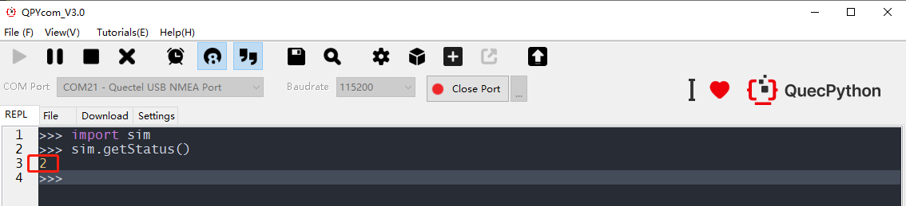

Step 1: Enter the PIN code for verification using the following method.

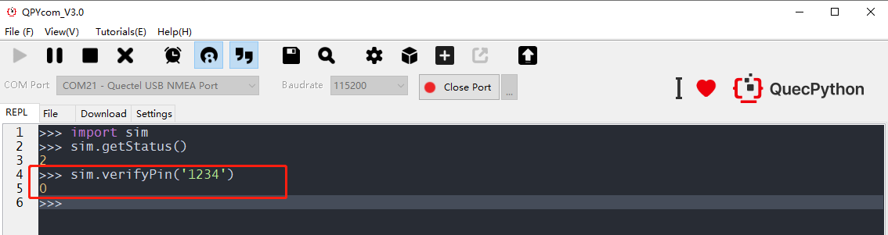

Step 2: Disable PIN code verification.

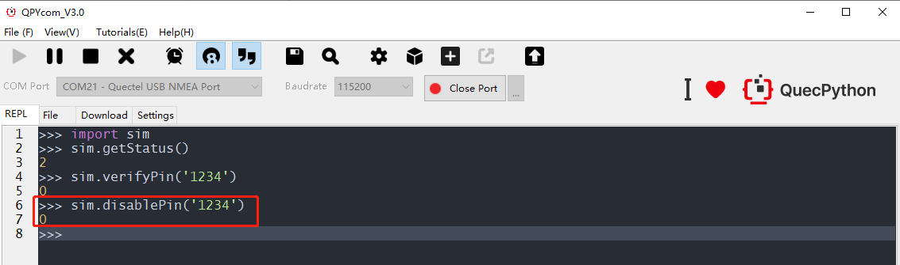

Step 3: Restart the device and check the SIM card status again to confirm if it has returned to normal.

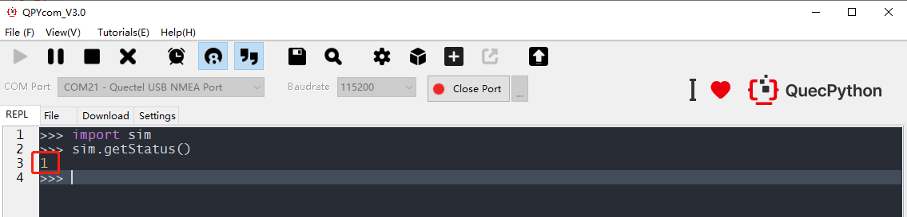

- When the SIM card status value is 3

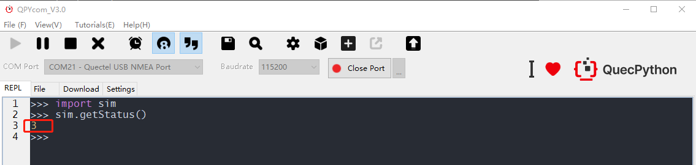

When the SIM card status value is 3, it means that the card is locked and you need to use the PUK code to unlock it. The PUK code can usually be found on the full size SIM card, as shown in the following image:

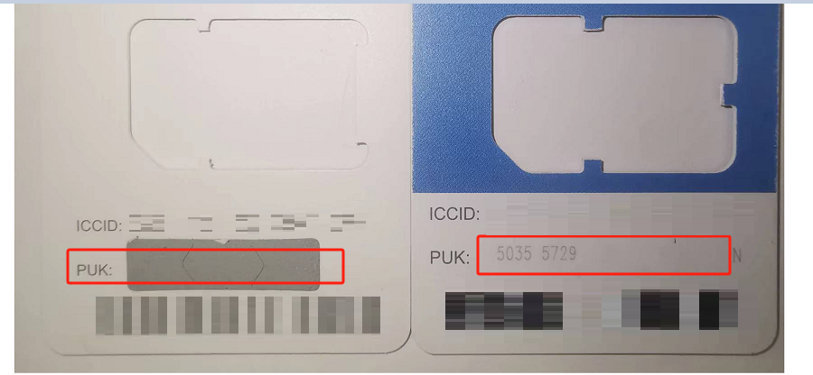

It should be noted that each SIM card has its own PUK code, and when unlocking the SIM card, you must make sure to use the correct PUK code. If the PUK code is entered incorrectly multiple times, the SIM card will be permanently locked and cannot be used anymore.

Once the user has confirmed the PUK code, you can follow the steps below to unlock it:

Step 1: Enter the correct PUK code to unlock it and set a new PIN code.

The method to unlock the SIM card is as follows. This method involves two parameters, the first parameter represents the PUK code, and the second parameter represents the new PIN code to be set. Generally, the reason why the SIM card is locked is that the user has enabled PIN code verification, but when entering the PIN code, they entered the wrong PIN code three times in a row, which caused the SIM card to be locked. Therefore, when using the PUK code to unlock it, the user needs to set a new PIN code.

```
sim.unblockPin(puk, newPin)
```

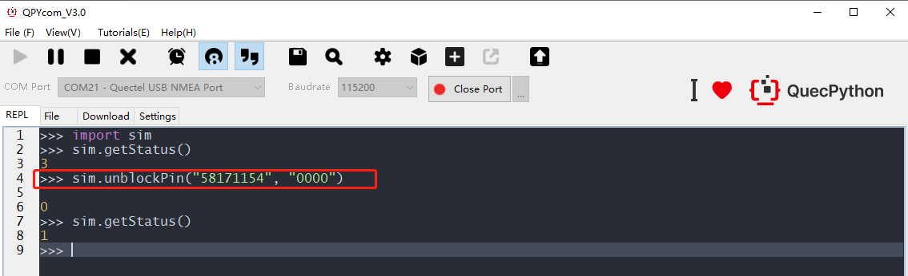

From the above image, it can be seen that the SIM card has been successfully unlocked, and after unlocking, the SIM card status has changed to 1. However, it should be noted that at this point, only the unlocking process has been completed, but the PIN code verification function of the SIM card has not been disabled. If the device is restarted now, after booting, the SIM card status will still be 2, indicating that the user needs to enter the PIN code for verification. Therefore, you can first disable the PIN code verification and then restart the device. Alternatively, after unlocking the SIM card and restarting, you can first enter the PIN code for verification, and after successful verification, disable the PIN code verification.

Step 2: Disable PIN code verification.

Note that since the SIM card has been unlocked and a new PIN code has been set, when performing PIN code verification and disabling PIN code verification, you must use the latest PIN code that was set.

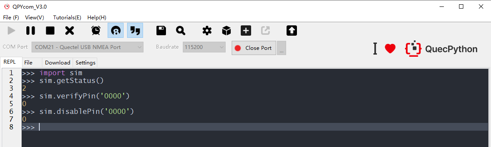

Step 3: Restart the device and confirm if the SIM card status is 1.

## SIM card is overdue

This situation is somewhat special because the conditions of SIM cards from different operators may vary, and it is not possible to use a completely unified standard to determine. Generally, if the following two situations occur, we recommend that users first check if the SIM card is overdue.

Situation 1: The SIM card status value is 1, the device has successfully registered on the network, and the cellular wireless card has also been activated successfully, but network services cannot be performed, such as sending or receiving data.

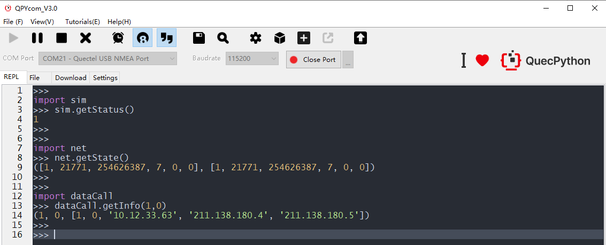

Situation 2: The SIM card status value is 1, but network registration fails.

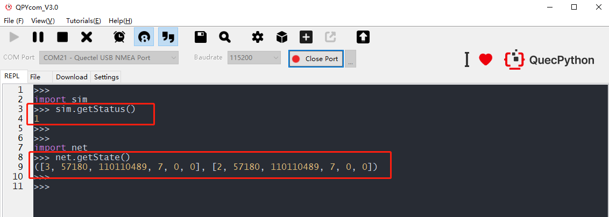

> Note that if the situation is "SIM card status value is 1, but network registration fails," it does not necessarily mean that the SIM card is overdue. SIM card overdue is just one of the possible reasons for this situation.